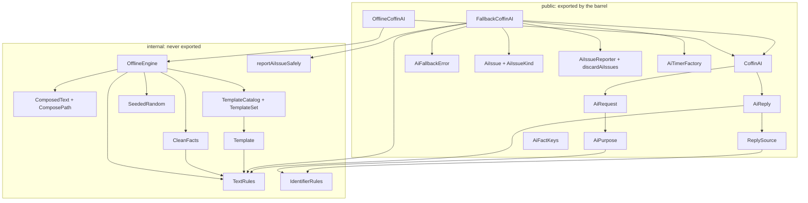
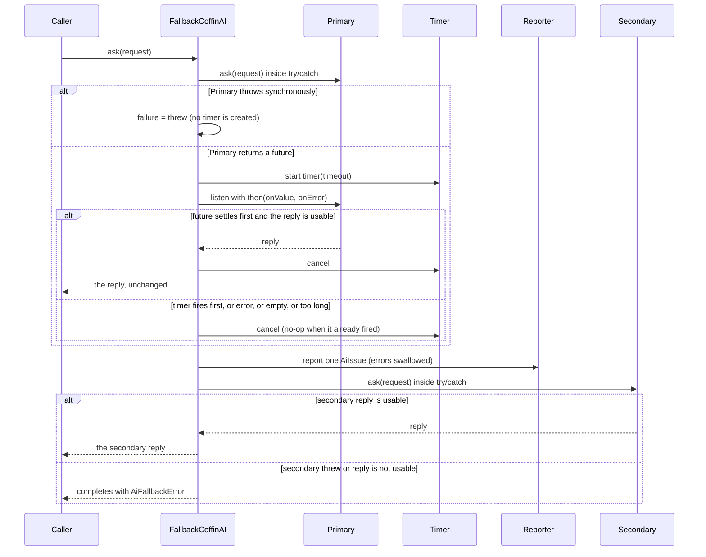
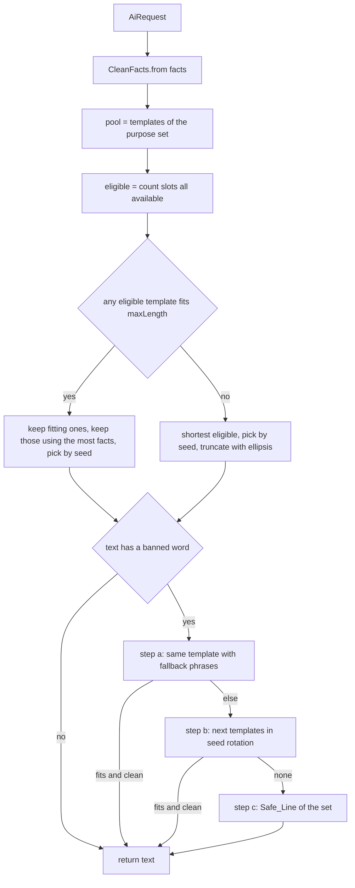

# Design Document

## Overview

The coffin-ai feature is step 1 of the AI layer of `coffin_core`. Apps talk to one small interface, `CoffinAI`, with one method, `ask`. The offline implementation, `OfflineCoffinAI`, writes short spooky lines from fixed templates and never touches a network. `FallbackCoffinAI` wraps a primary and a secondary `CoffinAI`, waits a bounded time for the primary, and falls back when the primary throws, times out or returns an unusable reply. Step 2 will add a remote implementation as one more `CoffinAI`. Nothing in this step calls an LLM, holds a key, or touches an app.

Key decisions (details below):

- **Public names carry an `Ai` prefix where the plain word is generic.** The requirements say Request, Reply, Purpose and Source. The public types are `AiRequest`, `AiReply`, `AiPurpose` and `ReplySource`. A plain `Request` already exists in `package:web` (a dependency of `hive_ce`, used on Flutter Web), so an app that imports both would get an ambiguity. See "Naming".
- **`Minimum_Max_Length` is 16.** It is the largest value the requirements allow. It lets every purpose keep a fact-free template of 16 code units or fewer, so the smallest accepted limit still gets a whole sentence and not a cut one.
- **The offline generator uses its own 32-bit PRNG (Mulberry32), not `dart:math` `Random(seed)`.** I ran `Random(seed)` on the VM and on Chrome and the sequences match today. The Dart documentation still says the stream can change between releases, so a golden table built on it could break on an SDK upgrade. Mulberry32 with an exact 32-bit multiply gives the same output on the VM and Chrome, checked against an independent `BigInt` reference.
- **`ReplySource` and `AiPurpose` are open value types, not enums.** Adding a value to an enum breaks every exhaustive `switch` in app code. Adding `ReplySource.remote` in step 2 must not.
- **Templates carry their own no-name variant.** A name slot is written `{ghostName|Your ghost}`: the text after the bar is shown when the name is missing. Recovery step (a) is then "render the same template with the fallback phrases", and no template needs a second copy.
- **Recovery is real code that the shipped catalog can never reach.** Name slots sit next to spaces or punctuation, so no banned word can form across a slot boundary, and the early name filter removes banned names first. The Recovery steps and the truncation path are still implemented and tested through an injected catalog on an internal engine class (`OfflineEngine`), not through a hook on the public API.
- **The timeout is injected as a timer factory, not through `fake_async`.** `flutter_test` does not export `FakeAsync`, and importing `fake_async` directly needs a new dependency line. A 40-line test clock does the job and makes "timeout wins at the exact timeout" true by construction.
- **When the secondary also fails, `FallbackCoffinAI` completes with a typed `AiFallbackError`.** It invents no last-resort line. The error carries two enum values and nothing else.
- **Tests never use `Future.delayed(Duration.zero)` in a loop.** On Chrome one such delay cost about 4.5 ms in my measurement. Tests pump microtasks instead.

### Research summary

I separate what I **ran** from what I only **read** or **inferred**. Every experiment was a throwaway file under `packages/coffin_core/test/ai/`, deleted afterwards.

| Question | Finding | How I know | Source |
|---|---|---|---|
| Toolchain | Flutter 3.47.9 stable. | Ran `flutter --version`. | local |
| `Random(seed)` stability promise | The Dart docs say the implementation of the random stream can change between releases of the library. | Read. | api.dart.dev `Random` constructor page |
| `Random(seed).nextInt(n)` on VM vs Chrome | The first 20 values are identical for seeds 0, 1, 42, 4294967295 and n in 2, 7, 1000, 2147483648, 4294967296 (20 combinations, 400 values). The Chrome test asserted equality against lists pasted from the VM run and passed. | **Ran** on the VM and with `--platform chrome`. | local |
| `1 << 32` on web | Printed `2147483648 0 4294967296` for `1 << 31`, `1 << 32`, `(1 << 31) * 2` on Chrome. So `1 << 32` is 0 on web. `Random.nextInt(1 << 32)` threw `RangeError: max must be in range 0 < max ≤ 2^32, was 0` on Chrome. On the VM the first version of the experiment used `1 << 32` and printed 20 values for n = 4294967296. | **Ran** on both. | local |
| Mulberry32 with exact multiply | For seeds 0, 1, 42, 2147483647, 2147483648, 4294967294, 4294967295 (20 values each) the VM and Chrome outputs equal an independent `BigInt` implementation, and the Chrome run equals the lists pasted from the VM run. | **Ran** on both. | local |
| Seed upper bound | 4294967295 is below 2^53, so it is an exact integer on the VM and on web. It is one of the seeds in the two runs above and gave identical sequences. | **Ran**, plus reasoning for exactness. | local |
| `FakeAsync` through `flutter_test` | `FakeAsync()` in a file that imports only `package:flutter_test/flutter_test.dart` fails analysis with `The function 'FakeAsync' isn't defined`. `flutter_test` lists `fake_async: ^1.3.3` in its own pubspec but exports nothing from it (the only `fake_async` hits in its `lib/` are imports). | **Ran** `flutter analyze`. Read the `flutter_test` pubspec and `lib/`. | local |
| `fake_async` in the lock | `fake_async 1.3.3`, `dependency: transitive`. | Read `pubspec.lock`. | repo |
| `depend_on_referenced_packages` | Importing `package:fake_async/fake_async.dart` from a coffin_core test gives `info • The imported package 'fake_async' isn't a dependency of the importing package ... depend_on_referenced_packages`. Fixing it needs a `fake_async` line in `pubspec.yaml`, which is a new direct dependency. | **Ran** `flutter analyze` on a probe file. | local |
| Injected timer factory on VM and Chrome | A prototype race with an injected `Timer Function(Duration, void Function())` and a hand-written fake clock gave the same results on the VM and on Chrome. See "Fake time experiment". | **Ran** on both. | local |
| `FakeAsync` ordering | Under `FakeAsync.elapse`, completing the primary and then elapsing the timeout in the same synchronous block gave **success**, because `elapse` drains microtasks before it fires the timer. | **Ran** on both. | local |
| Late completion and unhandled errors | A late value and a late error after a timeout produced 0 unhandled zone errors with a single `then(onValue, onError:)` listener. A control race with no `onError` produced exactly 1 unhandled error, so the capture works. | **Ran** on both. | local |
| glados generators on Chrome | Safe: `choose`, `either`, `oneOf`, `always`, `bool`, `combine2`, `combine5`, `doubleInRange`, `nullable`, `map`, `simple`. Throw or fail on Chrome: `int`, `intInRange`, `positiveIntOrZero`, `uint8`, `uint16`, `list`, `nonEmptyList`, `listWithLengthInRange`, `letters`, `lowercaseLetters`, `letterOrDigits`, `nonEmptyLetterOrDigits`, `stringOf`, `nonEmptyStringOf`. `uint32` throws at construction with an assertion (`min < max` in `anys.dart:27`). All 30 runs of every safe generator executed. `any.combineN` does not exist; glados has `combine2` to `combine10`. | **Ran** on the VM and on Chrome (30 runs each). Read `anys.dart`, `any.dart`. | local, glados 1.1.7 |
| glados async bodies on Chrome | An async body that awaited a 1 ms delay ran 10 of 10 times, and an async body with `expect(1, 2)` after an await failed on Chrome (`[E]`). So bodies are awaited on Chrome, as the crypt-storage spec found on the VM. | **Ran** on both. | local |
| Cost of `Future.delayed(Duration.zero)` | 2000 sequential awaits took 50 ms on the VM and 9086 ms on Chrome. 2000 times 20 microtask hops (`await Future<void>.value()`) took 65 ms on the VM and 181 ms on Chrome. | **Ran** on both. | local |
| Prototype of the whole algorithm | A throwaway implementation of the cleaning, selection, truncation and Recovery rules ran 100000 pseudo-random requests (all three template sets, hostile names, odd counts, limits from 16 to 5000, seeds across the full range) with every invariant asserted. The VM and Chrome gave the same digest and the same sample outputs. | **Ran** on both. | local |
| Template and word-list audit | Every template of the three sets, filled with no facts, with count 1 and a 2-unit name, and with count 1000000 and a 24-unit name, had no banned word, no insult word, at most one emoji, no blank or lone surrogate. Results in "Initial template copy". | **Ran** on both. | local |
| `@visibleForTesting` | `meta: 1.19.0` is already a direct dependency of `coffin_core` in `packages/coffin_core/pubspec.yaml`, so the annotation needs no new package. This design does not need it (see "OfflineEngine"). | Read the pubspec. | repo |
| Name clashes | No declaration of any chosen public name in Flutter's `packages/flutter/lib` and `flutter_test/lib`, `go_router-17.5.0`, `hive_ce-2.23.3`, `glados-1.1.7`, or the repo packages and apps. `package:web` 1.1.2 declares `Request` in `lib/src/dom/fetch.dart`. | **Ran** a text search. | local |
| Existing barrel | 30 `export` lines, none named like the AI names. | Read `coffin_core.dart`. | repo |
| dart2js release behavior | Not run. `flutter test --platform chrome` uses the development compiler, and the release build uses dart2js. The arithmetic used by the PRNG relies only on 32-bit masks and exact doubles below 2^53, which I expect to behave the same, but a release run was not made. | Not verified. | n/a |

I added no package. `pubspec.yaml` and `pubspec.lock` are unchanged. After cleanup `git status --short` showed the same lines as at the start of my session: the only entry from this feature is `?? .kiro/specs/coffin-ai/` (which already held `requirements.md` and `.config.kiro`), and the other modified and untracked files in that list belong to the crypt-storage work in progress. `packages/coffin_core/test/ai/` is gone again.

### PRNG experiment (Requirements 5.4 and 5.7)

`Random(seed).nextInt(n)` matches on the VM and Chrome today, for example `Random(4294967295).nextInt(1000)` starts `806, 695, 625, 702, 247` on both. I still prefer an internal generator, for three reasons:

1. The Dart documentation does not promise a stable stream across releases. A golden table of exact strings (Requirement 5.7) would then fail after an SDK bump with no change in our code.
2. The match I verified is for 4 seeds and 5 limits, on the development compiler. I did not run dart2js.
3. `Random.nextInt` needs a limit of at most 2^32, and `1 << 32` is 0 on web. That is a trap the internal generator avoids by never taking a limit above 65536.

The internal generator is Mulberry32. Its only multiplication is a 32-bit multiply written so that no intermediate value reaches 2^53 (see `SeededRandom` below). I ran it against a `BigInt` reference on the VM and on Chrome for seven seeds including 0, 2147483648 and 4294967295, and then asserted the Chrome output against lists pasted from the VM run. All passed.

First values, for the unit test of `SeededRandom` (taken from the VM run, identical on Chrome):

| Seed | First three `nextUint32()` values |
|---|---|
| 0 | 1144304738, 1416247, 958946056 |
| 1 | 2693262067, 11749833, 2265367787 |
| 42 | 2581720956, 1925393290, 3661312704 |
| 4294967295 | 3850105811, 813802916, 3073704848 |

### Fake time experiment (Requirements 10.2, 10.3, 10.10 and the Dependency Notice)

The prototype race is the one in "FallbackCoffinAI" below. The test clock (`FakeClock`) keeps a list of timers. `advance(d)` fires every active timer that is due, in due-time order, **synchronously and without running any microtask**, then sets the clock to the new time. I ran these cases on the VM and on Chrome; the output lines were identical.

| Case | Observed outcome | Pending timers after |
|---|---|---|
| Never-completing future, `advance(30 s - 1 ms)` then `advance(1 ms)` | Not settled at 29.999 s, `timedOut` at 30 s. Real time used: 2 ms on the VM, 8 ms on Chrome. | 0 |
| Primary completes at 29.999 s, microtasks flushed, then clock reaches 30 s | `ok` | 0 |
| Clock reaches exactly 30 s, then the primary completes | `timedOut` | 0 |
| Primary completes, and in the same synchronous block the clock reaches 30 s (no flush between) | `timedOut` | 0 |
| Clock passes 30.001 s, then the primary completes | `timedOut` | 0 |
| Primary already complete (`Future.value`) | `ok`, the timer was cancelled | 0 |
| `primary.ask` throws synchronously | `threw`, no timer was created | 0 |
| Late value, then late error, after a timeout (inside `runZonedGuarded`) | Both ignored, 0 unhandled errors | 0 |
| Control: same race without an `onError` listener, late error | exactly 1 unhandled error | 0 |
| Same scenarios under `FakeAsync` (`fakeAsync`, comparison only) | complete-after-elapse: `timedOut`; complete, then `elapse(timeout)` with no flush: **`ok`**; late error: `timedOut` and no pending timers | 0 |

**Decision.** An injectable `AiTimerFactory` (`Timer Function(Duration, void Function())`), with `Timer.new` as the production default. `fake_async` is not reachable without a new direct dependency (Requirement 16.9 and 17.7 forbid it), and it orders events differently: its `elapse` drains microtasks before it fires a timer, so "complete, then elapse" is a success under `FakeAsync` and a timeout under our clock. Owning the clock lets the design state one rule and test it once. The design does not use `Future.timeout`, because that function creates its timer through the current zone and cannot take an injected factory.

The requirement's Dependency Notice says the fake clock comes from `flutter_test` or from an injectable function, and that the design verifies which. Answer: `flutter_test` does not export it, so the injectable function is the mechanism. No change to `requirements.md` is needed.

### The exactly-at-timeout rule (Requirement 10.2)

**Rule: a Primary completion counts only if the wrapper has observed it before the timer callback ran. A completion at exactly the Fallback_Timeout counts as a timeout.**

Why the design guarantees it:

1. The timer callback calls `settle(timedOut)` **synchronously**. `settle` completes a single `Completer` only if it is not complete yet, so the first caller wins.
2. The Primary's result reaches `settle` only through `call.then(...)`. Dart always delivers `then` callbacks in a **microtask**, even for a future that is already complete.
3. A fake clock fires due timers inside `advance`, which is synchronous. So if the clock reaches the timeout in the same synchronous block as the completion, the timer callback runs first. If the test lets microtasks run first (the "before" case), the completion wins.
4. With the real clock the Dart event loop drains the microtask queue before it takes the next timer event. A completion whose microtask is already queued when the timer event is taken counts. Two events that really are simultaneous cannot be ordered by the program, so only the injected-clock behavior is tested, and the doc comment of `FallbackCoffinAI` states the rule.

The test (Requirement 15.7) has four rows: complete at timeout minus 1 ms and flush (success), advance to the timeout then complete (timeout), complete then advance to the timeout without a flush (timeout), advance past the timeout then complete (timeout).

### Late completion (Requirement 10.1)

The wrapper registers `call.then(onValue, onError: onError)` once. Both branches only call `settle`, which does nothing when the race is already decided. The error is therefore handled whenever it arrives, so no unhandled error reaches the zone. The experiment shows this (0 unhandled errors) and shows that dropping `onError` produces one. The "no-op error handler" the task mentions is this same listener: it is attached at the start, not after the timeout, so there is no window in which the error is unhandled.

### glados on Chrome (Requirements 13.7, 13.9, 14.8, 14.10)

The crypt-storage spec replaced `any.intInRange` and `any.listWithLengthInRange` with helpers in `test/storage/support/storage_generators.dart`. This feature **copies** the two helpers into `test/ai/support/ai_generators.dart` and does not import the storage file.

| Option | Pros | Cons |
|---|---|---|
| Import `test/storage/support/storage_generators.dart` | No duplicate code. | Couples two features: a change to storage generators (that file is still being edited by the crypt-storage tasks) could break the AI tests. That file also imports storage types. |
| **Copy about 25 lines into `test/ai/support/` (chosen)** | Independent. Requirement 13.7 asks for helpers under `test/ai/support/`. | Two copies of a small helper. |
| Move the helper to a shared `test/support/` | One copy. | Edits the storage tests, which are out of scope here. |

One change from the storage copy: the storage helper asserts `max - min <= 0xFFFFFFFF`. The AI seed generator needs the full range `0..4294967295`, which is `nextInt(4294967296)`. I ran `Random.nextInt(4294967296)` on Chrome and it works, so the copy allows a span up to 4294967296 and writes the literal, never `1 << 32`.

Strings come from a piece list (ASCII, accents, CJK, emoji, controls, lone surrogates), as in the storage helper, and never from `any.letters` or `any.stringOf`.

## Dependency decision

**No new package.** `meta: 1.19.0`, `glados: 1.1.7` and `flutter_test` are already declared by `coffin_core`, and nothing else is used. Lengths are in UTF-16 code units, so `characters` is not needed. `dart:async`, `dart:core` and `package:meta/meta.dart` (for `@immutable`) are the only imports in the AI files. `dart:math` is not imported at all (the PRNG is written with integers), which makes the "no unseeded `Random`" rule checkable by a plain import scan.

| Option for the fake clock | Pros | Cons |
|---|---|---|
| `fake_async` import in tests | Familiar. | Needs a direct dev dependency to satisfy `depend_on_referenced_packages`. Rejected. |
| Run the test inside `testWidgets` and use `tester.pump(duration)` | No import. | Needs the widget binding on a pure-Dart feature, and does not mix with glados bodies. Rejected. |
| **Injected `AiTimerFactory` and a test `FakeClock` (chosen)** | No dependency, deterministic order, one public typedef. | One more constructor parameter, and a 40-line test helper. |

## Architecture



Dependency direction: every AI file depends on `dart:core`, `dart:async` (two files: `fallback_coffin_ai.dart` and `ai_timer_factory.dart`) and `package:meta`. No file imports `src/storage`, `src/router`, `src/theme`, `src/widgets`, Flutter, `dart:io`, `dart:html` or `dart:math` (Requirements 4.2, 11.4, 16.3, 16.8). The AI layer does not depend on the storage layer: the reporter, the issue and the safe-report helper are AI-specific copies of the same idea.

### Fallback call flow



### Offline composition flow



## Components and Interfaces

### Naming

| Requirement term | Public name | Why |
|---|---|---|
| Coffin_AI | `CoffinAI` | Named by the requirements and the product doc. |
| Request | `AiRequest` | `package:web` declares `Request`. A bare `Request` would be ambiguous in any web app that also imports the barrel. |
| Reply | `AiReply` | Same family as `AiRequest`. |
| Purpose | `AiPurpose` | A bare `Purpose` is a word an app is likely to define itself. |
| Source | `ReplySource` | Unlikely to clash, reads well as `ReplySource.offline`, as the task suggested. |
| Fallback_Timeout mechanism | `AiTimerFactory` | New public typedef. |
| Known_Fact keys | `AiFactKeys` | Optional public holder for the four key strings (decision 8). |
| AI_Issue, AI_Issue_Kind, AI_Issue_Reporter | `AiIssue`, `AiIssueKind`, `AiIssueReporter` | Same style as `StorageIssue`, `StorageIssueKind`, `IssueReporter`. |
| Default reporter | `discardAiIssues` | Analogue of `discardIssues`. |

I searched Flutter, `go_router`, `hive_ce`, `glados`, the repo packages and apps for a declaration of each public name and found none. `Request` exists in `package:web`. Barrel clash check: the existing 30 export lines expose no name that starts with `Ai`, and none equals `CoffinAI`, `OfflineCoffinAI`, `FallbackCoffinAI` or `ReplySource`.

### File layout

```
packages/coffin_core/
├── lib/src/ai/
│   ├── coffin_ai.dart              CoffinAI (abstract interface class)
│   ├── ai_request.dart             AiRequest
│   ├── ai_purpose.dart             AiPurpose
│   ├── ai_reply.dart               AiReply
│   ├── reply_source.dart           ReplySource
│   ├── ai_fact_keys.dart           AiFactKeys
│   ├── offline_coffin_ai.dart      OfflineCoffinAI (thin shell over OfflineEngine)
│   ├── fallback_coffin_ai.dart     FallbackCoffinAI
│   ├── ai_fallback_error.dart      AiFallbackError
│   ├── ai_issue.dart               AiIssue
│   ├── ai_issue_kind.dart          AiIssueKind
│   ├── ai_issue_reporter.dart      AiIssueReporter, discardAiIssues, reportAiIssueSafely
│   ├── ai_timer_factory.dart       AiTimerFactory
│   │   internal (not exported):
│   ├── identifier_rules.dart       IdentifierRules
│   ├── text_rules.dart             TextRules (cleaning, truncation, banned and insult words)
│   ├── seeded_random.dart          SeededRandom
│   ├── clean_facts.dart            CleanFacts
│   ├── template.dart               Template (parser, renderer)
│   ├── template_set.dart           TemplateSet (templates plus Safe_Line)
│   ├── template_catalog.dart       TemplateCatalog (the three sets, the shipped copy)
│   ├── offline_engine.dart         OfflineEngine (the algorithm)
│   ├── composed_text.dart          ComposedText
│   └── compose_path.dart           ComposePath
└── test/ai/                        mirrors the layout, see "Testing Strategy"
```

One public class per file, `snake_case.dart`. Apps import only the barrel (Requirement 16.4). `ai_issue_reporter.dart` holds a typedef and two functions, the same shape as `storage/issue_reporter.dart`.

### CoffinAI

```dart
/// A source of short spooky text. [ask] completes with a reply, or completes
/// with an error when the implementation cannot answer. It never throws
/// synchronously and has no cancellation.
abstract interface class CoffinAI {
  /// Answers [request].
  Future<AiReply> ask(AiRequest request);
}
```

An `interface class` can be implemented from any library without `src/` imports (Requirement 1.6) and cannot be extended by accident. The signature uses no Flutter, HTTP or provider type (Requirement 1.2).

### AiPurpose

```dart
@immutable
final class AiPurpose {
  /// Creates a purpose with a custom [id]. Throws [ArgumentError] when [id]
  /// breaks the rules in [violation].
  factory AiPurpose(String id);

  const AiPurpose._(this.id);

  /// Short mood line for a ghost. Identifier `ghost_mood_line`.
  static const AiPurpose ghostMoodLine = AiPurpose._('ghost_mood_line');

  /// Verdict of a séance over an abandoned project. Identifier `seance_verdict`.
  static const AiPurpose seanceVerdict = AiPurpose._('seance_verdict');

  /// Longest allowed identifier, in UTF-16 code units.
  static const int maxIdLength = 64;

  /// Why [id] is not a valid identifier, or null when it is valid. The text
  /// states a length or an index and never repeats the identifier.
  static String? violation(String id);

  /// The identifier. Never shown to the user.
  final String id;

  @override bool operator ==(Object other);   // equal ids
  @override int get hashCode;
  @override String toString();                // AiPurpose(ghost_mood_line)
}
```

**Identifier rules (Requirements 2.12 to 2.14).** The identifier is 1 to 64 code units. The first character is `a` to `z`. Every other character is `a` to `z`, `0` to `9` or `_`. The rule is strict on purpose: no whitespace (so "trimmed" holds by construction), no control character, no surrogate, nothing that needs escaping in a log or a request. Rejection happens in the factory with `ArgumentError`, like the Max_Length and Seed rules. The two known constants use the private `const` constructor, so they are `const` values that apps can use in `const` expressions. The display text is never the identifier ("séance verdict" is not valid, `seance_verdict` is).

Equality is on `id` only. A custom `AiPurpose('ghost_mood_line')` equals `AiPurpose.ghostMoodLine`, so the offline generator treats it as the known purpose (Requirement 2.16).

### ReplySource

```dart
@immutable
final class ReplySource {
  /// Creates a source with a custom [name]. Same rules as [AiPurpose] ids,
  /// but at most 32 code units. Throws [ArgumentError] otherwise.
  factory ReplySource(String name);

  const ReplySource._(this.name);

  /// Text produced by [OfflineCoffinAI].
  static const ReplySource offline = ReplySource._('offline');

  /// Stable, human-readable name used by tests and logs.
  final String name;

  @override bool operator ==(Object other);
  @override int get hashCode;
  @override String toString();                // ReplySource(offline)
}
```

**Open value type or enum (Requirement 3.4): open value type.**

| | Open value type (chosen) | Enum |
|---|---|---|
| Add `remote` in step 2 | Add `static const remote` to `ReplySource`, or create `ReplySource('remote')` in the remote file with no edit here. No other file changes. | Add an enum value. Every exhaustive `switch` in app code stops compiling. |
| App code that branches on the source | Needs a default branch, so it keeps compiling. | Exhaustive `switch` is possible and is exactly what breaks. |
| A third-party `CoffinAI` with its own source | Possible without editing `coffin_core`. | Not possible. |
| Cost | Rules for the name string, one equality method. | None. |

Step 2 changes at most one `static const` line in `reply_source.dart`. `CoffinAI`, `AiRequest`, the `AiReply` field types and `FallbackCoffinAI` do not change.

### AiRequest

```dart
@immutable
final class AiRequest {
  /// Throws [ArgumentError] when [maxLength] is below [minimumMaxLength] or
  /// [seed] is outside 0..[maxSeed]. Odd [facts] are accepted.
  AiRequest({
    required this.purpose,
    Map<String, Object?> facts = const <String, Object?>{},
    required this.maxLength,
    this.seed = 0,
  }) : facts = Map<String, Object?>.unmodifiable(facts) { /* range checks */ }

  /// Smallest accepted [maxLength]: 16 UTF-16 code units.
  static const int minimumMaxLength = 16;

  /// Largest accepted [seed]: 4294967295.
  static const int maxSeed = 4294967295;

  final AiPurpose purpose;
  final Map<String, Object?> facts;   // unmodifiable copy
  final int maxLength;                // UTF-16 code units
  final int seed;

  @override bool operator ==(Object other);
  @override int get hashCode;
  @override String toString();   // purpose id, number of facts, maxLength, seed; no fact values
}
```

- `Map.unmodifiable` copies, so a later change to the caller's map cannot reach the request (Requirement 2.8).
- **Equality** compares purpose, `maxLength`, `seed` and the facts as sets of key/value pairs, so insertion order does not matter (Requirement 2.9). A value pair is equal when `==` is true, or when both are NaN. The NaN rule keeps `==` reflexive for a request that holds `double.nan`. `5` and `5.0` are equal on the VM and on web, and the hash agrees. A list or map value compares by identity, which is safe: the offline generator ignores such values, so equal requests always give equal replies.
- **Hash** is the XOR of one hash per entry (order independent), combined with the hashes of the other fields. NaN and `-0.0` hash like `0`. The hash is only for maps and sets and never feeds the generator (Requirement 5.4).
- `toString` does not print fact values, so a log line cannot leak a name. Test failure output uses a test-side `describeRequest` helper.
- `maxSeed` is the literal `4294967295`, never a shift.
- There is no upper limit on `maxLength`.

### AiFactKeys

```dart
/// The fact keys the offline generator reads. Other keys are ignored.
abstract final class AiFactKeys {
  static const String streakCount = 'streakCount';
  static const String daysSinceLastCommit = 'daysSinceLastCommit';
  static const String ghostName = 'ghostName';
  static const String projectName = 'projectName';
}
```

The four Known_Facts are the ones in the requirements. I add no key. A typo in a plain string key would silently mean "missing fact", so the holder is worth its 4 lines; it is a decision for you (item 8).

### AiReply

```dart
@immutable
final class AiReply {
  /// Accepts any [text], including empty text, so the wrapper can classify it.
  const AiReply({required this.text, required this.source});

  final String text;
  final ReplySource source;

  /// True when [text] has a non-whitespace character and is at most
  /// `request.maxLength` code units long.
  bool isUsableFor(AiRequest request);

  @override bool operator ==(Object other);   // text and source
  @override int get hashCode;
  @override String toString();                // source and length, not the text
}
```

No other field (Requirement 3.6). `isUsableFor` uses `TextRules.isBlank`, which has its own whitespace set, so the answer is the same on the VM and on web. `toString` omits the text because reply text can contain a user's ghost or project name.

### OfflineCoffinAI

```dart
final class OfflineCoffinAI implements CoffinAI {
  /// Cheap and stateless.
  const OfflineCoffinAI();

  @override
  Future<AiReply> ask(AiRequest request) {
    final ComposedText composed = OfflineEngine.standard.compose(request);
    return Future<AiReply>.value(
      AiReply(text: composed.text, source: ReplySource.offline),
    );
  }
}
```

`Future.value` completes in the next microtask, so no event-loop turn and no real waiting (Requirement 4.4). The class has no field, so call order cannot change a reply (Requirement 4.6). There is no catch-all: an unexpected internal error is a bug that the property tests must see, and swallowing it would turn it into a wrong reply. Section "Offline selection algorithm" shows why `compose` cannot throw.

### OfflineEngine, ComposedText, ComposePath (internal)

```dart
/// What happened on the way to the text (tests assert it).
enum ComposePath { picked, truncated, noNameVariant, nextTemplate, safeLine }

final class ComposedText {
  const ComposedText(this.text, this.path);
  final String text;
  final ComposePath path;
}

final class OfflineEngine {
  const OfflineEngine(this.catalog);
  /// The engine behind [OfflineCoffinAI]. Built on first use.
  static final OfflineEngine standard = OfflineEngine(TemplateCatalog.standard);
  final TemplateCatalog catalog;
  ComposedText compose(AiRequest request);
}
```

This is how the design meets Requirements 8.15 and 8.16 without a public hook. `OfflineCoffinAI` is a one-line shell, and tests build `OfflineEngine(testCatalog)` directly to reach Recovery and truncation. `package:meta` is already a direct dependency, so `@visibleForTesting` would also have been available, but a constructor flag on a public class would show up in app code completion. The engine file is not exported and is imported by tests through `package:coffin_core/src/ai/...`, as the storage tests do.

### SeededRandom (internal)

```dart
/// Mulberry32. Same output on the Dart VM and on Flutter Web.
final class SeededRandom {
  SeededRandom(int seed);              // seed in 0..4294967295, masked to 32 bits
  int nextUint32();                    // 0..4294967295
  int nextInt(int n);                  // nextUint32() % n, for 1 <= n <= 65536
}
```

```dart
const int _mask = 0xFFFFFFFF;

// 32-bit multiply. Each partial product is below 2^48, exact as a double.
int _imul(int a, int b) =>
    ((a & 0xFFFF) * b + ((((a >>> 16) * b) & 0xFFFF) << 16)) & _mask;

int nextUint32() {
  _a = (_a + 0x6D2B79F5) & _mask;
  int t = _imul(_a ^ (_a >>> 15), _a | 1);
  t = ((t + _imul(t ^ (t >>> 7), t | 61)) & _mask) ^ t;
  return (t ^ (t >>> 14)) & _mask;
}
```

This is the code of the prototype that I ran. `nextInt(n)` takes the remainder; for `n` at most 65536 the bias is below 2^-16 per value, which is irrelevant for choosing among at most 8 templates. `nextInt` asserts `n >= 1`. It never takes a limit near 2^32, so `1 << 32` never appears.

### TextRules (internal)

```dart
abstract final class TextRules {
  /// Gory words. Matched as substrings of the ASCII-lowercased final text.
  static const List<String> bannedWords = <String>[ /* 20 words below */ ];

  /// Mean words. No template or Safe_Line may contain one.
  static const List<String> insultWords = <String>[ /* 13 words below */ ];

  static const int maxNameLength = 24;
  static const String ellipsis = '\u2026';   // 1 code unit

  static bool isWhitespaceUnit(int unit);    // the Dart trim() set, listed below
  static bool isBlank(String text);          // every unit is whitespace (empty is blank)
  static String asciiLower(String text);     // A-Z to a-z, nothing else
  static bool containsBanned(String text);   // asciiLower(text) contains a banned word
  static String cleanName(String raw);       // may return ''
  static String truncate(String text, int maxLength);
}
```

**Whitespace set** (the set Dart documents for `trim`): U+0009 to U+000D, U+0020, U+0085, U+00A0, U+1680, U+2000 to U+200A, U+2028, U+2029, U+202F, U+205F, U+3000 and U+FEFF. The package owns this set instead of calling `trim()`, so the VM and web cannot differ for an exotic character.

**`cleanName` (Requirement 6.5, 6.10).** One pass over the code units:

1. A whitespace unit becomes a pending single space. Leading whitespace is skipped, so no space is added before the first kept character, and trailing whitespace never gets a space.
2. A control unit (below U+0020, or U+007F to U+009F) that is not whitespace is dropped.
3. A high surrogate followed by a low surrogate is kept as a pair. Any other surrogate is dropped, so the result has no lone surrogate.
4. If more than 24 code units remain, cut at 24. If the unit at index 23 is a high surrogate, cut at 23 instead, so a pair is never split.
5. Remove trailing spaces left by the cut.

The result is trimmed, has single spaces, has no control character and no lone surrogate, is at most 24 units, and cleaning it again returns the same string (idempotent).

**`truncate(text, maxLength)` (Requirement 7.4, 7.5).** Precondition: `maxLength >= 16`, and `text` starts with a non-whitespace unit and has no lone surrogate.

1. If `text.length <= maxLength`, return `text`.
2. `cut = maxLength - 1`.
3. If the unit at `cut - 1` is a high surrogate, `cut = cut - 1`. (Because `text` has no lone surrogate, a high surrogate at the cut is always followed by its low surrogate, so this step is exactly "do not split the pair".)
4. Drop trailing whitespace units from `text.substring(0, cut)`.
5. Append `…`.

Proof of the guarantees. Length: the kept part has at most `cut <= maxLength - 1` units and the ellipsis adds 1, so the result has at most `maxLength` units. Not empty: `cut >= 15 - 1 = 14` after step 3 and the first unit is not whitespace, so at least one unit survives step 4, and the ellipsis is added. No lone surrogate: the kept part is a prefix of a string without lone surrogates and does not end with a high surrogate (step 3), and the ellipsis is a BMP character. No edge whitespace: the first unit is non-whitespace and the last unit is `…`.

**Banned and insult words.**

Banned_Words (20, lowercase ASCII; gore and graphic violence):

`gore`, `blood`, `kill`, `murder`, `slaughter`, `mutilat`, `dismember`, `decapitat`, `behead`, `entrails`, `viscera`, `massacre`, `torture`, `stabbing`, `stabbed`, `severed`, `bludgeon`, `strangle`, `disembowel`, `maim`.

Insult_Words (13, lowercase ASCII; applied to templates and Safe_Lines, not to names the user typed):

`stupid`, `idiot`, `lazy`, `loser`, `useless`, `worthless`, `pathetic`, `dumb`, `failure`, `hopeless`, `incompetent`, `pitiful`, `ugly`.

**Substring or whole word (Requirement 8.3): substring on the ASCII-lowercased final text.**

| | Substring (chosen) | Whole word |
|---|---|---|
| Catches `Bloodhound`, `murderous`, `massacred` | Yes | No |
| Catches a word formed across a template and slot boundary | Yes | Only if a space separates the parts |
| False positives | Some | Few |
| Cost of a false positive | A user name becomes "missing" and the neutral phrase is shown | n/a |

I ran the collision check on ordinary words. With this list: `skill`, `skillful`, `Skillshare`, `Killian` hit `kill`; `bloodline` hits `blood`; `Gorey` and `degore` hit `gore`; `maimed` hits `maim`. These are accepted false positives, and each only turns a name fact into "missing". No hit for `category`, `stable`, `establish`, `ignored`, `August`, `gorgeous`, `dumbo`, `claim`. Words I left out of the list on purpose: `stab` (hits `stable`, `establish`), `gory` (inferred, not run: it is a substring of `category`), `gut` (hits `august`). `blood moon` is also avoided in the copy, because the design steering uses the colour name "blood-moon red". A template author must not write `skill`; the audit test catches it.

**ASCII fold.** `asciiLower` maps only `A` to `Z`. Dart's `toLowerCase` can differ between the VM and web for non-ASCII characters (for example the Kelvin sign U+212A), and requirement 5.3 needs identical output. The cost is that a name using such a look-alike letter is not matched. This filter keeps the copy gentle; it is not a security boundary. The test helper uses the same ASCII fold, so a generated Kelvin sign cannot make a test fail on one platform only.

### CleanFacts (internal)

```dart
final class CleanFacts {
  const CleanFacts({this.streakCount, this.daysSinceLastCommit, this.ghostName, this.projectName});
  factory CleanFacts.from(Map<String, Object?> facts);
  final int? streakCount;
  final int? daysSinceLastCommit;
  final String? ghostName;     // already cleaned, never empty, never banned
  final String? projectName;
}
```

**Count rule (Requirements 5.5, 6.4).** A value is a count when it is a `num`, finite, from 1 to 1000000, and equal to its own `truncateToDouble()`. Then the count is `value.toInt()`. A `bool`, a `String`, `null`, a list, a fractional or non-finite number, zero (`0`, `0.0` and `-0.0`), a negative number or a number above 1000000 is "missing". Zero is missing by user decision, so that a new user never sees "0 days so far". "Missing" has the usual meaning: templates with a count slot for that fact become ineligible, and the offline generator picks among templates that need no such count. Counts are read only by count slots, so name facts are unaffected. `Template.render` is unchanged and can still render `0 days` when a `CleanFacts` is constructed directly, but `CleanFacts.from` never yields 0. On web `5.0` and `5` are the same value; on the VM they are different types; both give the count 5 and the text `5 days`. Expected outcome per value under the rule:

| Input | Count |
|---|---|
| `0` | missing (changed from 0) |
| `-0.0` | missing (changed from 0) |
| `5.0` | 5 |
| `1000000` | 1000000 |
| `1000000.0` | 1000000 |
| `1000001` | missing |
| `-1` | missing |
| `0.5` | missing |
| `NaN` | missing |
| `Infinity` | missing |
| `'5'` | missing |
| `true` | missing |
| `null` | missing |
| `4294967295` | missing |

I ran the earlier rule (lower bound 0) on both platforms for these 14 values; the produced counts were identical on the VM and on Chrome, and only the printed label of the input differed, because web prints `5.0` as `5`. Only the rows for `0` and `-0.0` change under the new rule (they gave count 0 before). The new outcome for those two rows follows from the rule and has not been run; the task 6.3 test checks it on both platforms.

**Name rule (Requirements 6.5, 6.6).** A value is a name when it is a `String`. It is cleaned with `cleanName`. It is "missing" when the result is empty or contains a banned word. This is the early filter; the final-text check is the guarantee.

Only the four known keys are read. Every other key is ignored and its value can never reach the reply (Requirement 6.7).

### Template, TemplateSet, TemplateCatalog (internal)

**Pattern grammar.** A template is a string with slots:

```
slot      := '{' key [ ':' singular '/' plural ] [ '|' fallback ] '}'
count key := streakCount | daysSinceLastCommit    needs ':', has no '|'
name key  := ghostName | projectName              needs '|', has no ':'
```

A count slot renders `<number> <noun>`, with `singular` only when the number is 1 (`1 day`, `0 days`, `2 days`, `1000000 days`; the renderer handles 0 even though `CleanFacts.from` never yields it). There is no thousands separator and no locale. A name slot renders the cleaned name, or the `fallback` text when the name is missing. The `Template` constructor parses the pattern once and throws `StateError` on a bad pattern (unknown key, missing noun or fallback, stray brace). The catalog is built on first use, and the audit test builds it, so a bad pattern fails the tests and cannot reach a user.

```dart
final class Template {
  Template(String pattern);
  bool isEligible(CleanFacts facts);              // every count slot has its fact
  int usedFacts(CleanFacts facts);                // slots filled from a real fact
  bool usesRealName(CleanFacts facts);            // a name slot filled from a real name
  String render(CleanFacts facts, {bool useNames = true});
}

final class TemplateSet {
  TemplateSet(List<String> patterns, {required String safeLine});
  final List<Template> templates;
  final String safeLine;
}

final class TemplateCatalog {
  TemplateCatalog({required this.ghostMoodLine, required this.seanceVerdict, required this.generic});
  static final TemplateCatalog standard = /* the copy below */;
  final TemplateSet ghostMoodLine, seanceVerdict, generic;
  TemplateSet forPurpose(AiPurpose purpose);      // known id -> its set, else generic
}
```

**No-name variant (recovery step a).** I chose "name slots render to a neutral fallback phrase" over "write a second template for each name template". Every name slot carries its fallback phrase in the pattern, so a template and its no-name variant cannot drift apart, and the fallback text is part of the same length audit. Fallbacks start with a capital letter when the slot opens a sentence and with a lowercase letter inside one, written by hand in each pattern.

**Order for step (b).** The pool is the purpose's list in catalog order. The rotation starts at index `seed % pool.length` and walks the list once, wrapping. This is fixed and seed-determined. Catalog order is part of the determinism contract: reordering or inserting a template changes the output for existing seeds, and the golden table then needs a reviewed update.

### Offline selection algorithm

Input: `request`. Output: a `ComposedText`. `set = catalog.forPurpose(request.purpose)`, `pool = set.templates`, `max = request.maxLength`, `facts = CleanFacts.from(request.facts)`. The purpose id is used only here, to choose the set; it never reaches the seed, so two custom purposes give the same reply (Requirement 13.14).

1. `eligible` = the templates of `pool` whose count slots all have a fact.
2. If `eligible` is empty, return the Safe_Line with path `safeLine`. (Cannot happen with a catalog that has a template without count slots, which the audit requires; it keeps the method total for an injected catalog.)
3. `fitting` = the templates of `eligible` whose filled text (names as available) has at most `max` units.
4. If `fitting` is not empty:
   1. `best` = the largest `usedFacts` among `fitting`.
   2. `candidates` = the templates of `fitting` with `usedFacts == best`. (This is Requirement 6.9: a template that uses more of the available facts wins over one that uses fewer or none.)
   3. `picked = candidates[SeededRandom(seed).nextInt(candidates.length)]`, `text = picked.render(facts)`, `path = picked`.
5. Otherwise (Requirement 7.4), `shortest` = the templates of `eligible` with the smallest filled length. `picked = shortest[SeededRandom(seed).nextInt(shortest.length)]`, `text = truncate(picked.render(facts), max)`, `path = truncated`.
6. If `text` has no banned word, return it.
7. **Recovery (a)** (Requirement 8.11): if `picked.usesRealName(facts)`, let `t = picked.render(facts, useNames: false)`. If `t` fits and has no banned word, return it with `noNameVariant`.
8. **Recovery (b)**: for `i` from 0 to `pool.length - 1`, let `c = pool[(seed % pool.length + i) % pool.length]`. Skip `c` when it is not eligible. Let `t = c.render(facts)`. If `t` fits and has no banned word, return it with `nextTemplate`. Otherwise, if `c.usesRealName(facts)`, try `c.render(facts, useNames: false)` the same way.
9. **Recovery (c)**: return `set.safeLine` with `safeLine`.

Recovery candidates must fit without truncation; a candidate that does not fit is skipped, never cut. The Safe_Line is at most 16 units, so it fits every accepted `max` (Requirement 8.14).

**Termination and no throw.** Every step is a bounded loop over `pool` (at most 8 templates in the shipped catalog; the algorithm is linear in the pool size for any catalog) or a constant-time check. There is no recursion and no loop that depends on a result of the loop. `nextInt` is called with `n >= 1`: `candidates` and `shortest` are non-empty by construction. `substring` calls use `0 <= cut <= text.length` (step 2 of `truncate` has `cut = maxLength - 1 < text.length`). `render` reads a count only for templates in `eligible` (or in the skip-check of step 8), so the count is never null where it is read. The pool and the Safe_Line are fixed non-empty strings. So the algorithm ends for every input and returns text.

**Result guarantees.** Every returned text is one of: a rendered template that fits, a truncated text (at most `max`), or a Safe_Line (at most 16 units, `max >= 16`). Non-empty, no lone surrogate, no edge whitespace follow from the template audit (literals start and end with non-whitespace, names are cleaned) and from `truncate`. No banned word follows from steps 6 to 9: a text is returned only after the banned check, except the Safe_Line, which the audit checks.

Prototype evidence: 100000 pseudo-random requests, all invariants asserted, and for the 8906 requests with a known purpose, a valid count of that purpose and `maxLength >= 80`, the reply contained the formatted count every time.

### FallbackCoffinAI

```dart
final class FallbackCoffinAI implements CoffinAI {
  /// Throws [ArgumentError] when [timeout] is zero or negative.
  FallbackCoffinAI({
    required this.primary,
    required this.secondary,
    required this.timeout,
    AiIssueReporter reporter = discardAiIssues,
    AiTimerFactory? timerFactory,        // production default: Timer.new
  });

  final CoffinAI primary;
  final CoffinAI secondary;
  final Duration timeout;

  @override
  Future<AiReply> ask(AiRequest request);
}

/// How the wrapper starts its timeout timer. Tests pass a fake clock.
typedef AiTimerFactory = Timer Function(Duration duration, void Function() callback);
```

Skeleton of the implementation:

```dart
@override
Future<AiReply> ask(AiRequest request) async {
  final _Attempt attempt = await _tryPrimary(request);
  final AiReply? reply = attempt.reply;
  if (reply != null) return reply;                         // success, nothing reported
  final AiIssueKind kind = attempt.failure!;
  reportAiIssueSafely(_reporter, AiIssue.forKind(kind));   // exactly one, before completion
  return _askSecondary(request, kind);
}

Future<_Attempt> _tryPrimary(AiRequest request) {
  final Future<AiReply> call;
  try {
    call = primary.ask(request);
  } catch (_) {
    return Future<_Attempt>.value(const _Attempt.failed(AiIssueKind.threw));   // no timer yet
  }
  final Completer<_Attempt> settled = Completer<_Attempt>();
  void settle(_Attempt attempt) {
    if (!settled.isCompleted) settled.complete(attempt);                       // first one wins
  }
  final Timer timer = _timerFactory(
    timeout,
    () => settle(const _Attempt.failed(AiIssueKind.timedOut)),                 // synchronous
  );
  unawaited(call.then(
    (AiReply reply) => settle(_classify(reply, request)),                      // microtask
    onError: (Object _, StackTrace _) => settle(const _Attempt.failed(AiIssueKind.threw)),
  ));
  return settled.future.whenComplete(timer.cancel);                            // no timer left
}

AiIssueKind? _unusable(AiReply reply, AiRequest request) {
  if (TextRules.isBlank(reply.text)) return AiIssueKind.emptyReply;          // empty wins over too long
  if (reply.text.length > request.maxLength) return AiIssueKind.invalidReply;
  return null;
}

Future<AiReply> _askSecondary(AiRequest request, AiIssueKind primaryFailure) async {
  final AiReply reply;
  try {
    reply = await secondary.ask(request);
  } catch (_) {
    throw AiFallbackError(primaryFailure: primaryFailure, secondaryFailure: AiIssueKind.threw);
  }
  final AiIssueKind? bad = _unusable(reply, request);
  if (bad != null) {
    throw AiFallbackError(primaryFailure: primaryFailure, secondaryFailure: bad);
  }
  return reply;
}
```

How each requirement is met:

- `ask` is `async`, so even a synchronous throw from the primary or from a custom timer factory arrives as a failed future, never as a thrown exception (Requirement 1.4). A synchronous throw from `primary.ask` is caught and classified as `threw` (Requirement 9.6).
- **One issue** is reported, in `ask`, after the primary failure is known and before `_askSecondary` runs, so before the returned future completes (Requirements 9.10, 9.11, 10.7). A failing secondary adds no second report.
- `reportAiIssueSafely` calls the reporter inside `try`/`catch` and swallows anything it throws (Requirement 10.4). A reporter that returns a future that later fails cannot be caught by this code; the reporter type is `void Function`, and the doc comment says so.
- **No retry and no state**: the class holds only `final` fields, each call has its own `Completer`, so overlapping calls cannot see each other (Requirements 9.12, 9.13, 10.9).
- **No pending timer**: `whenComplete(timer.cancel)` cancels on every outcome. When the primary throws synchronously, no timer exists. When the timer fired, `cancel` has no effect (Requirement 10.10).
- **Success** returns the primary's reply object unchanged, with its own source (Requirement 9.5). The reply passes through `_classify` only to be checked, not copied.
- **Precedence of failure kinds**: a reply that is empty or whitespace only is `emptyReply`, even when it is also longer than the limit. A usable reply is neither.
- **The secondary has no timeout.** `OfflineCoffinAI` answers in the next microtask. A caller who uses a slow secondary can wrap it in another `FallbackCoffinAI`, which composes because the wrapper is itself a `CoffinAI` (Requirement 9.1).
- The wrapper never truncates a primary reply (Requirement 9.9).

**Issue messages (Requirement 11.3).** `AiIssue.forKind` uses one fixed text per kind and never any input:

| Kind | Message |
|---|---|
| `threw` | `The AI source threw an error, so the fallback was used.` |
| `timedOut` | `The AI source did not answer in time, so the fallback was used.` |
| `emptyReply` | `The AI source returned an empty reply, so the fallback was used.` |
| `invalidReply` | `The AI source returned a reply that was too long, so the fallback was used.` |

The message omits the purpose, which is optional in the requirement, so a custom identifier never appears in a log.

### AiIssue, AiIssueKind, AiIssueReporter

```dart
enum AiIssueKind { threw, timedOut, emptyReply, invalidReply }

@immutable
final class AiIssue {
  const AiIssue({required this.kind, required this.message});
  factory AiIssue.forKind(AiIssueKind kind);   // fixed message from the table above
  final AiIssueKind kind;
  final String message;
  @override bool operator ==(Object other);    // kind and message
  @override int get hashCode;
  @override String toString();
}

typedef AiIssueReporter = void Function(AiIssue issue);

/// The default reporter: drops every issue.
void discardAiIssues(AiIssue issue) {}

/// Internal helper (not exported): call the reporter, swallow whatever it throws.
void reportAiIssueSafely(AiIssueReporter reporter, AiIssue issue);
```

The AI files import nothing from `src/storage` (Requirement 11.4). The name `reportAiIssueSafely` is deliberately different from the storage `reportSafely`.

### AiFallbackError

```dart
/// Both the primary and the secondary failed. Carries kinds only: no reply
/// text, no fact value, no cause, no stack trace.
final class AiFallbackError implements Exception {
  const AiFallbackError({required this.primaryFailure, required this.secondaryFailure});
  final AiIssueKind primaryFailure;
  final AiIssueKind secondaryFailure;   // threw, emptyReply or invalidReply (never timedOut)
  @override String toString();          // fixed text plus the two kind names
}
```

**Why a typed error and not a built-in last-resort line (Requirement 10.6).** A line baked into the wrapper would duplicate the Safe_Line, hide the failure from the app, and put copy into a provider-agnostic wrapper. The app knows its own screen and can show its own empty state ("no dead ends" in the product rules). The error carries enum values only, because the original exception or reply could contain a name or other private text. `Exception` (not `Error`) tells callers that this is an expected, catchable condition. When the secondary is an `OfflineCoffinAI` the error cannot happen (Requirement 10.8).

### Barrel exports

New lines in `coffin_core.dart`, placed before the `src/router` lines to keep alphabetical order:

```dart
export 'src/ai/ai_fact_keys.dart' show AiFactKeys;
export 'src/ai/ai_fallback_error.dart' show AiFallbackError;
export 'src/ai/ai_issue.dart' show AiIssue;
export 'src/ai/ai_issue_kind.dart' show AiIssueKind;
export 'src/ai/ai_issue_reporter.dart' show AiIssueReporter, discardAiIssues;
export 'src/ai/ai_purpose.dart' show AiPurpose;
export 'src/ai/ai_reply.dart' show AiReply;
export 'src/ai/ai_request.dart' show AiRequest;
export 'src/ai/ai_timer_factory.dart' show AiTimerFactory;
export 'src/ai/coffin_ai.dart' show CoffinAI;
export 'src/ai/fallback_coffin_ai.dart' show FallbackCoffinAI;
export 'src/ai/offline_coffin_ai.dart' show OfflineCoffinAI;
export 'src/ai/reply_source.dart' show ReplySource;
```

That is 13 export lines and 14 names (`AiIssueReporter` and `discardAiIssues` share one line). Hidden: `reportAiIssueSafely`, `OfflineEngine`, `ComposedText`, `ComposePath`, `TemplateCatalog`, `TemplateSet`, `Template`, `CleanFacts`, `TextRules`, `SeededRandom`, `IdentifierRules`. No name clashes with the 30 existing export lines (checked against `coffin_core.dart`).

## Data Models

### Value types

| Type | Fields | Equality | Validation |
|---|---|---|---|
| `AiPurpose` | `id` | `id` | identifier rules, `ArgumentError` |
| `ReplySource` | `name` | `name` | identifier rules, max 32, `ArgumentError` |
| `AiRequest` | `purpose`, `facts`, `maxLength`, `seed` | all four, facts order independent | `maxLength >= 16`, `0 <= seed <= 4294967295` |
| `AiReply` | `text`, `source` | both | none |
| `AiIssue` | `kind`, `message` | both | none |
| `AiFallbackError` | `primaryFailure`, `secondaryFailure` | identity (not compared) | none |

### Known facts

| Key | Accepted value | Read by |
|---|---|---|
| `streakCount` | `int` or whole `double`, 1 to 1000000 (0 is missing) | ghost mood line, generic |
| `daysSinceLastCommit` | same (1 to 1000000, 0 is missing) | séance verdict, generic |
| `ghostName` | `String`, cleaned, at most 24 units | ghost mood line, generic |
| `projectName` | `String`, cleaned, at most 24 units | séance verdict, generic |

No fact key is added to the four of the requirements. Any other key is ignored.

### Minimum_Max_Length and Safe_Lines

**Minimum_Max_Length = 16** (`AiRequest.minimumMaxLength`).

| Set | Safe_Line | Length |
|---|---|---|
| Ghost mood line | `Boo. Still here.` | 16 |
| Séance verdict | `Rest, then rise.` | 16 |
| Generic | `Still here.` | 11 |

Why three: a mood line, a verdict and a custom line each read better with a matching last resort, and the cost is three constants and three rows in the audit. All are kind, spooky, free of banned and insult words (the audit checked it on the VM and on Chrome) and at most 16 units, so they fit every accepted limit without cutting. I counted: `Boo. Still here.` is 4 + 1 + 5 + 1 + 5 = 16.

### Initial template copy

All copy follows the design steering: short, witty, slightly spooky, never mean, never gory, at most one emoji and only a ghost or pumpkin. Count slots read `{streakCount:day/days}`, so `1` gives "1 day" and everything else "N days". `{ghostName|Your ghost}` shows the name, or "Your ghost" when there is none. Templates were written to read well for a count of 1 and for 1000000. A count of 0 never reaches a reply, because `CleanFacts.from` treats it as missing; the Template renderer can still print `0 days` when it is given a directly constructed `CleanFacts`.

**Ghost mood line (8 templates, 3 without any slot)**

```
G1  Floating along.
G2  Your ghost is getting hungry…
G3  Mist, moonlight and good company.
G4  {ghostName|Your ghost} drifts by to say boo. 👻
G5  Streak: {streakCount:day/days}. The mist is on your side.
G6  {ghostName|Your ghost} has counted {streakCount:day/days} and is still floating.
G7  {streakCount:day/days} so far. {ghostName|Your ghost} is humming.
G8  {ghostName|Your ghost} waits by the window, glowing softly.
```

**Séance verdict (8 templates, 4 without any slot)**

```
V1  The spirits are still listening.
V2  Not gone, just napping.
V3  Not quite gone.
V4  {projectName|This project} has been dead for {daysSinceLastCommit:day/days}. Not forever, though.
V5  Last commit: {daysSinceLastCommit:day/days} ago. The ghost remembers.
V6  {projectName|This project} still glows faintly in the dark.
V7  {daysSinceLastCommit:day/days} of silence, and {projectName|this project} is still worth a séance.
V8  Every great haunting starts with one small commit.
```

**Generic, for Unknown_Purposes (8 templates, 4 without any slot)**

```
X1  Boo. Hello from the mist.
X2  Something spooky this way comes.
X3  Quiet in here.
X4  The pumpkins say hi. 🎃
X5  {ghostName|A friendly ghost} says hello.
X6  {projectName|This one} is waiting in the moonlight.
X7  {streakCount:day/days} so far. The moon approves.
X8  {daysSinceLastCommit:day/days} on the clock. The fog is patient.
```

Each set has at least 6 templates (Requirement 6.1), at least 2 with no slot at all (Requirement 6.2), and at least one that is 16 units or shorter with no fact: G1 (15), V3 (15), X3 (14). A template that has only name slots is also usable without any fact, because the name falls back to its neutral phrase. The ghost emoji is in G4 and the pumpkin in X4; no template has more than one emoji (an emoji counts 2 code units in the lengths below).

**Filled lengths, in UTF-16 code units** (audited on the VM and on Chrome with the same numbers). "No facts" is the length with every name replaced by its fallback phrase, or `n/a` when the template needs a count. "Small" uses count 1 and a 2-unit name. "Extreme" uses count 1000000 and a 24-unit name. "No-name" is the step (a) variant at the extreme count.

| Id | No facts | Small | Extreme | No-name at extreme |
|---|---|---|---|---|
| G1 | 15 | 15 | 15 | 15 |
| G2 | 29 | 29 | 29 | 29 |
| G3 | 33 | 33 | 33 | 33 |
| G4 | 35 | 27 | 49 | 35 |
| G5 | n/a | 40 | 47 | 47 |
| G6 | n/a | 43 | 72 | 58 |
| G7 | n/a | 28 | 57 | 43 |
| G8 | 47 | 39 | 61 | 47 |
| V1 | 32 | 32 | 32 | 32 |
| V2 | 23 | 23 | 23 | 23 |
| V3 | 15 | 15 | 15 | 15 |
| V4 | n/a | 48 | 77 | 65 |
| V5 | n/a | 44 | 51 | 51 |
| V6 | 45 | 35 | 57 | 45 |
| V7 | n/a | 49 | 78 | 66 |
| V8 | 50 | 50 | 50 | 50 |
| X1 | 25 | 25 | 25 | 25 |
| X2 | 32 | 32 | 32 | 32 |
| X3 | 14 | 14 | 14 | 14 |
| X4 | 23 | 23 | 23 | 23 |
| X5 | 28 | 14 | 36 | 28 |
| X6 | 37 | 31 | 53 | 37 |
| X7 | n/a | 32 | 39 | 39 |
| X8 | n/a | 39 | 46 | 46 |

The longest filled text is V7 at 78 units, so every eligible template fits any `maxLength` of 80 or more. That is the limit the "facts are used" property relies on. The audit found no banned word, no insult word, no blank text, no lone surrogate and no edge whitespace in any filled form, and no more than one emoji per template. The three Safe_Lines passed the same checks.

**Banned substrings in the copy.** The audit scanned every pattern and every filled text against the 20 banned words and 13 insult words after the ASCII fold. The scan found none. No template contains `skill`, `blood`, `gore` or `stab`.

**Prototype outputs (not binding).** The throwaway prototype gave these texts for the golden requests below. The implementation must be reviewed against them, and the final table is produced from the real code in the tasks phase. The prototype and its output were identical on the VM and Chrome.

| Golden request (see the Testing Strategy table) | Prototype text |
|---|---|
| 1 | `Your ghost drifts by to say boo. 👻` |
| 2 | `3 days so far. Boo is humming.` |
| 3 | `1 day so far. Your ghost is humming.` |
| 4 | `5 days so far. Wisp is humming.` |
| 5 | `Todo Crypt has been dead for 214 days. Not forever, though.` |
| 6 | `Last commit: 1 day ago. The ghost remembers.` |
| 7 | `👻👻👻👻👻👻👻👻👻👻👻👻 still glows faintly in the dark.` |
| 8 | `2 days so far. The moon approves.` |
| 9 | `Floating along.` |
| 10 | to be regenerated from the implementation in task 8.2 under the new count rule (old prototype text `0 days so far. a b is humming.` no longer holds) |
| 11 | `Streak: 4 days. The mist is on your side.` |

Row 10 still shows the cleaning of the name `a\u0000  b\n` into `a b`, but its request has `streakCount: 0`, which is now missing. The request therefore has an eligible name and no count, so a name-only ghost mood template is expected (G4 or G8 are the ones that use a name and need no count). The exact text is not invented here; it is produced by the implementation in task 8.2. Row 7 shows 14 ghosts (28 units) capped at 12 ghosts (24 units) with no split pair. Row 11 shows the name `Murderous` being dropped as a banned name, so the template that needs no name was picked.

### Boundary construction for Recovery (Requirements 8.15, 8.16)

The shipped catalog cannot trigger Recovery (see the Overview), so the tests use an injected catalog on `OfflineEngine`.

**Step (a).** An injected set with one template: pattern `Hush, a mur{ghostName|!}`, Safe_Line `Boo. Still here.`. Request facts: `ghostName: 'der'`, `maxLength: 80`, any seed.

- Cleaning gives the name `der`. `der` alone has no banned word, so the early filter keeps it.
- The filled text is `Hush, a murder`, which contains `murder`. Only the combination is banned.
- Step (a) renders with the fallback `!`, which gives `Hush, a mur!`. It fits and is clean.
- Expected: text `Hush, a mur!`, path `noNameVariant`. I ran this on the VM and Chrome and got exactly that. With the name `Bo` the same template gives `Hush, a murBo` with path `picked`, so the test also shows that Recovery is not applied without a reason.

**Step (b).** An injected set with `Hush, a mur{ghostName|der}` and `Calm night.`, name `der`. The picked template is banned with the name (`murder`) and with the fallback (`murder` again), so step (a) fails. The rotation finds the second template. Observed: text `Calm night.`, path `nextTemplate`.

**Step (c).** An injected set with two templates that are banned by their own text (`Gore galore` and `A bloody mess {ghostName|x}`), name `Wisp`. Observed: text `Boo. Still here.`, path `safeLine`.

**Truncation.** An injected set with one 48-unit template and `maxLength: 16`. Observed: `This is a rathe…`, 16 units, path `truncated`. An injected template with two ghost emoji at the cut position gives `abcdefghijklmn…` (15 units, no lone surrogate), because the cut backs off one unit instead of splitting the pair.

## Correctness Properties

*A property is a characteristic or behavior that should hold true across all valid executions of a system-essentially, a formal statement about what the system should do. Properties serve as the bridge between human-readable specifications and machine-verifiable correctness guarantees.*

Reflection after the prework: it produced about 25 testable items. I merged those that share a generator and a call (length and non-emptiness; whitespace and surrogate hygiene; the wrapper outcome checks into Properties 18 to 20). I kept separate those that need a different generator or a different oracle. Properties 12 and 17 use their own oracles and are the independent checks on the internals. Properties 1 to 9 call the public `OfflineCoffinAI`, so they exercise the whole path including the generator; Properties 10 and 11 test the text rules directly. Not turned into properties because behavior does not vary with input: interface shape, source scan rules, template counts, Safe_Line checks, golden table, timeout boundary rows, throwing reporter, nested wrapper, and the example lists of Requirement 15. These are example tests.

### Property 1: Offline reply is non-empty and fits the limit

For any `AiRequest` (known or custom purpose, any facts, any seed in 0 to 4294967295, any `maxLength` from 16 up to 5000), the `OfflineCoffinAI` reply text contains at least one non-whitespace character and has `length <= maxLength`.

**Validates: Requirements 2.4, 7.1, 7.2, 7.7, 13.2**

### Property 2: Offline replies are deterministic and stateless

For any request `r` and any other request `q`, `ask(r)` called twice on one instance, `ask(r)` on a fresh instance, and `ask(r)` called after `ask(q)` on the same instance all return equal replies.

**Validates: Requirements 4.6, 5.1, 5.2, 13.3**

### Property 3: Offline always answers, with the offline source

For any request, `ask` returns a future without throwing synchronously, the future completes with a reply (not an error), and the reply's source equals `ReplySource.offline`.

**Validates: Requirements 1.4, 4.3, 4.8, 13.6**

### Property 4: No banned word in the reply

For any request, the reply text, folded to lowercase with an ASCII-only fold, contains none of the words of a banned list that the test file declares itself.

**Validates: Requirements 8.3, 8.4, 8.10, 8.13, 13.4**

### Property 5: No lone surrogate and no edge whitespace

For any request, whose facts may hold emoji, lone surrogates, control characters and long text, the reply text has no unpaired surrogate and its first and last code units are not whitespace.

**Validates: Requirements 6.10, 7.3, 7.5, 13.5**

### Property 6: The purpose identifier never changes or appears in the reply

For any request with a custom purpose whose identifier is not a known identifier and starts with the marker `zzmark_`, the reply does not contain the identifier. For any two such custom purposes with otherwise equal requests, the replies are equal. For any request, replacing the purpose by `AiPurpose('ghost_mood_line')` or `AiPurpose('seance_verdict')` gives the same reply as the matching constant.

**Validates: Requirements 2.16, 2.17, 2.18, 13.13, 13.14**

### Property 7: A whole double is the same fact as the int

For any request, replacing each count fact that holds an `int` in 1 to 1000000 by the same number as a `double` gives an equal reply.

**Validates: Requirements 5.5**

### Property 8: Unusable and extra facts behave like absent facts

For any request, removing every unknown key, every known-key entry with an unusable value (wrong type, fractional, non-finite, zero, negative, above 1000000, a name that is blank after cleaning or has a banned word) and every entry with an empty key gives an equal reply to the original. In addition, for any seed and any `maxLength`, a request that holds `streakCount: 0` or `daysSinceLastCommit: 0` (as `int`, `0.0` or `-0.0`) never yields a reply that contains `0 day`.

**Validates: Requirements 2.7, 5.6, 6.4, 6.6, 6.7**

### Property 9: Available facts are used when they fit

For any request with `AiPurpose.ghostMoodLine` and a valid `streakCount`, or with `AiPurpose.seanceVerdict` and a valid `daysSinceLastCommit`, and any `maxLength >= 80`, where the count is valid (1 to 1000000), the reply contains the count followed by `day` for 1 and `days` for any other number.

**Validates: Requirements 6.3, 6.8, 6.9**

### Property 10: Name cleaning

For any string `s`, `TextRules.cleanName(s)` has at most 24 code units, no control character, no unpaired surrogate, no leading or trailing whitespace, no two adjacent whitespace units, and `cleanName(cleanName(s)) == cleanName(s)`.

**Validates: Requirements 6.5, 6.10**

### Property 11: Truncation keeps its promises

For any string `s` that starts with a non-whitespace unit and has no unpaired surrogate, and any limit `m >= 16`, `TextRules.truncate(s, m)` has length at most `m`, is non-empty, has no unpaired surrogate and no trailing whitespace, equals `s` when `s.length <= m`, and otherwise ends with `…`.

**Validates: Requirements 7.4, 7.5**

### Property 12: Recovery never returns a banned word or an overlong text

For any injected catalog built from a pool of generated templates (some banned by their own text, some banned only through a name), any facts, any seed and any `maxLength >= 16`, `OfflineEngine.compose` returns text that has no banned word, has at most `maxLength` units and is non-empty.

**Validates: Requirements 8.11, 8.12, 8.13**

### Property 13: Request equality and hash

For any request `r`, a request built from the same purpose, a copy of the facts inserted in a shuffled order, the same `maxLength` and the same seed is equal to `r` and has the same hash. Changing any one of the four fields gives a request that is not equal.

**Validates: Requirements 2.1, 2.8, 2.9**

### Property 14: Request validation boundaries

For any integers `maxLength` and `seed`, the `AiRequest` constructor throws `ArgumentError` exactly when `maxLength < 16` or `seed < 0` or `seed > 4294967295`, and otherwise returns a request that holds those values.

**Validates: Requirements 2.5, 2.6**

### Property 15: Purpose identifier rules and equality

For any string `s`, `AiPurpose(s)` is accepted exactly when `s` has 1 to 64 code units, starts with `a` to `z` and contains only `a` to `z`, `0` to `9` and `_`; any rejected string raises `ArgumentError`. For any two accepted strings, the purposes are equal exactly when the strings are equal, and equal purposes have equal hashes.

**Validates: Requirements 2.12, 2.13, 2.15, 2.16**

### Property 16: Reply equality and the usable check

For any two texts and two sources, replies are equal exactly when both fields are equal, and equal replies have equal hashes. For any text and request, `isUsableFor` equals a test-side oracle (not blank by the test's own whitespace set, and length at most `maxLength`). Construction never throws, for any string.

**Validates: Requirements 3.1, 3.2, 3.3**

### Property 17: The PRNG matches an independent reference

For any seed in 0 to 4294967295, the first 20 values of `SeededRandom(seed).nextUint32()` equal the values of a `BigInt` implementation of Mulberry32 in the test file, and `nextInt(n)` for `1 <= n <= 65536` is always in `0 .. n - 1`.

**Validates: Requirements 5.4**

### Property 18: A wrapper with an offline secondary always answers, from the right source

For any sequence of at most 8 steps, each with a request and a scripted primary outcome (a usable reply with a generated source, a synchronous throw, an asynchronous error, a never-completing future, a reply completing after the timeout, an error completing after the timeout, an empty or whitespace-only reply, a reply longer than the limit), running every step through one `FallbackCoffinAI` with an `OfflineCoffinAI` secondary, a recording reporter and the fake clock gives, for each step, a usable reply. For a usable primary reply, the result is the primary's reply object unchanged, its source is the primary's source, and the secondary was not called. For every other outcome, the source is `ReplySource.offline`. The primary is called exactly once per step with the same request object.

**Validates: Requirements 9.4, 9.5, 9.12, 9.14, 10.8, 12.1, 12.2, 14.2, 14.3**

### Property 19: Exactly one fixed issue per fallback

For the same sequences, the reporter received no issue for a usable primary reply and exactly one issue for every other step. The kind is `threw` for synchronous and asynchronous errors, `timedOut` for a never-completing or late primary, `emptyReply` for an empty or whitespace-only reply, `invalidReply` for an overlong reply. The message equals the fixed message of that kind and contains neither the reply text nor any fact value from the request. The issue is already recorded when the completion handler of the returned future runs.

**Validates: Requirements 9.6, 9.7, 9.8, 9.9, 9.10, 9.11, 11.3, 14.4, 14.5**

### Property 20: No timer and no unhandled error is left behind

For the same sequences, after each call has completed the fake clock has 0 pending timers, and after a late value or a late error from an abandoned primary has been delivered, the zone that ran the sequence recorded 0 unhandled errors.

**Validates: Requirements 10.1, 10.10, 14.6**

### Property 21: A failing secondary gives a typed error and still one issue

For any request and any secondary that throws, returns an empty reply, or returns an overlong reply, combined with any failing primary outcome, the returned future completes with an `AiFallbackError` whose `primaryFailure` and `secondaryFailure` are the matching kinds, whose `toString` contains no reply text and no fact value, and the reporter received exactly one issue.

**Validates: Requirements 10.6, 10.7**

### Property 22: Overlapping calls do not mix results

For any two requests asked back to back before either primary completes, with the two primaries completed in either order, each call returns the result of its own primary (or its own fallback), and each issue and reply matches the call that produced it.

**Validates: Requirements 9.13, 10.9**

## Error Handling

| Situation | Behavior |
|---|---|
| `AiRequest` with `maxLength < 16` | `ArgumentError` naming the minimum 16. |
| `AiRequest` with a seed below 0 or above 4294967295 | `ArgumentError` naming the allowed range. |
| `AiPurpose` or `ReplySource` with an invalid identifier | `ArgumentError`; the message gives a length or an index and never repeats the string. |
| Facts with an empty key, a list, a map, `NaN`, infinity or any odd value | Request accepted. The offline generator ignores the entry. |
| Fact value is a name with a banned word, or blank after cleaning | Treated as missing, the neutral phrase is used. |
| Banned word appears in the final text | Recovery (a), (b), (c) in order. Deterministic. Never throws. |
| No template fits `maxLength` | The shortest eligible template is cut with an ellipsis. Not reachable with the shipped catalog because of the 15-unit and 14-unit templates. |
| `OfflineCoffinAI.ask` | Never throws and never completes with an error. No catch-all is added, so a bug would surface in tests. |
| `FallbackCoffinAI` timeout of zero or negative | `ArgumentError` from the constructor. |
| Primary throws synchronously or fails | Issue `threw`, secondary answers. |
| Primary does not answer within the timeout | Issue `timedOut`, secondary answers. A later result is ignored and produces no unhandled error. |
| Primary reply is empty or whitespace only | Issue `emptyReply`, secondary answers. |
| Primary reply is longer than `maxLength` | Issue `invalidReply`, secondary answers. The text is not cut. |
| Reporter throws | Swallowed. The reply is still returned. |
| Secondary throws or returns an unusable reply | The future completes with `AiFallbackError`, after exactly one issue was reported. No reply text, no fact, no cause. |
| Custom `AiTimerFactory` throws | The `async` method turns the exception into a failed future. A custom factory is test or advanced use, and the default `Timer.new` does not throw. |
| Flutter Web | All limits are in UTF-16 code units. No 64-bit arithmetic, no `1 << 32`, no `String.hashCode` in the generator. |

Doc comments on `ask` and `FallbackCoffinAI` state the contract: a reply or an error, never a synchronous throw, no cancellation, the exact-timeout rule, and that the secondary is not given a timeout.

## Testing Strategy

PBT applies: the offline generator, the text rules, the value types and the wrapper's outcome handling are pure or deterministic in their inputs, and 100 or more generated runs find more bugs than a few examples. glados 1.1.7 is the library; none is written from scratch.

### Layout and support

```
packages/coffin_core/test/ai/
├── support/
│   ├── ai_generators.dart          web-safe generators, describe helpers, RunCounter
│   ├── fake_clock.dart             FakeClock (the injected AiTimerFactory), pendingTimers
│   ├── scripted_ai.dart            ScriptedCoffinAI: a primary driven by a script and the clock
│   └── test_texts.dart             test-side banned list, whitespace set, lone-surrogate and trim oracle
├── coffin_ai_test.dart             implement CoffinAI from the barrel only
├── ai_purpose_test.dart, ai_purpose_property_test.dart
├── reply_source_test.dart
├── ai_request_test.dart, ai_request_property_test.dart
├── ai_reply_test.dart, ai_reply_property_test.dart
├── identifier_rules_test.dart
├── text_rules_test.dart, text_rules_property_test.dart
├── seeded_random_test.dart, seeded_random_property_test.dart
├── clean_facts_test.dart
├── template_test.dart              parser, plural rule, no-name variant
├── template_catalog_test.dart      the audit: counts, words, lengths, Safe_Lines, emoji
├── offline_engine_test.dart        injected catalogs: steps a, b, c, truncation
├── offline_engine_property_test.dart   Property 12
├── offline_coffin_ai_test.dart     examples, golden table, 4.4 timing
├── offline_coffin_ai_property_test.dart  Properties 1 to 9
├── fallback_coffin_ai_test.dart    each outcome, boundary rows, reporter throws, nesting, failing secondary
├── fallback_coffin_ai_property_test.dart  Properties 18 to 22
├── ai_issue_test.dart, ai_issue_reporter_test.dart, ai_fallback_error_test.dart
├── ai_barrel_test.dart             exported names, hidden names, no clash
└── ai_sources_test.dart            @TestOn('vm') source scan
```

`ai_generators.dart` has independent copies of `anyIntBetween` and `anyListBetween` (see "glados on Chrome"), plus: `anyAiPurpose` (known constants, custom valid identifiers, identifiers that reuse a known id, and custom ids with the `zzmark_` marker), `anyFacts` (known keys 80% of the time, extra keys, empty key, `int`, whole and fractional `double`, negative, 2^53 - 1, `NaN`, infinity, lists, maps, strings from the piece list with emoji, accents, control characters, lone surrogates, banned words and 40-unit text), `anySeed` (20% from the edge list 0, 1, 2147483647, 2147483648, 4294967294, 4294967295, otherwise `anyIntBetween(0, 4294967296)`), `anyMaxLength` (edges 16, 17, 80, 5000, otherwise 16 to 200), and `anyAiRequest`. Every integer stays below 2^53. No generator uses `any.intInRange`, `any.listWithLengthInRange`, `any.letters` or any other generator marked unsafe in the table above. Failure output uses `describeRequest`, a test helper that prints the purpose id, every fact with `repr`-style escaping, the limit and the seed, so a failing input is readable (Requirement 13.11).

### Run counts and counters

| Test group | Runs per property | Why |
|---|---|---|
| Offline (Properties 1 to 9), engine (12) | 500 | One run costs microseconds. The prototype ran 100000 requests in about a second on both platforms. 500 gives good coverage of the 8-template pools and the edge seeds. |
| Value types and rules (10, 11, 13 to 17) | 300 | Pure and very cheap. |
| Wrapper (18 to 22) | 200 | Each run executes up to 8 asynchronous calls. This is the lowest allowed count (Requirement 13.10). |

Fallback sequences have at most 8 steps (0 to 8), so each wrapper property executes up to 1600 calls.

Each property test increments a `RunCounter` in its body. A `tearDownAll` asserts that the counter is greater than zero and equals the configured `numRuns` (Requirements 13.9, 14.9). The wrapper properties also count calls and assert the total is greater than zero. I confirmed that glados runs a passing body exactly `numRuns` times on the VM and on Chrome (30 of 30, and 10 of 10 for an async body). A failing run can execute the body more times because of shrinking, which does not matter for a failing test.

### Wrapper test harness

- `FakeClock.create` is the `AiTimerFactory`. `advance(d)` fires due timers synchronously with no microtask. `pendingTimers` counts active timers.
- `ScriptedCoffinAI` is the primary. For a script step it either throws in `ask`, returns a failed or completed future, returns a never-completing future, or returns a `Completer` future that the test completes later (before the timeout, exactly after the timer fired, or after it). It counts calls and records the request object.
- The test pumps microtasks with `for (var i = 0; i < 20; i++) { await Future<void>.value(); }`. It never uses `Future.delayed(Duration.zero)` in a loop: that cost 9086 ms per 2000 awaits on Chrome and 50 ms on the VM.
- Each sequence runs inside `runZonedGuarded`. Errors go to a list that Property 20 asserts is empty. The body is `async`; glados awaits it on the VM and on Chrome. Because glados re-runs the body once without awaiting it after a failure, every run creates its own clock, wrapper, reporter and zone, and the body wraps its asserts in `try`/`catch` and rethrows a `TestFailure` that includes the generated sequence (as the crypt-storage tests do).
- Property 19 records `issuesSeenAtCompletion` inside `ask(...).then(...)`: the number of issues the reporter holds when the completion handler runs must already be the expected number.

### Golden table (Requirement 5.7)

`offline_coffin_ai_test.dart` holds a table of 11 requests with exact expected texts. The strings are produced from the implementation in the tasks phase, reviewed against the prototype column above, and pasted in. Row 10 has no prototype text under the new count rule (a count of 0 is missing); its text comes only from the implementation. The other 10 rows use counts 3, 1, 5.0, 214, 1, 2 and 4 (or none), so none of them uses a count of 0 and their prototype texts are unchanged. The same table runs on the VM and on Chrome.

| # | Purpose | Facts | `maxLength` | Seed | What it covers |
|---|---|---|---|---|---|
| 1 | ghost mood line | none | 80 | 0 | fact-free choice, emoji |
| 2 | ghost mood line | `streakCount: 3`, `ghostName: 'Boo'` | 80 | 1 | both facts, plural |
| 3 | ghost mood line | `streakCount: 1` | 40 | 2 | singular, fallback phrase |
| 4 | ghost mood line | `streakCount: 5.0`, `ghostName: 'Wisp'` | 80 | 4294967295 | whole double, top seed |
| 5 | séance verdict | `daysSinceLastCommit: 214`, `projectName: 'Todo Crypt'` | 120 | 42 | the "dead for 214 days" line |
| 6 | séance verdict | `daysSinceLastCommit: 1` | 60 | 7 | singular, no name |
| 7 | séance verdict | `projectName` of 14 ghost emoji (28 units) | 100 | 3 | 24-unit cap without a split pair |
| 8 | custom `AiPurpose('my_app_hint')` | `streakCount: 2` | 60 | 5 | generic set |
| 9 | ghost mood line | none | 16 | 9 | minimum limit |
| 10 | ghost mood line | `streakCount: 0`, `ghostName: 'a\u0000  b\n'` | 80 | 11 | control character and whitespace cleaning, and a zero count treated as missing (expected text regenerated in task 8.2; a name-only template is expected) |
| 11 | ghost mood line | `streakCount: 4`, `ghostName: 'Murderous'` | 80 | 6 | banned name treated as missing |

### Template audit (Requirement 8.8)

`template_catalog_test.dart` loops over every template of the three sets and fills it with: no facts (when eligible), count 0 (a `CleanFacts` constructed directly, because `CleanFacts.from` would drop it; this checks the plural rule for 0 at the Template level), count 1, count 2, count 1000000, a 2-unit name, a 24-unit name made of `W`, a 24-unit name made of emoji, a name with accents, and the no-name variant of each. For each text it asserts the length is at most 78, there is no banned word (test-declared list), no insult word, at most one emoji and only the ghost or pumpkin, no blank, no lone surrogate, no edge whitespace. It also asserts: at least 6 templates per set, at least 2 with no slots per set, at least one fact-free template of 16 units or fewer per set, every Safe_Line is at most 16 units with no banned or insult word, every pattern parses, the plural rule for 0, 1, 2 and 1000000, and that every word of the test-declared banned list is present in `TextRules.bannedWords` (so weakening the exported list fails a test, Requirement 8.9). Count 0 is handled in two ways: the Template-level fill above, with `CleanFacts` constructed directly, still checks the plural rule for 0; and a fill built through `CleanFacts.from` with count 0 checks that every template with a count slot for that fact is skipped (ineligible) and only count-free templates remain.

### Source scan (Requirements 12.3 to 12.6, 16.3, 16.8, 5.4)

`ai_sources_test.dart` is `@TestOn('vm')` and reads every `.dart` file under `lib/src/ai/` with `dart:io`, using the package-root lookup of `storage_sources_test.dart`. It scans the raw text, comments included, so doc comments must be phrased without these words ("reads no clock", not the API name). It fails when a file contains, case-insensitively: `http://`, `https://`, `api_key`, `apikey`, `authorization`, `bearer`, `package:http`, `dart:io`, `dart:html`, `HttpClient`, `package:flutter`, `DateTime.now`, `Stopwatch`, `src/storage`, `src/router`, `src/theme`, `src/widgets`, `package:go_router`, `package:hive`, `riverpod`, `dart:math`. It also fails on a seedless random generator and on identity hashes in the generator files:

- Seedless `Random`: the regular expression `(?<![A-Za-z0-9_$])Random\s*\(\s*\)` or `(?<![A-Za-z0-9_$])Random\.secure`. The look-behind stops a match inside `SeededRandom(`, because the character before `Random` is a letter. Because `dart:math` is also forbidden, `Random` cannot be imported at all.
- `.hashCode` member access is forbidden in `offline_coffin_ai.dart`, `offline_engine.dart`, `template*.dart`, `clean_facts.dart`, `text_rules.dart` and `seeded_random.dart` (Requirement 5.4). Value types may hash.

The scanner functions are tested on sample strings first: `final r = Random();` is flagged, `SeededRandom(seed)` and `class SeededRandom {` are not, `Random.secure()` is flagged.

### Chrome run (Requirement 17.6)

The Chrome run is the list of every file in `test/ai/` except `ai_sources_test.dart`, passed explicitly to `flutter test --platform chrome`, the same approach as the crypt-storage spec. I did not run a directory run containing a `@TestOn('vm')` file, so I do not rely on how it behaves. The tasks phase includes a task that runs this list and records the result.

### Timing expectations

| Run | Expected |
|---|---|
| `flutter test test/ai` on the VM | Seconds. The fixed per-file startup dominates. |
| Chrome run | The first compile takes tens of seconds, as in my experiments. Test bodies stay fast because no real timer is used: the 100000-request prototype took about a second on Chrome, and 40000 microtask hops took 181 ms. |

These are expectations from the measurements above, not measurements of the real test files, which did not exist when this table was written.

Limits and measured results (task 13.1): the VM run (`flutter test test/ai`) has a limit of about 60 s, and the Chrome run has a limit of about 90 s. Measured: VM 9.3 s with 486 tests, Chrome 68.6 s with 464 tests. About 17 s of the Chrome time is Chrome and compiler startup before the first test, and the test reporter counted 51 s. The user accepted the Chrome time and raised the Chrome limit to 90 s. Every run count is unchanged.

### Other unit tests (Requirement 15)

The example list of Requirement 15 maps to files as follows: 15.1 to `offline_coffin_ai_test.dart` and `ai_purpose_test.dart`; 15.2 to `clean_facts_test.dart` and `offline_coffin_ai_test.dart`; 15.3 and 15.4 to `ai_request_test.dart`; 15.5 to 15.10 to `fallback_coffin_ai_test.dart`; 15.11 and 15.12 to `ai_request_test.dart`, `ai_reply_test.dart`, `ai_issue_test.dart`; 15.13 to `template_catalog_test.dart`; 15.14 to `offline_coffin_ai_test.dart`. The step 2 readiness test (12.2) uses a `ScriptedCoffinAI` whose success reply has `ReplySource('remote')` and checks that the reply passes through unchanged. The `ai_barrel_test.dart` asserts the 14 exported names compile through the barrel, and that none of the hidden names can be referenced.

## What cannot be fully verified

- **Tone.** Whether the lines are witty and kind is a judgment. The audit proves there is no banned word, no insult word, at most one emoji and sensible lengths. It cannot prove charm. You should read the 24 lines above, especially for a count of 1 ("1 day so far") and for the line "has been dead for N days".
- **No real remote provider.** Nothing calls a network or an LLM. Step 2 will need its own timeout tuning, error mapping and secrets handling (a proxy server, no key in the client).
- **The real catalog never reaches Recovery or truncation.** Both are exercised only through injected catalogs. That is deliberate, but a future catalog edit could make them reachable, and the injected tests are the only proof they work.
- **dart2js release output.** The Chrome run uses the development compiler. The PRNG, the cleaning and the formatting avoid 64-bit and shift traps, and the prototype matched on Chrome, but I did not run a release build.
- **Real-clock ordering at the exact timeout.** The rule is tested with the fake clock. A real primary that completes within the same millisecond as the real timer is ordered by the event loop and is not testable.
- **Other platforms' `Random` and `String` behavior.** Not relevant to the generator, because it uses neither, but the cleaning relies on `String.codeUnitAt` and `RegExp` (in the template parser), which I ran only on the VM and Chrome.
- **Exotic text.** Zero-width and bidirectional control characters (U+200B to U+200F, U+202A to U+202E) are not removed from names, because the requirement only asks for control characters (category Cc). They could make a name look odd in the UI. Look-alike letters can slip past the ASCII-fold banned-word filter.
- **A reporter that returns a failing future.** The reporter type returns `void`, and a function that returns a future which later fails cannot be caught by the wrapper.
- **The prototype is not the implementation.** All numbers in this document come from a throwaway prototype of the same rules. The tasks phase must reproduce them with the real code, and the golden table must be reviewed.

## Requirement coverage

| Requirement | Where it is addressed |
|---|---|
| 1 Interface | CoffinAI (interface shape, doc, no cancellation), FallbackCoffinAI (`async ask`), Property 3, `coffin_ai_test.dart` |
| 2 Request | AiRequest, AiPurpose, Naming, Minimum_Max_Length, Properties 6, 8, 13, 14, 15 |
| 3 Reply | AiReply, ReplySource (open value type decision), Property 16 |
| 4 Offline contract | OfflineCoffinAI, OfflineEngine, SeededRandom, source scan, Properties 2, 3 |
| 5 Determinism | PRNG experiment, SeededRandom, CleanFacts count rule, golden table, Properties 2, 7, 8, 17 |
| 6 Templates and facts | Template grammar, Initial template copy, CleanFacts, selection algorithm step 4, Properties 8, 9, 10 |
| 7 Length rules | TextRules.truncate and its proof, selection steps 3 to 5, Properties 1, 5, 11 |
| 8 Tone and banned words | Word lists, substring decision, template audit, Recovery steps 6 to 9, boundary construction, Properties 4, 12 |
| 9 Fallback behavior | FallbackCoffinAI skeleton, call flow, Properties 18, 19, 22 |
| 10 Edge cases and secondary failure | Exactly-at-timeout rule, late completion, AiFallbackError, Properties 18, 19, 20, 21, 22 |
| 11 Issue and reporter | AiIssue, AiIssueKind, AiIssueReporter, fixed messages, Property 19 |
| 12 Step 2 readiness and hygiene | ReplySource decision, step 2 readiness test, source scan |
| 13 Offline property tests | Testing Strategy generators, run counts, counters, Properties 1 to 9 |
| 14 Fallback property tests | Wrapper test harness, Properties 18 to 22 |
| 15 Example tests | File layout and the mapping paragraph in the Testing Strategy |
| 16 Boundaries | File layout, barrel exports, source scan, dependency decision |
| 17 Quality gates | Chrome run, source scan, dependency decision (no new package), tasks phase will add format, analyze and build checks |

## Decisions for the user to confirm

1. **Public names.** `AiRequest`, `AiReply`, `AiPurpose`, `ReplySource`, plus `AiIssue`, `AiIssueKind`, `AiIssueReporter`, `discardAiIssues`, `AiFallbackError`, `AiTimerFactory` and `AiFactKeys`. Reason: `package:web` already declares `Request`. Your task text wrote `Purpose.ghostMoodLine`; with this choice it is `AiPurpose.ghostMoodLine`.
2. **`Minimum_Max_Length` is 16**, the largest value the requirements allow. A smaller value would force fragments for tiny limits; a UI that needs a limit below 16 cannot use this layer.
3. **Internal Mulberry32 PRNG** instead of `Random(seed)`, even though `Random(seed)` matched on the VM and Chrome in my runs, because Dart does not promise a stable stream.
4. **`ReplySource` and `AiPurpose` are open value types.** App code branching on the source needs a default branch.
5. **Purpose identifier rules.** 1 to 64 code units, start with `a` to `z`, then `a` to `z`, `0` to `9` or `_`. Identifiers `ghost_mood_line` and `seance_verdict`. A `ReplySource` name uses the same rules with a cap of 32.
6. **The test clock is an injected `AiTimerFactory`**, a public typedef and an optional constructor parameter on `FallbackCoffinAI`, not `fake_async`. This adds one small public name for the sake of testability.
7. **`AiFallbackError` instead of a last-resort line** when the secondary also fails. It carries two `AiIssueKind` values and nothing else.
8. **`AiFactKeys`** is an extra public class with four string constants. If you prefer no extra API, drop it, and apps type the key strings themselves.
9. **The template copy** (24 lines, three sets) and the **inline fallback phrases** for names. Please read the lines and change any wording. Changing the order or adding a template changes the output for existing seeds and the golden table.
10. **Three Safe_Lines**: `Boo. Still here.`, `Rest, then rise.`, `Still here.`.
11. **Word lists.** 20 banned words and 13 insult words, substring matching on an ASCII-lowercased text. Known false positives: `skill`, `Skillshare`, `Killian`, `bloodline`, `Gorey`, `maimed`. Say if you want a word added or removed.
12. **Source scan rules.** It scans raw text, comments included, and adds `dart:math`, `src/router`, `src/theme`, `src/widgets`, `go_router`, `hive`, `riverpod` and `.hashCode` in generator files to the list in the requirements.
13. **Independent copy of the web-safe generators** under `test/ai/support/`, not an import of the storage helper.
14. **Run counts.** 500 for offline properties, 300 for pure value and rule properties, 200 for wrapper properties with sequences of at most 8 steps.
15. **`AiIssue` messages omit the purpose.** The requirement allows including it.
16. **`CoffinAI` is an `abstract interface class`.** Apps can implement it but not extend it.
17. **Recovery lives on an internal `OfflineEngine`** that tests build with an injected catalog, instead of a `@visibleForTesting` parameter on the public class.
18. **Names are not stripped of zero-width or bidirectional control characters**, only of control characters (category Cc), as the requirement says.
19. **Count 0 is treated as missing** (user decision after the golden-text review), so a new user never sees a zero count.

## Decisions confirmed by the user

- Chrome AI test run limit raised to 90 s (measured 68.6 s); VM limit stays 60 s; no run count lowered.
