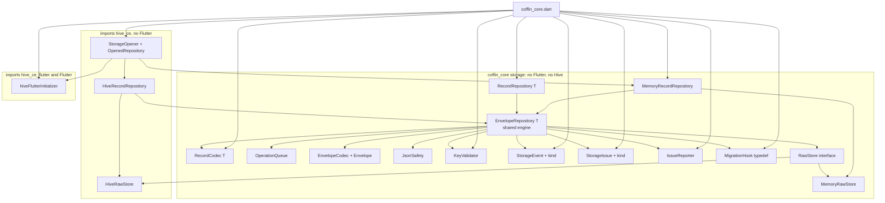
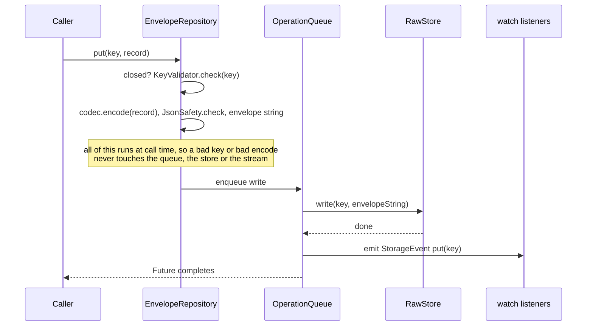

# Design Document

## Overview

The crypt-storage feature gives `coffin_core` its storage layer. An app describes a record type with a small `RecordCodec<T>` (to and from a JSON map), then asks the `StorageOpener` for a `RecordRepository<T>`. It gets a `hive_ce` backed repository when persistent storage works and an in-memory one when it does not, plus a flag that says which. No Hive type appears in any public signature, no adapters are written, and nothing is generated.

Key decisions (details below):

- **One shared engine, two thin stores.** All behavior (key checks, envelope, migration, corrupt handling, ordering, events, serialization of calls, close) lives in one class, `EnvelopeRepository<T>`, written against a tiny `RawStore` interface (`String` values by `String` key). `MemoryRawStore` and `HiveRawStore` are the only two places that differ. This makes the two repositories identical by construction, and the model-based test then checks the one thing that can still differ: the real Hive box.
- **The key rules are not what the requirements assumed.** `hive_ce` 2.23.3 does not require ASCII keys. It stores String keys as UTF-8 with a one-byte length, and checks the 255 limit only inside a debug `assert`. The coffin `KeyValidator` is therefore a deliberate, stricter subset: non-empty, at most 255 UTF-16 code units, every code unit at most `0x7F`. See "Key rules (verified from source)". Requirement 3.8 has been reworded in `requirements.md` to match (Decisions confirmed by the user, item 2).
- **The repository emits its own events.** `Box.watch` emits one event per key on `clear` and none for an empty clear, and it throws after close. A repository-owned `StreamController` gives the exact semantics of Requirements 2 and 4 on both stores.
- **Every call goes through one async queue.** This gives Requirement 2.9 (calls applied in call order) without relying on Hive, which does not serialize writes itself.
- **`getAll` sorts explicitly.** Hive's keystore is already sorted with `String.compareTo` (verified by reading), but the shared engine sorts anyway so the memory store and the Hive store cannot drift.
- **Values are stored as one JSON string** (`{"v":1,"data":{...}}`) in a `Box<dynamic>`. No Hive type machinery is involved, and the bytes are the same on every backend.
- **`hive_ce` is pinned to `2.23.3` and `hive_ce_flutter` to `2.3.4`, not the newest `2.5.0`.** `hive_ce_flutter` 2.4.0 and later depend on `material_ui`, which drags in the same extra packages that the fog-router design declined for `go_router` 18. The pins are confirmed (Decisions confirmed by the user, item 1), and the first implementation task is a `flutter pub add --dry-run` gate described in "Dependency decision".
- **glados awaits async test bodies.** I ran the Requirement 13 experiment and it behaves correctly, so the model-based test uses an async glados body with run counters.

### Research summary

I separate what I **ran** from what I only **read** or **inferred**.

| Question | Finding | How I know | Source |
|---|---|---|---|
| Toolchain | Flutter 3.47.9 stable. Dart 3.13.7 is the version given in the task; my `flutter --version` output was cut to three lines and did not show the Dart line. | Ran `flutter --version` (Flutter line only). | local |
| Latest `hive_ce` | 2.23.3 (published 2026-11-09), SDK `^3.4.0`. Dependencies: `meta ^1.14.0`, `crypto ^3.0.0`, `web >=0.5.0 <2.0.0`, `isolate_channel ^0.6.2`, `json_annotation ^4.9.0`. | Ran `curl` on the pub.dev API. | pub.dev API |
| `hive_ce_flutter` versions | 2.3.4 (2026-01-09): Flutter `>=3.27.0`, depends on `hive_ce ^2.16.0`, `path_provider ^2.0.10`, `path ^1.8.2`. 2.4.0 and 2.5.0 (latest): Flutter `>=3.44.0` and additionally depend on `material_ui ^1.0.0`. | Ran `curl` on the pub.dev API. | pub.dev API |
| What `material_ui` adds | `material_ui` 1.11.0 depends on `cupertino_ui`, `flutter_localizations`, `intl`, `material_color_utilities`, `vector_math`, `collection`. | Ran `curl` on the pub.dev API. | pub.dev API |
| Already in the workspace lock | `crypto 3.0.8`, `meta 1.19.0`, `path 1.9.1`, `web 1.1.2`, `ffi 2.2.0`, `collection 1.19.1`, `glados 1.1.7`, `flutter_web_plugins` (SDK). Not in the lock: `isolate_channel`, `json_annotation`, `path_provider*`, `plugin_platform_interface`, `platform`, `xdg_directories`, `jni`. | Read `pubspec.lock`. | repo |
| `path_provider` chain | `path_provider 2.1.6` depends on `path_provider_android 2.3.1` (which lists `jni`, `jni_flutter`), `path_provider_foundation 2.6.0` (`ffi`, `objective_c`), `path_provider_linux 2.2.2` (`ffi`, `path`, `xdg_directories`), `path_provider_windows 2.3.0` (`ffi`, `path`), `path_provider_platform_interface 2.1.3` (`platform`, `plugin_platform_interface`). These are the latest of each; pub may resolve older ones. | Read from the pub.dev API. **I did not run pub resolution** (not allowed), so the exact set is unconfirmed. | pub.dev API |
| Key rule: type and length | `Frame.assertKey` accepts an `int` in `0..0xFFFFFFFF` or a `String` with `key.length <= 0xFF` and otherwise throws `HiveError`. It is called only inside `assert(...)` in the three `Frame` constructors. | Read. `hive_ce-2.23.3/lib/src/binary/frame.dart` lines 27, 36, 44, 48-62 (the length check is lines 53-56). | pub archive |
| Key rule: encoding | String keys are written as `FrameKeyType.utf8StringT`, then `writeByte(bytes.length)` where `bytes` is the UTF-8 encoding, then the bytes. Reading mirrors it with `readByte()` for the byte count. | Read. `lib/src/binary/binary_writer_impl.dart` lines 217-229, `lib/src/binary/binary_reader_impl.dart` lines 224-234. | pub archive |
| Consequence for non-ASCII keys | Hive's check counts UTF-16 code units, but the file format stores a UTF-8 byte count in one byte. 255 `é` characters pass the check and are 510 bytes. I expect the one-byte count to wrap and corrupt the frame. **I did not run this** (it needs the package). | Inferred from the two reads above. | pub archive |
| Consequence for lone surrogates | `utf8.encode` replaces a lone surrogate with U+FFFD (bytes 239, 191, 189), so such a key would come back changed. | **Ran** a plain Dart snippet (no packages). | local |
| Empty key | `key.length <= 0xFF` is true for the empty string, so Hive's own check accepts it. IndexedDB accepts an empty string as a key per the spec. | Read for Hive; IndexedDB behavior is from my knowledge, **not verified** here. | pub archive |
| Is the check different on web? | Both backends share the `Frame` constructors, so the same debug-only assert applies. On web the key goes to IndexedDB as `frame.key.jsify()` with no byte-length step, so the one-byte count problem does not exist there. In release builds the assert is gone on every platform. | Read. `lib/src/backend/js/native/storage_backend_js.dart` lines 184, 193, 195. | pub archive |
| Key ordering | `Keystore` holds an `IndexableSkipList` built with `defaultKeyComparator`, whose String branch is `(k1 as String).compareTo(k2)`. `Box.keys` returns `keystore.getKeys()`. On web, `initialize` inserts the IndexedDB keys into the same keystore. So order is `String.compareTo` order on both backends. `String.compareTo` compares UTF-16 code units. | Read: `lib/src/box/default_key_comparator.dart` lines 2-19, `lib/src/box/keystore.dart` lines 42-43 and 118-120, `lib/src/box/box_base_impl.dart` lines 62-66. Code-unit order of `compareTo` **ran** on the VM (`'a\uFFFF'.compareTo('a\u{10000}')` is 1). | pub archive, local |
| `Box.watch` | Exists, broadcast (`ChangeNotifier` uses `StreamController.broadcast()`), throws `HiveError` when the box is closed. `Keystore.clear` calls `_notifier.notify` once per existing key, so an empty box emits nothing. `deleteAll` skips keys that are absent. `put` of an equal value still notifies. | Read. `lib/src/box/change_notifier.dart` line 13, `lib/src/box/box_base_impl.dart` lines 88-92, `lib/src/box/keystore.dart` lines 255-265, `lib/src/box/box_impl.dart` lines 70-79. | pub archive |
| Write ordering inside Hive | `_writeFrames` updates the keystore (`beginTransaction`) before the backend write finishes and rolls back on error. Hive does not queue concurrent calls. | Read. `lib/src/box/box_impl.dart` lines 81-95. | pub archive |
| Global state | `final HiveInterface Hive = HiveImpl();` is a global singleton. `HiveImpl` lives under `src/` and is not exported, so tests cannot build a private instance. | Read. `lib/hive.dart` line 38, `lib/src/hive_impl.dart` line 25. | pub archive |
| Where the box lives | `openBox(name, path: ...)` takes a per-call `path`. The VM backend throws `HiveError('You need to initialize Hive or provide a path...')` when both `path` and `Hive.init` are missing. Box names are lowercased and must be ASCII, at most 255 (debug assert). | Read. `lib/src/hive_impl.dart` lines 50-63, 78-84, 162-190, `lib/src/backend/vm/backend_manager.dart` lines 29-32. | pub archive |
| Web backend | The IndexedDB database is named after the box (lowercased), with an object store called `box`, version 1. `Hive.init` needs no path on web. | Read. `lib/src/backend/js/native/backend_manager.dart` lines 24-28. | pub archive |
| `initFlutter` | Takes the documents directory from `path_provider` unless `kIsWeb`, calls `Hive.init`, then **registers the Color and TimeOfDay adapters** (type ids 200 and 201). In 2.3.4 it only calls `WidgetsFlutterBinding.ensureInitialized()`. | Read `hive_ce_flutter-2.3.4/lib/src/hive_extensions.dart`. | pub archive |
| glados async bodies | `Glados.test` runs the body through `succeeds(...)`, which does `await tester(input)`, in both the explore and shrink loops. After a failure it calls the body once more **without awaiting** to rethrow the real error. | Read `glados-1.1.7/lib/src/glados.dart` lines 131-165 and `utils.dart` lines 50-57 from the local pub cache. | local cache |
| Async smoke test | See "Async smoke test result" below. | **Ran** it. | local |
| JSON facts | `jsonDecode('1.0')` is a `double` and `jsonDecode('1')` an `int` on the VM. `jsonEncode` throws `JsonUnsupportedObjectError` for NaN, infinity and non-String map keys. `-0.0` survives. A lone surrogate survives a `jsonEncode`/`jsonDecode` round trip. A decoded integer above 2^63 becomes a `double`. Duplicate object keys: the last one wins. | **Ran** a plain Dart snippet. | local |
| JSON on web | On dart2js, `1.0` and `1` are the same JS number, so `is int` is true for both. VM and web would disagree on a "must be an `int`" check. | Inferred from the JS number model, **not run**. | reasoning |

The experiments wrote only inside the repository and were removed. `git status --short` after cleanup showed only `?? .kiro/specs/crypt-storage/`, which was already untracked before this work (it holds the approved `requirements.md`). I added no package, and `pubspec.yaml` and `pubspec.lock` are unchanged.

### Async smoke test result (Requirement 13)

I created a throwaway `packages/coffin_core/test/storage/_async_smoke_test.dart` with two glados tests (5 runs each, `ExploreConfig(numRuns: 5)`). Both bodies were `async` and did `await Future<void>.delayed(1 ms)` first. One then ran `expect(1, 2)`, the control ran `expect(n, n)`. `flutter test test/storage/_async_smoke_test.dart` reported:

- The failing test: **FAILED** (`-1`, marked `[E]`). Glados printed `Tested 1 input, shrunk 3 times. Failing for input: 0`.
- The control test: **passed**.
- Overall line: `+1 -1: Some tests failed.`

So glados 1.1.7 awaits async bodies. Two quirks matter for the design:

1. On failure the first error text is `A property test behaved undeterministically ... failed the first time, but succeeded the second time with output Instance of 'Future<void>'`. That is because glados re-runs the body once without awaiting it. The real assertion message (`deliberate failure after await, n=0`) appears right after, as a separate async error. The model-based test therefore wraps its body in `try`/`catch` and rethrows a `TestFailure` that contains the operation sequence, so the sequence is in the failure output either way (Requirement 12.7).
2. Because of the un-awaited re-run, the body must create and dispose all its own state (own temp directory, own box) in a `try`/`finally`, never rely on shared state between runs.

I deleted the file and the empty `test/storage` directory afterwards. `git status` confirmed the tree was clean apart from the spec folder.

## Dependency decision

**Decided: `hive_ce: 2.23.3` and `hive_ce_flutter: 2.3.4`, both pinned exactly in `packages/coffin_core/pubspec.yaml`.** Nothing is added by this design phase. Alongside them, `meta: 1.19.0` (exact) is declared as a direct dependency of `coffin_core`. `meta` is already in `pubspec.lock` at that version, so it is not a new package.

| Option | Pros | Cons |
|---|---|---|
| **hive_ce 2.23.3 + hive_ce_flutter 2.3.4 (chosen)** | Newest `hive_ce` (the one I read). `hive_ce_flutter` stays on `path_provider` + `path`. Fits Flutter 3.47.9 (`>=3.27.0`). | `hive_ce_flutter` is not the newest line. |
| hive_ce 2.23.3 + hive_ce_flutter 2.5.0 | Newest. | Needs `material_ui`, which brings `cupertino_ui`, `intl`, `flutter_localizations` and more. You approved two storage packages, not that chain. The fog-router design declined the same pattern for `go_router` 18. |
| hive_ce only, own initializer | Smallest graph. | Mobile needs a documents directory, so we would add `path_provider` ourselves. That is a third package you did not approve, and `hive_ce_flutter` already wraps it. Rejected. |

**Expected package list (the single list the dry-run is compared against).** Option 1 is expected to add exactly these packages, taken from pub.dev metadata and not from a resolution run:

1. `hive_ce` and `hive_ce_flutter` (the two approved packages themselves)
2. `isolate_channel`
3. `json_annotation`
4. `path_provider`
5. `path_provider_android`
6. `path_provider_foundation`
7. `path_provider_linux`
8. `path_provider_windows`
9. `path_provider_platform_interface`
10. `plugin_platform_interface`
11. `platform`
12. `xdg_directories`
13. `objective_c`
14. possibly `jni` and `jni_flutter` (both or neither; I could not confirm whether pub picks the `jni` family)

`isolate_channel` needs only `meta`, and `json_annotation` is small pure Dart. The rest are native plugin packages. Packages already in the lock (`crypto`, `meta`, `path`, `web`, `ffi`, `collection`) are not additions.

**First implementation task (hard gate).** Before anything is written to a `pubspec.yaml`, run `flutter pub add hive_ce:2.23.3 hive_ce_flutter:2.3.4 --dry-run` in `packages/coffin_core`. Compare the packages it would add with the expected list above:

- If every added package is on the list, continue and add the two packages with exact pins, plus `meta: 1.19.0`.
- If it would add any package not on the list, work stops. The full dry-run output is shown to the user and nothing is added until the user decides.

`meta` is not part of the dry-run comparison, because it is already resolved in the lock. Its pubspec line is added in the same task as the two storage packages.

Consequence of `hive_ce_flutter`: `Hive.initFlutter` registers the Color and TimeOfDay adapters (type ids 200 and 201). The user accepted this (Decisions confirmed by the user, item 3). Our code registers no adapter of its own (Requirement 7.3 holds for our code), and our boxes hold only JSON strings, so those adapters are never used. The `hiveFlutterInitializer` doc comment says so explicitly.

## Key rules (verified from source)

This answers Requirement 3.7. Facts below are from reading `hive_ce` 2.23.3 (paths and lines in the table above), not from running a box.

| Aspect | `hive_ce` 2.23.3 | coffin `KeyValidator` |
|---|---|---|
| Allowed key types | `int` (0 to 0xFFFFFFFF) or `String` | `String` only |
| Length unit | UTF-16 code units (`String.length`), checked only in a debug `assert` | UTF-16 code units, always checked |
| Maximum length | 255 (`0xFF`) | 255 |
| Character range | Any. Stored as UTF-8, so non-ASCII keys are accepted by the check | `0x00` to `0x7F` only |
| Empty string | Accepted | **Rejected** |
| Lone surrogates | Accepted by the check, silently changed to U+FFFD on the VM | Rejected (above `0x7F`) |
| Differs on web | Same assert. No byte-length step on IndexedDB | Same on every platform |
| Release builds | The assert is removed, nothing is checked | Always checked |

Why stricter than Hive:

- With ASCII only, a key's UTF-8 byte count equals its code unit count, so the one-byte length in the VM file format can never overflow when the key is at most 255.
- No lone surrogate can be silently rewritten, so a key you put is the key you get back.
- An empty key is a likely programming mistake, and Requirement "Key" says a Key is non-empty.
- It keeps the guarantee that matters: **the in-memory repository never accepts a key that Hive would reject**, because the coffin rule is a subset of what Hive accepts and also covers what Hive only rejects in debug builds.

Requirement 3.8 in `requirements.md` has been reworded to match this strict-subset design. It now says: every key the validator accepts works in a real box (put, get and the box keys return the same key and record), every key the real box rejects is also rejected by the validator, and the validator MAY reject keys that Hive accepts (for example empty or non-ASCII keys). The agreement test asserts, per boundary key, the expected Hive outcome and the expected coffin outcome separately, and checks exactly those two directions.

### Boundary key table

Used by the validator-vs-real-box agreement test (Requirement 3.8) and by the glados key generators (Requirement 12.5). `K(n)` means the character `k` repeated `n` times.

| Id | Key | Coffin | Real box (debug assert on, VM tests) | Purpose |
|---|---|---|---|---|
| B1 | `''` | reject | accepts (characterization only) | empty key |
| B2 | `'a'` | accept | accepts | shortest valid |
| B3 | `K(255)` | accept | accepts | longest valid length |
| B4 | `K(256)` | reject | `HiveError` | one past the longest length |
| B5 | `'x\u007F'` | accept | accepts | highest valid character |
| B6 | `'\u0000'` | accept | accepts | lowest character |
| B7 | `'x\u0080'` | reject | accepts (characterization only) | first invalid character |
| B8 | `'\u{1F47B}'` (non-BMP, two code units) | reject | not written | multi-unit character |
| B9 | `'\uD800'` (lone surrogate) | reject | not written | lossy in UTF-8 |
| B10 | `'é' * 128` (128 units, 256 bytes) | reject | not written | would overflow the one-byte length |
| B11 | `'a/b..c d'` (ordinary punctuation and a space) | accept | accepts | ordinary |

Rows marked "not written" are never sent to a real box, because the expected effect is corruption. Rows B1 and B7 are put into a real box only in a clearly named characterization test, so a future `hive_ce` change shows up as a failing test. All real-box assertions go through `expectLater(() => box.put(...), throwsA(isA<HiveError>()))` because `Box.put` throws synchronously from a non-async method.

## Architecture



Dependency direction: the pure files depend on `dart:async`, `dart:convert` and `dart:core` only. Hive-aware files depend on `hive_ce`. Exactly one file, `hive_flutter_initializer.dart`, depends on `hive_ce_flutter` and Flutter, so every other storage file runs on the Dart VM test runner (Requirements 7.9, 15.4).

### Why one shared engine

| | Shared engine over `RawStore` (chosen) | Two independent implementations |
|---|---|---|
| Behavior parity | By construction | Must be tested into existence |
| Hive-specific risk | Confined to `HiveRawStore` (about 40 lines) | Spread through the repository |
| Test value of model-based comparison | Mainly checks the real box and the stores | Checks everything, with more duplicated code |
| Cost | `RawStore` is one more type to read | Two large classes to keep in sync |

The skeleton must be readable in one sitting, so the shared engine wins. The model-based test still compares memory, Hive and a plain `Map`, so a bug in either store shows up. The honest limit: because the engine is shared, the model-based test cannot catch an engine bug that the plain-`Map` model also shares in its own reimplementation. The model is written independently from the spec (it does not reuse the engine), and the unit and property tests on envelope, migration and corrupt handling cover the engine directly.

### Put flow



### Concurrency, ordering and timing rules

- **One queue per repository.** `OperationQueue.run` chains each operation after the previous one with `Future.then`, and swallows the previous failure so one failed write cannot block later calls. Reads (`get`, `getAll`) also go through the queue, so a read never sees a half-applied write and Requirement 2.8 holds without extra logic.
- **Checks happen at call time, before enqueueing.** Order of checks: closed (`StateError`), then key (`ArgumentError`), then encode and JSON safety (`ArgumentError`). The methods are `async`, so these appear as errors on the returned `Future`.
- **Events are emitted after the store write completes**, inside the queued operation, in application order.
- **`put` always emits**, even for an equal value. **`delete` emits only if the store reported that the key existed.** **`clear` always emits one `clear` event.**
- **`close` marks the repository closed immediately** (new calls throw), then enqueues the close, so calls already made finish first. The close closes the store, then the event controller, and the returned `Future` is the same for a second call.
- **`watch` after close** returns `Stream<StorageEvent>.empty()`, which is a broadcast stream that completes without events.
- **No replay.** The controller is `StreamController<StorageEvent>.broadcast()`, so a late listener gets only later events.

### Corrupt entries and reports

`getAll` reads keys from the store, ignores any key that is not a valid coffin key or not a String (foreign data written by someone else, no issue reported), sorts the rest with `String.compareTo`, and decodes each value. Every failed decode skips the entry and reports **one** `StorageIssue`. Because reads do not repair anything, each `get` or `getAll` reports again for the same entry, once per read (Requirement 10.2: one issue per skipped entry per read). A foreign non-String value in a Hive box reads as `''`, which is an unparseable envelope, so it is a `corruptRecord`.

Issue messages are fixed strings plus the key and the exception type name, for example `Record could not be read: invalid envelope (FormatException)`. They never include the exception's own message, because `FormatException` quotes part of the source text, and they never include payload content (Requirement 10.10).

### Decode decision table

Applied to each stored string, in this order:

| Step | Condition | Result | Issue kind |
|---|---|---|---|
| 1 | Not valid JSON, or not an object | skip | `corruptRecord` |
| 2 | `v` missing, not a number, not integral, negative, or above `2^31 - 1` | skip | `corruptRecord` |
| 3 | `data` missing or not an object | skip | `corruptRecord` |
| 4 | `v` greater than `currentVersion` | skip, entry left untouched | `unknownVersion` |
| 5 | `v` less than `currentVersion`, no hook | skip | `unknownVersion` |
| 6 | `v` less than `currentVersion`, hook throws | skip | `migrationFailed` |
| 7 | `v` less than `currentVersion`, hook returns | decode the returned map | (see step 9) |
| 8 | `v` equals `currentVersion` | decode the stored map, hook not called | (see step 9) |
| 9 | `codec.decode` throws | skip | `corruptRecord` |

"Integral" means `v == v.truncateToDouble()` after `jsonDecode`, so `2` and `2.0` are both version 2 on the VM and on web. This avoids the VM/web difference in `is int` (see Research summary) and is a deliberate reading of "not an integer" (decided, Decisions confirmed by the user, item 7).

## Components and Interfaces

### File layout

```
packages/coffin_core/
├── pubspec.yaml                          # + hive_ce 2.23.3, hive_ce_flutter 2.3.4, meta 1.19.0 (all exact; meta is already in the lock)
├── lib/
│   ├── coffin_core.dart                  # barrel, + storage exports
│   └── src/storage/
│       ├── json_map.dart                 # typedef JsonMap
│       ├── record_codec.dart             # RecordCodec<T>
│       ├── record_repository.dart        # RecordRepository<T>
│       ├── storage_event.dart            # StorageEvent
│       ├── storage_event_kind.dart       # StorageEventKind
│       ├── storage_issue.dart            # StorageIssue
│       ├── storage_issue_kind.dart       # StorageIssueKind
│       ├── issue_reporter.dart           # IssueReporter typedef, discardIssues, reportSafely
│       ├── migration_hook.dart           # MigrationHook typedef
│       ├── key_validator.dart            # KeyValidator
│       ├── json_safety.dart              # JsonSafety
│       ├── envelope.dart                 # Envelope (value)
│       ├── envelope_codec.dart           # EnvelopeCodec
│       ├── envelope_format_exception.dart# EnvelopeFormatException
│       ├── operation_queue.dart          # OperationQueue
│       ├── raw_store.dart                # RawStore (interface)
│       ├── memory_raw_store.dart         # MemoryRawStore
│       ├── envelope_repository.dart      # EnvelopeRepository<T> (shared engine)
│       ├── memory_record_repository.dart # MemoryRecordRepository<T>
│       ├── hive_raw_store.dart           # HiveRawStore (imports hive_ce)
│       ├── hive_record_repository.dart   # HiveRecordRepository<T>
│       ├── opened_repository.dart        # OpenedRepository<T>
│       ├── storage_opener.dart           # StorageOpener
│       └── hive_flutter_initializer.dart # hiveFlutterInitializer (ONLY hive_ce_flutter import)
└── test/storage/                         # mirrors the files above, see Testing Strategy
```

One public class per file, `snake_case.dart`. Apps import only the barrel. No app `pubspec.yaml` changes and no app code imports storage in this feature (Requirement 15.7).

### JsonMap and RecordCodec

```dart
/// A JSON object whose values are JSON-safe (see [JsonSafety]).
typedef JsonMap = Map<String, Object?>;

/// Converts records of type [T] to and from JSON maps. No adapters, no codegen.
abstract interface class RecordCodec<T> {
  /// Returns a JSON-safe map for [record]. Non-finite numbers, integers beyond
  /// +/-(2^53 - 1), and non-String map keys make the repository reject the put.
  JsonMap encode(T record);

  /// Rebuilds a record from [json]. May throw; the repository then treats the
  /// stored entry as corrupt.
  T decode(JsonMap json);
}
```

### RecordRepository

```dart
/// A keyed store of records of type [T]. Data is stored unencrypted.
abstract interface class RecordRepository<T> {
  /// The record under [key], or null when absent or corrupt.
  Future<T?> get(String key);

  /// Every readable record, ascending by key (UTF-16 code unit order).
  Future<List<T>> getAll();

  /// Stores [record] under [key], overwriting any existing entry.
  Future<void> put(String key, T record);

  /// Removes [key]. Completes normally when [key] is absent.
  Future<void> delete(String key);

  /// Removes every record and emits one clear event.
  Future<void> clear();

  /// A broadcast stream of changes made after you subscribe.
  Stream<StorageEvent> watch();

  /// Closes the repository. Safe to call twice.
  Future<void> close();
}
```

Every member carries a full doc comment in the real file (Requirement 1.5). No Hive type appears anywhere.

### Value types

```dart
/// What happened to the store.
enum StorageEventKind { put, delete, clear }

/// One change. [key] is null for [StorageEventKind.clear].
@immutable
final class StorageEvent {
  const StorageEvent(this.kind, [this.key]);
  const StorageEvent.put(String key) : this(StorageEventKind.put, key);
  const StorageEvent.delete(String key) : this(StorageEventKind.delete, key);
  const StorageEvent.clear() : this(StorageEventKind.clear);
  final StorageEventKind kind;
  final String? key;
  // ==, hashCode and a readable toString over (kind, key)
}

/// What went wrong.
enum StorageIssueKind { corruptRecord, migrationFailed, unknownVersion, fallbackToMemory }

/// A problem report. [message] never contains stored payload content.
@immutable
final class StorageIssue {
  const StorageIssue({required this.kind, required this.message, this.key});
  final StorageIssueKind kind;
  final String? key;
  final String message;
  // ==, hashCode, toString
}

/// Receives every [StorageIssue]. Exceptions it throws are swallowed.
typedef IssueReporter = void Function(StorageIssue issue);

/// The default reporter: drops every issue.
void discardIssues(StorageIssue issue) {}

/// Calls [reporter] and swallows anything it throws. Used by repositories and the opener.
void reportSafely(IssueReporter reporter, StorageIssue issue);

/// Upgrades [data] from [fromVersion] to the repository's current version.
typedef MigrationHook = JsonMap Function(int fromVersion, JsonMap data);
```

`StorageEvent` uses `@immutable` from `package:meta` through `package:flutter/foundation.dart`? That would import Flutter. The pure files import `package:meta/meta.dart` instead, which is already in the lock. `meta: 1.19.0` (exact, matching `pubspec.lock`) is declared as a direct dependency of `coffin_core`, which also satisfies the `depend_on_referenced_packages` lint. It is already in the lockfile, so this is a pubspec line and not a new package (Decisions confirmed by the user, item 10).

### KeyValidator

```dart
/// The single definition of a valid storage key, shared by every repository.
abstract final class KeyValidator {
  /// Longest valid key, in UTF-16 code units.
  static const int maxLength = 255;

  /// Highest valid code unit (ASCII DEL).
  static const int maxCodeUnit = 0x7F;

  /// Why [key] is invalid, or null when it is valid.
  static String? violation(String key);

  /// True when [key] is valid.
  static bool isValid(String key) => violation(key) == null;

  /// Throws [ArgumentError] with the reason when [key] is invalid.
  static void check(String key);
}
```

`violation` returns messages such as `must not be empty`, `longer than 255 code units (was 256)`, `contains a code unit above 0x7F at index 3`. The message states a length or index, never the key text.

### JsonSafety, Envelope, EnvelopeCodec

```dart
/// Checks and copies JSON-safe values.
abstract final class JsonSafety {
  /// Largest integer magnitude kept exactly on VM and web: 2^53 - 1.
  static const int maxSafeInt = 9007199254740991;

  /// Maximum nesting depth. Deeper (or cyclic) values are unsafe.
  static const int maxDepth = 64;

  /// True when [value] is null, bool, finite num (ints within +/-maxSafeInt),
  /// String, List of safe values, or Map<String, _> of safe values.
  static bool isSafe(Object? value);

  /// Throws [ArgumentError] (naming the path, never the value) when unsafe.
  static void check(JsonMap map);

  /// A deep copy with fresh Map<String, Object?> and List<Object?> instances.
  static JsonMap deepCopy(JsonMap map);
}

/// A stored wrapper: a schema version and its payload.
@immutable
final class Envelope {
  const Envelope(this.version, this.data);
  final int version;
  final JsonMap data;
}

/// Reads and writes the envelope text: {"v":<int>,"data":{...}}.
abstract final class EnvelopeCodec {
  /// Largest accepted schema version: 2^31 - 1.
  static const int maxVersion = 2147483647;

  /// The envelope text for [version] and [data].
  static String encode(int version, JsonMap data);

  /// Parses [raw]. Throws [EnvelopeFormatException] with a fixed message
  /// (never part of the input) when rules 1 to 3 of the decode table fail.
  static Envelope parse(String raw);
}
```

`EnvelopeFormatException` is a tiny `FormatException` subclass in its own file, `envelope_format_exception.dart` (one public class per file), carrying a fixed reason string. Extra object keys in the envelope are ignored, so a future version can add fields.

### OperationQueue

```dart
/// Runs async operations one at a time, in the order they were submitted.
final class OperationQueue {
  /// Runs [operation] after every earlier operation has finished (successfully or not).
  Future<R> run<R>(Future<R> Function() operation);
}
```

### RawStore and its two implementations

```dart
/// The tiny storage surface the engine needs: String values by String key.
abstract interface class RawStore {
  /// The stored string, or null when absent.
  Future<String?> read(String key);

  /// Every stored key, in any order. Non-String keys are not reported.
  Future<List<String>> keys();

  /// Stores [value] under [key], overwriting.
  Future<void> write(String key, String value);

  /// Removes [key]. Returns whether it existed.
  Future<bool> remove(String key);

  /// Removes everything.
  Future<void> removeAll();

  /// Releases the store. Persistent stores keep their data.
  Future<void> close();
}

/// A Map-backed store. Closing drops the entries. Shares no state between instances.
final class MemoryRawStore implements RawStore {
  MemoryRawStore([Map<String, String> seed = const {}]);
}

/// A [RawStore] over one hive_ce box. Data is stored unencrypted.
final class HiveRawStore implements RawStore {
  HiveRawStore(Box<dynamic> box);

  /// Opens (or creates) the box [boxName] and wraps it. [location] is passed to
  /// hive_ce as the box path; null uses the path set by the initializer (and
  /// is ignored on web).
  static Future<HiveRawStore> open(String boxName, String? location);
}
```

`HiveRawStore` uses `Box<dynamic>` so a foreign non-String value cannot cause a cast error on read; `read` returns the value when it is a `String`, `''` for any other non-null value, and null when absent. `keys()` returns `box.keys.whereType<String>()`. `remove` checks `containsKey` first, then `delete`. `removeAll` calls `box.clear()`. `close` calls `box.close()`, which keeps the data. `MemoryRawStore` validates seed keys with `KeyValidator` and throws `ArgumentError` for a bad one, so a seed cannot hold a key the Hive store would not.

### EnvelopeRepository and the two public repositories

```dart
/// Shared behavior for every repository: keys, envelope, migration, corrupt
/// handling, ordering, events, call serialization and close.
class EnvelopeRepository<T> implements RecordRepository<T> {
  EnvelopeRepository({
    required RawStore store,
    required RecordCodec<T> codec,
    required int currentVersion,
    MigrationHook? migrate,
    IssueReporter reportIssue = discardIssues,
  });
}

/// The in-memory repository. Same behavior as [HiveRecordRepository]; data is
/// lost on close and when the app ends.
final class MemoryRecordRepository<T> extends EnvelopeRepository<T> {
  MemoryRecordRepository({
    required RecordCodec<T> codec,
    required int currentVersion,
    Map<String, String> seed = const {},
    MigrationHook? migrate,
    IssueReporter reportIssue = discardIssues,
  });
}

/// The persistent repository over a [RawStore] (normally a [HiveRawStore]).
/// Data is stored unencrypted, in the Hive box, in IndexedDB on web.
final class HiveRecordRepository<T> extends EnvelopeRepository<T> {
  HiveRecordRepository({
    required RawStore store,
    required RecordCodec<T> codec,
    required int currentVersion,
    MigrationHook? migrate,
    IssueReporter reportIssue = discardIssues,
  });
}
```

`currentVersion` must be in `0..EnvelopeCodec.maxVersion` (asserted). `HiveRecordRepository` adds nothing to the engine except its name and its documentation about persistence and missing encryption. That is a small redundancy, kept because the requirements name the class and because it gives the opener a precise return type for the persistent case. It takes a `RawStore` instead of a Hive `Box` so tests can inject a store that fails.

### StorageOpener

```dart
/// Prepares hive_ce, e.g. [hiveFlutterInitializer] in apps or
/// `() async => Hive.init(tempDir.path)` in VM tests.
typedef StorageInitializer = Future<void> Function();

/// Opens the raw store for [boxName] at [location] (null for the default).
typedef RawStoreOpener = Future<RawStore> Function(String boxName, String? location);

/// The result of opening: the repository and whether it persists.
final class OpenedRepository<T> {
  const OpenedRepository({required this.repository, required this.isPersistent});
  final RecordRepository<T> repository;
  /// False when the memory fallback is in use; data will not be saved.
  final bool isPersistent;
}

/// Opens a persistent repository, or falls back to memory. Data is stored
/// unencrypted and must not hold secrets.
final class StorageOpener {
  const StorageOpener({
    required this.initializer,
    this.openStore = HiveRawStore.open,
    this.reportIssue = discardIssues,
  });
  final StorageInitializer initializer;
  final RawStoreOpener openStore;
  final IssueReporter reportIssue;

  /// Never throws. Runs [initializer], then [openStore]. On any failure returns
  /// a [MemoryRecordRepository] and reports one fallbackToMemory issue.
  Future<OpenedRepository<T>> open<T>({
    required String boxName,
    required RecordCodec<T> codec,
    required int currentVersion,
    String? location,
    MigrationHook? migrate,
    IssueReporter? repositoryIssues,
  });
}
```

`StorageOpener` wraps the whole body in one `try`/`catch (Object)`. A bad box name (not ASCII or over 255) is checked first and takes the fallback path, because Requirement 11.7 says the opener completes in every case. The fallback issue is `StorageIssue(kind: fallbackToMemory, message: 'Persistent storage unavailable; using memory (<ExceptionType>)')`, without the exception text. `repositoryIssues` defaults to `reportIssue`, so one callback usually receives both opener and repository issues. Hive lowercases box names, so `Notes` and `notes` are the same box (documented).

### hiveFlutterInitializer

```dart
/// Initializes hive_ce for Flutter apps (documents directory on mobile,
/// IndexedDB on web). Pass it as StorageOpener.initializer. [subDir] is an
/// optional folder inside the documents directory.
///
/// Note: hive_ce_flutter's `Hive.initFlutter` registers the Flutter Color and
/// TimeOfDay type adapters (type ids 200 and 201). Coffin registers no adapters
/// of its own, and coffin boxes hold only JSON strings, so those two adapters
/// are never used. Data is stored unencrypted.
Future<void> hiveFlutterInitializer([String? subDir]);
```

It imports `package:hive_ce/hive_ce.dart show Hive` and `package:hive_ce_flutter/hive_ce_flutter.dart show HiveX`, and calls `Hive.initFlutter(subDir)`. It is the only file that imports `hive_ce_flutter`. Boxes live in the app's own namespace on web (IndexedDB database per box), so apps should use prefixed box names such as `hauntagotchi_ghosts` to avoid collisions if both apps are ever served from one origin.

### Barrel exports

Added to `coffin_core.dart` in the existing `show` style:

```dart
export 'src/storage/hive_flutter_initializer.dart' show hiveFlutterInitializer;
export 'src/storage/issue_reporter.dart' show IssueReporter, discardIssues;
export 'src/storage/json_map.dart' show JsonMap;
export 'src/storage/key_validator.dart' show KeyValidator;
export 'src/storage/memory_record_repository.dart' show MemoryRecordRepository;
export 'src/storage/migration_hook.dart' show MigrationHook;
export 'src/storage/opened_repository.dart' show OpenedRepository;
export 'src/storage/record_codec.dart' show RecordCodec;
export 'src/storage/record_repository.dart' show RecordRepository;
export 'src/storage/storage_event.dart' show StorageEvent;
export 'src/storage/storage_event_kind.dart' show StorageEventKind;
export 'src/storage/storage_issue.dart' show StorageIssue;
export 'src/storage/storage_issue_kind.dart' show StorageIssueKind;
export 'src/storage/storage_opener.dart' show StorageInitializer, StorageOpener;
```

Not exported on purpose: `RawStore`, `RawStoreOpener`, `MemoryRawStore`, `HiveRawStore`, `EnvelopeRepository`, `HiveRecordRepository`, `OperationQueue`, `Envelope`, `EnvelopeCodec`, `JsonSafety`, `reportSafely`. Apps get a Hive-backed repository only through `StorageOpener`, so no Hive type or Hive-aware class leaks (Requirement 15.3). Tests under `test/storage/` import the `src/` files directly, as the existing router tests do.

## Data Models

**Envelope text.** `{"v":2,"data":{"title":"Haunted lamp","tags":["a","b"]}}`. `v` is the schema version (a non-negative integer). `data` is the codec's JSON map. The whole string is the value stored in the box (a `String`, no adapter). Unknown extra properties are ignored on read and dropped on the next put.

**Sample record for tests.** A test-only `TestNote` with `String title`, `int count`, `double? weight`, `List<String> tags` and `Map<String, Object?> extra` (so nested structures are exercised), with a `TestNoteCodec`, value equality and a readable `toString`. It lives under `test/storage/support/`, not in `lib/`.

**Operations for the model-based test.** A small sealed `Op` hierarchy (`PutOp(key, note)`, `DeleteOp(key)`, `ClearOp()`), each with a readable `toString` such as `put("a", TestNote(title: x, count: 2))`. A run is a `List<Op>` plus a `concurrent` flag.

**Generators (glados).**

- Keys: `any.oneOf` weighted toward a pool of six ordinary keys (`a` to `f`, so overwrites and deletes of existing keys are common), plus all boundary keys from the table (B1 to B11). The invalid ones must reach the repositories to prove they throw. B8 to B10 are safe here because the validator rejects them before any real box is touched.
- JSON maps for the envelope property: depth at most 3, at most 4 entries per map or list, values from null, bool, finite doubles in `[-1e9, 1e9]` (built with `any.doubleInRange`, never `any.double`), ints within `+/-(2^53 - 1)`, strings from a mixed alphabet (ASCII, accented letters, CJK, an emoji, a lone surrogate, quotes, backslashes, control characters), and keys drawn from the same alphabet.
- Seeded entries for the classification properties: current-version valid, lower-version valid, higher-version, garbage text, JSON non-object, missing `v`, invalid `v` (negative, `1.5`, string, null), `data` not an object, valid envelope whose codec decode throws.

## Correctness Properties

*A property is a characteristic or behavior that should hold true across all valid executions of a system-essentially, a formal statement about what the system should do. Properties serve as the bridge between human-readable specifications and machine-verifiable correctness guarantees.*

**Property reflection.** The prework produced about 25 testable criteria. I merged them as follows. 2.1 to 2.5, 2.8, 2.10, 3.2 to 3.4, 4.2 to 4.4, 7.7 and 8.1 all say "the repository behaves like a plain keyed map with sorted reads and these events", so one model-based property covers them. 6.3 and 6.5 are the same envelope round trip. 9.3 to 9.8, 10.1 to 10.3 and 2.6 are one decode table, so they become one classification property. 9.1 and 9.10 are one "put stores the current version" property. 9.9 and 10.5 are one "reads change nothing" property. 3.5 and 3.6 plus the validator rules become one validator property. 2.9 (call order) is covered by running the model-based property in a concurrent mode instead of a separate property.

### Property 1: Codec round trip

For any generated `TestNote` `x`, `codec.decode(codec.encode(x))` equals `x`, and `JsonSafety.isSafe(codec.encode(x))` is true.

**Validates: Requirements 6.2, 6.4, 12.1**

### Property 2: Envelope round trip

For any JSON-safe map `m` (nested, with unicode keys and values) and any version `v` in `0..EnvelopeCodec.maxVersion`, `EnvelopeCodec.parse(EnvelopeCodec.encode(v, m))` returns version `v` and a map deeply equal to `m`.

**Validates: Requirements 6.3, 6.5, 12.2**

### Property 3: Key validator matches its rule

For any string `s`, `KeyValidator.isValid(s)` is true exactly when `s` is non-empty, has at most 255 UTF-16 code units, and every code unit is at most `0x7F`. When it is false, `KeyValidator.check(s)` throws `ArgumentError` and the message does not contain `s`; when it is true, `check` does not throw.

**Validates: Requirements 3.1, 3.5, 3.6**

### Property 4: JSON safety detects every unsafe value

For any JSON-safe map, `JsonSafety.check` passes and `deepCopy` returns an equal map that shares no `Map` or `List` instance with the original. For any such map with one unsafe value injected at a random position (NaN, infinity, an integer beyond +/-(2^53 - 1), a non-String map key, a `DateTime`, a depth beyond 64), `check` throws `ArgumentError`.

**Validates: Requirements 6.2, 6.6, 9.11**

### Property 5: A rejected put changes nothing

For any repository (memory and Hive) and any record whose codec returns an unsafe map, `put` fails with `ArgumentError`, `getAll` is unchanged, the raw store contents are unchanged, and no event is emitted.

**Validates: Requirements 6.6, 14.6**

### Property 6: Memory, Hive and a plain Map agree

For any generated sequence of `put`, `delete` and `clear` operations (keys including the boundary keys), applied to a `MemoryRecordRepository`, a `HiveRecordRepository` over a real box, and a `Map<String, TestNote>` reference model, after every operation: `get` of every key touched so far returns the same record (or null) in all three; `getAll` returns the same list, in `String.compareTo` order of keys; the events observed by `watch` on both repositories equal the events expected from the model (`put` always, `delete` only if the key was present, `clear` always, none for a rejected operation). An operation with a key that violates the rules makes all three (the model through `KeyValidator.check`) throw `ArgumentError`, leaves the state unchanged and emits nothing. The sequence is applied either awaiting each call or firing all calls first and awaiting them together; both modes give the same final state and event list.

**Validates: Requirements 2.1, 2.2, 2.3, 2.4, 2.5, 2.7, 2.8, 2.9, 2.10, 3.2, 3.3, 3.4, 4.2, 4.3, 4.4, 7.7, 8.1, 12.3, 12.4, 12.5, 12.6**

### Property 7: Stored entries are decoded by the table, and only that

For any seeded set of stored entries drawn from the generator classes above, and any current version, with a counting migration hook: each entry reads as the decode table says (current version decodes without the hook, lower version with a hook calls it exactly once with the stored version and a copy of the payload, lower without a hook and higher are `unknownVersion`, a throwing hook is `migrationFailed`, anything else invalid or a throwing codec is `corruptRecord`); `get` returns null for each skipped entry; `getAll` returns exactly the decodable records in key order; the reporter receives exactly one issue per skipped entry per read, each with the right kind and the entry's key; and no issue message contains any payload text (each payload carries a unique marker string that is searched for).

**Validates: Requirements 2.6, 9.2, 9.3, 9.4, 9.5, 9.6, 9.7, 9.8, 10.1, 10.2, 10.3, 10.10**

### Property 8: Reads change nothing

For any seeded set of stored entries and any sequence of `get` and `getAll` calls, the raw store contents (every key and every string) are identical before and after, whether entries are valid, outdated, newer or corrupt.

**Validates: Requirements 9.6, 9.9, 10.5**

### Property 9: Put stores the current version

For any record and any current version, after `put` the raw envelope for the key has version equal to the current version and `get` returns an equal record. This also holds when the key previously held an older or corrupt entry that was read first.

**Validates: Requirements 9.1, 9.10, 10.6**

## Error Handling

| Situation | Behavior |
|---|---|
| Key violates the rules | `ArgumentError` from the returned `Future`, before the queue and the store, no event. |
| Call after `close` | `StateError('... is closed')`. The closed check runs before the key check. |
| `close` twice | Completes normally, same `Future`. |
| `watch` after `close` | Empty stream that completes with no events. |
| `encode` returns an unsafe value | `ArgumentError` naming the path (not the value), store and events unchanged. |
| `encode` itself throws | The exception propagates unchanged from `put`, nothing written. |
| Stored entry unreadable | Skipped, one `StorageIssue` per skipped entry per read, entry left in place. |
| `IssueReporter` throws | Swallowed by `reportSafely`. |
| Migration hook throws | `migrationFailed` issue, entry skipped. |
| Store write fails (disk error, IndexedDB quota, closed box) | The underlying exception propagates from `put`, `delete` or `clear`. Nothing is emitted. Hive rolls its in-memory keystore back (read in `_writeFrames`). The queue continues with later calls. Not wrapped, because I cannot reproduce quota errors here. |
| Initializer or box open fails | `StorageOpener` returns a memory repository with `isPersistent: false` and reports one `fallbackToMemory` issue. It never throws. |
| Invalid box name | Same fallback path, issue names the cause as an invalid box name. |
| Foreign keys or non-String values in the box | Non-String and invalid-coffin-key entries are ignored by `getAll`; a non-String value under a valid key reads as corrupt. |
| Debug asserts | `currentVersion` outside `0..maxVersion` fails an assert at construction. |

## Testing Strategy

Property-based testing applies here: the codec, envelope, validator, decode table and repository semantics are pure logic with large input spaces. glados `1.1.7` is already a dev dependency, and `flutter_test` provides the runner. Tests mirror `lib/`:

```
packages/coffin_core/test/storage/
├── support/                              # PURE helpers (no dart:io, no hive_ce): TestNote, TestNoteCodec, generators, deepEquals, repository_contract.dart (shared example body that takes a repository factory)
│   └── hive_test_box.dart                # VM ONLY: unique box names, temp dir, disposer (see "Real-box test hygiene")
├── key_validator_test.dart               # [chrome] table + examples
├── key_validator_property_test.dart      # [chrome] Property 3
├── key_validator_hive_agreement_test.dart# Requirement 3.8, real box, @TestOn('vm')
├── json_safety_test.dart                 # [chrome]
├── json_safety_property_test.dart        # [chrome] Property 4
├── envelope_codec_test.dart              # [chrome]
├── envelope_codec_property_test.dart     # [chrome] Property 2
├── record_codec_property_test.dart       # [chrome] Property 1
├── storage_event_test.dart               # [chrome]
├── storage_issue_test.dart               # [chrome]
├── issue_reporter_test.dart              # [chrome]
├── operation_queue_test.dart             # [chrome]
├── memory_raw_store_test.dart            # [chrome]
├── memory_record_repository_test.dart    # [chrome] semantics, Requirements 2 to 5, 9, 10, memory only
├── hive_raw_store_test.dart              # @TestOn('vm')
├── hive_record_repository_test.dart      # same semantics via repository_contract + persistence, @TestOn('vm')
├── envelope_repository_property_test.dart# [chrome] Properties 5, 7, 8, 9 (memory store, fast)
├── repository_model_property_test.dart   # Property 6, memory + Hive + Map, @TestOn('vm')
├── storage_opener_test.dart              # success, init failure, open failure, fallback report
└── storage_sources_test.dart             # import scans, one public class per file
```

**Example tests** (unit tests, run against both repositories through a shared test body): get on a missing key, overwrite, delete missing with no event, `clear` on an empty repository emits one `clear`, ordering, closed behavior (second `close`, `StateError` on each method, `watch` after close completing, memory dropping data, Hive keeping data), broadcast stream and no replay for a late listener, `watch` completing on close, no stream error for corrupt entries, a throwing reporter, the default reporter, migration cases (lower with hook, lower without hook, equal, higher, missing version, invalid versions, throwing hook, hook mutating its argument), corrupt put and delete events, the opener's four cases, persistence across close and reopen of the same temp directory.

**Source scans** (`storage_sources_test.dart`): no pure storage file imports `package:flutter/`, `package:hive_ce`, or anything under `apps/`; only `hive_raw_store.dart` and `hive_flutter_initializer.dart` import Hive packages and only the latter imports `hive_ce_flutter`; no `TypeAdapter` or `registerAdapter` in `lib/src/storage`; no `build_runner` or `hive_ce_generator` in any pubspec; every storage file declares at most one public class; the barrel exports no name from the Hive-aware files except the initializer.

**Property test configuration.**

- Every property test uses `ExploreConfig(numRuns: ...)` and a comment tag in the existing style, for example `// Feature: crypt-storage, Property 2: envelope round trip` and `// Validates: Requirements 6.3, 6.5, 12.2`.
- **Run counts (decided).** Properties 1 to 5, 7, 8 and 9 use `numRuns: 200`. They are pure or memory-only and cheap. **Property 6 (model-based) uses `numRuns: 100` and at most 30 operations per sequence.** The Hive side is the cost: each run opens a box in a fresh temp directory and does file I/O for every operation. I have not measured it because the package is not added yet.
- **Timing rule (never lower counts silently).** When the storage tests first run, the task measures the total wall-clock time of `flutter test test/storage` in `packages/coffin_core`. If it exceeds about 60 seconds, the task reports the timing (total and the slowest files) to the user BEFORE lowering any run count or sequence length, and waits for the user's decision. Counts are never lowered silently.
- Each run in Property 6 owns its state completely and uses the helper from "Real-box test hygiene" below: its own unique box name, its own box and its own temp directory. `Hive.init` is not needed for this test.
- Non-vacuous counters (Requirement 12.8): top-level `int runsExecuted` and `int opsExecuted` are incremented inside the glados body. A plain `test('model test really ran', ...)` declared after the glados test in the same group asserts `runsExecuted == numRuns` and `opsExecuted > 0`. Tests in a file run in declaration order, so the check sees the final counts.
- Failure reporting (Requirement 12.7): the body wraps its work in `try`/`catch` and rethrows `TestFailure('... after op N of [put("a", ...), delete("b"), ...]: <original>')`. glados also prints the shrunk input, whose elements print through the `Op.toString` above. glados shrinks lists by dropping and shrinking elements, which keeps sequences readable.
- Hive-backed files carry `@TestOn('vm')` because they use `dart:io`.

### Real-box test hygiene

Hive keeps one global `Hive` singleton (read in `lib/hive.dart` line 38 and `lib/src/hive_impl.dart` line 25) and caches open boxes by name. Reopening a name that is still open returns the already-open box, even with a different `path:`. A reused name can therefore leak state between tests or silently ignore a fresh temp directory. These rules apply to every test and every glados run that opens a real box, including the agreement test, `hive_raw_store_test`, `hive_record_repository_test`, the opener test with a real store and Property 6.

- **Unique names.** Every test and every glados run uses a unique, lowercase, ASCII box name, for example `'crypt_t${counter}_${random}'`, built from a fixed prefix, a monotonically increasing counter and a random suffix (lowercase hex). It must stay within Hive's box-name rules: lowercase ASCII, at most 255 characters.
- **Close before delete.** The box is closed in a `finally` block (or through `addTearDown` in plain tests) BEFORE its temp directory is deleted, including when the run fails.
- **One deliberate exception.** The persistence test (close and reopen at the same location) reuses the SAME name within that one test, and closes the box before reopening it.
- **Own state per run.** Because glados re-runs a failed body once without awaiting it (see "Async smoke test result"), each run owns its name, box and temp directory and shares nothing with other runs.
- **Shared helper.** `test/storage/support/hive_test_box.dart` (VM only, imports `dart:io` and `hive_ce`) exposes one function, for example `Future<HiveTestBox> openHiveTestBox()`. It produces a unique name as above, creates a fresh directory with `Directory.systemTemp.createTemp('crypt_storage_')`, opens the box with `Hive.openBox<dynamic>(name, path: dir.path)` (the design already prefers `openBox(name, path:)` over the global `Hive.init`), and returns the box, its name, its directory and a `dispose()` that closes that box and then deletes the directory with `recursive: true`. `dispose()` is safe to call twice.
- **No global reset.** From what the design already found, state is keyed by box name inside the singleton, and each test file runs in its own isolate, so unique names are enough. The helper closes only the specific box it opened. `Hive.close()` (closes every open box) and `Hive.deleteBoxFromDisk` are not needed between tests, because the temp directory is deleted as a whole. I did not run an experiment on this. The tasks therefore include one leakage test: open two boxes with different unique names, put the same key with different values in each, and assert each box returns only its own value, both before and after closing and reopening one of them. If that test ever fails, work stops and the user is told before the helper is changed.
- **Pure tests stay pure.** `hive_test_box.dart` is never imported by a Chrome-run file (see "Chrome run of the pure storage tests").

### Chrome run of the pure storage tests

The apps deploy to web and are tested on the VM, and number handling differs between them (`int` versus `double`, the 2^53 limit, `2.0` versus `2`). The pure storage tests therefore also run in Chrome:

```
flutter test --platform chrome \
  test/storage/key_validator_test.dart \
  test/storage/key_validator_property_test.dart \
  test/storage/json_safety_test.dart \
  test/storage/json_safety_property_test.dart \
  test/storage/envelope_codec_test.dart \
  test/storage/envelope_codec_property_test.dart \
  test/storage/record_codec_property_test.dart \
  test/storage/storage_event_test.dart \
  test/storage/storage_issue_test.dart \
  test/storage/issue_reporter_test.dart \
  test/storage/operation_queue_test.dart \
  test/storage/memory_raw_store_test.dart \
  test/storage/memory_record_repository_test.dart \
  test/storage/envelope_repository_property_test.dart
```

run from `packages/coffin_core`. These are exactly the files marked `[chrome]` in the layout above. The selection rule is mechanical: a test file is Chrome-run if and only if it imports neither `package:hive_ce`, `package:hive_ce_flutter`, `dart:io`, nor `support/hive_test_box.dart`, and carries no `@TestOn('vm')`. Excluded and VM only: `key_validator_hive_agreement_test`, `hive_raw_store_test`, `hive_record_repository_test`, `repository_model_property_test`, `storage_opener_test` (its default store opener is Hive-aware), and `storage_sources_test` (reads files with `dart:io`). Tests that use `Directory.systemTemp` or `hive_ce` must not be imported by any Chrome-run file. `storage_sources_test` also checks this rule: every file in the list above is scanned for those imports.

The task that adds this step does the following:

- Check whether Chrome is available (for example `flutter devices` lists Chrome, or `flutter doctor` reports it). If Chrome is not available, the task REPORTS that it could not run the Chrome step and why. It does not skip silently and does not mark the step as passed.
- If a Chrome-run file fails only because a package (for example glados) does not support the web platform, the task reports that to the user rather than dropping the file.
- Property tests run with their normal run counts in Chrome. If the Chrome run is slow, the timing rule above applies: report first, never lower counts silently.
- I have not run this step. Whether glados 1.1.7 compiles for the web test runner is unverified.

**Real-box agreement test (Requirement 3.8).** Uses the helper from "Real-box test hygiene". For each row of the boundary table the test records the validator verdict and, for rows where the validator accepts, runs put, get and `keys` on a real box and asserts the same key comes back; for B4 it asserts a `HiveError` from the real box; for B1 and B7 a labelled characterization test shows Hive accepts them. Rows B8 to B10 are validator-only.

**Opener tests** use the injected `openStore` and `initializer` to simulate failures, and one test uses the real `HiveRawStore.open(name, location)` with a unique name and a temp directory passed as `location`, following "Real-box test hygiene" (no global `Hive.init`).

**Gates before any task is marked done:** the `pub add --dry-run` check from "Dependency decision" (first task only), `dart format` with no changes, `flutter analyze` with zero warnings across the workspace, `flutter test` passing in `coffin_core` and both apps, the Chrome run above (or an explicit report that Chrome is unavailable), the timing report if the storage tests exceed about 60 seconds, and `flutter build web` succeeding for both apps (Requirement 16.9).

### What cannot be fully verified in `flutter test`

- **Real IndexedDB behavior.** VM tests use the file backend. What I know about the web backend comes from reading `storage_backend_js.dart` (keys passed straight to IndexedDB, values stored natively). I have not run it in a browser. The pure test files run in Chrome through the step in "Chrome run of the pure storage tests", which checks the VM/web number differences (integral versions, the 2^53 limit) but not IndexedDB itself. I have not run that step yet.
- **Private-browsing and blocked-storage failures.** On web, a blocked `indexedDB.open` should reject and surface as an exception from `openBox` (read in `backend_manager.dart`, lines 28-35), which the opener catches. The tests simulate this with an injected failing `openStore`. A real browser has not been exercised.
- **Quota errors and crash durability.** Not reproducible in unit tests. `put` surfaces the underlying exception; I make no durability claim beyond "data written before a clean `close` is present after reopening on the VM".
- **A manual web check is not possible in this feature.** The apps do not import storage here (Requirement 15.7), so there is no UI to load in a browser. The later app spec that first calls `StorageOpener.open` should add a manual check: `flutter build web`, serve the output with a static server, put a record, reload the page, and confirm the record survives; then repeat in a private window to see the fallback warning. For this feature, `flutter build web` for both apps must still compile (Requirement 16.9) even though the apps do not use storage, because the barrel now brings `hive_ce` and `hive_ce_flutter` into the compile graph. I have not run that build, because the packages are not added.
- **Whether the debug-only key assert fires as I read it, and the byte-count wrap.** The first is checked by the real-box agreement test in debug mode. The second (255 `é` characters) is inferred and deliberately never written to a real box.
- **Resolution of the `path_provider` chain on Flutter 3.47.9.** Confirmed only when the tasks phase runs the dry-run.

## Requirement coverage

| Requirement | Where it is addressed |
|---|---|
| 1 Generic repository interface | `RecordRepository`, doc comments, barrel (no Hive type); `storage_sources_test` |
| 2 Repository semantics | `EnvelopeRepository` rules (queue, sort, events), Properties 6 and 7, example tests |
| 3 Key rules | "Key rules (verified from source)", `KeyValidator`, boundary table, Properties 3 and 6, agreement test (reworded 3.8, decision 2), "Real-box test hygiene" |
| 4 Watch stream | Repository-owned broadcast controller, Property 6, example tests |
| 5 Lifecycle after close | Close rules in "Concurrency, ordering and timing rules", example tests on both repositories |
| 6 Codec and envelope | `RecordCodec`, `JsonSafety`, `EnvelopeCodec`, Properties 1, 2, 4, 5 |
| 7 Hive implementation | `HiveRawStore`, `HiveRecordRepository`, `hiveFlutterInitializer` (adapter note in its doc comment), persistence test (same-name exception); web runtime unverified |
| 8 In-memory implementation | `MemoryRawStore`, `MemoryRecordRepository` (shared engine), Property 6 |
| 9 Schema version and migration | Decode table, Properties 7, 8, 9, migration example tests |
| 10 Corrupt records and reporting | Decode table, `reportSafely`, fixed messages, Properties 7 and 8 |
| 11 Open failure and fallback | `StorageOpener`, `OpenedRepository`, opener tests |
| 12 Property-based verification | Properties 1, 2, 6; generators; counters; "Real-box test hygiene" (unique names, temp-dir lifecycle); run counts and timing rule; failure reporting |
| 13 Async glados verification | "Async smoke test result": ran, glados awaits; model test uses an async body |
| 14 Example-based tests | Testing Strategy example list |
| 15 Package boundaries and scope | File layout, barrel list, source scans, doc comments on unencrypted storage |
| 16 Quality gates | Gates paragraph; exact pins (`hive_ce`, `hive_ce_flutter`, existing `meta`); dry-run gate and expected package list; timing rule; Chrome run; `flutter build web` for both apps |

## Decisions confirmed by the user

1. **Pins and extra packages.** `hive_ce: 2.23.3` and `hive_ce_flutter: 2.3.4`, exact. The first implementation task is `flutter pub add --dry-run` for both. If it would add any package beyond the expected list in "Dependency decision", work stops and the full list is shown to the user before anything is added.
2. **Stricter keys than Hive.** The `KeyValidator` stays a strict subset of what Hive accepts (non-empty, at most 255 code units, each at most `U+007F`). Requirement 3.8 has been reworded in `requirements.md`: every key the validator accepts works in a real box, every key the real box rejects is rejected by the validator, and the validator may reject keys Hive accepts. "Key rules (verified from source)" cites this wording.
3. **Adapters.** Acceptable. `hiveFlutterInitializer` stays built on `Hive.initFlutter`. Its doc comment states that `hive_ce_flutter` registers the Color and TimeOfDay adapters (type ids 200 and 201), that coffin registers none of its own, and that coffin boxes hold only JSON strings.
4. **Run counts.** Property 6 uses 100 runs with at most 30 operations per sequence. All other glados properties use 200 runs. If the storage tests take more than about 60 seconds in total, the timing is reported to the user before any count is lowered. Counts are never lowered silently.
5. **Foreign data (as proposed).** `getAll` silently ignores non-String keys and keys that are not valid coffin keys. A non-String value under a valid key counts as corrupt.
6. **Error precedence (as proposed).** After `close`, a call with an invalid key throws `StateError`, not `ArgumentError`.
7. **Version integrality (as proposed).** A stored version such as `2.0` is accepted as version 2 on VM and web. `1.5`, negative numbers and strings are corrupt.
8. **Integer range (as proposed).** JSON-safe integers are limited to +/-(2^53 - 1). Codecs store larger numbers as strings.
9. **Exports (as proposed).** `HiveRecordRepository` is not exported. Apps reach persistence only through `StorageOpener`. `MemoryRecordRepository` is exported for app tests.
10. **meta.** `meta: 1.19.0` (exact, matching `pubspec.lock`) is added to the `coffin_core` dependencies. It is already in the lockfile and is not a new package.
11. **Opener shape (as proposed).** The opener takes an optional `location` and an injectable `RawStoreOpener`, so no Hive type is in its signature. A bad box name takes the fallback path instead of throwing, to honor Requirement 11.7.
12. **Chrome run.** The pure storage tests also run with `flutter test --platform chrome`, using the named file list in "Chrome run of the pure storage tests". If Chrome is unavailable, the task reports that instead of skipping silently.
13. **Real-box test hygiene (user addition).** Every real box uses a unique lowercase ASCII name, is closed in a `finally` (or `addTearDown`) before its directory is deleted, and is opened through a shared helper. The persistence test is the one deliberate same-name reuse. See "Real-box test hygiene".

### Decisions affect on requirements

Requirement 16.6 ("add `hive_ce` and `hive_ce_flutter` with exact pinned versions and no other new package") still holds. `meta` is an existing package already resolved in `pubspec.lock`, so declaring it directly adds no new package. The transitive packages arrive only through the two approved packages, and they are gated by the first-task dry-run comparison against the expected list: anything beyond that list stops work until the user decides. Requirement 3.8 has already been reworded in `requirements.md` to the strict-subset form used here. No other requirement text changes.
