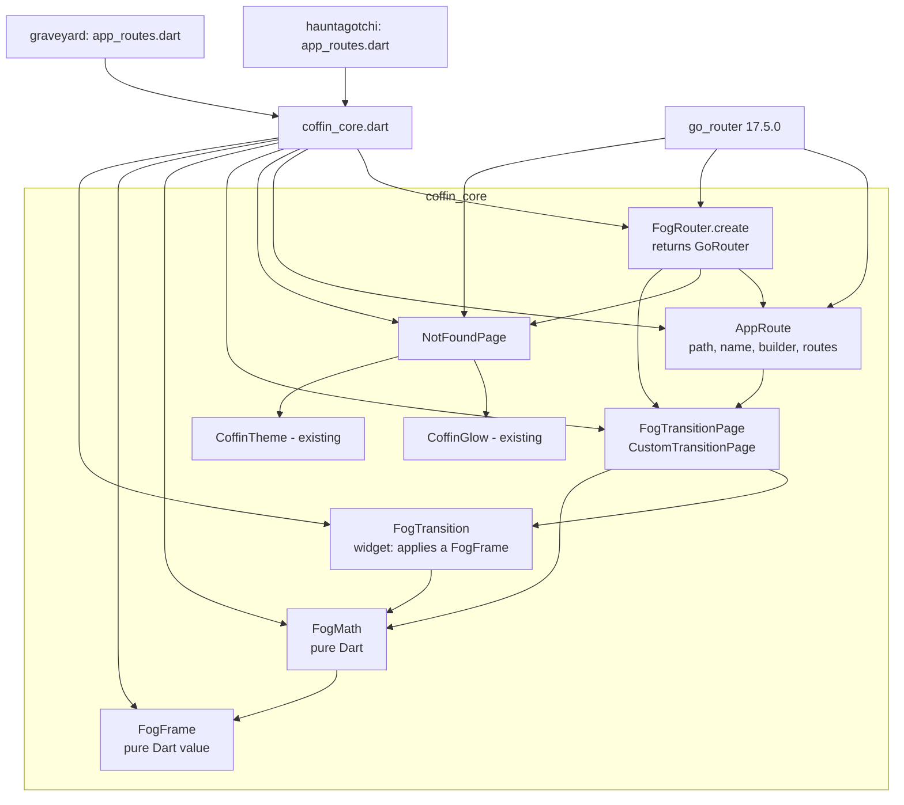
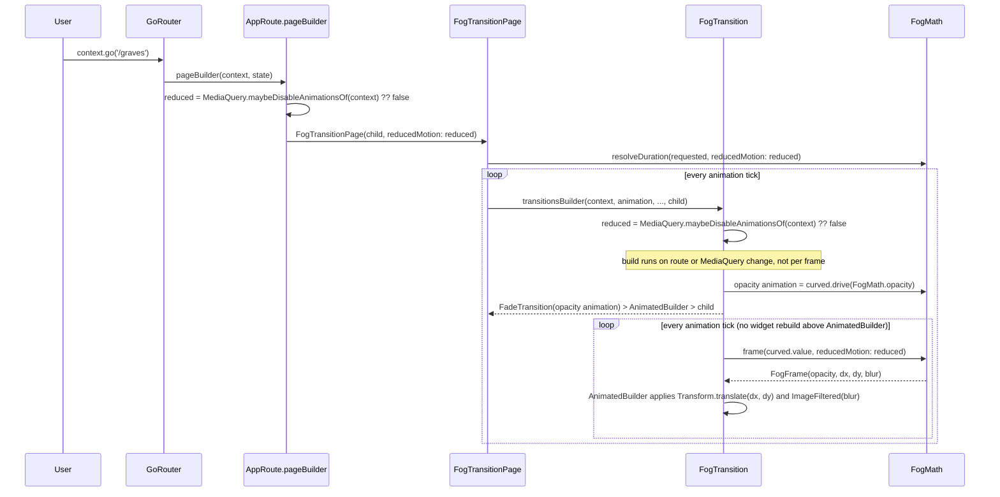

# Design Document

## Overview

The fog-router feature gives `coffin_core` its routing layer. An app declares a list of `AppRoute`s, hands them to `FogRouter.create`, and gets back a `GoRouter` where every page arrives through the fog transition (fade in, slight upward drift, resolving from a blur). Unknown locations land on a spooky `NotFoundPage` with a button home. Both apps are rewired to `MaterialApp.router`, with their existing `PlaceholderScreen` as the `/` route.

Key decisions (details below):

- **All transition numbers live in one pure Dart class, `FogMath`.** It has no Flutter imports. The widget layer only applies what `FogMath` returns. This is what the glados tests exercise.
- **Reduced motion is decided in two places on purpose.** The page duration is chosen when the page is created (`AppRoute`'s `pageBuilder` reads `MediaQuery`). The visual effect is chosen on every frame (the transition widget reads `MediaQuery` live). Both go through `FogMath`.
- **The easing curve lives in the widget layer, not in `FogMath`.** `FogMath` is a linear function of progress. The widget feeds it an ease-in-out curved animation value. This keeps the math trivially monotonic and testable.
- **The URL strategy is never touched.** Flutter Web defaults to the hash strategy. We add no code that changes it, and a source-scan test guards that.
- **`go_router` is pinned to `17.5.0`, not the latest `18.1.4`.** See "Dependency decision". This needs your confirmation.

### Research summary

| Question | Finding | Source |
|---|---|---|
| Latest `go_router` and its SDK floor | 18.1.4 (published 2026-11-09), needs Flutter >=3.44. 17.5.0 needs Flutter >=3.38. Both fit Flutter 3.47.9 / Dart 3.13.7. | pub.dev API |
| What does 18.x add to the dependency graph? | `flutter pub add go_router:18.1.4 --dry-run` in `coffin_core` resolved and would add `go_router`, `material_ui`, `cupertino_ui`, `intl`, `flutter_localizations` and `flutter_web_plugins`. | dry-run, no files changed |
| What does 17.5.0 add? | Same dry-run for 17.5.0 would add only `go_router` and `flutter_web_plugins` (an SDK package). | dry-run, no files changed |
| Why does 18.x matter for us? | 18.0.0 "migrates to material_ui and cupertino_ui". Its `isMaterialApp` check looks for **`material_ui`'s** `MaterialApp`. Our apps use `MaterialApp` from `package:flutter/material.dart`, which Flutter 3.47.9 still ships. It is a different class, so 18.x would not see a Material app and would use its generic widgets-app fallback for default pages, hero controller and error screen. | `go_router-18.1.4/lib/src/pages/material.dart`, `builder.dart` |
| Does that break our design? | No for routes, because every page we build is a `CustomTransitionPage` and the not-found page is ours. But it is a silent mismatch we would carry for no benefit. 17.5.0 detects the framework `MaterialApp` correctly. | same files |
| How does a custom transition work? | `GoRoute.pageBuilder` returns a `CustomTransitionPage` with `child`, `transitionsBuilder`, `transitionDuration` and `reverseTransitionDuration`. Duration is a plain field fixed at page creation. The `transitionsBuilder` runs on every animation tick. | `custom_transition_page.dart`, `doc/transition-animations.md` |
| Does the page wrap its child in semantics? | Yes: `Semantics(scopesRoute: true, explicitChildNodes: true, child: ...)`. | `custom_transition_page.dart` |
| Does `GoRouter` accept an empty route list? | The `GoRouter` constructor has no `routes.isNotEmpty` assertion (only `ShellRoute` does). I read the constructor assertions. I have **not** run it with an empty list, so Req 1.10 is checked by a test in the tasks. | `go_router-17.5.0/lib/src/router.dart`, `route.dart` |
| Error handling options | `GoRouter` asserts that at most one of `onException`, `errorPageBuilder`, `errorBuilder` is set. We use only `errorPageBuilder`, so the not-found page also gets the fog transition. | `router.dart` lines 250-255 |
| URL strategy | `go_router` does not set a strategy. Flutter Web defaults to hash. The router docs defer to the Flutter URL-strategy page. | `doc/web.md` |
| Context extension for navigation | `GoRouterHelper` on `BuildContext` provides `go`, `push`, `replace`, `pop`. | `lib/src/misc/extensions.dart` |
| Where does `MediaQuery` sit? | `WidgetsApp` (inside `MaterialApp.router`) provides `MediaQuery` above the `Router`, so `GoRoute.pageBuilder` and the transition both see it. Not verified at runtime yet. A test in the tasks covers it. | reasoning from framework structure; unverified |

I did not create any files outside this repository. Version research used `curl` streamed into `tar -xzO` and `flutter pub add --dry-run`, which writes nothing.

## Dependency decision

**Proposed: pin `go_router` to exactly `17.5.0` in `packages/coffin_core/pubspec.yaml`.**

| Option | Pros | Cons |
|---|---|---|
| **17.5.0 (proposed)** | One new package plus an SDK package. Detects the framework `MaterialApp` correctly. Fits the "lean skeleton" product goal. | Not the newest line. Fixes shipped in 18.x are not included. |
| 18.1.4 | Current, actively patched. | Pulls `material_ui`, `cupertino_ui`, `intl` and `flutter_localizations` into every app, which you did not explicitly approve. Does not recognize the framework `MaterialApp`. |

The requirements say you approved `go_router` with a pinned version, but not the extra transitive packages that 18.x brings. 17.5.0 is the version that stays inside what you approved. If you prefer 18.1.4, the design still works (routes and not-found page are ours), but you should accept the extra packages knowingly. The pin appears in exactly one place, so switching later is a one-line change plus a test run.

I have **not** added anything yet. Per your instructions, no code or pubspec change happens before the tasks are approved.

## Architecture



Dependency direction: `FogMath` and `FogFrame` depend on nothing but `dart:core`. The widget layer depends on `FogMath`. `AppRoute` and `FogRouter` depend on the widget layer and `go_router`. Apps depend only on the barrel (and on `go_router` directly only if they need a type the barrel does not re-export, which is not expected).

### Navigation and motion flow



## Components and Interfaces

### File layout

```
packages/coffin_core/
├── pubspec.yaml                      # + go_router: 17.5.0 (pinned)
├── lib/
│   ├── coffin_core.dart              # barrel, + router exports
│   └── src/router/
│       ├── fog_frame.dart            # FogFrame (pure Dart)
│       ├── fog_math.dart             # FogMath (pure Dart)
│       ├── fog_transition.dart       # FogTransition (widget)
│       ├── fog_transition_page.dart  # FogTransitionPage
│       ├── app_route.dart            # AppRoute
│       ├── fog_router.dart           # FogRouter
│       └── not_found_page.dart       # NotFoundPage
└── test/router/
    ├── fog_math_test.dart
    ├── fog_math_property_test.dart
    ├── fog_frame_test.dart
    ├── fog_transition_test.dart
    ├── fog_transition_page_test.dart
    ├── app_route_test.dart
    ├── fog_router_test.dart
    ├── not_found_page_test.dart
    └── router_sources_test.dart      # import and URL-strategy source scans

apps/hauntagotchi/lib/src/ui/app_routes.dart   # list of AppRoute, home = PlaceholderScreen
apps/graveyard/lib/src/ui/app_routes.dart      # same layout
```

One public class per file, `snake_case.dart`. `NotFoundPage` goes in `src/router/` because it depends on `go_router` and is part of the routing story (Req 6.11 allows either folder). The apps' route lists go in `lib/src/ui/` because they build screens; a new `lib/src/router/` folder in each app would add a layer for one small file.

### FogFrame (pure Dart)

```dart
/// One sampled frame of the fog transition.
final class FogFrame {
  /// Creates a frame.
  const FogFrame({
    required this.opacity,
    required this.dx,
    required this.dy,
    required this.blur,
  });

  /// Opacity, 0.0 to 1.0.
  final double opacity;

  /// Horizontal drift in logical pixels. Always 0.0 in this version.
  final double dx;

  /// Vertical drift in logical pixels. Positive moves the page down.
  final double dy;

  /// Gaussian blur sigma in logical pixels, 0.0 or more.
  final double blur;

  // ==, hashCode, toString: value semantics over all four fields.
}
```

The offset is two plain doubles instead of Flutter's `Offset`, because `FogFrame` must not import Flutter (Req 4.1, 9.3). The widget builds an `Offset(dx, dy)`.

### FogMath (pure Dart)

```dart
/// Pure functions that map animation progress to fog transition values.
final class FogMath {
  /// Creates the math with a maximum [maxDrift] and [maxBlur].
  const FogMath({this.maxDrift = defaultMaxDrift, this.maxBlur = defaultMaxBlur})
    : assert(maxDrift >= 0),
      assert(maxBlur >= 0);

  static const double defaultMaxDrift = 16; // logical px
  static const double defaultMaxBlur = 8;   // blur sigma, logical px
  static const Duration minDuration = Duration(milliseconds: 300);
  static const Duration maxDuration = Duration(milliseconds: 600);
  static const Duration defaultDuration = Duration(milliseconds: 450);

  final double maxDrift;
  final double maxBlur;

  /// Clamps [t] into 0..1. NaN becomes 0.
  double progress(double t);

  double opacity(double t, {bool reducedMotion = false});
  double dx(double t, {bool reducedMotion = false});
  double dy(double t, {bool reducedMotion = false});
  double blur(double t, {bool reducedMotion = false});

  /// All four values for [t] as one frame.
  FogFrame frame(double t, {bool reducedMotion = false});

  /// Picks the transition duration. See "Duration rules".
  Duration resolveDuration(
    Duration requested, {
    bool reducedMotion = false,
    Duration reducedDuration = Duration.zero,
  });
}
```

Formulas, with `p = progress(t)`:

| Value | Normal motion | Reduced motion |
|---|---|---|
| `opacity` | `p` | `p` |
| `dx` | `0.0` | `0.0` |
| `dy` | `maxDrift * (1 - p)` | `0.0` |
| `blur` | `maxBlur * (1 - p)` | `0.0` |

At `p = 0` the page is invisible, `maxDrift` px low and fully blurred. At `p = 1` it is opaque, in place and sharp. The drift is positive `dy`, so the page rises into place, which fits "floaty" motion. The magnitudes (16 px, sigma 8) are small on purpose: "slight drift", and a smaller sigma keeps the web blur cost down.

Why these formulas satisfy the requirements:

- Opacity is non-decreasing because it is `p`, and `p` is a clamp of `t` (Req 4.3, 4.5, 5.2).
- Drift and blur are non-increasing in `p` and exactly `0.0` at `p = 1` because `1 - 1 = 0` and `x * 0 = 0` (Req 4.6, 5.5).
- The reduced branch returns the literal `0.0` instead of computing a product, so the result is exactly zero and never `-0.0` or a rounding residue (Req 4.8, 5.3, 5.4).
- Out-of-range input is clamped and NaN becomes `0.0`, so every output stays in range (Req 4.4, 4.11).

Duration rules (`resolveDuration`):

| Mode | Result |
|---|---|
| Normal motion | `requested` clamped into 300 to 600 ms |
| Reduced motion | `reducedDuration` clamped into 0 to `defaultDuration`; default is `Duration.zero` (an instant change) |

If an app wants a plain opacity fade under reduced motion instead of an instant change, it passes a `reducedDuration` such as 150 ms. The opacity then runs with no drift or blur, as Req 3.3 allows. The default is instant because it is the most conservative choice for people who disable animations. Negative requested durations count as the lower bound of their mode (300 ms normal, zero reduced).

### FogTransition (widget)

```dart
/// Applies the fog transition to [child] for the given [animation].
class FogTransition extends StatelessWidget {
  const FogTransition({
    super.key,
    required this.animation,
    required this.child,
    this.math = const FogMath(),
  });

  final Animation<double> animation;
  final FogMath math;
  final Widget child;
}
```

Behavior:

1. Read `reduced = MediaQuery.maybeDisableAnimationsOf(context) ?? false` on every build, so a setting change affects the next navigation (Req 3.6).
2. Wrap the `animation` with an ease-in-out `CurveTween(Curves.easeInOut)` using `animation.drive(...)`. This allocates no controller, so there is nothing to dispose.
3. Derive an opacity animation from the curved animation through `FogMath`: `curved.drive(Animatable<double>.fromCallback((t) => math.opacity(t, reducedMotion: reduced)))`. This creates a lightweight derived animation. It allocates no controller.
4. Build `FadeTransition(opacity: opacityAnimation, alwaysIncludeSemantics: true, child: ...)` as the outer widget. `FadeTransition` listens to the animation itself and updates its render object's opacity directly, so the opacity does not rebuild any widget per frame. This is the cheaper path, especially on web.
5. Inside the `FadeTransition`, use an `AnimatedBuilder` on the curved animation **only for drift and blur**. Its builder calls `math.frame(curved.value, reducedMotion: reduced)`, wraps the pre-built `child` (passed through `AnimatedBuilder.child`, so it is not rebuilt) in `Transform.translate(offset: Offset(dx, dy))`, and adds `ImageFiltered(ImageFilter.blur(sigmaX: blur, sigmaY: blur, tileMode: TileMode.decal))` **only when `blur >= 0.1`**. When `dy == 0` and the blur is below the threshold, the builder returns the child unwrapped.
6. Under reduced motion, `math.frame` returns zero drift and blur, so the `AnimatedBuilder` always returns the child unwrapped, and only the `FadeTransition` remains. With the default zero duration that is an instant change; with a non-zero `reducedDuration` it is a plain opacity fade.

Why:

- `alwaysIncludeSemantics: true` on the `FadeTransition` keeps the page in the accessibility tree even at opacity 0, so a screen reader can reach the content during the animation (Req 2.10). `FadeTransition`, `Transform` and `ImageFiltered` add no semantics nodes of their own.
- The opacity still flows through `FogMath.opacity`, so the property-tested function is the one the screen uses, even though the widget that applies it is `FadeTransition`.
- The `0.1` threshold skips the blur layer for the last sliver of the animation, and entirely once settled (Req 2.6, 2.9). Below 0.1 px of sigma the blur is not visible.
- Only the incoming page is wrapped. `secondaryAnimation` is ignored, so the outgoing page is not animated (Req 2.7).
- The reverse (pop) transition runs the same animation from 1.0 to 0.0. `easeInOut` is symmetric, so pop looks like push played backwards (Req 2.5).
- The settled state is `p = 1`: opacity 1.0, offset 0, no blur filter (Req 2.9). To avoid a pointless layer, when the frame is fully settled the widget returns the child unwrapped.

### FogTransitionPage

```dart
/// A go_router page that fades its child in with the fog transition.
class FogTransitionPage<T> extends CustomTransitionPage<T> {
  FogTransitionPage({
    required super.child,
    super.key,
    super.name,
    super.arguments,
    super.restorationId,
    Duration duration = FogMath.defaultDuration,
    bool reducedMotion = false,
    FogMath math = const FogMath(),
  });
}
```

It calls `super` with `transitionsBuilder` returning `FogTransition(animation: animation, math: math, child: child)`, and both `transitionDuration` and `reverseTransitionDuration` set to `math.resolveDuration(duration, reducedMotion: reducedMotion)`. The `transitionsBuilder` ignores `reducedMotion` and re-reads `MediaQuery` inside `FogTransition`, so the visuals always follow the live setting while the duration follows the setting at creation time. Because the constructor body cannot call instance methods in an initializer list, the duration is computed in a private static helper that takes `math`.

### AppRoute

```dart
/// A route declared by an app and converted to a go_router [GoRoute].
@immutable
class AppRoute {
  const AppRoute({
    required this.path,
    required this.builder,
    this.name,
    this.routes = const <AppRoute>[],
    this.duration = FogMath.defaultDuration,
  });

  final String path;
  final String? name;
  final Widget Function(BuildContext context, GoRouterState state) builder;
  final List<AppRoute> routes;
  final Duration duration;

  /// Converts this route, and recursively its children, to GoRoutes.
  GoRoute toGoRoute();
}
```

`toGoRoute()` returns:

```dart
GoRoute(
  path: path,
  name: name,
  pageBuilder: (context, state) => FogTransitionPage<void>(
    key: state.pageKey,
    name: state.name,
    child: builder(context, state),
    duration: duration,
    reducedMotion: MediaQuery.maybeDisableAnimationsOf(context) ?? false,
  ),
  routes: [for (final r in routes) r.toGoRoute()],
)
```

Child routes use `toGoRoute()` too, so they also get the fog transition (Req 1.6). Go_router path rules still apply and are documented on `path`: top-level paths start with `/`, child paths do not.

### FogRouter

```dart
/// Builds a GoRouter whose pages all use the fog transition.
abstract final class FogRouter {
  static GoRouter create({
    required List<AppRoute> routes,
    String initialLocation = '/',
    Widget Function(BuildContext, GoRouterState)? notFoundBuilder,
    List<NavigatorObserver>? observers,
    bool debugLogDiagnostics = false,
  });
}
```

It returns `GoRouter(routes: [for (final r in routes) r.toGoRoute()], initialLocation: initialLocation, errorPageBuilder: ..., observers: observers, debugLogDiagnostics: debugLogDiagnostics)`. The error page builder returns a `FogTransitionPage` around `notFoundBuilder?.call(...) ?? const NotFoundPage()`. It sets no URL strategy and ships no routes. An empty `routes` list is passed through; every location then resolves to the not-found page (Req 1.10, to be confirmed by a test).

### NotFoundPage

```dart
/// A spooky page for locations that match no route.
class NotFoundPage extends StatelessWidget {
  const NotFoundPage({
    super.key,
    this.homeLocation = '/',
    this.message,
  });

  final String homeLocation;
  final String? message; // overrides the default body copy
}
```

Layout, top to bottom, centered in a `SafeArea` inside a `Scaffold`, wrapped in a `SingleChildScrollView` and a `ConstrainedBox(maxWidth: 480)`:

1. A tombstone-shaped glowing panel: a `DecoratedBox` using `CoffinGlow.decoration(color: scheme.primary, intensity: 0.6, fill: scheme.surface, borderRadius: BorderRadius.vertical(top: Radius.circular(48), bottom: Radius.circular(CoffinMetrics.cornerRadius)))` holding an `Icon(Icons.nightlight_round)`. The whole panel is inside `ExcludeSemantics` (Req 6.6). It is static, so it has no looping or moving decoration in any motion setting (Req 6.10).
2. Heading `Text('This page has passed on…', style: textTheme.displaySmall)`, marked `Semantics(header: true)`.
3. Body copy `Text(message ?? 'The link you followed is a ghost now. Let\u2019s get you back to the living.', style: textTheme.bodyLarge)` in `scheme.onSurfaceVariant`.
4. A `FilledButton` labeled "Back to the land of the living", with a `Text.semanticsLabel` of "Go back to the home page". Its `onPressed` calls `context.go(homeLocation)`, which replaces the location (Req 6.3, 6.4).

All colors and text styles come from `Theme.of(context)`, so it fits both themes (Req 6.5). The theme already gives buttons a 48x48 minimum size and hover, focus and pressed overlays (haunted-theme Req 4.5, 4.6), so the page adds none of its own (Req 6.7). The scroll view and width constraint cover 320 px phones, wide desktops and short viewports (Req 6.9). The default copy is written in the brand voice and never blames the user.

### Barrel exports

Added to `coffin_core.dart`, following the existing `show` style:

```dart
export 'package:go_router/go_router.dart' show GoRouter, GoRouterState, GoRouterHelper;
export 'src/router/app_route.dart' show AppRoute;
export 'src/router/fog_frame.dart' show FogFrame;
export 'src/router/fog_math.dart' show FogMath;
export 'src/router/fog_router.dart' show FogRouter;
export 'src/router/fog_transition.dart' show FogTransition;
export 'src/router/fog_transition_page.dart' show FogTransitionPage;
export 'src/router/not_found_page.dart' show NotFoundPage;
```

`GoRouter` and `GoRouterState` are the types an app touches when it builds or reads a route. `GoRouterHelper` is the `BuildContext` extension that provides `context.go`, `context.push` and `context.pop`. I confirmed all three are public in 17.5.0. With these re-exports, apps need no direct `go_router` dependency (Req 8.6, 8.8, 8.9).

### App wiring

Each app gets `lib/src/ui/app_routes.dart`:

```dart
final List<AppRoute> appRoutes = <AppRoute>[
  AppRoute(
    path: '/',
    name: 'home',
    builder: (context, state) => const PlaceholderScreen(),
  ),
];
```

and `main.dart` becomes:

```dart
class HauntagotchiApp extends StatefulWidget {
  const HauntagotchiApp({super.key});
  @override
  State<HauntagotchiApp> createState() => _HauntagotchiAppState();
}

class _HauntagotchiAppState extends State<HauntagotchiApp> {
  late final GoRouter _router = FogRouter.create(routes: appRoutes);

  @override
  void dispose() {
    _router.dispose();
    super.dispose();
  }

  @override
  Widget build(BuildContext context) => MaterialApp.router(
    title: 'Hauntagotchi',
    theme: CoffinTheme.dark(),
    routerConfig: _router,
  );
}
```

The router is created once in `State`, not in `build`, so hot reload and rebuilds do not reset navigation. `PlaceholderScreen` is unchanged (Req 8.10). `main()` still just calls `runApp`, with no URL-strategy call (Req 7.1, 7.2). Graveyard is identical with its own names. The apps do not import each other.

Existing app tests pump `MaterialApp(home: PlaceholderScreen())` directly, which keeps working. The one existing test that pumps `HauntagotchiApp()` and asserts `app.theme` currently reads a `MaterialApp`; `MaterialApp.router` is still a `MaterialApp` widget, so `find.byType(MaterialApp)` still finds it. Because routing resolves asynchronously, that test needs one extra `await tester.pumpAndSettle()` before finding `PlaceholderScreen`. The same update is made in the Graveyard test.

## Data Models

`FogFrame` is the only new value type (above). `AppRoute` is an immutable configuration object. `FogMath` is an immutable, `const`-constructible object with two `final` doubles. There is no persisted data.

## Correctness Properties

*A property is a characteristic that should hold across all valid executions. Each one below becomes a glados test over generated inputs.*

**Property 1: Output ranges.** For any finite progress `t` (including values outside 0 to 1) and either motion mode, `opacity` is in `[0, 1]`, `dx == 0`, `dy` is in `[0, maxDrift]`, and `blur` is in `[0, maxBlur]`. Validates Req 4.3, 4.4, 5.1.

**Property 2: Opacity is monotonic.** For any `a <= b` and either motion mode, `opacity(a) <= opacity(b)`. Validates Req 4.3, 5.2.

**Property 3: Reduced motion has no movement.** For any `t`, `frame(t, reducedMotion: true)` has `dx == 0`, `dy == 0` and `blur == 0`, and opacity in `[0, 1]`. Validates Req 3.1, 3.2, 4.8, 5.3, 5.4.

**Property 4: Drift and blur settle.** With normal motion, for any `a <= b`, `dy(a) >= dy(b)` and `blur(a) >= blur(b)`. Validates Req 2.2, 2.3, 5.5.

**Property 5: Settled end state.** For any `t >= 1`, the frame is opacity 1, offset zero and blur zero. For any `t <= 0`, opacity is 0. Validates Req 2.9, 4.5, 4.6.

**Property 6: Duration rules.** For any requested duration, normal-motion `resolveDuration` returns a value in `[300 ms, 600 ms]`, and reduced-motion `resolveDuration` returns a value in `[0, defaultDuration]` and `Duration.zero` by default. Validates Req 2.4, 2.8, 3.5.

**Property 7: Determinism.** Calling `frame` twice with equal inputs returns equal frames. Validates Req 4.7.

Unit tests cover what generators do not: the exact boundary values 0.0, 0.5, 1.0, -1.0, 2.0 and NaN (Req 5.6), the constructor assertions for negative maxima (Req 4.10), `FogFrame` equality, and `AppRoute` conversion.

## Error Handling

| Situation | Behavior |
|---|---|
| Unknown location | `errorPageBuilder` shows the custom builder or `NotFoundPage` in a `FogTransitionPage`. |
| `routes` is empty | Same as unknown location for every location (to be confirmed by test). |
| Custom `notFoundBuilder` throws | Not handled by us. It is app code, and Flutter's normal error widget applies. |
| `t` outside 0..1 or NaN | `FogMath.progress` clamps it; NaN becomes 0. |
| Negative `maxDrift` / `maxBlur` | Debug assertion. Release builds do not check. |
| Duration outside range | Clamped in normal motion; reduced motion clamps to 0..`defaultDuration`. |
| `MediaQuery` missing (for example a bare widget test) | `maybeDisableAnimationsOf` returns null, treated as normal motion. |
| Invalid go_router path (for example a top-level path without a leading `/`) | go_router's own debug assertion fires. `AppRoute.path` documents the rules. |

## Testing Strategy

Tests mirror `lib/` under `packages/coffin_core/test/router/`. glados tests hide the clashing `expect`, `group` and `test` names from the glados import, as the existing theme property tests do.

- **`fog_math_property_test.dart`**: Properties 1 to 7 with `Glados`/`Glados2`, using `any.doubleInRange(-5, 5)` for progress and a duration generator built from milliseconds.
- **`fog_math_test.dart`**: boundary unit tests, assertions, defaults (16 px, sigma 8, 450 ms).
- **`fog_frame_test.dart`**: equality and `hashCode`.
- **`fog_transition_test.dart`** (widget): drives an `AnimationController` through `FogTransition` under a `MediaQuery` wrapper. At progress 0, find a `FadeTransition` whose animation value is 0 and with `alwaysIncludeSemantics` true, and a non-zero translation. Assert the `FadeTransition` is the outermost fog widget and that no `Opacity` widget is used. Under `disableAnimations: true`, assert zero translation at every sampled step and no `ImageFiltered`. When settled, assert no `ImageFiltered` and no translation. Assert `Semantics` is still reachable at progress 0.
- **`fog_transition_page_test.dart`**: duration is clamped to 300 to 600 ms normally, zero under reduced motion, `reverseTransitionDuration` matches, the page is a `CustomTransitionPage`.
- **`app_route_test.dart`**: `toGoRoute` preserves path and name, converts children recursively, and produces a `FogTransitionPage` for both parent and child.
- **`fog_router_test.dart`**: pumps a `MaterialApp.router`. Verifies the initial location, navigation between routes, an unknown location showing `NotFoundPage`, a custom `notFoundBuilder`, an empty route list, and that reduced motion set through `tester.platformDispatcher.accessibilityFeaturesTestValue` yields no translation. `MediaQuery` is not overridden above `MaterialApp.router`, because the app builds its own from the view.
- **`not_found_page_test.dart`**: heading text, button navigates to `/`, theme colors come from `Theme` in both `CoffinTheme.dark()` and `light()`, no overflow at 320 px wide and at 1200 px wide, scrolls in a short viewport, the decorative panel is excluded from semantics, the button's tap target is at least 48x48, no `AnimationController`-driven widgets exist.
- **`router_sources_test.dart`**: scans `packages/coffin_core/lib` and both apps' `lib` for `usePathUrlStrategy`, `setUrlStrategy` and `url_strategy` (Req 1.9, 7.1 to 7.3), checks that `fog_math.dart` and `fog_frame.dart` import no `package:flutter/` library (Req 4.1, 9.3), and that no file under `coffin_core/lib` imports from `apps/`.
- **App tests** (one per app): the app starts on `PlaceholderScreen`; an unknown location shows `NotFoundPage` and the button returns to `PlaceholderScreen`; `CoffinTheme.dark()` is still applied (Req 8.5, 8.11, 8.12).

Gates before any task is marked done: `dart format` with no changes, `flutter analyze` with zero warnings, and `flutter test` passing in `coffin_core` and both apps.

### What cannot be fully verified in `flutter test`

- **Real hash URLs in a browser.** Widget tests run on the VM and cannot show `/#/nowhere` in an address bar. The source-scan test proves we never change the strategy. A manual check is listed as a task: `flutter build web` for one app, serve the output with a plain static server, and open the bare URL and a `#/nowhere` URL.
- **Blur cost on web.** The blur is small (sigma 8, only while animating), but I have not profiled it on CanvasKit. If it looks heavy, the fix is lowering `defaultMaxBlur`, which is one constant.
- **Pixel appearance.** `flutter test` renders with the Ahem font, so no test checks how the heading or the animation looks. This needs a visual pass in the running app.

## Requirement coverage

| Requirement | Where it is addressed |
|---|---|
| 1 Routing helper | `FogRouter`, `AppRoute`, barrel exports, `router_sources_test` |
| 2 Fog transition | `FogTransition`, `FogTransitionPage`, `FogMath` constants |
| 3 Reduced motion | `FogMath` reduced branch, live `MediaQuery` read in `FogTransition`, creation-time read in `AppRoute` |
| 4 Pure math | `FogMath`, `FogFrame` |
| 5 Property tests | Properties 1 to 7, boundary unit tests |
| 6 Not-found page | `NotFoundPage` |
| 7 Hash strategy | No URL-strategy code anywhere, source scans, manual web check |
| 8 App wiring | `app_routes.dart`, updated `main.dart`, updated app tests |
| 9 Boundaries | File layout, barrel `show` clauses, source scans |
| 10 Quality gates | Testing Strategy gates; `go_router` is the only new package |

## Decisions confirmed by the user

1. **`go_router` version:** pinned to `17.5.0`.
2. **Reduced-motion default:** an instant change (zero duration). An app can opt into a fade through `reducedDuration`.
3. **Re-exported `go_router` names:** `GoRouter`, `GoRouterState` and `GoRouterHelper`.
4. **Existing app tests:** the two existing tests that pump the full app are updated (added `pumpAndSettle`).
5. **Opacity widget:** `FadeTransition` with `alwaysIncludeSemantics: true`, driven by the curved animation through `FogMath.opacity`. `AnimatedBuilder` is used only for drift and blur.
