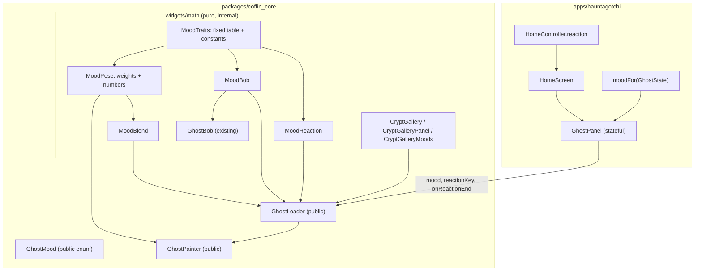

# Design Document: ghost-moods

## Overview

This feature gives the Coffin ghost a face and a body language. `coffin_core` gains the public enum `GhostMood`, mood support in `GhostPainter` and `GhostLoader`, and a mood section in the `CryptGallery`. Hauntagotchi maps `GhostState` to a mood, plays `fed` after each check-off, plays `rising` once when a ritual completes, and keeps the ghost clear of the top edge of the home screen.

Design summary:

- **One public enum, six internal pure classes.** `GhostMood` is the only new barrel export. `MoodTraits`, `MoodPose`, `MoodBob`, `MoodBlend`, `MoodReaction`, `EyeStyle` and `MouthStyle` are pure Dart in `lib/src/widgets/math/` and stay internal (Requirements 1.5, 12, A6).
- **A pose is a weighted mix of mood table rows.** A `MoodPose` holds seven mood weights plus the numbers that animate (opacity, lean, droop, scale, lift, blended bob amplitude). Every transition, every reaction and every interruption is the same operation: `MoodBlend.mix(fromPose, toPose, progress)`. This is what makes "start from the currently shown blend, no jump" (7.6, 9.4, 9.11) one rule instead of five.
- **One ticker.** `GhostLoader` keeps `MotionLoop` and its single repeating controller. Transitions and reactions are functions of `elapsedMs` minus a start time stored in the state. No extra `AnimationController`, no `Timer`. `MotionLoop` gets one small optional hook so that a steady `dead` ghost stops its ticker (see "Motionless_Pose and the MotionLoop hook").
- **The painter stays dumb.** It receives plain values (a mood or a pose, a bob offset, colors) and reads no theme and no controller.
- **Hauntagotchi events are an in-memory value on the controller.** `HomeController.reaction` is an immutable `GhostReaction(kind, key)`. `GhostPanel` becomes stateful, remembers the last key it handled, and so plays each event once.
- **The top-edge fix is 8 px.** The home list's top padding goes from 16 to 24 (see "A5 diagnosis").

### Research summary

No web research was needed: the feature uses plain Flutter APIs already used in this repository. The facts below were read from the code and shape the design.

1. **`GhostPainter`** (`packages/coffin_core/lib/src/widgets/ghost_painter.dart`) draws a path (head arc, straight sides, three-scallop hem), a glow along that path, the body fill and two round eyes of radius `0.07 * w` at `top + 0.40 * w`, `cx +- 0.18 * w`. The ghost is `0.8 * h` wide. `headroom` is kept free above and below; `bobOffset` is clamped into `[-headroom, headroom]`. The class doc says "It has no mood, expression or state parameter", which becomes false and is updated.
2. **`GhostLoader`** (`ghost_loader.dart`) uses the `MotionLoop` mixin: one repeating `AnimationController` (1 s period, value never read) and `elapsedMs` from `lastElapsedDuration`. The ghost box is `0.8 * size` wide and `size + 2 * headroom` high, with `headroom = bob amplitude`. Under reduced motion it paints one `CustomPaint` with offset 0 and no `AnimatedBuilder`.
3. **`MotionLoop`** requires `SingleTickerProviderStateMixin`. A second controller would need `TickerProviderStateMixin` and a change to a mixin that `FlickerText` and `FogBackground` also use. The design avoids this (Decision D1). `MotionLoop` always repeated while motion was allowed, so a steady `dead` ghost would tick at 60 frames per second for nothing (Requirement 24); the design adds one optional hook (Decision D11).
4. **`GhostBob`** clamps period to 2500..5000 ms and amplitude to 2..10 px, so it cannot express "no bob" (amplitude 0).
5. **Existing tests that bind the design.**
   - `apps/hauntagotchi/test/ui/home_screen_a11y_test.dart` (lines 206 to 243): under `disableAnimations` there must be no `AnimatedBuilder` below `GhostLoader` and `tester.hasRunningAnimations` must be false; with motion allowed there must be at least one `AnimatedBuilder` below it. The mood path of `GhostLoader` keeps exactly this split.
   - `packages/coffin_core/test/widgets/ghost_loader_test.dart`: with no mood, one ticker, `bobOffset` moves, size is constant, painter props are body `text`, eyes `background`, glow `primary`. The legacy path stays byte-for-byte the same code.
   - `packages/coffin_core/test/widgets/crypt_gallery_test.dart` line 173 asserts `GhostLoader` count per panel (flagged item F1).
   - `widgets_sources_test.dart` scans `lib/src/widgets/` for color literals and `lib/src/widgets/math/` for `package:flutter`, `dart:ui`, `dart:math`, `dart:io`, seedless `Random` and `.hashCode`. The new pure files obey it (no `dart:math`, no `listEquals`, no `x.hashCode`).
   - `widgets_barrel_sources_test.dart` checks a list of expected export lines and a list of internal names. It gets one added line for the `GhostMood` export (F13, approved by the user). A new test covers the new export and the new internal names.
6. **Contrast of the starting opacities fails in daylight.** The body is `primary` `6B3FD4` over `background` `F7F3FC`. Measured with the WCAG formula and 8-bit blending: opacity 0.50 gives 2.23, 0.65 gives 2.95. Requirement 4.4 therefore applies and the table is raised (see "MoodTraits").
7. **Hauntagotchi.** `HomeController._act` sets `_haunting`, optionally `_welcomeBack`, calls `_notify()` once, then enqueues writes. `toggle` chooses between `h.undo(id)` and `h.complete(id)`. `HomeScreen` is stateful only for the lifecycle observer and builds a `ListView(padding: EdgeInsets.all(16))` inside `SafeArea`. `GhostPanel` is a `StatelessWidget` and `GhostPanel` tests construct it without any reaction argument, so new parameters must be optional.

## Architecture



Only `GhostMood`, `GhostPainter` and `GhostLoader` cross the package boundary. Hauntagotchi imports `package:coffin_core/coffin_core.dart` only.

### Animation data flow in `GhostLoader`

```mermaid
sequenceDiagram
  participant W as Parent widget
  participant S as _GhostLoaderState
  participant L as loopController (MotionLoop)
  participant P as GhostPainter
  W->>S: didUpdateWidget(mood, reactionKey)
  S->>S: from = poseAt(elapsedMs); startMs = elapsedMs; runStartMs (reaction only)
  L-->>S: tick (listener): fire onReactionEnd once when run is over
  L->>S: AnimatedBuilder rebuild
  S->>S: pose = MoodBlend.mix(from, target(elapsedMs), eased progress)
  S->>P: pose, bobOffset = MoodBob.mixedOffsetAt(pose, elapsedMs)
```

`target(ms)` is the rest pose of the current mood. While a Reaction_Run is active, `scale`, `lift` and `opacity` of the target come from `MoodReaction` at the run's progress. Because the overlay values are part of the *target*, the blend from the previous pose is continuous at the first frame and reaches the reaction curve at the end of the blend.

### Hauntagotchi event flow

```mermaid
sequenceDiagram
  participant U as User
  participant C as HomeController
  participant H as HomeScreen
  participant P as GhostPanel
  participant L as GhostLoader
  U->>C: toggle(habit)
  C->>C: _haunting = next; _reaction = GhostReaction(kind, ++key)
  C-->>H: notifyListeners (once)
  H->>P: rebuild with reaction
  P->>P: key != handledKey and not reduced and not dead? accept
  P->>L: mood fed, reactionKey key, onReactionEnd
  L-->>P: onReactionEnd (once)
  P->>L: mood = moodFor(state)
```

## Components and Interfaces

### File layout

```text
packages/coffin_core/lib/src/widgets/
  ghost_mood.dart              NEW  public enum, no Flutter import
  ghost_painter.dart           EDIT mood, pose, face drawing
  ghost_loader.dart            EDIT mood, reactionKey, onReactionEnd, loopWanted override, settle check
  motion_loop.dart             EDIT optional loopWanted getter and syncLoop() (default behaviour unchanged)
  crypt_gallery_panel.dart     EDIT adds the mood section
  crypt_gallery_moods.dart     NEW  internal: CryptGalleryMoods
  math/
    eye_style.dart             NEW  enum
    mouth_style.dart           NEW  enum
    mood_traits.dart           NEW  table and constants
    mood_pose.dart             NEW  value
    mood_bob.dart              NEW
    mood_blend.dart            NEW
    mood_reaction.dart         NEW
packages/coffin_core/lib/coffin_core.dart   EDIT +1 export line
packages/coffin_core/README.md              EDIT "Ghost moods" section only
apps/hauntagotchi/lib/src/ui/
  mood_map.dart                NEW  moodFor(GhostState)
  ghost_reaction_kind.dart     NEW  enum { fed, rising }
  ghost_reaction.dart          NEW  immutable (kind, key)
  home_controller.dart         EDIT reaction event
  ghost_panel.dart             EDIT stateful, mood and reaction wiring
  home_screen.dart             EDIT passes reaction, top padding 24
```

Barrel line, inserted in sorted order after `ghost_loader.dart`: `export 'src/widgets/ghost_mood.dart' show GhostMood;`. The six math files and `CryptGalleryMoods` are not exported.

### GhostMood (public)

```dart
/// How a ghost feels. Five steady moods are held until changed; two reaction
/// moods play once and then hold their final pose.
enum GhostMood { thriving, content, hungry, fading, dead, fed, rising }
```

Each value has a doc comment. The enum order is the order used everywhere (table, gallery, pose weights index). `isReaction` is not added to the enum; `MoodReaction.isReaction(mood)` answers it, so the enum stays a plain list.

### EyeStyle and MouthStyle (pure, internal)

```dart
enum EyeStyle { round, wide, droopy, halfClosed, cross, happyArc }
enum MouthStyle { none, smile, gentleSmile, wideSmile, smallOpen, flat }
```

The requirement lists "wobble" as an example mouth. No mood needs it, so it is not added (YAGNI).

### MoodTraits (pure, internal): the single source of numbers

`final class MoodTraits` with `const` rows and `static MoodTraits of(GhostMood mood)`. Fields: `eyes`, `mouth`, `lean` (radians, positive tilts clockwise), `droop` (signed; positive squashes the body towards the hem and widens it, negative stretches it), `opacity`, `bobPeriodMs`, `bobAmplitude` (0 means no bob).

| Mood | Eyes | Mouth | lean | droop | opacity | bob period ms | bob amplitude px |
| --- | --- | --- | --- | --- | --- | --- | --- |
| `thriving` | wide | smile | 0 | 0 | 1.00 | 3000 | 8 |
| `content` | round | gentleSmile | 0 | 0 | 0.92 | 3600 | 6 |
| `hungry` | droopy | smallOpen | 0.04 | 0.03 | 0.85 | 4400 | 4 |
| `fading` | halfClosed | flat | 0.06 | 0.07 | 0.78 | 5000 | 2 |
| `dead` | cross | none | 0.15 | 0.10 | 0.72 | 5000 (unused) | 0 (no bob) |
| `fed` | happyArc | wideSmile | 0 | 0 | 1.00 | 3000 | 8 |
| `rising` | wide | smallOpen | 0 | -0.06 | 1.00 | 3000 | 8 |

Every pair of rows differs in `(eyes, mouth, lean, droop)`, so no two moods differ by opacity or bob alone (3.2). `fed` and `rising` use the `thriving` bob profile, and `rising` ends at the opacity of `thriving` (8.8, 4.5).

**Opacity values changed by Requirement 4.4.** The first-draft values 1.00, 0.92, 0.80, 0.65, 0.50 fail the 3.0 contrast rule in daylight. Contrast of the body blended over `background` (8-bit blending, WCAG formula; the eye color is `background`, so the eye-on-body ratio is the same number):

| Opacity | Night | Daylight | Note |
| --- | --- | --- | --- |
| 1.00 | 15.99 | 5.84 | `thriving`, `fed`, `rising` end |
| 0.92 | 13.49 | 5.03 | `content` |
| 0.85 | 11.60 | 4.37 | `hungry` |
| 0.78 | 9.86 | 3.79 | `fading` |
| 0.72 | 8.52 | 3.39 | `dead`, `rising` start |
| 0.65 (old `fading`) | 7.04 | **2.95 fails** | |
| 0.50 (old `dead`) | 4.56 | **2.23 fails** | |

Daylight is the binding set: the smallest opacity that reaches 3.0 is about 0.68, so `dead` is 0.72 for a margin of 0.39. The order stays strictly decreasing with steps of 0.06 to 0.08, which stays visible. The same table serves both themes, so the Token_Set never reaches the pure classes. Over `surface` the numbers are equal or better (daylight 0.72 gives 3.57).

Constants held here (so the painter, loader and tests read one place):

| Constant | Value | Used by |
| --- | --- | --- |
| `maxBobAmplitude` | 8 | reserve |
| `fedMaxScale`, `fedMaxLift` | 1.10, 6 | reaction, painter clamp, reserve |
| `risingMaxLift` | 10 | reaction, painter clamp, reserve |
| `maxLean` | 0.15 | painter clamp, reserve |
| `popReserve`, `stretchReserve` | 0.05, 0.06 (fraction of ghost height) | reserve |
| `reserveFor(size)` | `ceil(8 + 10 + 0.06 * size)` | loader box |

`reserveFor(size)` is the vertical room above and below the ghost, in logical pixels, for `size` already clamped to 24..256: 20 at 24, 22 at 64, 24 at 96, 34 at 256. The derivation is under "Fixed layout" below.

### MoodPose (pure, internal)

An immutable value. Fields: `weights` (unmodifiable `List<double>` of 7, indexed by `GhostMood.index`, each in 0..1, sum 1), `opacity`, `lean`, `droop`, `scale`, `lift`, `bobAmplitude` (double). There is no blended period (F4).

- `MoodPose.rest(GhostMood m)`: weight 1 on `m`, numbers from `MoodTraits.of(m)`, `scale` 1, `lift` 0. This is also the Still_Frame of every mood, including `fed` and `rising` (their final pose has scale 1, lift 0, the thriving opacity).
- `copyWith({opacity, scale, lift})`: used to build reaction targets.
- `==` and `hashCode` by value. The list comparison is a hand-written loop (the pure scan forbids `package:flutter`, so no `listEquals`) and `hashCode` is built with `Object.hash` and `Object.hashAll` (the scan forbids the text `.hashCode`).
- `upwardReach(size)`, `downwardReach(size)`, `horizontalReach(size)`: analytic bounds of how far the body can reach beyond its rest rectangle, excluding the bob (see "Fixed layout"). Used by the loader tests and by Property 11.

### MoodBob (pure, internal)

```dart
abstract final class MoodBob {
  static double offsetAt(GhostMood mood, int elapsedMs);
  static double mixedOffsetAt(MoodPose pose, int elapsedMs);
}
```

- `offsetAt`: 0 for `dead` (amplitude 0). For every other mood it returns `GhostBob(periodMs, amplitude).offsetAt(elapsedMs)` from the table, built once per mood. All bobbing profiles are inside `GhostBob`'s clamp range (period 3000..5000, amplitude 2..8), so `GhostBob` is reused unchanged (5.6 for the bobbing moods; see F3 for `dead`).
- `mixedOffsetAt`: the sum over moods of `weight * offsetAt(mood, elapsedMs)`. Each term is continuous in time, so the sum is continuous across transitions, and `abs(sum) <= pose.bobAmplitude` because the blended amplitude is the same weighted sum of the table amplitudes.

**Why offsets are mixed and no period is blended.** A bob is `A * wave((t + P/4) mod P)`. If `P` changed continuously the phase would jump (at `t = 20 s` a change from 3000 to 5000 ms moves the phase by thousands of milliseconds). Mixing the offsets of the two moods at the same `t` has no jump and needs no integration of `1/P`. `MoodBlend` blends amplitude, posture and opacity only (Requirement 7.2, F4); the blended amplitude is the bound that `mixedOffsetAt` respects.

### MoodBlend (pure, internal)

```dart
abstract final class MoodBlend {
  static const int transitionMs = 500;
  static const int restartMs = 200;
  static double ease(double u);                       // smoothstep, NaN -> 1, clamped
  static double progressAt(int sinceStartMs, int durationMs);   // integer in, 0..1 out
  static MoodPose mix(MoodPose from, MoodPose to, double progress);
}
```

- `ease(u)`: `u` clamped into 0..1 (below 0 gives 0, above 1 gives 1, NaN gives 1), then `u * u * (3 - 2 * u)`. Monotonic, maps 0 to 0 and 1 to 1, peak slope 1.5 (7.4).
- `progressAt`: `sinceStartMs / durationMs`, clamped; a negative time gives 0; `durationMs <= 0` gives 1.
- `mix`: with `e = ease(progress)`, every number (opacity, lean, droop, scale, lift, bob amplitude) and every weight is `from + (to - from) * e`, except that `e == 0` returns the `from` value and `e == 1` the `to` value exactly, and every result is clamped into the closed interval of its two endpoints. Weights of two normalized poses mix to a normalized pose.

### MoodReaction (pure, internal)

```dart
abstract final class MoodReaction {
  static bool isReaction(GhostMood m);
  static int durationMs(GhostMood m);                   // fed 900, rising 2200, others 0
  static double progressAt(GhostMood m, int elapsedMs); // integer ms in, 0..1 out
  static double scaleAt(GhostMood m, double p);         // fed 1.0..1.10, others 1
  static double liftAt(GhostMood m, double p);          // fed 0..6, rising 0..10, others 0
  static double opacityAt(GhostMood m, double p);       // fed 1.0, rising dead..thriving
}
```

- Curves use one envelope: `bump(p) = ease(2p)` for `p <= 0.5` and `ease(2 - 2p)` above, so it rises to 1 at the middle and returns to 0. `fed`: `scale = 1 + 0.10 * bump(p)`, `lift = 6 * bump(p)`. `rising`: `lift = 10 * bump(p)` (it returns to 0 so the held final pose equals the Still_Frame, and the ghost does not drop when the caller leaves the reaction), `opacity = dead + (thriving - dead) * ease(p)`.
- NaN `p` is treated as 1. `p` is clamped into 0..1.
- Speed (8.9): the envelope's peak slope is `2 * 1.5 = 3` per unit of progress, while its total travel is 2, so the peak speed is exactly 1.5 times the average speed over the run. `rising` opacity is a smoothstep, peak 1.5 times average. No curve flashes.

### GhostPainter (public, edited)

New optional constructor parameters; all existing parameters and defaults stay.

| Parameter | Type | Default | Meaning |
| --- | --- | --- | --- |
| `mood` | `GhostMood?` | `null` | Draw this mood at full weight. `null` and no `pose` draws the Legacy_Look. |
| `pose` | `MoodPose?` | `null` | Internal mix used by `GhostLoader` during transitions. Wins over `mood` when both are given. The type is not exported, so apps cannot name it. |

Everything animated lives in the pose (opacity, lean, droop, scale, lift, weights). `bobOffset` and `headroom` keep their meaning. There is no `reactionKey` on the painter (2.10).

Drawing, when a mood or pose is present (the legacy branch is the existing code, untouched, so pixels match, 2.3):

1. Same dimensions: `room = headroom`, `h = height - 2 * room`, `w = min(width, 0.8 * h)`, resting top `room + dy` with `dy` the clamped bob.
2. `canvas.save()`, translate to the ghost center minus `lift`, `rotate(lean)`, `scale(scale)` (the pop is about the center), then squash or stretch about the hem: `scale(1 + droop / 2, 1 - droop)` anchored at the hem point. Values are clamped to the `MoodTraits` constants first (lean to `+-0.15`, scale to 1..1.10, lift to 0..10, droop to `-0.10..0.12`). Non-finite values become the neutral value.
3. Glow and body are drawn with the body's alpha multiplied by `pose.opacity` (`color.withValues(alpha: color.a * opacity)`), so `bodyColor` and `glow` still arrive unchanged and the opacity is a separate input.
4. Faces: for each mood with weight above 0.002, draw its eyes and mouth in `eyeColor` at `weight` alpha, at full strength regardless of body opacity. Weights sum to 1, so a cross-fade never shows a missing face or two full-strength faces (7.5). A static mood is one face at weight 1.
5. `canvas.restore()`.

Face geometry, relative to the ghost width `w`, eye centers at `cx +- 0.18 w`, `top + 0.40 w`, mouth center at `cx`, `top + 0.62 w`. These are starting values tuned by eye in the task; the pixel-difference tests (3.7, 3.8) protect distinctness.

| Style | Drawing |
| --- | --- |
| eyes `round` | filled circle, radius `0.07 w` (the legacy eye) |
| eyes `wide` | filled circle, radius `0.095 w` |
| eyes `droopy` | filled oval `0.15 w` by `0.10 w`, tilted so the outer ends sit lower (`+-0.35` rad) |
| eyes `halfClosed` | filled lower half of a circle, radius `0.07 w`, flat edge up |
| eyes `cross` | two crossing strokes, length `0.13 w`, width `0.035 w`, round caps |
| eyes `happyArc` | upward arc ("^"), width `0.14 w`, stroke `0.035 w`, round caps |
| mouth `none` | nothing |
| mouth `smile` | arc stroke, width `0.26 w`, depth `0.07 w` |
| mouth `gentleSmile` | arc stroke, width `0.16 w`, depth `0.04 w` |
| mouth `wideSmile` | filled half disc, radius `0.15 w`, flat edge up |
| mouth `smallOpen` | filled oval `0.08 w` by `0.10 w` |
| mouth `flat` | line, width `0.14 w`, stroke `0.03 w` |

`shouldRepaint` adds `mood != old.mood || pose != old.pose` to the existing comparison. `MoodPose` equality is by value, so equal inputs give false and any changed number gives true (2.6).

The painter's class doc comment is rewritten: it no longer says "no mood".

### GhostLoader (public, edited)

New optional parameters: `GhostMood? mood` (default null), `int reactionKey` (default 0), `VoidCallback? onReactionEnd`. Doc comments say that the caller increments `reactionKey` once per event; that `bobPeriodMs` and `bobAmplitude` are ignored when `mood` is not null; and that `null` means the Legacy_Look.

**Legacy path (`mood == null`).** The current `build` code is kept as it is: box `0.8 * size` by `size + 2 * headroom`, one ticker, same painter arguments. No existing `GhostLoader` test changes.

**Mood path layout.** Width `size`, height `size + 2 * reserve`, with `size` clamped as before and `reserve = MoodTraits.reserveFor(size)`. Both depend only on `size`, never on the mood (6.1). The caption keeps its 8 px gap and sits below the box, so a mood change never moves it (6.5). The `Semantics` and `ExcludeSemantics` wrapper is the existing one, so labels, the live region and the excluded painting are unchanged (11.x).

**State** (all in `_GhostLoaderState`, no new controller):

| Field | Meaning |
| --- | --- |
| `_from` (`MoodPose`) | pose at the start of the current blend |
| `_blendStartMs`, `_blendMs` | start time and duration (500 for a mood change, 200 for a key restart) |
| `_runStartMs` (`int?`) | start of the Reaction_Run, or null when none runs |
| `_endHandled` (`bool`) | `onReactionEnd` already called for this run |
| `_wasReduced` | last seen reduced-motion value |
| `_animating` (`bool`) | true from a mood change (or key change) until the settle check collapses the state; always false for a first build with a steady mood. Only read for `dead` (see "Motionless_Pose and the MotionLoop hook") |

`poseAt(ms)`: `target = MoodPose.rest(mood)`; while `_runStartMs != null`, `p = MoodReaction.progressAt(mood, ms - _runStartMs)` and `target = target.copyWith(scale: scaleAt, lift: liftAt, opacity: opacityAt)`; `e = MoodBlend.progressAt(ms - _blendStartMs, _blendMs)`; result `MoodBlend.mix(_from, target, e)`.

| Event | Action |
| --- | --- |
| First build, steady mood | `_from = rest(mood)`, no blend. |
| First build, reaction mood, motion on | `_from` is the target at `p = 0` (no blend), `_runStartMs = 0` (9.3). |
| `mood` changes, motion on | `_from = poseAt(elapsedMs)`, blend 500 ms from now, `_animating = true`, then `syncLoop()` (restarts a stopped loop before the first frame, 24.4). If the new mood is a reaction mood, `_runStartMs = now`, `_endHandled = false`; otherwise `_runStartMs = null` and no callback (9.4, 9.15). |
| `mood` unchanged | no blend (7.7). |
| `reactionKey` changes, mood unchanged and a reaction mood, motion on | `_from = poseAt(elapsedMs)`, blend 200 ms, `_runStartMs = now`, `_endHandled = false`. The first frame equals the last frame of the interrupted run (9.10, 9.11). `syncLoop()` runs here too; a reaction mood always wants the loop, so it is already running (24.5). The interrupted run never calls `onReactionEnd` because `_endHandled` is reset for the new run only (9.12). |
| `reactionKey` changes, steady mood | nothing (9.13). |
| Same mood, same key, rebuild | nothing (9.2). |
| Reduced motion on | no `AnimatedBuilder`; one `CustomPaint` with `MoodPose.rest(mood)` and bob 0 (10.2 to 10.5). The state is reset to that pose, `_runStartMs = null`, `_animating = false`. For a reaction mood, or a key change on a reaction mood, `onReactionEnd` is called once from a `addPostFrameCallback` after the first frame (9.6, 9.14). |
| Reduced motion turns off | `syncLoop()` (called by `MotionLoop.didChangeDependencies`) restarts the loop unless the mood is a settled `dead`; the state resets to `rest(mood)`, no replay. Turning it on stops the loop (9.9). |
| `mood` becomes null or null becomes a mood | the build switches path; the pose starts from `rest(mood)` with no blend, `_animating = false`, then `syncLoop()` (a settled `dead` stops the loop, null wants it). Smooth blending between the legacy look and a mood is not provided (not required). |

**Tick listener.** One listener on `loopController` (added in `initState`, removed on dispose) does two checks per tick. (1) `onReactionEnd`: `_runStartMs != null && !_endHandled && elapsedMs - _runStartMs >= durationMs(mood)`. It sets `_endHandled` and calls the callback once (9.5). The listener runs in the tick phase, never during build, and never calls `setState` (9.8). When the mood changes away from a reaction before it ends, `_runStartMs` is cleared, so no call follows (9.4). After dispose the listener is gone, so no callback follows (9.7). (2) Settle check, see below.

Painting: `AnimatedBuilder(animation: loopController, builder: ...)` wrapped in the existing `RepaintBoundary`. In the builder: `pose = poseAt(elapsedMs)`, `bob = MoodBob.mixedOffsetAt(pose, elapsedMs)`, then one `GhostPainter(pose: pose, bobOffset: bob, headroom: reserve, ...)` with the same colors as today (body `SpookyTokens.ghostBody`, eyes `tokens.background`, glow `CoffinGlow` in `primary`, 14.1).

Ticker count: at most one (the loop). A transition or reaction adds none (7.8). The loop runs for every bobbing mood and for the Legacy_Look, and stops for a settled `dead` ghost (Requirement 24, F9).

#### Motionless_Pose and the MotionLoop hook

`MotionLoop` gains one optional member and one method; nothing else changes.

```dart
mixin MotionLoop<T extends StatefulWidget> on State<T>, SingleTickerProviderStateMixin<T> {
  // ... loopController, reducedMotion, elapsedMs unchanged ...

  /// Whether the loop should run while motion is allowed. Defaults to true,
  /// which is the behaviour before this hook existed.
  bool get loopWanted => true;

  /// Starts or stops the loop from [reducedMotion] and [loopWanted].
  void syncLoop() {
    if (reducedMotion || !loopWanted) {
      loopController.stop();
    } else if (!loopController.isAnimating) {
      loopController.repeat();
    }
  }

  @override
  void didChangeDependencies() {
    super.didChangeDependencies();
    syncLoop();
  }
}
```

With the default `loopWanted` the body of `syncLoop` is the old `didChangeDependencies` body character for character (`reducedMotion` then stop, else repeat when not animating). So `FlickerText`, `FogBackground` and the Legacy_Look of `GhostLoader` (which never override `loopWanted`) behave exactly as before (24.6, 24.7).

**Existing tests stay unchanged.** They only touch `loopController`, `elapsedMs`, `reducedMotion` and `transientCallbackCount`, none of which change meaning:

| Test file | Why it is unaffected |
| --- | --- |
| `motion_loop_test.dart` (probe has no override) | `loopWanted` is true, so all four tests run the old code path |
| `flicker_text_test.dart`, `fog_background_test.dart` | no override; same ticks, same stop and restart under `disableAnimations` |
| `ghost_loader_test.dart` | uses no mood, so `loopWanted` is true; count 1, stop and restart as before |
| `crypt_gallery_test.dart` (lines 269 to 281: count 0 under reduced motion, above 0 and then 0 after removal) | the gallery still holds Legacy_Look loaders, fog and flicker text, which tick; reduced motion stops everything; the new mood loaders add `fed`, `rising` and bobbing moods that tick and `dead` that stops, so "above 0" still holds |
| `widgets_barrel_sources_test.dart` | `MotionLoop` is already in its internal list; no new export |
| `home_screen_a11y_test.dart` | reduced motion: no `AnimatedBuilder`, `hasRunningAnimations` false (unchanged). Motion allowed: the ghost is `_ghost(60)`, and the mood path keeps its `AnimatedBuilder` in every motion-allowed state, even when the loop is stopped, so `findsWidgets` holds |

**`GhostLoader` override.**

```dart
@override
bool get loopWanted =>
    widget.mood != GhostMood.dead || _animating;
```

For `mood == null` and for every mood except `dead` the getter is true, so those looks keep their bob loop exactly as before (24.6). For `dead` it is true only while a transition or reaction into or out of that state is playing.

**Settle check** (second half of the tick listener). When `widget.mood == GhostMood.dead && _animating && _runStartMs == null && elapsedMs - _blendStartMs >= _blendMs`, the listener collapses the state and stops the loop:

```text
_from = MoodPose.rest(dead); _blendStartMs = 0; _runStartMs = null; _animating = false;
loopController.stop();
```

Collapsing matters because a stopped controller reports `elapsedMs == 0` and a restarted loop counts from 0 again. Without the reset, `poseAt(0)` would use a stale `_blendStartMs` and show an old pose. After the collapse `poseAt(0)` is `rest(dead)` for any time, bob 0.

The settled pose is exactly what the last tick painted: at progress 1 `MoodBlend.mix` returns the `to` pose exactly, so the frame after `stop()` (the `AnimatedBuilder` still marks itself dirty from the same tick) is pixel-identical. `stop()` inside a ticker callback is allowed: the ticker is inactive afterwards, so it does not reschedule, and `transientCallbackCount` is 0 after the next pump.

**Transitions into and out of `dead`, and reaction end.**

| Case | What happens |
| --- | --- |
| First build with `dead`, motion on | `_animating` false, `loopWanted` false, `syncLoop()` never starts the loop. `transientCallbackCount` 0 from the first pump (24.1). Painted bob 0. |
| First build with `dead`, reduced motion | the existing reduced branch; no loop (24.2). |
| `X -> dead` (any mood, loop running) | transition 500 ms with `_animating = true`; the settle check stops the loop at the first tick at or after 500 ms (24.3). If `X` was a reaction mood, the run is cleared (9.4), no callback. |
| `dead -> X`, motion on | loop is stopped, so `elapsedMs` is 0; `_from = poseAt(0)` is `rest(dead)`, blend starts at 0, then `syncLoop()` calls `repeat()` in `didUpdateWidget`, before the first frame of the transition (24.4). A reaction mood starts its run at 0 the same way. |
| `dead -> X` while the dead transition is still running (loop alive) | normal interruption: `_from = poseAt(elapsedMs)`, `_animating` stays true, no stop. If `X` is `dead` again nothing happens (7.7). |
| `X -> dead -> Y` quickly | each change re-arms `_animating = true`; the settle check only fires when the current mood is `dead` and its blend has finished. |
| Reaction end (`fed` or `rising`) | the reaction mood bobs with the `thriving` profile, so the loop runs through the run and the hold. `onReactionEnd` makes the caller change the mood, which is a normal `X -> Y` change. If that mood is `dead` (a `fed` run interrupted by an undo that kills the ghost), the panel guard of 16.10 changes the mood to `dead` at once and the settle check stops the loop 500 ms later. |
| Same mood or same key rebuild of a settled `dead` | nothing, loop stays stopped (7.7, 9.2, 9.13: a key change with a steady mood starts nothing, so a settled `dead` ghost stays stopped). |
| Reduced motion toggles while settled `dead` | on: loop is already stopped; off: `syncLoop()` sees `loopWanted == false` and leaves it stopped (9.9, 24.1). |
| Disposal | `MotionLoop.dispose` disposes the controller whether running or stopped (9.7). |

### Fixed layout and the stay-inside rule (6.x)

All reaches are measured from the ghost's rest rectangle (width `0.8 s`, height `s`, `s` the clamped size), outside the bob:

| Source | Up | Down | Sideways (half) |
| --- | --- | --- | --- |
| bob (any mood) | 8 | 8 | 0 |
| `fed` pop, scale 1.10 about the center | `0.05 s` | `0.05 s` | `0.04 s` |
| `fed` lift | 6 | 0 | 0 |
| `rising` lift | 10 | 0 | 0 |
| `rising` stretch, droop -0.06 about the hem | `0.06 s` | 0 | 0 |
| `dead` tilt 0.15 rad (linear bound `0.4 * s * lean` up and down, `0.5 * s * lean` sideways; no trig, as the pure scan requires) | `0.06 s` | `0.06 s` | `0.075 s` |
| `dead` droop 0.10 (widen by 5 percent) | 0 | 0 | `0.02 s` |

Every pose is a convex mix of table rows plus an overlay that fades out in the same blend, and each reach is linear in the weights, so the reach of any mix is at most the largest single reach. The largest upward reach is `rising`: `8 + 10 + 0.06 s`. A `fed` reaction interrupted into `dead` gives at most `8 + 6 + 0.05 s`. So `reserve = ceil(18 + 0.06 s)` bounds every pose above and below (down is at most `8 + 0.06 s`). Sideways the largest half extent is below `0.5 s` (tilt 0.075 s plus half body 0.4 s plus droop 0.02 s is 0.495 s), so a box of width `s` holds every mood. Property 11 checks this over generated poses; a pixel test checks it on a real canvas.

Cost: for `size = 96` the ghost box grows from `0.8 * 96 = 76.8` by `108` to `96` by `144`. The gap between the ghost at rest and its caption is `reserve + 8 = 32` px at size 96 (legacy: 14). See F6.

### CryptGalleryMoods (internal) and the gallery

`crypt_gallery_moods.dart` builds the section, and `CryptGalleryPanel` inserts it after the two existing `GhostLoader` samples:

- A semantic header (`Semantics(header: true, child: Text(...))`, `titleMedium`) with the title **"Seven ways to be haunted"** and one line below it, **"Each ghost wears its mood on its face."**
- A `Wrap` (spacing 16, run spacing 16, centered) of seven `SizedBox(width: 96)` items, each a `GhostLoader(mood: m, caption: m.name)` in `GhostMood.values` order. The same widget builds both panels, so the order is equal (15.6).
- 96 px items give two per row at 320 and 360 and wrap further without overflow; captions wrap inside their 96 px at text scale 1.5 (15.2).
- No `onReactionEnd`, no own ticker. `fed` and `rising` play once on first build and hold their final pose; under reduced motion each shows its Still_Frame (15.4, 15.5).
- The two existing loaders and their captions stay (15.6). `CryptGallery` public API is unchanged (15.8).

### Hauntagotchi

**`moodFor`** (`mood_map.dart`), a top-level pure function:

```dart
GhostMood moodFor(GhostState state) => switch (state) {
  GhostState.thriving => GhostMood.thriving,
  GhostState.content => GhostMood.content,
  GhostState.hungry => GhostMood.hungry,
  GhostState.fading => GhostMood.fading,
  GhostState.dead => GhostMood.dead,
};
```

It sits in `ui/`, not `domain/` (A7).

**`GhostReaction`** (`ghost_reaction.dart`): `final class GhostReaction { const GhostReaction(this.kind, this.key); final GhostReactionKind kind; final int key; }` with value equality. `GhostReactionKind` (`fed`, `rising`) is in its own file.

**`HomeController`**:

- `GhostReaction? get reaction` returns the latest event or null. Private `GhostReaction? _reaction` and `int _reactionKey = 0`.
- `_act` gets an optional argument `GhostReactionKind? Function(HauntChanged)? reactionFor`. In the `HauntChanged` branch, after `_haunting = next` and the welcome text, it sets `_reaction = GhostReaction(kind, ++_reactionKey)` when `reactionFor` returns a kind, then calls `_notify()` once, so the panel sees the new state and the event together (19.2). `_notify()` already ignores a disposed controller (19.3).
- `toggle` keeps its closure and adds a local `bool completing`, set to true on the `h.complete(id)` branch. `reactionFor` returns `null` when not completing; `rising` when `changed.resurrected`; `null` when `changed.next.state == GhostState.dead` (a Ritual step that does not finish the Ritual, 16.6); else `fed`. Order matters: `resurrected` is tested first, because a resurrected ghost is not dead afterwards. So undo, rejection, add, rename, archive, day-change taps, `load` and `refresh` publish nothing (16.4, 16.5). A ritual completion publishes `rising` and no `fed` (17.1).
- No `Timer`, no `Future.delayed`, nothing stored. Keys start at 1 in a new controller and only grow (19.6, 19.7).
- A Check_Off that leaves the ghost dead (a Ritual step, Ritual not complete) publishes no event (16.6, F11). The panel keeps its own guard (16.10) for any `fed` event that reaches it while dead, for example from a future caller.

**`GhostPanel`** becomes a `StatefulWidget` with a new optional `GhostReaction? reaction` parameter (default null, so existing tests keep working). Its state holds `int? _handledKey`, `GhostReaction? _active`, `int _shownKey = 0`:

- `initState`: `_handledKey = widget.reaction?.key`. An event that already exists when the panel is built (the app reopened the page, a retry rebuilt the screen) counts as handled, so no replay (16.5, 17.3, 17.5).
- `didUpdateWidget`: when `reaction != null` and `reaction.key != _handledKey`, set `_handledKey`, then accept it unless motion is reduced (16.9, 17.6) or it is a `fed` event while `widget.state` is `dead` (16.10). Accepting sets `_active` and `_shownKey = reaction.key`.
- `build`: `mood = (!reduced && _active != null) ? mapped(_active.kind) : moodFor(widget.state)`. `GhostLoader(size: 96, caption: ghostName, mood: mood, reactionKey: _shownKey, onReactionEnd: _active == null ? null : () => _end(key))`. `_end(key)` calls `setState` to clear `_active` only when `mounted` and the key matches.
- The same loader instance stays mounted, so a state change is a Mood_Transition and not a remount (13.4). `_shownKey` changes only on a new event (19.8). Semantics, health line, bar, icon and streak are unchanged (13.3, 11.4).
- Reduced motion: `didChangeDependencies` clears `_active` when motion is reduced, so a loader never receives a reaction mood under reduced motion (22.15).
- Dead guard: `didUpdateWidget` also clears an active `fed` when `widget.state` becomes `dead` (an undo can kill the ghost during a `fed` run), so the loader moves to `dead` at once and the settle check can stop its ticker (16.10, 24.3).
- Order for a check-off that changes state (16.7): the panel shows `fed` first (the loader keeps the `fed` mood until `onReactionEnd`), then the Mood_Transition to the new steady mood.

**`HomeScreen`** passes `reaction: _controller.reaction` to `GhostPanel`, and changes the list padding (see below). The loading branch keeps `GhostLoader(size: 96, caption: 'Waking the ghost…')` without a mood (13.5).

## A5 diagnosis: the ghost against the top edge

Method: read the layout from the widget tree and compute the distance from the top of the safe area to the highest painted point of the ghost body. Nothing was run; the numbers come from the code. The new top-clearance widget test (Requirement 18.5) measures the same distance on a real canvas and is the confirmation.

Layout chain today (`home_screen.dart`, `ghost_loader.dart`, `ghost_painter.dart`):

`Scaffold` (no app bar) > `FogBackground` > `SafeArea` > `ListView(padding: all(16))` > `Center` > `Column` > ... > `GhostPanel` > `GhostLoader` > `SizedBox(height: size + 2 * headroom)` > `CustomPaint`.

With no banner and no welcome message the `GhostPanel` is the first child. On Flutter Web `SafeArea` adds 0.

| Quantity | Value (size 96) |
| --- | --- |
| `SafeArea` inset (web) | 0 |
| `ListView` top padding | 16 |
| `headroom` (= bob amplitude 6) | 6 |
| ghost body top at rest | 16 + 6 = 22 |
| ghost body top at the highest bob | 16 + 6 - 6 = **16** |

**Cause.** The painter reserves `headroom` equal to the bob amplitude, so at the top of the bob the body touches the top of its own box. The only space above is the 16 px list padding. Nothing else is above the ghost in the common state. The 16 px is the same value used between the cards, so the ghost reads as glued to the window edge. When the memory notice, save banner or welcome message is present, the ghost is lower and the clearance only grows.

**Projection with moods and no screen change** (reserve 24 at size 96): `thriving` highest point at 16 + 24 - 8 = 32; `dead` tilt about 34; `fed` about 21 (8 + 6 + 4.8 up); `rising` about **16.2** (8 + 10 + 5.8 up). So the requirement of 24 px fails only for the two reactions, and by at most 8 px.

**Fix, the smallest change that gives 24.** In `_buildReady` change the list padding from `EdgeInsets.all(16)` to `EdgeInsets.fromLTRB(16, 24, 16, 16)`. The distance becomes `24 + reserve - upwardReach`, at least 24.2 at the worst point (`rising` at size 96), 32.2 for `fed`, and more for steady moods. It does not depend on width or text scale (the padding is a fixed top inset), and it is larger when a banner or message sits above the ghost. Spacing between cards, side padding and bottom padding do not change (18.4).

Rejected: raising `reserve` inside the loader (the loader would then carry a screen concern and every gallery ghost would grow); a `Padding(top: 8)` above only the `GhostPanel` (it would also widen the gap under a banner, so it changes more spacing than needed).

No Hauntagotchi test pins the old top spacing (searched `getTopLeft`, `getRect`, `.dy`, `EdgeInsets` in `apps/hauntagotchi/test`), so nothing is flagged for 18.4.

## Data Models

| Type | Fields | Invariants |
| --- | --- | --- |
| `GhostMood` | 7 enum values | order fixed; index is the weight index |
| `EyeStyle`, `MouthStyle` | enums | see above |
| `MoodTraits` | `eyes`, `mouth`, `lean`, `droop`, `opacity`, `bobPeriodMs`, `bobAmplitude` | one const row per mood; opacities in 0.72..1.00, strictly decreasing over the five steady moods; bobbing periods strictly increasing, amplitudes strictly decreasing from `thriving` to `fading`; `dead` amplitude 0 |
| `MoodPose` | `weights[7]`, `opacity`, `lean`, `droop`, `scale`, `lift`, `bobAmplitude` | weights in 0..1 and sum to 1 (within 1e-9); every number inside the range of the table rows plus the reaction ranges (`scale` 1..1.10, `lift` 0..10) |
| `GhostReaction` | `kind`, `key` | `key >= 1`, strictly increasing per controller |

Reaction constants: `fed` 900 ms, scale up to 1.10, lift up to 6 px; `rising` 2200 ms, lift up to 10 px, opacity 0.72 to 1.00. Blend constants: Mood_Transition 500 ms, key restart blend 200 ms.


## Correctness Properties

*A property is a characteristic or behavior that should hold true across all valid executions of a system-essentially, a formal statement about what the system should do. Properties serve as the bridge between human-readable specifications and machine-verifiable correctness guarantees.*

Glados covers the pure mood classes and the contrast rule that depends on them. Painting, layout, semantics, tickers, callbacks and the Hauntagotchi wiring are covered by example-based tests (see Testing Strategy).

### Prework reflection

The prework analysis classified the numeric criteria as PROPERTY and everything about drawing, widgets and lifecycle as EXAMPLE or SMOKE. Redundancy removed:

- Criteria 3.2, 4.1, 4.2, 4.5, 5.1, 5.2 and 5.6 all describe rows of one fixed table. They form one property (Property 1).
- 7.5 (cross-fade weights) and 7.6 (no jump on interruption) both reduce to "a chain of blends stays a valid mix and starts at the shown pose". One property (Property 6).
- 6.2 and 6.4 both reduce to "the reserve covers the reach of every pose". One property (Property 10).
- The speed rule 8.9 and the easing speed rule 7.4 stay separate because they test different functions (reaction curves and the blend easing).
- Hauntagotchi event criteria (16.x, 17.x, 19.x) depend on an async controller with storage, so they stay example tests. The strictly increasing key (19.6) is checked in a scripted sequence.

### Property 1: The mood table is ordered, in range and distinct

For any two different moods `a` and `b`, the traits rows differ in at least one of eyes, mouth, lean or droop. For any two steady moods where `a` comes before `b` in the order `thriving, content, hungry, fading, dead`, `opacity(a) > opacity(b)`; for any two such moods that both bob (up to `fading`), `bobPeriodMs(a) < bobPeriodMs(b)` and `bobAmplitude(a) > bobAmplitude(b)`. For any mood, opacity lies in 0.72 to 1.00, `fed` has opacity 1.00, `rising` has the opacity of `thriving`, and every bobbing mood has period 2500 to 5000 ms and amplitude 2 to 10 px.

**Validates: Requirements 3.2, 4.1, 4.2, 4.5, 5.1, 5.2, 5.6**

### Property 2: Mood bob is bounded, periodic and equals GhostBob

For any mood and any elapsed time from minus 2^40 to 2^40, `MoodBob.offsetAt` is finite and within the closed range from minus the amplitude of the mood to plus it; it is exactly 0 for `dead`; it equals the offset of a `GhostBob` with the table's period and amplitude for every other mood; and `offsetAt(t) == offsetAt(t + period)`.

**Validates: Requirements 5.3, 5.4, 5.5, 5.7**

### Property 3: Every mood keeps its contrast in both themes

For any mood and either Token_Set (night or daylight), the body color blended at the mood's opacity over the `background` token (rounded to 8 bits per channel) has a `WcagContrast` ratio of at least 3.0 against `background`, and the eye color has a ratio of at least 3.0 against that blended body.

**Validates: Requirements 4.4, 14.2**

### Property 4: The blend easing is monotonic, bounded and slow enough

For any progress value (including values below 0, above 1 and NaN), `MoodBlend.ease` is finite and within 0 to 1; `ease(0) == 0` and `ease(1) == 1`; for any two progress values `a <= b`, `ease(a) <= ease(b)`; and for any duration `d` in {500, 200} (the transition and the key-restart blend) and any `u` in 0 to 1 minus 16/d, `ease(u + 16/d) - ease(u) <= 1.5 * 16 / d + 1e-9`.

**Validates: Requirements 7.3, 7.4, 9.11**

### Property 5: A blend stays between its endpoints

For any two moods, any progress value (including below 0, above 1 and NaN), every number of `MoodBlend.mix(rest(a), rest(b), progress)` (opacity, lean, droop, scale, lift, bob amplitude, and every weight) is finite and between the two endpoint values inclusive; at progress 0 the result equals the first pose exactly and at progress 1 the second exactly; NaN behaves as progress 1.

**Validates: Requirements 7.2, 7.3**

### Property 6: Interrupted blends have no jump and stay valid mixes

For any chain of up to 6 blends, each from the pose reached so far to the rest pose of any mood at any progress (including reaction overlays), the weights of the reached pose are each in 0 to 1 and sum to 1 within 1e-9, every number lies between the smallest and the largest table value of that number, and `mix(reached, next, 0)` equals the reached pose.

**Validates: Requirements 7.5, 7.6, 9.4**

### Property 7: The mixed bob never exceeds the blended amplitude

For any pose reached by a chain of blends and any elapsed time from minus 2^40 to 2^40, `MoodBob.mixedOffsetAt` is finite and its absolute value is at most `pose.bobAmplitude + 1e-9`; for the rest pose of any mood it equals `MoodBob.offsetAt` of that mood.

**Validates: Requirements 5.4, 7.2, 7.6**

### Property 8: Reaction values stay in range and start and end without a jump

For any reaction mood and any elapsed time (negative, zero, up to 2^40), `MoodReaction.progressAt` is within 0 to 1, is 0 for times at or below 0 and 1 for times at or above the duration. For any progress value (including below 0, above 1 and NaN): the `fed` scale is within 1.0 to 1.10, the `fed` lift within 0 to 6, the `rising` lift within 0 to 10, the `rising` opacity between the opacity of `dead` and of `thriving`; at progress 0 and at progress 1 the `fed` scale is 1.0, the lift is 0 and the opacity is 1.0, the `rising` lift is 0, and the `rising` opacity is the opacity of `dead` at progress 0 and of `thriving` at progress 1; NaN behaves as progress 1.

**Validates: Requirements 8.3, 8.4, 8.5, 8.6**

### Property 9: Reactions move no faster than 1.5 times their average speed

For any reaction mood and any progress `p` in 0 to `1 - 16 / duration`, the change of scale, lift and opacity over the next 16 ms is at most `1.5 * travel / duration * 16 + 1e-9`, where `travel` is the total path length of that value over the run (`fed` scale 0.20, `fed` lift 12, `rising` lift 20, `rising` opacity 0.28).

**Validates: Requirements 8.9**

### Property 10: The reserved box covers every reachable pose

For any size from 0 to 4000 (clamped into 24 to 256 with NaN as 64, as the loader does), any pose reached by a chain of blends with any reaction overlay, and any elapsed time, `pose.upwardReach(size) + abs(bob)` and `pose.downwardReach(size) + abs(bob)` are at most `MoodTraits.reserveFor(size)`, and `pose.horizontalReach(size)` is at most `size / 2`.

**Validates: Requirements 6.2, 6.4**

### Property 11: Pure mood classes are deterministic

For any mood, pose chain, progress and elapsed time, calling `MoodBob`, `MoodBlend`, `MoodReaction` and `MoodTraits` twice with the same arguments returns equal results, and none throws for NaN, infinite or negative inputs.

**Validates: Requirements 12.5, 12.6**

## Error Handling

Every pure function and the painter accept any input and never throw. Bad input becomes the nearest valid value, and each rule is tested.

| Input | Behavior |
| --- | --- |
| `MoodBlend.ease` or `mix` progress below 0, above 1, NaN | clamped to 0, clamped to 1, treated as 1 |
| `MoodBlend.progressAt` negative time, duration 0 or less | progress 0; progress 1 |
| `MoodReaction` progress NaN, below 0, above 1 | treated as 1; clamped |
| `MoodReaction` with a steady mood | scale 1, lift 0, opacity of the mood, duration 0 |
| elapsed time negative or huge in `MoodBob` | wrapped by `GhostBob` (non-negative `%`); beyond 2^53 on the web there is no precision guarantee but the result is in range |
| `GhostLoader.size` below 24, above 256, NaN | clamped into 24..256, NaN becomes 64 (also for every mood) |
| `GhostPainter` with a pose containing NaN or out-of-range numbers | each number is clamped to its `MoodTraits` range, non-finite values become the neutral value |
| `GhostPainter` with zero, negative or non-finite size, or no room after `headroom` | draws nothing, as before |
| `GhostLoader` mood changes to null or from null | the build switches path; no blend between legacy and mood |
| `GhostLoader` removed during a run | the loop controller is disposed by `MotionLoop`, the tick listener goes with it, `onReactionEnd` is never called afterwards |
| `onReactionEnd` calls `setState` on a parent that is already gone | the panel guards with `mounted` and a key match |
| `GhostPanel` receives an event while reduced, or a `fed` event while dead | the event is marked handled and ignored |
| `HomeController` disposed while an action is in flight | `_notify()` is a no-op, the event is not delivered, nothing throws |
| `HomeScreen` rebuilt for a theme change, save status change or rename | `reaction.key` equals the handled key, so nothing replays |

## Testing Strategy

The feature has pure numeric logic (property tests apply) and a large widget and wiring part (example tests apply). Both kinds are used.

### Property tests (glados)

- Library: glados, already a pinned dev dependency. No hand-made property framework.
- Files in `packages/coffin_core/test/widgets/math/`: `mood_traits_property_test.dart` (P1), `mood_bob_property_test.dart` (P2, P7), `mood_contrast_property_test.dart` (P3), `mood_blend_property_test.dart` (P4, P5, P6), `mood_reaction_property_test.dart` (P8, P9), `mood_reserve_property_test.dart` (P10), `mood_determinism_property_test.dart` (P11).
- Generators: web-safe only, reusing `RunCounter`, `anyIntBetween`, `anyListBetween`, `anyElapsed`, `anySize` from `test/widgets/support/widget_generators.dart` (21.3). A new `test/widgets/support/mood_generators.dart` (with its own self-test) adds `anyMood` (index 0 to 6), `anyProgress` (integer thousandths from -1.5 to 2.5, with NaN, infinity, 0 and 1 drawn about 20 percent of the time), and `anyChain` (list of 1 to 6 pairs of mood and progress). They use `any.simple`, `combine2` and `anyListBetween`. Not used: `any.int`, `any.intInRange`, `any.list`, `any.listWithLengthInRange`, string generators, `uint*`.
- Each property runs at least 100 times: 300 for P1 to P5 and P7 to P9 and P11 (cheap), 200 for P6 and P10 (chains), and 200 for P3 (small domain). Each test body increments a `RunCounter`, and a plain test asserts `runs > 0 && runs == numRuns`.
- Tag in every test name or comment: `Feature: ghost-moods, Property N: <title>`.
- No test file under `test/widgets/math/` or `test/widgets/support/` imports `dart:io`, so they run in Chrome.

### Unit and fixed-value tests

- `ghost_mood_test.dart`: seven values in order, doc comments present, barrel export has `show GhostMood`, none of the pure names is exported (new test, in addition to the one approved line in `widgets_barrel_sources_test.dart`, F13).
- `mood_traits_test.dart`: the table pinned row by row, the constants, `reserveFor` at 24, 64, 96, 256 (20, 22, 24, 34).
- `mood_pose_test.dart`: `rest` for every mood, value equality, `copyWith`, normalized weights.
- `mood_blend_test.dart`, `mood_bob_test.dart`, `mood_reaction_test.dart`: edge cases (progress 0, 1, NaN, -1, 2; elapsed 0, negative, 2^40; duration 0).
- `mood_fixed_values_test.dart` (Chrome too): outputs of every pure class for every mood at progress 0, 0.25, 0.5, 1 and at a few fixed times, with numbers derived once by hand from the formulas and pinned (12.7).
- Extend the existing pure source scan expectations by adding the new math files to its sweep (the scan already reads the whole `math/` folder, so the new files are covered with no edit, 14.3).

### Widget tests (flutter_test, VM)

Use `pumpSpooky` from `test/widgets/support/pump_spooky.dart` and explicit `pump(Duration)` calls, never `pumpAndSettle` for looping widgets (22.10).

| Area | Tests |
| --- | --- |
| `GhostPainter` (`ghost_painter_mood_test.dart`) | `shouldRepaint` false for equal inputs and true for a changed `mood` or `pose`; legacy pixels equal a painter built without the new parameters (render to bytes, 2.3); every mood renders different bytes from every other, in both Token_Sets (3.7); same pairwise check with identical opacity and bob (3.8); opacity applies to body and glow but not to the face (4.3); no paint outside the box for worst poses (rising peak, fed peak, dead tilt, with bob at both extremes), found by scanning alpha rows and columns of the image |
| `GhostLoader` layout and semantics (`ghost_loader_mood_test.dart`) | render size equal for all moods at sizes 24, 64, 96, 256 and widths 320, 360, 1280, text scales 1.0 and 1.5, both themes, no exception (22.7); caption offset constant across moods (6.5); one live-region node labelled by caption or "Loading" for every mood, mood name absent from labels, semantics unchanged during a transition or reaction (11.x) |
| Reduced motion | every mood shows `rest(mood)` with bob 0, `transientCallbackCount == 0`, no `AnimatedBuilder` below the loader; pairwise different pixels (10.x); toggling `disableAnimations` while mounted stops and starts the ticker without a parent rebuild (9.9) |
| Normal motion | a bobbing mood has one ticker and the painted offset changes; after a finished reaction only the bob loop runs (22.2) |
| Motionless_Pose (`ghost_loader_dead_ticker_test.dart`, Requirement 24) | (a) steady `dead` built with motion on: `transientCallbackCount == 0` after `pump(1 s)`, painted `bobOffset` is 0 at several pumps, `loopController.isAnimating` false (24.9, 24.1). (b) `dead -> content`: `transientCallbackCount > 0` right after the pump that applies the change, and pose values at 0, 250, 500 ms follow `MoodBlend.mix`, so the transition plays in full (24.10, 24.4). (c) `content -> dead`: ticking during the 500 ms, `transientCallbackCount == 0` after `pump(600 ms)`, pose equals `rest(dead)` (24.10, 24.3). (d) `dead -> fed` starts a run from progress 0 and `onReactionEnd` fires once at 900 ms; `fed -> dead` mid-run: no callback, ticker stops after 500 ms. (e) `X -> dead -> Y` quickly: no stale pose, no exception. (f) a settled `dead` ghost: rebuild with the same mood, same key and a changed key all leave `transientCallbackCount` 0 (7.7, 9.13). (g) reduced motion toggled on and off while a settled `dead` ghost is mounted: stays at 0 both times (9.9). (h) no mood, and each bobbing mood: one ticker (24.11, 24.6). (i) removal of a stopped `dead` loader and of a running one: no exception, count 0 (9.7) |
| `MotionLoop` hook (`motion_loop_wanted_test.dart`, new file; `motion_loop_test.dart` untouched) | a probe that overrides `loopWanted` with a field: false at build gives count 0 and `isAnimating` false; after `setState` flips it true and `syncLoop()` runs, the loop ticks; flipping it back and `syncLoop()` stops it; under reduced motion it never ticks whatever `loopWanted` is; default probe (no override) still ticks, which the old file already pins |
| Transitions | pose values at 0, 250 and 500 ms match `MoodBlend.mix` (22.3); a mood change at 250 ms continues from the shown pose with no jump; same mood gives no blend; after 500 ms the pose equals `rest(mood)` |
| Reactions (`ghost_loader_reaction_test.dart`) | `onReactionEnd` once at 900 ms (`fed`) and 2200 ms (`rising`); not on a change away; not twice after rebuilds; once after the first frame under reduced motion (22.4); same mood and same key rebuild does not restart; changed key restarts from progress 0 with the first frame equal to the last frame before it; the callback fires once for the new run and not for the interrupted one; changed key on a steady mood starts nothing; a mood change to a reaction mood starts a run whatever the key is; reduced motion with a changed key starts no ticker and calls the callback once (22.12); `reactionKey` defaults to 0 and omitting it behaves as 0 (22.13) |
| Disposal | replace the loader with `SizedBox`, `transientCallbackCount == 0`, no exception, no callback after (22.5) |
| Gallery (`crypt_gallery_moods_test.dart`) | each panel shows seven mood loaders with the mood name as caption in the same order; section header is a semantic header; wraps with no overflow at 320, 360, 1280 and scales 1.0 and 1.5 in both themes; reduced motion adds no ticker; normal motion plays `fed` and `rising` once and holds |
| Hauntagotchi (see below) | map, controller events, panel, screen, top clearance |

### Hauntagotchi tests (`apps/hauntagotchi/test/ui/`)

- `mood_map_test.dart`: all five states map to the same-named steady mood; no state maps to a reaction mood (13.1).
- `home_controller_reactions_test.dart`: fed on a successful check-off at Health 100 and below while the ghost is not dead afterwards; none on undo, rejection, day-change tap, add, rename, archive, load or refresh; **none for a Ritual step while the ghost is dead afterwards (the Ritual not complete)**, and the key counter does not advance for it; `rising` and no `fed` on ritual completion; keys strictly increase over a scripted sequence of check-offs; one `notifyListeners` per action carrying both the new haunting and the reaction; no event after dispose; no write of the event (storage records unchanged).
- `ghost_panel_mood_test.dart`: the loader shows `moodFor(state)`; a state change is a transition, not a remount (same `GhostLoader` element); `fed` plays after a tick and returns to the steady mood on `onReactionEnd`; a second check-off during a running `fed` restarts it with the new key; a rebuild for another reason keeps the key and does not replay; a mounted-late panel does not replay an old event; a `fed` event handed to a panel whose state is `dead` is ignored (the guard stays even though the controller no longer sends one); an active `fed` is dropped when the state becomes `dead`; under reduced motion no reaction mood ever reaches the loader for a check-off or a ritual completion; the semantics label stays `<name>, health <n> of 100, <state word>`.
- `home_screen_mood_test.dart`: `rising` plays once after a ritual, not after a rebuild, reload or foreground refresh; the welcome-back message shows at once.
- `home_screen_top_clearance_test.dart`: for the five steady moods and for `rising` at its lift peak, sample the loader painter over one bob period at 100 ms steps; for each sample render the painter alone to an image (glow off), find the first row with body pixels, add the loader box's top relative to the top of the `SafeArea`; the minimum over samples is at least 24. Run at widths 320, 360, 1280, text scales 1.0 and 1.5, with and without the welcome message, memory notice and save-error banner (18.1 to 18.3, 18.5). Also asserts no layout exception and that the first habit tile is reachable by scrolling at 320.
- The existing `home_screen_a11y_test.dart` stays unchanged and must still pass (see Research item 5).

### Gates and runs

`dart format` with no changes, `flutter analyze` with zero warnings, `flutter test` in `packages/coffin_core`, `apps/hauntagotchi`, `apps/graveyard` and `tool`. After the pure math and at the end, `flutter test --platform chrome test/widgets/math test/widgets/support/widget_generators_test.dart test/widgets/support/mood_generators_test.dart test/common` in `packages/coffin_core`. At the end also `flutter build web` for both apps and `git diff --stat` to confirm no `pubspec.yaml` or `pubspec.lock` change and no edit to `DIARY.md`, `CREDITS.md` or the root `README.md`.

## Flagged items for review

All open items are decided. The last column records the decision; none is open.

| # | Item | What the design does | Decision |
| --- | --- | --- | --- |
| F1 | **Gallery test count (15.9).** `packages/coffin_core/test/widgets/crypt_gallery_test.dart` line 173, in `every sample appears in each panel`: `expect(inPanel(find.byType(GhostLoader)), findsNWidgets(2))`. | Each panel now holds 2 existing loaders plus 7 mood loaders, so the count becomes **9** per panel (18 on the page, which no test asserts). This is the only count assertion that changes. No other gallery test counts loaders, tickers by number or headers by number. | **Decided: required change**, applied in the gallery task. |
| F2 | **Opacity table (4.4).** First-draft values 0.80, 0.65, 0.50 fail daylight contrast (down to 2.23). | Table 1.00, 0.92, 0.85, 0.78, 0.72 (daylight worst 3.39, night worst 8.52), strict order kept, `rising` starts at 0.72. | **Decided: accepted.** Requirements 4.1 and 4.4 now carry these values. |
| F3 | **5.6 versus `dead` amplitude.** 5.6 says every bob profile is inside `GhostBob`'s clamp (amplitude at least 2), while 5.1 says `dead` has no bob. | `dead` has amplitude 0 and `MoodBob` returns 0 without calling `GhostBob`. 5.6 applies to the bobbing moods. | **Decided: keep.** Requirement 5.6 now says so. |
| F4 | **7.2 blended bob period.** Blending a period in a time-based bob makes the phase jump. | `MoodBlend` blends amplitude, posture (lean, droop) and opacity only. There is no blended period, no period field in `MoodPose`, no period test or property. The visible offset is the weighted sum of the moods' own offsets, bounded by the blended amplitude. | **Decided: accepted** (blended period dropped). |
| F5 | **9.11 against 8.9.** Returning to the new curve within 200 ms needs a faster move than 1.5 times the average speed of the `fed` run (about 0.72 against 0.32 px per frame for the lift). | A 200 ms eased restart blend; first frame equals the last frame of the interrupted run. The speed of that blend is bounded by the blend itself (peak 1.5 times the average of the 200 ms blend per 16 ms frame, Property 4), not by 8.9. Tests check continuity and that bound. | **Decided: accepted** (9.11 and 8.9 reworded). |
| F6 | **Taller ghost box.** The reserve for the largest bob plus the `rising` lift plus the stretch is `ceil(18 + 0.06 * size)` px above and below. | At size 96 the box goes from 108 to 144 px high, and the gap between the resting ghost and its caption is 32 px (legacy 14). Legacy mode (no mood) is unchanged. | **Decided: accepted.** Review the look after the first build; if too loose, lower `risingMaxLift` or `fedMaxLift`. |
| F7 | **Existing home a11y test** requires no `AnimatedBuilder` below `GhostLoader` under reduced motion and one with motion. | The mood path keeps that split. No edit to that test. | **Decided: keep.** |
| F8 | **Top spacing test.** Requirement 18.4 asks to list a test that pins the old top spacing, if one exists. | None exists in `apps/hauntagotchi/test`. Nothing to flag. | **Decided: keep** (nothing to flag). |
| F9 | **A steady `dead` ghost ticking.** A dead ghost has no bob, yet `MotionLoop` repeated forever and repainted a still pose at 60 frames per second. | **Not accepted as is. Redesigned (Requirement 24).** `MotionLoop` gets an optional `loopWanted` getter (default true) and a `syncLoop()` method; `GhostLoader` overrides `loopWanted` and stops the loop through a settle check. `transientCallbackCount` is 0 for a settled `dead` ghost; the loop resumes when the mood changes away from `dead` (a key change on a steady mood starts nothing, so it does not resume it). See "Motionless_Pose and the MotionLoop hook". | **Decided: fix.** Smallest change is 12 lines in one shared file; all existing `FlickerText`, `FogBackground`, `GhostLoader`, gallery and a11y tests stay unchanged (table in that section). |
| F10 | **Painter has an extra public parameter `pose`.** | Its type is internal and not exported, so apps cannot use it; the documented public parameter is `mood` (2.1). | **Decided: keep.** |
| F11 | **16.1 versus A4.** A Check_Off on a dead ghost's ritual step succeeds. | The controller publishes no event when the ghost is dead after the Check_Off (16.1, 16.6). The panel guard stays (16.10). | **Decided: controller skips it.** Controller test list updated. |
| F12 | **Stale doc comment.** The `GhostPainter` doc says "no mood". | Rewritten as part of the edit. The root README and the existing "Widgets" bullet for `GhostLoader` are not touched (20.4); only the new "Ghost moods" section is added to the `coffin_core` README. | **Decided: keep.** |
| F13 | **`widgets_barrel_sources_test.dart` needs the new export line.** | The test pins the exact list of widget export lines, so the `GhostMood` export cannot land without it. | **Decided: widgets_barrel_sources_test.dart: one line added for the GhostMood export (approved by the user).** Only that line is added; the test title was also reworded to drop "six". |

## Decisions and rejected alternatives

- **D1 One ticker, state timestamps.** Transitions and reactions are functions of `elapsedMs` minus a stored start time. Rejected: an `AnimationController` per transition and reaction (needs `TickerProviderStateMixin`, which is a bigger change to `MotionLoop` shared by two other widgets, and more disposal paths); a `Timer` for `onReactionEnd` (forbidden by 9.8).
- **D11 Optional `loopWanted` hook in `MotionLoop`, settle check in `GhostLoader`.** The hook defaults to true, so the shared code path is unchanged for other users. The stop decision lives in the loader, because only it knows when a transition into `dead` has finished. Rejected: stopping and starting the controller from the loader without a hook (`didChangeDependencies` would restart it on every dependency change, for example a theme change); a second `AnimationController` for transitions (needs `TickerProviderStateMixin`, see D1); leaving the dead ghost ticking (user decision: not acceptable, Requirement 24); making `MotionLoop` aware of moods (leaks one widget's concern into a shared mixin).
- **D2 Pose as a weighted mix of table rows.** One `mix` handles transitions, reactions and interruptions, and every blended value is between table values, which Property 6 can check. Rejected: storing "from mood, to mood, progress" in the painter (cannot represent an interruption of an interruption without growing); a painter parameter list of ten loose numbers (no single invariant to test).
- **D3 One opacity table for both themes.** The pure classes know no token. Rejected: a per-theme opacity (the pure classes would take a Token_Set, and the gallery would show two different ghosts for one mood).
- **D4 Overlays are part of the blend target.** Reaction `scale`, `lift` and `opacity` are the target values of the blend, so the first frame of any run equals the previous pose. Rejected: adding the overlay after the blend (a jump at the start of `rising` when the previous pose is not `dead`, and at a key restart).
- **D5 Reaction envelope returns to rest.** `rising` lift goes up and back to 0, so the held final pose equals the Still_Frame and the ghost does not drop when the panel leaves the reaction. Rejected: holding the 10 px lift (a drop of 10 px at the moment the caller changes the mood).
- **D6 Reserve as a size-only formula.** `ceil(18 + 0.06 * size)` is a loose bound with no trig, so it lives in the pure table and is checked by Property 10. Rejected: measuring the painted bounds at runtime (a layout that depends on the pose would reflow with the mood, against 6.1).
- **D7 Event as a value on the controller, consumed by key.** `HomeController.reaction` plus `GhostPanel._handledKey`. Rejected: a `Stream` (async delivery and an extra subscription lifecycle, against 19.1); a `take()` method that clears the event during build (a side effect in `build`); the screen tracking the key (the panel already owns the loader and the reduced-motion decision).
- **D8 Top padding, not a loader change.** 24 px list top padding. See "A5 diagnosis".
- **D9 Gallery section as its own internal widget.** `CryptGalleryMoods` keeps `CryptGalleryPanel` readable and follows one public widget per file.
- **D10 Face distinctness stays in the table.** Distinct `(eyes, mouth, lean, droop)` per mood is a table property and a pixel test, so no mood depends on color, opacity or bob.

## Requirement coverage

| Requirement | Where it is designed |
| --- | --- |
| 1 GhostMood | GhostMood, barrel line, ghost_mood tests |
| 2 Optional mood, painter and loader | GhostPainter, GhostLoader (legacy path), `shouldRepaint` |
| 3 Shape and motion, not color | MoodTraits table, face geometry, Property 1, pixel tests |
| 4 Opacity | MoodTraits, opacity table with contrast, Properties 1 and 3 |
| 5 Mood bob | MoodTraits, MoodBob, Properties 1, 2, 7 |
| 6 Fixed layout | Fixed layout, `reserveFor`, Property 10, size and pixel tests |
| 7 Transitions | MoodBlend (amplitude, posture, opacity; no period), GhostLoader state table, Properties 4 to 6 |
| 8 Reaction moods | MoodReaction, GhostLoader, Properties 8 and 9 |
| 9 Reaction lifecycle | GhostLoader state table, tick listener, reaction tests; 9.11 speed bound by the 200 ms blend (F5, Property 4) |
| 10 Reduced motion | GhostLoader reduced branch, `rest(mood)` as Still_Frame |
| 11 Semantics | unchanged wrapper, semantics tests |
| 12 Pure math, web safety | math folder, scans, Property 11, fixed values in Chrome |
| 13 Hauntagotchi mapping | moodFor, GhostPanel |
| 14 Theme and tokens | painter and loader colors from tokens, Property 3 |
| 15 Gallery | CryptGalleryMoods, F1 |
| 16 Fed on every check-off | HomeController `reactionFor` (no event when dead after the Check_Off), GhostPanel guard, F11 |
| 17 Rising after ritual | HomeController, GhostPanel |
| 18 Top clearance | A5 diagnosis, home screen padding, clearance test |
| 19 Controller events and lifecycle | HomeController, GhostPanel key handling |
| 20 Documentation | README "Ghost moods" section (task) |
| 21 Property tests | Correctness Properties, Testing Strategy |
| 22 Widget and app tests | Widget tests, Hauntagotchi tests |
| 23 Quality gates, scope | Gates and runs, file layout (edits only in the allowed trees; `motion_loop.dart` is under `packages/coffin_core/lib`) |
| 24 No ticker for a Motionless_Pose | "Motionless_Pose and the MotionLoop hook": `loopWanted`, `syncLoop`, settle check, transition table (24.1 to 24.6); hook default and unchanged-tests table (24.7, 24.8); `ghost_loader_dead_ticker_test.dart` and `motion_loop_wanted_test.dart` (24.9 to 24.11); D11, F9 |
