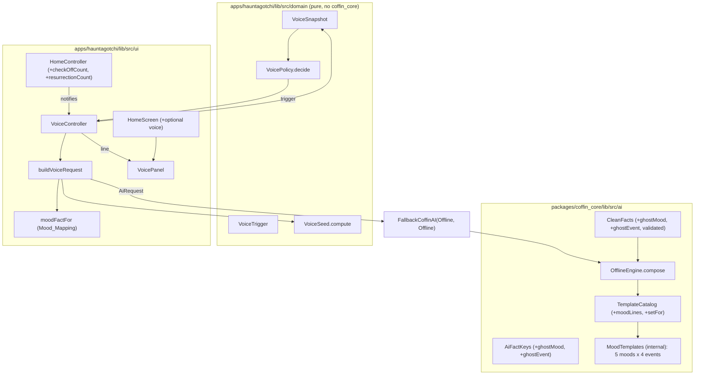

# Design Document: ghost-voice

## Overview

Wisp gets one short line under the ghost. The line comes from `CoffinAI` (`AiPurpose.ghostMoodLine`), offline only, and changes on four triggers only: app open, a check-off, a mood change and a resurrection.

Design summary:

- **`coffin_core` learns two facts and one template group.** `AiFactKeys.ghostMood` and `AiFactKeys.ghostEvent` are read as plain strings by `CleanFacts`. A new internal class `MoodTemplates` holds the copy for 5 moods and 4 events. `TemplateCatalog` gets an optional `moodLines` field. A request without the new facts takes the same code path as today (Requirement 3).
- **No new public export.** The barrel is unchanged. `ai/` stays free of Flutter and does not import `GhostMood`: the fact value is the enum `name`, checked against a fixed list of five strings.
- **Hauntagotchi decides in pure Dart, builds the request in the UI layer.** The Domain_Folder gets `VoiceTrigger`, `VoiceSnapshot`, `VoicePolicy` and `VoiceSeed`, all on `GhostState`, with no Flutter and no `coffin_core` import. `lib/src/ui/` gets the Mood_Mapping, the Voice_Request_Builder, `VoiceController` and `VoicePanel`.
- **Triggers are derived from snapshots, not from call sites.** `VoiceController` listens to `HomeController`, takes a `VoiceSnapshot` on each notification and asks `VoicePolicy.decide(previous, next)`. Saves, retries, renames, archives, adds, rebuilds and no-op refreshes leave the snapshot equal, so they cannot trigger a line (Requirement 6.7 holds by construction, and a test proves it).
- **`HomeController` gets two read-only counters.** `checkOffCount` and `resurrectionCount` rise by one per successful completing toggle and per resurrection. No existing behavior changes.
- **The AI call never blocks.** `VoiceController` asks without `await` from the listener, applies the latest answer only, and falls back to a fixed safe line.

## Research summary

No web research was needed. These facts were read from the code and shape the design.

1. **Engine flow** (`offline_engine.dart`). `compose` picks a `TemplateSet` with `catalog.forPurpose`, builds `CleanFacts`, keeps eligible templates (all count slots filled), keeps the ones that fit `maxLength`, keeps those that use the most facts, then draws one with `SeededRandom(request.seed)`. Recovery steps use the same set. The only change needed is which set is chosen, so the design swaps one line and moves the `CleanFacts.from` line above it.
2. **`CleanFacts`** has a const constructor with optional named fields, so two new optional fields do not break `CleanFacts(...)` calls in `template_catalog_test.dart` and `clean_facts_test.dart`. `TemplateCatalog(...)` is built with three required named sets in `offline_engine_test.dart` and `offline_engine_property_test.dart`, so `moodLines` must be optional.
3. **Banned words.** `TextRules.bannedWords` (gore, blood, kill, murder and others) is checked on the final text. The copy avoids all of them, and the engine tests would catch a slip through the recovery path.
4. **`FallbackCoffinAI`** takes `primary`, `secondary` and a required `timeout`, and throws `AiFallbackError` when both fail.
5. **`HomeController`** notifies several times per action: after the state change, and again for each save status change. `_act` sets `_haunting`, `_welcomeBack` and the reaction, then notifies once before writing. A day change is applied in `_syncDay`, which also notifies. A ritual completion goes through `complete`, so `resurrected` is only set inside `_act`.
6. **`GhostReaction`** exists (`fed`, `rising`) but is null for a check-off that leaves the ghost dead (a ritual step). The voice must also speak then, so it cannot use the reaction as its signal. It uses the new counters.
7. **`SemanticsService.announce` is deprecated** in Flutter 3.47. The design uses `SemanticsService.sendAnnouncement(View.of(context), message, textDirection)`.
8. **Existing guards that bind the design.**
   - `packages/coffin_core/test/ai/ai_sources_test.dart`, test "no app file references the AI API", fails as soon as any file under `apps/*/lib` or `apps/*/test` names an AI type. See flagged item F1.
   - The same file scans `lib/src/ai` for forbidden words (`dart:math`, `package:flutter`, URLs and others), for at most one public class per file, and for imports limited to sibling files. New AI files obey this.
   - `apps/hauntagotchi/test/source_rules/domain_sources_test.dart` checks the Domain_Folder for Flutter, `dart:io`, `DateTime.now`, `Timer` and `coffin_core/src`. It does not check `package:coffin_core`, so a new source-rule test is needed (Requirement 13.2).
   - `generator_rules_test.dart` enforces web-safe generators in the app tests.

## Architecture



Dependency rule check: `domain/` imports nothing from `ui/` or `coffin_core`. `ui/` imports `domain/` and `package:coffin_core/coffin_core.dart`. `coffin_core` imports nothing from the app.

## Components and Interfaces

### coffin_core

**`AiFactKeys`** (edit). Adds `ghostMood = 'ghostMood'` and `ghostEvent = 'ghostEvent'`, each with a doc comment that lists the accepted values.

**`CleanFacts`** (edit). Adds optional `String? ghostMood` and `String? ghostEvent`. `CleanFacts.from` sets each only when the value is a `String` that equals, exactly, one of:

- moods: `thriving`, `content`, `hungry`, `fading`, `dead`
- events: `appOpened`, `checkedOff`, `moodChanged`, `resurrected`

Anything else (null, a number, `fed`, `rising`, a different case, extra spaces) is absent. The valid names are two `static const List<String>` on `CleanFacts`, so the template tests and the clean-facts tests share one list. The existing four fields keep their rules byte for byte.

**`MoodTemplates`** (new, internal, `mood_templates.dart`).

```dart
final class MoodTemplates {
  MoodTemplates(Map<String, TemplateSet> sets);        // keys: 'hungry' and 'hungry/checkedOff'
  static final MoodTemplates standard = ...;           // the shipped copy
  TemplateSet setFor(String mood, String? event);      // event set, else the mood set
}
```

The constructor throws `StateError` unless each of the five moods has a base set (key `mood`), so a valid mood always yields a set. `setFor` returns `sets['$mood/$event']` when it exists, otherwise `sets[mood]`. Every set carries a mood-specific `safeLine`, so requirement 2.6 holds: an empty eligible pool gives a warm safe line, never an empty string.

Set sizes (`standard`): each of the 20 mood/event cells has at least 5 templates, of which at least 3 have no count slot (always eligible). Each mood has a base set of at least 3 templates without a count slot, for requests that carry a mood but no event. Only `thriving` and `content` use `{streakCount:day/days}`. `hungry`, `fading` and `dead` never count days (Requirement 4.3). At most one name slot per template. Authoring budget: literal text of 40 characters or fewer when the template holds a name slot, so the worst case (40-character name) is 80 characters. A template with a count slot and a name slot keeps its literal text to 28 characters or fewer. The test renders every template with the worst case facts (Requirement 2.5).

**`TemplateCatalog`** (edit).

```dart
TemplateCatalog({required ghostMoodLine, required seanceVerdict, required generic, this.moodLines});
final MoodTemplates? moodLines;
TemplateSet setFor(AiPurpose purpose, CleanFacts facts) =>
    purpose.id == 'ghost_mood_line' && facts.ghostMood != null && moodLines != null
        ? moodLines!.setFor(facts.ghostMood!, facts.ghostEvent)
        : forPurpose(purpose);
```

`standard` passes `MoodTemplates.standard`. The three existing sets and `forPurpose` do not change.

**`OfflineEngine.compose`** (edit, two lines). `CleanFacts.from(request.facts)` moves above the set choice, and `catalog.forPurpose(request.purpose)` becomes `catalog.setFor(request.purpose, facts)`. Everything below is untouched. For a request without a valid Mood_Fact, `setFor` returns `forPurpose`, so the pool, the order, the seed draw and the recovery steps are the same as before.

### Hauntagotchi domain (pure Dart)

**`VoiceTrigger`** (`voice_trigger.dart`): `enum VoiceTrigger { appOpened, checkedOff, moodChanged, resurrected }`. The `name` is the Event_Fact value. A unit test pins the four names, because they are a contract with `coffin_core`.

**`VoiceSnapshot`** (`voice_snapshot.dart`): immutable value with `GhostState? state` (null while the home screen is not ready), `int checkOffs`, `int resurrections`, plus `==` and `hashCode`.

**`VoicePolicy`** (`voice_policy.dart`):

```dart
static VoiceTrigger? decide(VoiceSnapshot? previous, VoiceSnapshot next) {
  if (next.state == null) return null;                                   // not ready
  if (previous == null || previous.state == null) return VoiceTrigger.appOpened;
  if (next.resurrections > previous.resurrections) return VoiceTrigger.resurrected;
  if (next.checkOffs > previous.checkOffs) return VoiceTrigger.checkedOff;
  if (next.state != previous.state) return VoiceTrigger.moodChanged;
  return null;
}
```

The order of the `if` lines is the priority of Requirement 6.6. A resurrection also raises `checkOffs`, and `resurrected` wins. A reload after a load error goes through `loading` and back to `ready`, so it counts as an open.

**`VoiceSeed`** (`voice_seed.dart`):

```dart
static const int _modulus = 4294967291;   // largest prime below 2^32
static const int _base = 1000003;
static int compute({required int epochDay, required GhostState state, required VoiceTrigger trigger,
                    required int streak, required int completedToday}) {
  var h = 17;
  for (final v in <int>[epochDay, state.index, trigger.index, streak, completedToday]) {
    h = (h * _base + _fold(v)) % _modulus;
  }
  return h;
}
static int _fold(int v) => ((v % _modulus) + _modulus) % _modulus;   // JS-safe for negatives
```

Web safety: `h < 2^32` and `_base < 2^20`, so `h * _base < 2^52` and the sum stays below 2^53. Only `+ * %` and comparisons are used. The result is in `0..4294967290`, inside `AiRequest.maxSeed`. Changing one input by `d` changes `h` by `d * _base^k` modulo a prime, which is zero only when `d` is a multiple of the modulus, so a single changed input always changes the seed in the tested ranges. `state.index` and `trigger.index` depend on enum order, so a unit test pins the order and a few known seeds.

### Hauntagotchi UI

**`moodFactFor(GhostState)`** (`mood_fact.dart`): `moodFor(state).name`. It reuses `moodFor`, so the Mood_Mapping has one source of truth. A test checks the five states and that the result is always one of the five accepted values.

**`buildVoiceRequest`** (`voice_request.dart`):

```dart
AiRequest buildVoiceRequest({required VoiceTrigger trigger, required GhostState state,
    required int streak, required int completedToday, required String ghostName, required int epochDay}) =>
  AiRequest(
    purpose: AiPurpose.ghostMoodLine,
    facts: {
      AiFactKeys.ghostMood: moodFactFor(state),
      AiFactKeys.ghostEvent: trigger.name,
      if (streak >= 1) AiFactKeys.streakCount: streak,
      AiFactKeys.ghostName: ghostName,
    },
    maxLength: 80,
    seed: VoiceSeed.compute(...),
  );
```

`streak` is `Haunting.streak`. `completedToday` is `Haunting.book.completedCountOn(haunting.today)`. `epochDay` is `haunting.today.epochDay`. No habit name enters the request.

**`defaultVoiceAi()`** (`voice_ai.dart`): `FallbackCoffinAI(primary: const OfflineCoffinAI(), secondary: const OfflineCoffinAI(), timeout: Duration(seconds: 2))`. Both sides are offline, as decision 1 asks. The wrapper still earns its place: it shields against a throwing or slow primary, and a hosted model would later replace only `primary`.

**`VoiceController`** (`voice_controller.dart`, `ChangeNotifier`).

```dart
VoiceController({required HomeController home, CoffinAI? ai, Duration askTimeout = const Duration(seconds: 4)});
String? get line;                         // null until the first answer
VoiceAnnouncement? get announcement;      // set only for checkedOff / resurrected with a new text
void dispose();
```

Behavior:

1. The constructor adds a listener to `home` and runs it once, so a controller built on an already-ready home asks for `appOpened`.
2. The listener builds a `VoiceSnapshot` (`state` from `home.haunting?.state` when `home.status == ready`, counters from the home controller) and calls `VoicePolicy.decide(_last, snapshot)`. It then stores the snapshot. A null decision ends the call.
3. On a trigger it increments a generation counter, builds the request from `home.haunting` and calls `_ask` without awaiting.
4. `_ask` runs `ai.ask(request).timeout(askTimeout)` inside `try`. It accepts the reply only when `reply.isUsableFor(request)`. Any other result (throw, timeout, blank, over-long) uses `VoiceCopy.safeLine`.
5. After the await, if the controller is disposed or the generation changed, the answer is dropped (Requirement 6.8).
6. If the new text equals the current line, nothing changes and nobody is notified. Otherwise `_line` is set and listeners are notified. For `checkedOff` and `resurrected` the controller also sets `announcement` with a new key.
7. While waiting, `line` keeps its old value, so the panel shows the previous line or the safe line and never a spinner.

`VoiceController` never calls a method that writes on `HomeController`, so storage writes and home state are the same with and without it (Requirement 9.6).

**`VoicePanel`** (`voice_panel.dart`, `StatefulWidget`): takes the controller and the ghost name.

- Builds with `ListenableBuilder(listenable: controller)`. The text is `controller.line ?? VoiceCopy.safeLine`.
- Semantics: `Semantics(label: '<ghostName> says: <line>', child: ExcludeSemantics(child: Text(line)))`. It is not a button, has no tap handler, takes no focus and is not a live region.
- Look: `DecoratedBox` with a 16 px radius, the theme's surface container color, a soft glow (`BoxShadow` with the primary color at low alpha and a large blur radius), 16 px padding, body text style, centered. No `maxLines`. Colors come from `Theme.of(context)`, so contrast follows the theme tokens in both modes.
- Motion: when `MediaQuery.disableAnimationsOf(context)` is true the panel returns the plain `Text` with no `AnimatedSwitcher`, so nothing is scheduled. Otherwise it wraps the text in an `AnimatedSwitcher` (450 ms, `Curves.easeInOut` in and out, `FadeTransition`, keyed by the line). The first child does not animate, there is no loop, no typing effect and no per-character animation.
- Announcements: the state listens to the controller and remembers the last announcement key it handled (initialized from the current value, so a rebuild or a route change never repeats one). When a new key arrives and `MediaQuery.accessibleNavigationOf(context)` is true, it calls `SemanticsService.sendAnnouncement(View.of(context), text, Directionality.of(context))` once. Nothing is announced on app open or on a mood change.

**`HomeController`** (edit, additive). Two private counters with getters `checkOffCount` and `resurrectionCount`. `_resurrections++` goes inside the existing `if (resurrected)` block of `_act`. `_checkOffs++` is done by a new optional `onChanged` callback of `_act`, which `toggle` passes (it counts only when `completing` is true). Both increments happen before the existing `_notify()`. No other line changes.

**`HomeScreen`** (edit). New optional parameter `VoiceController? voice`. When it is not null, `_buildReady` inserts `VoicePanel` directly after `GhostPanel`. `buildAppRoutes` gets the same optional parameter and passes it on. With `voice == null` (every existing test) the screen is built exactly as before.

**`HauntagotchiApp`** (edit). New optional parameter `CoffinAI? ai`. `initState` creates `VoiceController(home: widget.controller, ai: widget.ai ?? defaultVoiceAi())` before `load()`, and `dispose` disposes it. `main()` stays unchanged. `HomeController` gets no new required parameter (Requirement 5.4).

## Data models

| Value | Type | Where | Rule |
|---|---|---|---|
| `VoiceTrigger` | enum, 4 values | domain | `name` is the Event_Fact |
| `VoiceSnapshot` | immutable value | domain | `state == null` means not ready |
| Voice_Seed | `int`, `0..4294967290` | domain | five inputs, `+ * %` only |
| Mood_Fact | `String` | request | one of five names |
| Event_Fact | `String` | request | one of four names |
| `VoiceAnnouncement` | `({int key, String text})` | ui | set only for check-off and resurrection |

## Sample copy (tone check)

The full copy is written in the template task under Requirement 4. One sample per cell shows the tone. `{name}` is the ghost name slot.

Copy rules (Requirement 4.8 and 4.9):

- **Plain characters only.** Every character of a template or safe line is printable ASCII or the ellipsis U+2026. No emoji, because offline web may draw it as an empty box and a screen reader reads its name.
- **Streaks carry their unit.** The only count slot is `{streakCount:day/days}`. The existing slot already picks "day" for 1 and "days" for 2 or more, and the parser rejects a count slot without nouns, so a bare number cannot be written. A test renders every streak template for 1 and for 2 or more and checks the digit run is followed by the right noun (for example "1 day so far", "3 days so far", never "1 days" or "3 and counting").

| Mood | appOpened | checkedOff | moodChanged | resurrected |
|---|---|---|---|---|
| thriving | `{name} is glowing. {streak} in a row.` | `Yum. {name} hums in the moonlight.` | `{name} is glowing again, bright as the moon.` | `{name} is back and shining!` |
| content | `The mist is calm. {streak} so far.` | `A little glow for {name}. Thank you.` | `{name} settles in, content.` | `{name} is back. Welcome home.` |
| hungry | `{name} is peckish. One tick will do.` | `Crumbs of light. {name} perks up.` | `{name} could use a snack, no rush.` | `{name} is back. Soft landing.` |
| fading | `{name} waits by the window. Whenever you are ready.` | `A spark! {name} drifts closer.` | `{name} is a little pale. A tick helps.` | `{name} is back. The mist cheers.` |
| dead | `The ritual waits. {name} believes in you.` | `One step closer. The candles flicker.` | `The crypt is quiet. The ritual awaits.` | `It worked! {name} floats free!` |

`{streak}` is the slot `{streakCount:day/days}` and renders "1 day" or "3 days". No sample holds an emoji.

## Decisions

- **D1. Two facts, strings.** The mood and event travel as the `name` of an enum, validated against fixed lists, so `ai/` needs no Flutter and no new export.
- **D2. Mood templates live in a separate group, not in the existing set.** The old eight lines stay untouched and used only for legacy requests (Requirement 3.5).
- **D3. The snapshot decides, call sites do not.** One pure function covers all six trigger rules and the "no trigger" rule. The alternative (calling the voice from `toggle`, `load` and `_syncDay`) needs a call at each place and misses new paths.
- **D4. Counters on `HomeController` instead of reading `GhostReaction`.** The reaction is null for a ritual step that leaves the ghost dead, and the voice must speak then.
- **D5. Optional `voice` parameter instead of a new required one.** Existing tests build `HomeScreen(controller:)` and stay unchanged.
- **D6. Latest answer wins.** A generation counter drops stale answers, so a slow first line cannot overwrite the line for a later check-off.
- **D7. Announce only with a screen reader on.** `accessibleNavigation` gates the call, so nothing is sent to the platform when no assistive technology runs.
- **D8. One `Text`, plain fade.** A typing effect fights screen readers and Reduced_Motion. A 450 ms cross-fade is the only motion.

## Correctness properties

1. **Legacy equality.** For any request without a valid Mood_Fact and without a valid Event_Fact, `OfflineEngine.standard.compose` equals the engine built from a frozen copy of the old catalog (same text, same path). Also pinned by a baseline table recorded before the edit.
2. **Invalid facts are absent.** For any mood or event value that is not exactly one of the accepted strings, the text equals the text of the same request without that fact.
3. **Mood lines are well formed.** For every mood, event (or none), seed in range, streak (or none) and name (or none): the text is non-empty, at most 80 characters, with no line break.
4. **Determinism.** The same request gives the same text twice.
5. **Mood fit.** With a valid mood, the text comes from that mood's templates or its safe line, never from another mood (checked by building the allowed text set per mood).
6. **Seed range and web safety.** `VoiceSeed.compute` is in `0..4294967290`, and every intermediate value stays below 2^53 for inputs in the generator ranges.
7. **Seed sensitivity.** Changing one of the five inputs changes the seed for at least 99 percent of generated pairs (expected: all).
8. **Seed stability.** The same five inputs give the same seed.
9. **Trigger count.** Over generated sequences of snapshots, `decide` returns a trigger exactly when the snapshot is the first ready one, or a counter rose, or the state changed. Equal consecutive snapshots never trigger.
10. **Priority.** When a resurrection, a check-off and a state change occur together, `decide` returns `resurrected`. Without a resurrection it returns `checkedOff`.
11. **Mood mapping totality.** `moodFactFor` maps all five states to five distinct accepted names.
12. **Request shape.** `buildVoiceRequest` always has purpose `ghostMoodLine`, `maxLength` 80, a seed in range, no `streakCount` when the streak is 0, and no key other than the four allowed ones.

## Error handling

| Case | Result |
|---|---|
| AI throws, returns blank or over-long text | safe line (`VoiceCopy.safeLine`), no error shown |
| AI never answers | after `askTimeout` the safe line is shown |
| Answer arrives after a newer trigger | dropped |
| Answer arrives after dispose | dropped, no `notifyListeners` |
| Invalid or missing facts in the request | engine treats them as absent |
| Ghost name holds a banned word | `CleanFacts` drops the name, the template uses its default |
| Home screen not ready or load error | no trigger, panel shows nothing new |
| No screen reader | no announcement call |

## Testing strategy

Pure logic gets unit tests and glados property tests with web-safe generators only (integer ranges below 2^32, `bool`, enum choices, strings from a fixed alphabet, no `double`).

`packages/coffin_core/test/ai/` (new files; support files only gain additions):

- `mood_facts_test.dart`: `AiFactKeys` values, `CleanFacts` validation table (valid, wrong case, `fed`, `rising`, number, null, spaces).
- `mood_templates_test.dart`: 5 by 4 coverage, set sizes, always-eligible count, length with worst-case facts, one line, no banned word (library list and a test-owned shame/gore list), warm safe lines, the streak words only in `thriving` and `content`, ASCII-or-ellipsis characters only (no emoji) in every pattern, safe line and rendered line, and streak grammar for 1 and for 2 or more.
- `mood_engine_test.dart` and `mood_engine_property_test.dart`: properties 2 to 5.
- `legacy_equality_test.dart` and `legacy_equality_property_test.dart`: property 1, with a frozen baseline table.

`apps/hauntagotchi/test/`:

- `domain/voice_policy_test.dart`, `voice_policy_property_test.dart` (9, 10), `voice_seed_test.dart`, `voice_seed_property_test.dart` (6 to 8), `voice_trigger_test.dart`.
- `ui/mood_fact_test.dart` (11), `voice_request_test.dart` (12 and the streak 0, 1, large cases), `voice_controller_test.dart`, `voice_controller_session_test.dart` (scripted day with several check-offs, a mood change, a resurrection), `voice_panel_test.dart`, `voice_panel_a11y_test.dart`, `home_screen_voice_test.dart`.
- `source_rules/voice_domain_sources_test.dart`: no `package:coffin_core`, `package:flutter`, `dart:ui` in the Domain_Folder.

Widget and controller tests cover: one AI call per trigger and none on rebuild, save, save retry, rename, archive, add, no-op refresh, same-mood undo, route change and resize; slow AI and throwing AI (scripted); disposed with a request in flight; same home state and writes with and without the voice; Reduced_Motion on and off (`tester.hasRunningAnimations` is false after a line change, no `AnimatedSwitcher`); the semantics label with and without a ghost name; announcement count over 10 check-offs, read from a fake handler on `SystemChannels.accessibility`; no overflow at 320, 360 and 1280 with text scale 2.0.

The final task runs `flutter test` in `packages/coffin_core`, `apps/hauntagotchi`, `apps/graveyard` and `tool`, plus `dart format` and `flutter analyze`, and checks `git diff --exit-code` on all `pubspec.yaml` files and `pubspec.lock`.

## Flagged items for your review

- **F1. The expired AI guard is replaced by the lasting rule (approved).** `ai_sources_test.dart` has the test "no app file references the AI API". It scans every app's `lib` and `test` and fails when a file names an AI type. It was written when no app used the AI layer, and it expires with this feature (Graveyard uses the AI next). It is not narrowed to Graveyard. It is replaced, as the storage tests already do, by the rule that apps use the AI API only through `package:coffin_core/coffin_core.dart` and never through `package:coffin_core/src/`. The new test scans `lib` and `test` of every app (Hauntagotchi and Graveyard), reports each offending `import` or `export` as `file:line`, and has a self-check with a bad and a good sample. The helpers that only the old test used (`_aiApiNames`, `_aiNamesIn`) and their self-check lines are removed so that `flutter analyze` stays clean. The test "app pubspecs do not mention the AI layer" stays. This is the only existing test edited, apart from the Requirement 10.6 list.
- **F2. Requirement 10.2 amended.** "At most 3 lines" cannot hold: 80 characters at text scale 2.0 on a 320 px screen needs about 5 lines. The requirement now says the text wraps without overflow and is never cut.
- **F3. Web_Safe bound (accepted).** The seed multiplies a value below 2^32 by about 2^20, so intermediates reach 2^52. The glossary bound is 2^53, which is exact in JavaScript numbers. In addition, no bitwise operator touches a value of 2^31 or more, because JavaScript bitwise operators truncate to 32 bits. `VoiceSeed` uses no bitwise operator at all. The engine's existing `SeededRandom` masks to 32 bits itself and is not changed.
- **F4. Consecutive check-offs.** The seed differs for each check-off (the completed count changes), but the line is drawn from a pool of 5 or more, so two consecutive lines can still match with probability about 1 in 5. Forcing a difference would make the line depend on history, which breaks "same situation, same line after a restart". Requirement 7.4 is tested on the seed, and on the line only through set membership.
- **F5. Offline on both sides of the fallback.** `primary` and `secondary` are both `OfflineCoffinAI`, as decision 1 states. The wrapper adds the timeout and exception shield. The controller adds its own timeout and a fixed safe line for a custom injected AI.
- **F6. Check-off while dead.** A ritual step that leaves Wisp dead counts as `checkedOff`, with mood `dead`, so Wisp encourages the ritual. The announcement rule applies to it as to any check-off.
- **F7. Panel position.** `VoicePanel` sits directly after `GhostPanel`, as its own widget, so `GhostPanel` semantics and tests stay untouched. Because `voice` is optional, no existing home screen test should need an edit. `app_routes_test.dart` builds `HauntagotchiApp`, which now creates a voice panel. If a finder there breaks, the design lists the fix under Requirement 10.6 at that task.
