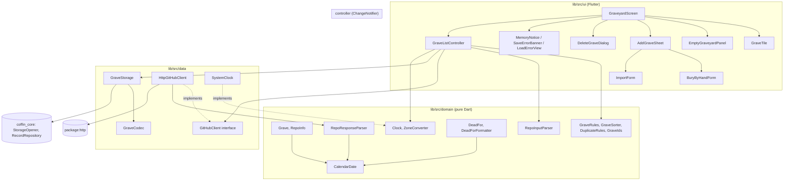
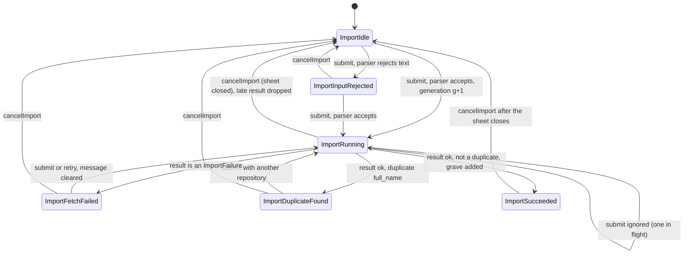
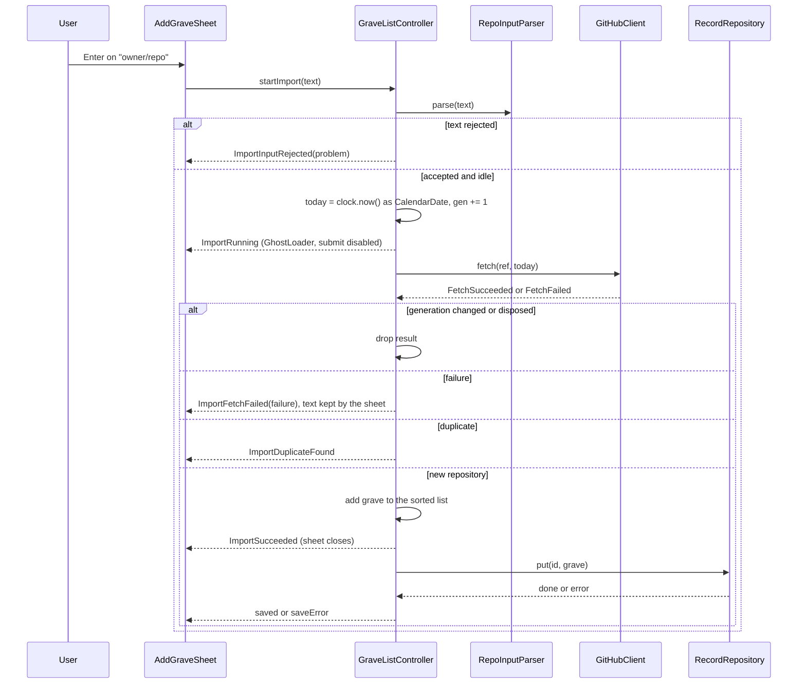
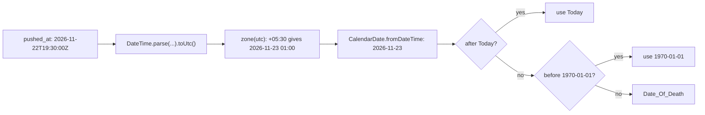

# Design Document: graveyard-core

## Overview

This feature builds the core loop of Graveyard in `apps/graveyard`. The user buries abandoned side projects as tombstones. Each tombstone shows the project name, the date of death, and how long the project has been dead. A grave is added in one of two ways: by hand (a name and the date the project was last worked on), or by importing a public GitHub repository, whose last push becomes the date of death. Everything happens on one screen at `/`. The animated scene, the AI séance and the resurrection belong to later specs.

Outside `apps/graveyard/lib` and `apps/graveyard/test`, the feature makes exactly these edits (Requirement 16.1):

| # | File | Edit |
| --- | --- | --- |
| 1 | `apps/graveyard/pubspec.yaml` | two added lines: `http: 1.6.0` under `dependencies`, `glados: 1.1.7` under `dev_dependencies` |
| 2 | `pubspec.lock` (root) | one added package entry, `http` 1.6.0 (8 lines, exact diff below) |
| 3 | `CREDITS.md` | one added entry for `http` |
| 4 | `.github/workflows/deploy-web.yml` | two added steps: "Analyze graveyard" and "Test graveyard" |

Nothing changes in `packages/coffin_core`, `apps/hauntagotchi`, `tool/` or `tool/templates`.

### Design principles

- **Rules are pure Dart.** Every rule lives in `lib/src/domain`, which imports no Flutter library, no `dart:io`, no `dart:html`, no `package:http` and no `package:hive_ce`. Widgets show values and forward taps.
- **Dates are calendar values, not durations.** A `CalendarDate` is year, month and day. Day counts and month counts use integer calendar arithmetic and never a `Duration`, so daylight saving cannot move a day.
- **One local calendar.** Today comes from the injected `Clock` (local time). A GitHub `pushed_at` is converted through the injected `ZoneConverter` before its year, month and day are read. Both sides of "dead for N days" are therefore on the same calendar.
- **Time and network are injected.** Only `SystemClock` calls `DateTime.now()`. Only `HttpGitHubClient` imports `package:http`. Tests inject `FakeClock`, `FakeGitHubClient` and a fixed-offset zone converter, so no test depends on the machine's time zone or the network.
- **Errors are values.** The GitHub client and both parsers never throw. Every failure is an `ImportFailure` or a typed rejection, and every failure has a short, kind message.
- **One owner for the state.** `GraveListController` owns the list, the saving state and the import state machine. Widgets never call the GitHub client or the repository.

### Decisions that were open

| Topic | Decision | Reason |
| --- | --- | --- |
| `http` version | `1.6.0`, exact pin, no caret | Latest stable release on pub.dev (published 2025-11-10), supports `sdk: ^3.4.0`, and it is already in the pub cache, so `pub get` works offline. |
| `glados` | `1.1.7` | Approved. Same version as `coffin_core` and Hauntagotchi, already in the lock. |
| Grave repository type | `RecordRepository<Grave>` from `coffin_core`. Persistent: `StorageOpener.open`. Memory: `MemoryRecordRepository<Grave>`. | `coffin_core` already ships both. A second interface would only wrap them. |
| Ids | `g1`, `g2`, ... the smallest number not used by a loaded grave | Deterministic, a valid storage key, no random source. |
| GitHub client signature | `fetch(RepoRef ref, {required CalendarDate today})` | The parser needs Today for the clamp (Req 4.12). The controller reads Today from the Clock at the time of the import (Req 8.11). |
| Rate-limit reset | `Retry-After` wins over `x-ratelimit-reset` when both exist | Relative seconds do not depend on the device clock being right. |
| Add sheet | Modal bottom sheet with a two-option selector | Mobile first, works as a centered sheet on wide screens. |
| Delete control | A visible button below each tombstone, outside the tombstone | The tombstone keeps one clean semantic label (Req 14.3). |
| Epitaph | The Dead_For_Text, shown only while the text scale is at most 1.2 | The engraved line is one line and decorative. At large scales the same words are in the body. |

## Research summary

Facts read from the repository, from the live API and from the Hauntagotchi design. They shape the design.

1. **Storage API** (`packages/coffin_core/lib/src/storage`). `StorageOpener({required initializer, openStore, reportIssue})` has `Future<OpenedRepository<T>> open<T>({required boxName, required codec, required currentVersion, location, migrate, repositoryIssues})`. It never throws and falls back to a `MemoryRecordRepository` with `isPersistent` false. `OpenedRepository<T>` has `repository` and `isPersistent`. `RecordRepository<T>` has `get`, `getAll`, `put(key, record)`, `delete`, `clear`, `watch`, `close`. `getAll` skips entries whose codec throws and reports an issue. `RecordCodec<T>` has `JsonMap encode(T)` and `T decode(JsonMap)`. `MemoryRecordRepository({required codec, required currentVersion, seed, migrate, reportIssue})` accepts raw envelope text in `seed`, which the corrupt-entry tests use. Keys are ASCII, 1 to 255 characters.
2. **Initializer.** `hiveFlutterInitializer([String? subDir])` is exported. Hauntagotchi calls it with `'hauntagotchi'`. Graveyard calls it with `'graveyard'` so both apps can share an origin without sharing boxes.
3. **Barrel exports used here.** `TombstoneCard`, `GhostLoader`, `FogBackground`, `FogRouter`, `AppRoute`, `GoRouter`, `NotFoundPage`, `CoffinTheme`, `CoffinColorTokens`, `CoffinGlow`, `CoffinMetrics`, `StorageOpener`, `StorageInitializer`, `OpenedRepository`, `RecordRepository`, `RecordCodec`, `MemoryRecordRepository`, `JsonMap`, `KeyValidator`, `hiveFlutterInitializer`. The app imports nothing from `coffin_core/lib/src`.
4. **`TombstoneCard`** (`widgets/tombstone_card.dart`). Constructor: `TombstoneCard({key, required String title, String? dateLine, Widget? child, VoidCallback? onTap, String? semanticLabel, bool showEpitaph = true, String epitaph = 'R.I.P.'})`. At most 300 px wide, centered. With a `child` it is at least 1.2 times as tall as wide. The title shows 3 lines at most, the date line 2 lines at most. The epitaph is one line (font size 20, scaled by the text scaler), excluded from semantics. `semanticLabel` and focus handling apply only when `onTap` is set. The card scrolls its own content (`SingleChildScrollView`), so it never throws a layout overflow, and in a list its height is unbounded and it grows with the content.
5. **`GhostLoader`** (`widgets/ghost_loader.dart`). `GhostLoader({size = 64, caption, bobPeriodMs, bobAmplitude, mood, reactionKey, onReactionEnd})`. One live-region semantics node labelled with `caption` (or "Loading"). Still frame under `MediaQuery.disableAnimations`.
6. **Routing.** `FogRouter.create({required List<AppRoute> routes, initialLocation = '/', notFoundBuilder, observers, debugLogDiagnostics})` returns a `GoRouter`. `AppRoute({required path, required builder, name, routes, duration})`. `lib/src/ui/app_routes.dart` currently holds a global `appRoutes` with one route (`/`, name `home`) that builds `PlaceholderScreen`. `main.dart` has a `const GraveyardApp()` that builds the router in `State` and uses `CoffinTheme.dark()`.
7. **Theme.** `CoffinTheme.dark()` and `light()` return `ThemeData` built from `CoffinColorTokens`. `CoffinMetrics.minTapTarget` is 48, `cornerRadius` 16, `focusRingWidth` 2. The app reads colors only through `Theme.of(context).colorScheme` and `CoffinGlow.decoration(color:, intensity:, fill:)`.
8. **Live API check (2026-11-23, curl with an `Origin` header).** `GET https://api.github.com/repos/octocat/Hello-World` answers `access-control-allow-origin: *`, and `access-control-expose-headers` lists `Retry-After`, `X-RateLimit-Remaining` and `X-RateLimit-Reset`. The browser can therefore read the rate-limit headers (Req 7.9, 7.10). `Accept` is a CORS-safelisted request header, so the request needs no preflight. The client sets no other header, and in particular not `X-GitHub-Api-Version` or `User-Agent`, because those would make the browser block or preflight the call.
9. **`http` 1.6.0.** Dependencies: `async ^2.5.0`, `http_parser ^4.0.0`, `meta ^1.3.0`, `web >=0.5.0 <2.0.0`. The root lock already holds `async` 2.13.1, `http_parser` 4.1.2, `meta` 1.19.0 and `web` 1.1.2, so `http` is the only package the lock gains. `package:http/testing.dart` (`MockClient`) is part of the same package and runs on web. On web, `http.Client()` is the browser client.
10. **glados 1.1.7 on web.** `any.intInRange` and `any.listWithLengthInRange` throw in Chrome. The Hauntagotchi design solves this with local generators on `any.simple` and `Random.nextInt` for ranges below 2^32. Graveyard keeps its own copy under `test/domain/support/`, because an app may not import `coffin_core` test code.
11. **Existing Graveyard files that change.** `lib/main.dart`, `lib/src/ui/app_routes.dart`, `lib/src/ui/placeholder_screen.dart` (removed), `test/ui/app_routes_test.dart` (updated), `test/ui/placeholder_screen_test.dart` (removed), `lib/src/domain/.gitkeep` and `lib/src/data/.gitkeep` (removed).

## Architecture



### Import state machine

The controller owns one `ImportState`. A generation counter tags each attempt, so a result that arrives after the sheet closed or after disposal is dropped.



Disposal is a separate flag, not a state. After `dispose()` a late result is dropped and `notifyListeners` is never called (Req 8.10).

### Data flow of one import



The grave is shown as soon as it is added in memory. "Saved" is reported only after the write finishes (Req 10.9).

### Folder layout

```
apps/graveyard/lib/
├── main.dart                       wiring only
└── src/
    ├── domain/    calendar_date.dart, clock.dart, zone_converter.dart, name_rules.dart,
    │              grave_source.dart, repo_info.dart, grave.dart, grave_rejection.dart,
    │              manual_grave_check.dart, manual_grave_accepted.dart, manual_grave_rejected.dart,
    │              grave_rules.dart, grave_sorter.dart, grave_ids.dart, duplicate_rules.dart,
    │              repo_ref.dart, repo_parse_problem.dart, repo_parse_result.dart,
    │              repo_parsed.dart, repo_parse_failed.dart, repo_input_parser.dart,
    │              import_failure_kind.dart, import_failure.dart, fetched_repo.dart,
    │              fetch_result.dart, fetch_succeeded.dart, fetch_failed.dart,
    │              repo_response_parser.dart, rate_limit_wait.dart,
    │              dead_for_unit.dart, dead_for.dart, dead_for_formatter.dart
    ├── data/      system_clock.dart, grave_codec.dart, grave_storage.dart,
    │              github_client.dart, http_github_client.dart
    └── ui/        app_routes.dart, grave_list_controller.dart, grave_list_status.dart,
                   save_status.dart, import_state.dart, import_idle.dart, import_running.dart,
                   import_input_rejected.dart, import_fetch_failed.dart,
                   import_duplicate_found.dart, import_succeeded.dart,
                   graveyard_screen.dart, grave_tile.dart, add_grave_sheet.dart,
                   add_mode.dart, bury_by_hand_form.dart, import_form.dart,
                   delete_grave_dialog.dart, empty_graveyard_panel.dart, memory_notice.dart,
                   save_error_banner.dart, load_error_view.dart, graveyard_copy.dart
apps/graveyard/test/                mirrors lib; test/support/ holds FakeClock, FakeGitHubClient,
                                    ThrowingRecordRepository, FixedOffsetZone and a controller helper;
                                    test/domain/support/ holds the web-safe generators;
                                    test/source_rules/ holds every test that reads files with dart:io;
                                    test/domain and test/data never import dart:io
```

Removed: `lib/src/ui/placeholder_screen.dart`, `test/ui/placeholder_screen_test.dart`, `lib/src/domain/.gitkeep`, `lib/src/data/.gitkeep`.

## Components and Interfaces

All public APIs get a doc comment (Req 15.10). One public class per file; enums, typedefs and the members of a sealed family each get a file, as in Hauntagotchi.

### Domain

**`CalendarDate`** (immutable, `Comparable<CalendarDate>`, value equality)

```dart
final class CalendarDate implements Comparable<CalendarDate> {
  const CalendarDate._(this.year, this.month, this.day);
  factory CalendarDate(int year, int month, int day);        // throws ArgumentError unless a real date, year 1..9999
  static CalendarDate? tryCreate(int year, int month, int day); // null unless a real date
  factory CalendarDate.fromDateTime(DateTime dateTime);       // reads year, month, day only
  factory CalendarDate.fromEpochDay(int epochDay);
  static CalendarDate? tryParse(String iso);                  // strict 'YYYY-MM-DD', real dates only
  static final CalendarDate earliest = CalendarDate(1970, 1, 1);
  final int year, month, day;
  int get epochDay;                                           // days since 1970-01-01
  int get daysInMonth;
  bool get isLastDayOfMonth;
  CalendarDate addDays(int n);                                // n may be negative
  CalendarDate addMonthsClamped(int n);                       // day clamped to the target month's length
  int daysUntil(CalendarDate other);                          // other.epochDay - epochDay
  int wholeMonthsUntil(CalendarDate later);                   // whole months per Req 5.7, 0 when later is not after
  String toIso();                                             // 'YYYY-MM-DD'
}
```

`epochDay` uses the integer "days from civil" algorithm (400-year eras of 146,097 days). `fromEpochDay` is its inverse. A `DateTime` is touched only in `fromDateTime`, and only for its three calendar fields. All integers stay far below 2^53.

`wholeMonthsUntil(later)`: let `m = (later.year - year) * 12 + (later.month - month)`. If `later.day >= day`, or `later.isLastDayOfMonth && day > later.daysInMonth`, the result is `m`. Otherwise it is `m - 1`. A negative result becomes 0. This is exactly Req 5.7.

**`Clock`**: `abstract interface class Clock { DateTime now(); }` (local time).

**`ZoneConverter`**: `typedef ZoneConverter = DateTime Function(DateTime utc);`. The production default is `(utc) => utc.toLocal()`, named `localZone`. Tests inject `FixedOffsetZone(Duration offset)` from `test/support/`, whose `call` is `utc.add(offset)`. The result is only read for year, month and day, so the `isUtc` flag does not matter.

**`NameRules`**

```dart
abstract final class NameRules {
  static const int maxLength = 80;
  static String normalize(String raw);          // trim, collapse every whitespace run to one space
  static int length(String normalized);         // code points: runes.length
  static String keyOf(String raw);              // normalize(raw).toLowerCase(), used for duplicates
  static String forRepo(String fullName);       // Project_Name for an import, see "Names of imported graves"
}
```

Whitespace is the Unicode `\s` class (`RegExp(r'\s+')`).

**`GraveSource`** (enum): `manual`, `github`.

**`RepoInfo`** (immutable): `const RepoInfo({required String fullName, String? htmlUrl, String? description, bool archived = false, int stars = 0})`, value equality.

**`Grave`** (immutable, value equality)

```dart
final class Grave {
  factory Grave.manual({required String id, required String name, required CalendarDate dateOfDeath});
  factory Grave.github({required String id, required String name, required CalendarDate dateOfDeath, required RepoInfo repo});
  final String id;
  final String name;                // normalised, 1..80 code points
  final CalendarDate dateOfDeath;
  final GraveSource source;
  final RepoInfo? repo;             // non-null exactly when source is github
}
```

**`GraveRejection`** (enum): `nameEmpty`, `nameTooLong`, `dateMissing`, `dateNotReal`, `dateInFuture`, `dateTooEarly`, `duplicate`.

**`GraveRules`**

```dart
abstract final class GraveRules {
  /// Checks a by-hand grave. The date arrives as parts so that an impossible date such as 2025-02-30 is rejected, not shifted.
  static ManualGraveCheck checkManual({
    required String rawName, required int? year, required int? month, required int? day,
    required CalendarDate today,
  });
}
```

Order of checks: name empty, name too long, date missing (any part null), date not real, date before `CalendarDate.earliest`, date after `today`. `ManualGraveCheck` is sealed: `ManualGraveAccepted(String name, CalendarDate dateOfDeath)` or `ManualGraveRejected(GraveRejection reason)`. Equal to `today` and equal to `earliest` are accepted.

**`GraveIds.next(Iterable<String> existing) -> String`**: the smallest `gN` (N from 1) not in `existing`.

**`GraveSorter.sort(Iterable<Grave>) -> List<Grave>`**: returns a new list ordered by `dateOfDeath` descending, then `name.toLowerCase()` ascending, then `id` by `String.compareTo`. Never mutates its input.

**`DuplicateRules.isDuplicate(Grave candidate, Iterable<Grave> existing) -> bool`**

- Both GitHub: equal `NameRules.keyOf(repo.fullName)`.
- Both Manual: equal `NameRules.keyOf(name)` and equal `dateOfDeath`.
- Different sources: never a duplicate (Req 6.11).

A manual grave with the same name and another date is accepted (Req 6.10). The key is case and whitespace insensitive on both sides, so the check is symmetric (Req 6.13).

**`RepoRef`** (immutable): `const RepoRef(this.owner, this.repo)`, `toString() => '$owner/$repo'`, value equality. `static bool isValidOwner(String)` and `isValidRepo(String)` implement the glossary rules, plus one rule: a Repo_Name may not end in `.git` (any letter case). GitHub itself refuses such names, and the parser strips that suffix, so the round trip of Req 3.11 stays exact.

**`RepoInputParser.parse(String input) -> RepoParseResult`**. `RepoParseResult` is sealed: `RepoParsed(RepoRef ref)` and `RepoParseFailed(RepoParseProblem problem)`. `RepoParseProblem` (enum): `notGitHub`, `needOwnerRepo`, `invalidOwner`, `invalidRepo`.

Algorithm, never throws, never decodes percent escapes:

1. `s = input.trim()`. Cut `s` at the first `?` or `#`.
2. If `s` starts with `scheme://` (`^[A-Za-z][A-Za-z0-9+.-]*://`), the scheme must be `http` or `https` (any case), else `notGitHub`. Remove the scheme.
3. Split on `/` and drop empty segments (this tolerates a trailing slash).
4. If a scheme was present, or the first segment contains a `.`, the first segment is a host. It must equal `github.com` or `www.github.com` (case-insensitive), else `notGitHub`. Remove it. (An owner cannot contain a dot, so `owner/repo` is never taken for a host.)
5. Fewer than two segments gives `needOwnerRepo`. Take the first two as `owner` and `repo`. Extra segments are ignored.
6. If `repo` ends in `.git` (any case), remove that suffix once. An empty result gives `needOwnerRepo`.
7. `repo` equal to `.` or `..`, or not a valid Repo_Name, gives `invalidRepo`. An owner that is not a valid Owner_Name gives `invalidOwner`. The owner is checked first.
8. Return `RepoParsed(RepoRef(owner, repo))` with the letter case the user typed.

**`ImportFailureKind`** (enum): `notFoundOrPrivate`, `rateLimited`, `offline`, `timeout`, `malformedResponse`, `unexpectedStatus`.
**`ImportFailure`**: `const ImportFailure(this.kind, {this.resetAt})`. `resetAt` is a `DateTime?`, set only for `rateLimited`.
**`FetchedRepo`**: `const FetchedRepo({required RepoInfo info, required CalendarDate dateOfDeath})`.
**`FetchResult`** (sealed): `FetchSucceeded(FetchedRepo repo)` and `FetchFailed(ImportFailure failure)`.

**`RepoResponseParser`**

```dart
abstract final class RepoResponseParser {
  static FetchResult parse(
    String body, {
    required RepoRef requested,
    required CalendarDate today,
    ZoneConverter zone = localZone,
  });
}
```

1. `jsonDecode(body)` inside `try`. Anything but a `Map<String, Object?>` gives `FetchFailed(malformedResponse)`. Any thrown object (including a stack overflow on deeply nested input) is caught with `on Object`.
2. `pushed_at` must be a `String` that matches `^\d{4}-\d{2}-\d{2}T\d{2}:\d{2}:\d{2}(\.\d+)?(Z|[+-]\d{2}:\d{2})$` and whose fields are real: year 0001 or later (year 0000 is rejected), month 1-12, a day that exists in that month and year, hour 0-23, minute 0-59, second 0-59 (leap seconds rejected), and an offset that is `Z` or has hours 0-14 and minutes 0-59. Otherwise `malformedResponse`. `updated_at` and `created_at` are never read.
3. `local = zone(parsed.toUtc())`. `raw = CalendarDate.fromDateTime(local)`.
4. Clamp: `raw > today` gives `today` (clock skew). `raw < CalendarDate.earliest` gives `earliest`.
5. `RepoInfo`: `full_name` if a non-empty string of at most 140 code points after normalisation, else `'${requested.owner}/${requested.repo}'`. `html_url` if a string. `description` if a string. `archived` if a `bool`, else false. `stargazers_count` if an `int` of 0 or more, else 0. Unknown fields are ignored. A JSON number such as `12.0` is a `double` on the VM and an `int` in JavaScript, so the parser accepts a `num` that is integral (`n == n.truncate()`) and non-negative, and converts it to `int`. This keeps the VM and the web run identical.

**`RateLimitWait.minutes({required DateTime resetAt, required DateTime now}) -> int`**: `ms = resetAt.millisecondsSinceEpoch - now.millisecondsSinceEpoch`. Result is `max(1, (ms + 59999) ~/ 60000)` (round up, never below 1).

**`DeadFor`**, **`DeadForUnit`**, **`DeadForFormatter`**

```dart
enum DeadForUnit { today, days, weeks, months, years }   // declaration order is the "younger to older" order
final class DeadFor {
  const DeadFor(this.unit, this.count);
  factory DeadFor.between(CalendarDate dateOfDeath, CalendarDate today);
  final DeadForUnit unit;
  final int count;          // 0 for today, else 1 or more
  String get text;          // 'Died today', 'Dead for 1 day', 'Dead for 3 weeks', ...
}
abstract final class DeadForFormatter {
  static String format(CalendarDate dateOfDeath, CalendarDate today) => DeadFor.between(dateOfDeath, today).text;
}
```

`between`: `days = dateOfDeath.daysUntil(today)`. If `days <= 0` the result is `today` (this covers a death date after Today, Req 5.9). Otherwise `months = dateOfDeath.wholeMonthsUntil(today)`. Then: `months >= 12` gives `years` with `months ~/ 12`; `months >= 1` gives `months`; `days >= 7` gives `weeks` with `days ~/ 7`; else `days`. Singular and plural are decided by `count == 1`. No `Duration` and no `DateTime` anywhere in these files.

### Data

**`SystemClock`** implements `Clock` with `DateTime.now()`. It is the only place that calls it.

**`GraveCodec`** implements `RecordCodec<Grave>`. See Data Models.

**`GraveStorage`**

```dart
abstract final class GraveStorage {
  static const String boxName = 'graveyard_graves';
  static const int currentVersion = 1;
  static const String subDirectory = 'graveyard';
  static Future<OpenedRepository<Grave>> open(StorageOpener opener) =>
      opener.open<Grave>(boxName: boxName, codec: const GraveCodec(), currentVersion: currentVersion);
  static OpenedRepository<Grave> memory() => /* MemoryRecordRepository<Grave>, isPersistent false */;
}
```

In `main.dart`: `StorageOpener(initializer: () => hiveFlutterInitializer(GraveStorage.subDirectory))`. Tests build `OpenedRepository<Grave>(repository: MemoryRecordRepository<Grave>(codec: const GraveCodec(), currentVersion: 1), isPersistent: ...)` directly, so no test uses Hive.

**`GitHubClient`**

```dart
abstract interface class GitHubClient {
  /// Never throws. Every error arrives as FetchFailed.
  Future<FetchResult> fetch(RepoRef ref, {required CalendarDate today});
}
```

**`HttpGitHubClient`** (the only file that imports `package:http`, and the only file that holds an `api.github.com` URL)

```dart
typedef TimeoutTimerFactory = Timer Function(Duration duration, void Function() onTimeout);

final class HttpGitHubClient implements GitHubClient {
  HttpGitHubClient({
    http.Client? client,                         // default http.Client()
    required Clock clock,                        // for Retry-After
    ZoneConverter zone = localZone,
    TimeoutTimerFactory startTimer = Timer.new,  // tests pass a manual timer
    Duration timeout = requestTimeout,
  });
  static const Duration requestTimeout = Duration(seconds: 10);
  void close();                                  // closes an owned client
}
```

`fetch` does this:

1. Build `Uri(scheme: 'https', host: 'api.github.com', pathSegments: ['repos', ref.owner, ref.repo])`. `pathSegments` percent-encodes each segment. A `RepoRef` is always validated, so encoding changes nothing today, and the client stays safe if the rules ever loosen.
2. Start `startTimer(timeout, onTimeout)`. Create a `Completer<FetchResult>`. The timer callback completes it with `FetchFailed(timeout)` if it is still open.
3. Send `client.get(uri, headers: {'Accept': 'application/vnd.github+json'})`. No other header.
4. On the response, if the completer is still open, map it (below) and complete it. Cancel the timer. A response that arrives after the timeout is dropped.
5. Any exception from `get` (`http.ClientException`, a socket error, anything) completes with `FetchFailed(offline)`.
6. A last `try`/`catch (Object)` around the whole method returns `FetchFailed(offline)`, so nothing ever escapes (Req 7.15).

Status mapping:

| Response | Result |
| --- | --- |
| 200 | `RepoResponseParser.parse(body, requested: ref, today: today, zone: zone)` |
| 404 | `notFoundOrPrivate` |
| 429 | `rateLimited`, reset moment read from the headers |
| 403 with `x-ratelimit-remaining: 0`, or with a `retry-after` header | `rateLimited`, reset moment read from the headers |
| anything else (403 without those headers, 301, 5xx, ...) | `unexpectedStatus` |

Reset moment: if `retry-after` is an integer from 0 to 10,000,000 seconds, `resetAt = clock.now() + that many seconds`. Else if `x-ratelimit-reset` is an integer of Unix seconds from 0 to 4,102,444,800, `resetAt = DateTime.fromMillisecondsSinceEpoch(seconds * 1000, isUtc: true)`. Else no `resetAt`. The bounds keep every product below 2^53. `package:http` lowercases header names.

### Controller

**`GraveListController extends ChangeNotifier`**

```dart
GraveListController({
  required Clock clock,
  required GitHubClient github,
  required Future<OpenedRepository<Grave>> Function() openStorage,
});

GraveListStatus get status;        // loading, ready, loadError
SaveStatus get saveStatus;         // saved, saving, saveError
List<Grave> get graves;            // sorted, unmodifiable
bool get isPersistent;
ImportState get importState;
Clock get clock;                   // widgets read time only through this
CalendarDate get today;            // CalendarDate.fromDateTime(clock.now())

Future<void> load();                                      // opens once, reads, sorts; also the retry
void refreshToday();                                      // app resume: notify so dead-for texts recompute
Future<GraveRejection?> addManual({required String rawName, required int? year, required int? month, required int? day});
Future<ImportState> startImport(String text);             // returns the state it ended in
void cancelImport();                                      // the sheet closed
Future<void> deleteGrave(String id);
Future<void> retrySave();
Future<void> disposeStorage();
@override void dispose();                                 // sets the disposed flag, then super.dispose()
```

Rules:

- **Load.** `load()` opens storage on the first call, reads with `getAll()`, sorts with `GraveSorter`, and sets `ready`. Corrupt entries are already skipped by the repository (Req 10.7). A throw from `openStorage` or `getAll` sets `loadError`. A second call retries (Req 13.4).
- **Adding.** `addManual` reads Today from the Clock, calls `GraveRules.checkManual`, then `DuplicateRules.isDuplicate`. A rejection returns the reason and changes nothing. Otherwise it builds `Grave.manual(id: GraveIds.next(...), ...)`, inserts it into the sorted list, notifies, then writes.
- **Import.** `startImport(text)`:
  1. If an attempt is running, return the current state. This is the double-submit guard (Req 8.3).
  2. Parse the text. A rejection sets `ImportInputRejected(problem)` and returns it. No attempt starts.
  3. Read Today once. Set `ImportRunning(ref)`, increase the generation, notify.
  4. `await github.fetch(ref, today: today)`.
  5. If the controller was disposed or the generation changed, return `ImportIdle` and do nothing else.
  6. `FetchFailed` sets `ImportFetchFailed(failure)`. `FetchSucceeded` checks `DuplicateRules` against the list as it is now: a duplicate sets `ImportDuplicateFound`. Otherwise it builds `Grave.github(name: NameRules.forRepo(info.fullName), ...)`, inserts it, sets `ImportSucceeded(graveId)`, notifies, then writes.
- **`cancelImport()`** increases the generation and sets `ImportIdle`. A result already on its way is dropped when it arrives (Req 8.8).
- **Delete.** `deleteGrave(id)` removes the grave from the list, notifies, then deletes from the repository.
- **Writes.** All writes go through one chain (`_writeChain = _writeChain.then(...)`), so they apply in order. The controller keeps a set of ids not yet written and a set of ids not yet deleted. While a write runs, `saveStatus` is `saving`. When the chain is empty and no write threw, it is `saved`. A throw sets `saveError`, keeps the in-memory list, and keeps the id in the pending set. `retrySave()` repeats every pending put and delete (Req 10.10, 13.5).
- **Disposal.** Every `notifyListeners` call goes through `_notify()`, which does nothing after disposal. `disposeStorage()` closes the repository and swallows a `StateError`.
- **Time.** `today` is read from the Clock on each add and each import, never cached (Req 8.11). The screen calls `refreshToday()` from `WidgetsBindingObserver.didChangeAppLifecycleState(resumed)`, so a tab left open past midnight recomputes its dead-for texts when the user returns. The controller owns no timer.

**`ImportState`** (sealed): `ImportIdle`, `ImportRunning(RepoRef ref)`, `ImportInputRejected(RepoParseProblem problem)`, `ImportFetchFailed(ImportFailure failure)`, `ImportDuplicateFound(String fullName)`, `ImportSucceeded(String graveId)`.

### UI

Every user-facing string is in `GraveyardCopy`, so copy is reviewed in one file and one test scans it for banned words.

| Widget | Shows |
| --- | --- |
| `GraveyardScreen` | `Scaffold` over `FogBackground`. A centered column of max width 560 inside a scrolling list, 16 px side padding, bottom padding 96. `ListenableBuilder` on the controller. Registers the lifecycle observer. An extended `FloatingActionButton` "Bury a project" opens the sheet. |
| `GraveTile` | One tombstone plus its delete button, see below. |
| `AddGraveSheet` | Modal bottom sheet, `isScrollControlled`, `useSafeArea`, content padded by the keyboard inset, inside a `SingleChildScrollView`. A two-option selector (`SegmentedButton<AddMode>`, minimum size 48 by 48): "Bury by hand" and "Import from GitHub". |
| `BuryByHandForm` | Name `TextField` (`maxLength` not enforced, so a long name shows the rule instead of silently cutting it), a read-only date field that opens `showDatePicker` (`firstDate` is `CalendarDate.earliest`, `lastDate` is Today, `initialDate` is Today), a submit button. Rejection text sits under the field. |
| `ImportForm` | One `TextField` for `owner/repo` or a github.com URL, a submit button. While running: `GhostLoader(caption: 'Digging up the repository…')` and a disabled submit. A message area (live region) and a "Try again" button after a failure. |
| `DeleteGraveDialog` | `AlertDialog` that names the grave, with "Keep it" and "Delete" buttons. |
| `EmptyGraveyardPanel` | Invitation naming both ways, two buttons, one per way, each opening the sheet on its option. |
| `MemoryNotice` | Gentle note when `isPersistent` is false. |
| `SaveErrorBanner` | Gentle note with a "Try again" button that calls `retrySave()`. |
| `LoadErrorView` | Gentle error with a "Try again" button that calls `load()`. |
| `GraveyardCopy` | All strings. |

**`GraveTile` content.**

```
TombstoneCard(
  title: grave.name,
  dateLine: 'Died 3 Jan 2023',                      // GraveyardCopy.dateLine, English month names, no intl package
  epitaph: deadFor.text,                            // shown only while textScaler.scale(1) <= 1.2
  showEpitaph: scale <= 1.2,
  child: Column(
    Text(deadFor.text),
    // GitHub only:
    Text(repo.fullName),
    Text('★ 181478'  + (archived ? ' · Archived' : '')),   // words and a star glyph, never color alone
    Text(description, maxLines: 3, overflow: ellipsis),    // plain Text, never Markdown or emoji shortcodes
    // Manual only:
    Text('Buried by hand.'),
  ),
)
```

The tombstone is not interactive (`onTap` null), so `TombstoneCard`'s own semantics are off. `GraveTile` wraps it as `Semantics(container: true, label: fullLabel, child: ExcludeSemantics(child: card))`. `fullLabel` states the name, the Dead_For_Text, and the source: "Buried by hand", or "From GitHub, owner/repo, 181478 stars, archived. Description: ...", with the full untruncated description. Below the card sits a `TextButton.icon` "Delete" with semantic label `Delete <name>`, minimum size 48 by 48, hover and press states from `CoffinTheme`.

Under text scale 1.5 the card grows in height inside the list, and long names and descriptions wrap or truncate with an ellipsis. The card's 300 px maximum width fits both 320 and 360 px screens (288 and 328 px of room).

**States of `GraveyardScreen`.**

| Condition | Shows |
| --- | --- |
| `status == loading` | Centered `GhostLoader(caption: 'Waking the graveyard…')`, inside `Semantics(label: 'Loading graves')`. |
| `status == loadError` | `LoadErrorView`. |
| `ready`, list empty | `EmptyGraveyardPanel`. |
| `ready`, list not empty | The tombstones. |
| `isPersistent == false` | `MemoryNotice` above everything else in the `ready` states. |
| `saveStatus == saveError` | `SaveErrorBanner` above the list. The tombstones stay visible. |

**Add sheet behaviour.**

- `showAddGraveSheet(context, controller, {AddMode initial})` opens the sheet. When it closes for any reason, `controller.cancelImport()` runs.
- Enter in a text field submits that option. Escape closes the sheet: the sheet content sits inside `CallbackShortcuts({SingleActivator(LogicalKeyboardKey.escape): Navigator.of(context).pop})`. The same wrapper goes around the delete dialog.
- By-hand rejection and import problems show their reason under the field, and the controllers of the text fields keep their text. Success of a by-hand add pops the sheet. Success of an import pops the sheet when `startImport` returns `ImportSucceeded`.
- The failure message is wrapped in `Semantics(liveRegion: true)`. The text field, the mode selector and the close action stay enabled in every failure state (Req 9.12). While `ImportRunning`, only the import submit is disabled.

**Delete dialog.** `showDialog` with `AlertDialog`. The "Keep it" button has `autofocus: true`, so focus moves into the dialog. The dialog is `Semantics(scopesRoute: true, namesRoute: true, label: 'Delete <name>?')`. Flutter's focus scope restores focus to the control that opened the dialog when the route pops.

**Routing.** `appRoutes` (a global list) becomes `List<AppRoute> buildAppRoutes(GraveListController controller)` with one route: path `/`, name `home`, builder `GraveyardScreen(controller: controller)`. `GraveyardApp` takes a required `GraveListController`, calls `load()` in `initState`, calls `disposeStorage()` in `dispose`, and keeps `CoffinTheme.dark()` and the single `FogRouter` route. `main()`:

```dart
void main() {
  const SystemClock clock = SystemClock();
  final HttpGitHubClient github = HttpGitHubClient(clock: clock);
  final GraveListController controller = GraveListController(
    clock: clock,
    github: github,
    openStorage: () => GraveStorage.open(
      StorageOpener(initializer: () => hiveFlutterInitializer(GraveStorage.subDirectory)),
    ),
  );
  runApp(GraveyardApp(controller: controller));
}
```

## Data Models

### Stored record

Key = grave id (`g1`, `g2`, ...). Both shapes use `currentVersion` 1 and no migration.

Manual grave:

```json
{ "id": "g1", "name": "Todo app v3", "died": "2024-02-29", "source": "manual" }
```

GitHub grave:

```json
{ "id": "g2", "name": "atom/atom", "died": "2023-01-03", "source": "github",
  "repo": { "full_name": "atom/atom", "html_url": "https://github.com/atom/atom",
            "description": ":atom: The hackable text editor", "archived": true, "stars": 60681 } }
```

Every value is JSON-safe: strings, integers, booleans, `null`, one nested object. Dates are `YYYY-MM-DD` strings. Key order is fixed, so encoding is deterministic. The manual shape has no `repo` key.

### Decode rules

| Field | Rule | On violation |
| --- | --- | --- |
| `id` | a `String` that passes `KeyValidator.isValid` | throw `FormatException` |
| `name` | a `String`; after `NameRules.normalize`, 1 to 80 code points | throw |
| `died` | a `String` that `CalendarDate.tryParse` accepts | throw |
| `source` | `"manual"` or `"github"` | throw |
| `repo` (github only) | a JSON object, otherwise treated as `{}` | defaults below |
| `repo.full_name` | a non-empty `String`, else the grave's `name` | default |
| `repo.html_url`, `repo.description` | a `String`, else `null` | default |
| `repo.archived` | a `bool`, else `false` | default |
| `repo.stars` | an integral number of 0 or more, else `0` | default |
| any other key | ignored | none |

The decoded `name` is the normalised text. A manual record ignores any `repo` key. A stored date before 1970 or after today is accepted, because the codec has no clock and the rules about the range apply only when a grave is created.

### Names of imported graves

A GitHub `full_name` can hold up to 140 characters (39 for the owner, one slash, 100 for the repo), but a Project_Name holds at most 80. `NameRules.forRepo(fullName)` returns the normalised `full_name` when it has at most 80 code points. Otherwise it returns the first 79 code points of the repo segment (the text after the first `/`) followed by `…`, or the first 79 code points of the whole text when there is no slash. The complete `full_name` stays in `RepoInfo`, is shown on the tombstone, and is the duplicate key, so nothing is lost. Almost every real repository is far below 80 characters, so the usual case is exactly "the canonical `full_name` is the Project_Name" (Req 8.5).

### Local-date derivation



The worked cases of Req 4.18 to 4.20, with `FixedOffsetZone`:

| `pushed_at` (UTC) | Offset | Local time | Date_Of_Death | Today | Text |
| --- | --- | --- | --- | --- | --- |
| 2026-11-22T19:30:00Z | +05:30 | 2026-11-23 01:00 | 2026-11-23 | 2026-11-23 | Died today (never "Dead for 1 day") |
| 2026-11-23T03:00:00Z | -05:00 | 2026-11-22 22:00 | 2026-11-22 | 2026-11-22 | Died today |
| 2026-11-23T10:00:00Z | +05:30 | 2026-11-23 15:30 | 2026-11-23 | 2026-11-23 | Died today |

The four real repositories of the requirements, at offset +00:00 and `today` 2026-11-23: `flutter/flutter` gives 2026-11-23 (181478 stars, not archived), `atom/atom` gives 2023-01-03 (60681, archived), `mojombo/grit` gives 2023-08-17 (2046, not archived), `octocat/Hello-World` gives 2024-08-20 (4037, not archived). The fixtures keep the `full_name`, `pushed_at`, `archived`, `stargazers_count` and `description` of the requirements table, plus an `updated_at` that differs from `pushed_at` to prove it is not read.

### Dead-for text

For `days = dateOfDeath.daysUntil(today)` and `months = dateOfDeath.wholeMonthsUntil(today)`:

| Condition (first match) | Text |
| --- | --- |
| `days <= 0` | `Died today` |
| `months >= 12` | `Dead for {months ~/ 12} year(s)` |
| `months >= 1` | `Dead for {months} month(s)` |
| `days >= 7` | `Dead for {days ~/ 7} week(s)` |
| `days == 1` | `Dead for 1 day` |
| otherwise (2 to 6) | `Dead for {days} days` |

Examples: died 2026-11-23, Today 2026-11-23: "Died today". Died 2026-11-22: "Dead for 1 day". Died 2026-11-17: "Dead for 6 days". 2026-11-16: "Dead for 1 week". 2026-10-23 (Today 2026-11-23): "Dead for 1 month". 2025-11-23: "Dead for 1 year". Died 2025-01-31 and Today 2025-02-28: whole month, because Today is the last day of February and 31 is greater than 28, so "Dead for 1 month". Died 2025-01-31 and Today 2025-02-27: 27 days, no whole month, "Dead for 3 weeks".

### Error taxonomy and messages

| Source | Kind | Message (exact copy lives in `GraveyardCopy`) |
| --- | --- | --- |
| Parser | `notGitHub` | "Only GitHub addresses work here. Try owner/repo." |
| Parser | `needOwnerRepo` | "Type it as owner/repo, like flutter/flutter." |
| Parser | `invalidOwner`, `invalidRepo` | "That doesn't look like a GitHub owner/repo. Check the spelling." |
| Client | `notFoundOrPrivate` | "GitHub couldn't find that repository, or it's private. Without signing in, Graveyard can't tell which." |
| Client | `rateLimited` with a reset | "GitHub asked Graveyard to wait. Try again in about {n} minute(s)." (`n` from `RateLimitWait.minutes`) |
| Client | `rateLimited` without a reset | "GitHub asked Graveyard to wait a while. Try again a little later." |
| Client | `offline` | "Graveyard can't reach the network right now. Check your connection and try again." |
| Client | `timeout` | "GitHub took too long to answer. Give it another try." |
| Client or parser | `malformedResponse` | "Graveyard couldn't read GitHub's answer, or it has no last-push date. You can bury this project by hand instead." |
| Client | `unexpectedStatus` | "GitHub answered in an unexpected way. Try again in a moment." |
| Controller | duplicate (import or by hand) | "This grave already exists." |
| By-hand rule | `nameEmpty` | "Every grave needs a name." |
| By-hand rule | `nameTooLong` | "That name is too long. Keep it to 80 characters." |
| By-hand rule | `dateMissing` | "Pick the day it last drew breath." |
| By-hand rule | `dateNotReal` | "That day isn't on the calendar. Pick another." |
| By-hand rule | `dateInFuture` | "A project can't have died in the future." |
| By-hand rule | `dateTooEarly` | "The graveyard starts on 1 Jan 1970." |
| Storage | write throws | "Couldn't tuck that into the crypt. Your graves are still here." |
| Storage | load throws | "The graveyard won't open right now. Give it another try." |
| Storage | memory fallback | "Graves can't be kept between visits here. They stay while this tab stays open." |

No message shows an exception text, a stack trace, an HTTP body or a raw status code, and none uses "failed", "invalid" or "your fault" (Req 9.9, 9.10, 13.6).

### Dependency and lock change plan

**`apps/graveyard/pubspec.yaml`.** Exact diff:

```diff
 dependencies:
   flutter:
     sdk: flutter
   coffin_core:
     path: ../../packages/coffin_core
+  http: 1.6.0
 dev_dependencies:
   flutter_test:
     sdk: flutter
   flutter_lints: ^6.0.0
+  glados: 1.1.7
```

**Root `pubspec.lock`.** The expected diff is one package entry, inserted in alphabetical order directly before `http_parser`:

```diff
+  http:
+    dependency: transitive
+    description:
+      name: http
+      sha256: "87721a4a50b19c7f1d49001e51409bddc46303966ce89a65af4f4e6004896412"
+      url: "https://pub.dev"
+    source: hosted
+    version: "1.6.0"
```

The hash is the `archive_sha256` that pub.dev reports for `http-1.6.0`. `dependency: transitive` matches how the root lock already labels `glados` (a workspace member's dependency is transitive from the root). The exact quoting and label come from `pub`, not from this document, so the implementation report must paste the real `git diff -U0 -- pubspec.lock` output. `async`, `http_parser`, `meta` and `web` are already locked, so no other line may change. If the real diff holds anything beyond this one entry, stop and ask.

**Order of commands.** `flutter pub get --enforce-lockfile` fails by design while the lock must change. So the implementation runs a plain `flutter pub get` once, checks the diff above, and afterwards runs `flutter pub get --enforce-lockfile` and `git diff --exit-code -- pubspec.lock` (second run, no change). CI keeps `--enforce-lockfile`, which passes once the new lock is committed.

**`CREDITS.md`.** The file has `## Fonts` and `## Icons` sections and no package section, so the entry adds a `## Packages` heading above one entry:

```markdown
## Packages
### http
- **Author:** The Dart project authors
- **Used for:** the GitHub repository import in Graveyard (one GET request)
- **License:** BSD 3-Clause
- **Source files:**
  - Package: https://pub.dev/packages/http
  - License: https://raw.githubusercontent.com/dart-lang/http/master/pkgs/http/LICENSE
```

The implementation checks that the license URL answers before it commits.

**`.github/workflows/deploy-web.yml`.** Two steps, placed after "Test hauntagotchi" and before "Build hauntagotchi", copying the Hauntagotchi step shape:

```yaml
      - name: Analyze graveyard
        working-directory: apps/graveyard
        run: flutter analyze
      - name: Test graveyard
        working-directory: apps/graveyard
        run: flutter test
```

No other line of the workflow changes.

**`tool/` interplay.** The raise-check copies the root lock into a temporary app and runs `flutter pub get --offline`. Extra packages in a copied lock are pruned by pub, and `http` is in the pub cache, so this keeps working. The implementation runs the raise-check anyway (Verification plan).

## Correctness Properties

*A property is a characteristic or behavior that should hold true across all valid executions of a system-essentially, a formal statement about what the system should do. Properties serve as the bridge between human-readable specifications and machine-verifiable correctness guarantees.*

Testing with generated inputs applies to the Domain and the codec: pure functions over large input spaces (dates, names, repository references, JSON bodies, grave lists). It does not apply to the HTTP client, the controller, the widgets or the source rules. Those use example tests with `MockClient`, fakes and widget tests, because their behavior does not vary meaningfully with input or depends on I/O.

Reflection on the first draft merged overlapping criteria. For example, the individual manual-validation rules (2.2 to 2.9) became one model-based property, the optional URL parts (3.2, 3.3, 3.12) became one equivalence property, and the sort rules 6.1 to 6.5 and 6.7 became one property over an order check, a permutation check and idempotence. The remaining properties each add distinct coverage.

### Property 1: Calendar date round trip

*For any* valid `CalendarDate` `d`, `CalendarDate.tryParse(d.toIso())` equals `d` and `CalendarDate.fromEpochDay(d.epochDay)` equals `d`. *For any* string that is not a real `YYYY-MM-DD` date (wrong shape, month 13, `2025-02-30`, extra characters), `tryParse` returns null.

**Validates: Requirements 1.6**

### Property 2: Day counts are calendar days, also across daylight saving

*For any* `CalendarDate` `d` (the generator includes month ends, leap days, year ends, and the daylight saving change dates 2026-03-08, 2026-03-29, 2026-10-25 and 2026-11-01) and any `n` from 0 to 800, `d.daysUntil(d.addDays(n))` is `n`, stepping `addDays(1)` `n` times equals `d.addDays(n)`, and `d.addDays(n).addDays(-n)` equals `d`.

**Validates: Requirements 1.3, 1.4**

### Property 3: Time of day does not change Today or the text

*For any* calendar date and any two `DateTime` values on that local date, `CalendarDate.fromDateTime` gives equal dates, and for any date of death, `DeadForFormatter.format(death, today)` is the same for both.

**Validates: Requirements 1.2, 1.5**

### Property 4: Name normalisation is idempotent and well formed

*For any* string `s` (ASCII, accents, CJK, an emoji, tabs, newlines, runs of spaces), `normalize(normalize(s)) == normalize(s)`, the result has no leading or trailing whitespace, and it holds no run of two whitespace characters.

**Validates: Requirements 2.12**

### Property 5: Manual validation matches its rules

*For any* raw name (0 to 90 code points, with surrounding whitespace), any optional year, month and day parts (including impossible dates such as 2025-02-30 and missing parts), and any `today`, `GraveRules.checkManual` returns exactly the outcome of a model that applies the rules in order: empty name, name over 80, missing date, not a real date, before 1970-01-01, after Today, else accepted. A date equal to Today and a date equal to 1970-01-01 are accepted. An accepted result carries the normalised name and the exact date, never a shifted one.

**Validates: Requirements 2.2, 2.3, 2.4, 2.5, 2.6, 2.7, 2.8, 2.9**

### Property 6: Generated grave ids are unique

*For any* set of existing ids, `GraveIds.next(existing)` is not in `existing` and is a valid storage key, and adding it to the set and asking again gives a different id.

**Validates: Requirements 2.1**

### Property 7: Repo reference round trip

*For any* valid `RepoRef` (owner and repo built from the allowed characters, with mixed letter case, single hyphens, dots and underscores), `RepoInputParser.parse(ref.toString())` is `RepoParsed` with a reference equal to `ref`, so the letter case is kept.

**Validates: Requirements 3.1, 3.9, 3.11**

### Property 8: Optional URL parts do not change the reference

*For any* valid `RepoRef` and any combination of: a scheme (`https://`, `http://` or none), a host (`github.com` or `www.github.com`, any letter case), surrounding whitespace, a trailing slash, a `.git` suffix, extra path segments, a query string and a fragment, parsing the assembled text gives `RepoParsed` with a reference equal to `ref`.

**Validates: Requirements 3.2, 3.3, 3.9, 3.12**

### Property 9: The input parser is total and only returns valid references

*For any* text (arbitrary code points including control characters, very long text, empty text, and text assembled from URL fragments), `RepoInputParser.parse` returns without throwing, and every `RepoParsed` result holds an owner that passes `isValidOwner` and a repo that passes `isValidRepo`. *For any* URL whose host is not `github.com` or `www.github.com`, the result is `RepoParseFailed(notGitHub)`.

**Validates: Requirements 3.4, 3.6, 3.10**

### Property 10: The local date is the instant plus the offset

*For any* instant (seconds since 1970 up to the year 2099) and any fixed offset from -12:00 to +14:00 in 30-minute steps, `RepoResponseParser.parse` of a body whose `pushed_at` is that instant, with a `FixedOffsetZone` of that offset, returns a `dateOfDeath` equal to `CalendarDate.fromEpochDay(floorDiv(seconds + offsetSeconds, 86400))`, computed by integer arithmetic, whenever that date lies between 1970-01-01 and Today, and the machine's own zone is never read.

**Validates: Requirements 4.1, 4.3, 4.17, 4.22**

### Property 11: A push made now reads as "Died today"

*For any* instant `t` and any fixed offset in the same range, with `today` derived from `t` through the same offset, parsing a body whose `pushed_at` is `t` gives a `dateOfDeath` equal to `today`, `daysUntil` is 0, and `DeadForFormatter.format` returns `Died today`.

**Validates: Requirements 4.18, 4.22**

### Property 12: Clamping keeps the date in range

*For any* parsed local date, `today` and body, the returned `dateOfDeath` is not before 1970-01-01 and not after `today`. A local date after `today` returns `today`. A local date before 1970-01-01 returns 1970-01-01. Otherwise the date is unchanged.

**Validates: Requirements 4.12, 4.13**

### Property 13: Optional fields default, extra fields are ignored

*For any* JSON object with a valid `pushed_at` and, for each of `full_name`, `description`, `html_url`, `archived` and `stargazers_count`, a value drawn from {absent, `null`, a string, an integer, a negative integer, a boolean, a list, an object}, the parsed `RepoInfo` follows the defaults: `full_name` is the value if it is a usable string, else `owner/repo` of the request; `description` and `html_url` are the value if a string, else none; `archived` is the value if a boolean, else false; `stars` is the value if a non-negative integer, else 0. Adding any unknown fields, including `updated_at` and `created_at` with other values, leaves the result equal.

**Validates: Requirements 4.2, 4.4, 4.5, 4.6, 4.7, 4.8, 4.9, 4.14**

### Property 14: A body without a usable push date is malformed

*For any* JSON value that is not an object (a list, a number, a string, `null`), and *for any* JSON object whose `pushed_at` is absent, `null`, a non-string, or a string that is not an ISO-8601 timestamp, the result is `FetchFailed(malformedResponse)`, even when `updated_at` is a valid timestamp.

**Validates: Requirements 4.2, 4.10, 4.11**

### Property 15: The response parser is total

*For any* text, whether valid JSON, truncated JSON, deeply nested JSON, or arbitrary code points, `RepoResponseParser.parse` returns a `FetchResult` and never throws.

**Validates: Requirements 4.15**

### Property 16: The dead-for text follows the calendar model

*For any* pair of dates, `DeadFor.between` equals the result of an independent model: `days = daysUntil`; the whole months are the largest `k` from 0 to 1200 for which `death.addMonthsClamped(k)` is not after `today`; then the same decision table as in "Dead-for text". A death date after Today gives `Died today`. The whole-month count for a death on the 31st and Today on the last day of a shorter month is 1.

**Validates: Requirements 5.1, 5.2, 5.3, 5.4, 5.5, 5.6, 5.7, 5.9**

### Property 17: The dead-for text is never malformed

*For any* pair of dates, the text is not empty, equals the text of a second call with the same arguments, does not contain `0 days`, `1 days`, `1 weeks`, `1 months`, `1 years` or a `-`, where each of those number phrases is matched as a whole number (so `Dead for 51 years` is allowed and `Dead for 1 years` is not), and always has the shape `Died today` or `Dead for {positive integer} {unit}` with the unit singular exactly when the number is 1.

**Validates: Requirements 5.8, 5.11**

### Property 18: Waiting one more day never makes the project look younger

*For any* date of death and any `today` on or after it, comparing `DeadFor.between(death, today)` with `DeadFor.between(death, today.addDays(1))` by (unit order `today`, `days`, `weeks`, `months`, `years`, then count) never decreases.

**Validates: Requirements 5.12**

### Property 19: Sorting orders, keeps, and does not mutate

*For any* list of graves (equal dates, names that differ only in letter case, equal names, distinct ids), `GraveSorter.sort` returns a new list that is a permutation of the input (same length and same elements), leaves the input list equal to its copy taken before the call, has `dateOfDeath` non-increasing along the list, orders equal dates by lower-cased name and then by id, and `sort(sort(x))` equals `sort(x)`.

**Validates: Requirements 6.1, 6.2, 6.3, 6.4, 6.5, 6.7**

### Property 20: Sorting does not depend on the input order

*For any* list of graves with distinct ids and any shuffle of it, `GraveSorter.sort` gives equal results.

**Validates: Requirements 6.6**

### Property 21: Duplicate rules

*For any* grave list and candidate: a GitHub candidate is a duplicate exactly when some GitHub grave has the same `full_name` after lower-casing and whitespace normalisation. A manual candidate is a duplicate exactly when some manual grave has the same normalised, lower-cased name and the same date. A manual and a GitHub grave are never duplicates of each other. A manual candidate with an equal name and another date is not a duplicate. Changing the letter case or the surrounding and repeated whitespace of either compared name never changes the answer, and swapping the roles of two graves gives the same answer.

**Validates: Requirements 6.8, 6.9, 6.10, 6.11, 6.13**

### Property 22: The rate-limit wait is rounded up and at least one minute

*For any* `resetAt` and `now` (offsets from -3600 to 100,000 seconds), `RateLimitWait.minutes` is at least 1, is not smaller than the exact wait in minutes, and is less than the exact wait plus one minute when the reset is more than a minute away.

**Validates: Requirements 9.3**

### Property 23: Grave codec round trip

*For any* valid `Grave`, manual or GitHub (names of 1 to 80 code points, any description including `null`, Markdown, emoji shortcodes and 2,000-character text, any star count from 0, both flags), `decode(encode(g))` equals `g`, the encoded map holds only JSON-safe values with the date as a `YYYY-MM-DD` string, and `decode(jsonDecode(jsonEncode(encode(g))))` equals `g`.

**Validates: Requirements 10.2, 10.3**

### Property 24: The codec ignores unknown fields and fills missing optional ones

*For any* valid encoded grave, adding any unknown top-level or `repo` keys with any JSON values leaves `decode` equal to the original grave. *For any* encoded GitHub grave, removing any subset of `repo.html_url`, `repo.description`, `repo.archived`, `repo.stars` (or the whole `repo` object) decodes to a GitHub grave whose missing fields are none, none, false and 0, and whose `full_name` falls back to the grave's name.

**Validates: Requirements 10.4, 10.5**

### Property 25: Corrupt records are rejected

*For any* valid encoded grave and any one corruption from the list (missing `id`, `name`, `died` or `source`; `id` empty, non-ASCII or over 255 characters; `name` empty, whitespace only, or over 80 code points; `died` malformed or impossible such as `2026-02-30`; `source` unknown; a field of the wrong JSON type), `decode` throws.

**Validates: Requirements 10.6**

## Error Handling

| Situation | Behaviour |
| --- | --- |
| Storage cannot open (private window, blocked IndexedDB) | `StorageOpener` returns an in-memory repository with `isPersistent` false. The app works and shows the Memory_Notice. |
| `openStorage` or `getAll()` throws | `GraveListStatus.loadError`. The gentle view with "Try again". Retry calls `load()` again. No blank screen. |
| A stored record is corrupt | The codec throws, the repository skips it and reports an issue, the rest are shown. |
| A write throws (`put` or `delete`) | The in-memory list is kept. `SaveStatus.saveError` shows the banner. "Try again" repeats the pending puts and deletes, in order. |
| Bad `owner/repo` text | `RepoParseFailed`. The reason shows under the field, the text stays, no request starts. |
| Repository not found or private | `notFoundOrPrivate` message. The sheet stays open, the text stays, "Try again" and the by-hand option stay available. |
| Rate limit | `rateLimited` message with minutes when a reset moment is known. |
| No network, blocked request, DNS failure | `offline` message. |
| No answer within 10 s | The timer fires, `timeout` message. A late answer is dropped. |
| Body is not JSON, not an object, or has no usable `pushed_at` | `malformedResponse` message that suggests the by-hand option. |
| 403 without rate-limit headers, 301, 5xx | `unexpectedStatus` message. |
| Duplicate import or by-hand add | Kind message, list unchanged, text kept. |
| Invalid by-hand input | Reason under the field, text kept, list unchanged. |
| Double submit | The second `startImport` returns the running state and starts nothing. The submit button is disabled as well. |
| Sheet closed during an import | `cancelImport()` raises the generation. The result is dropped, no grave is added, no error appears. |
| Controller disposed during an import or a write | The late result is dropped and `_notify()` does nothing. |
| Clock skew (`pushed_at` after Today) | The date of death becomes Today. |
| `pushed_at` before 1970 | The date of death becomes 1970-01-01. |
| Midnight passes while the tab is open | The dead-for texts recompute when the tab resumes (`refreshToday()`) and on the next add or import. |
| Delete cancelled | Nothing changes. |

No copy uses "failed", "invalid" or "your fault".

## Testing Strategy

**Why property-based tests apply here.** The Domain is pure Dart with date arithmetic, parsers, a formatter, a sort and duplicate rules, and the codec is a serializer. These are the best fit for glados. The HTTP client, the controller, the screens and the source rules use example tests, because rendering and I/O have no meaningful "for all inputs" statement.

**Library and configuration.** `glados: 1.1.7` (approved). Each correctness property is one `Glados(...).test(...)` with `ExploreConfig(numRuns: 200)` (the minimum is 100). Each test carries a comment:

```dart
// Feature: graveyard-core, Property 16: The dead-for text follows the calendar model
// Validates: Requirements 5.1, 5.2, 5.3, 5.4, 5.5, 5.6, 5.7, 5.9
```

Every property file counts its runs with a small `RunCounter` and asserts the count equals `numRuns`, so a silent skip cannot pass.

**Web-safe generators** (Requirement 17.3) live in `test/domain/support/grave_generators.dart`, with their own test:

- `anyIntBetween(min, max)` and `anyListBetween(min, max, item)` built on `any.simple` and `Random.nextInt` (ranges below 2^32). No `any.int`, `any.intInRange`, `any.list`, `any.listWithLengthInRange`, `any.uint*`, or glados string generators. `test/source_rules/generator_rules_test.dart` scans `test/` for the banned names.
- `anyCalendarDate`: epoch day from 0 (1970-01-01) to 47,482 (2099-12-31), mixed with fixed edge values (leap days, month and year ends, the four daylight saving dates).
- `anyInstantSeconds`: an epoch day (0 to 47,482) times 86,400 plus a second of the day (0 to 86,399). The largest value is about 4.1 billion, far below 2^53.
- `anyOffsetMinutes`: an index from 0 to 52 mapped to -720 + 30 * index.
- `anyRepoRef`: owner (1 to 39 characters from letters, digits and single hyphens, not starting or ending with a hyphen) and repo (1 to 100 characters from letters, digits, `-`, `_` and `.`, not `.`, `..`, or ending in `.git`), built from piece lists and `Random.nextInt`.
- `anyProjectName`: pieces from ASCII, accents, CJK, an emoji, tabs, newlines and runs of spaces, 0 to 90 code points, so empty, valid and too-long names all occur.
- `anyGrave` and `anyGraveList`: 0 to 12 graves with small id numbers, colliding dates and names that differ only in letter case.
- `anyJsonText`, `anyJsonValue`: small recursive generators of JSON values (depth at most 4), plus mutators that replace a field with a value of another type.
- `anyUrlDecoration`: independent booleans and small choices for scheme, host case, whitespace, trailing slash, `.git`, extra segments, query and fragment.

**Unit tests (example based)**, by area:

| File (under `test/`) | Covers |
| --- | --- |
| `domain/calendar_date_test.dart` | Leap years, month ends, `tryParse` strictness, year bounds, `wholeMonthsUntil` clamp cases |
| `domain/grave_rules_test.dart` | Each criterion of Requirement 2 with named examples, boundaries Today and 1970-01-01, 2025-02-30 |
| `domain/repo_input_parser_test.dart` | The four inputs of Req 3.8, each failure kind, `.`, `..`, `repo.git`, `github.com` alone, `example.com/a/b`, `ftp://github.com/a/b` |
| `domain/repo_response_parser_test.dart` | The four real repositories at +00:00 (Req 4.16), the three offset cases (Req 4.18 to 4.20, mandatory), `updated_at` ignored, clamps, every default |
| `domain/dead_for_test.dart` | Day counts 0, 1, 2, 6, 7, 13, 14, end of February (leap and common), the month-end clamp, the day before and the day of the first month and the first year, a span across 2026-03-08 and 2026-10-25 |
| `domain/grave_sorter_test.dart`, `domain/duplicate_rules_test.dart` | Ties by name and id, each duplicate rule with examples |
| `domain/rate_limit_wait_test.dart` | 30 s gives 1, 61 s gives 2, past reset gives 1 |
| `data/grave_codec_test.dart` | Each failure and tolerance of Req 10.4 to 10.6, key set |
| `data/grave_storage_test.dart` | Box name, version 1, sub directory, `isPersistent` for a fake opener, corrupt seed entry skipped (Req 10.1, 10.7) |
| `data/http_github_client_test.dart` | `MockClient`: URL, method, `Accept`, no `Authorization`, one request; 200, 404, 429, 403 with and without headers, 301, 500; `Retry-After` and `x-ratelimit-reset` with and without a value; `ClientException` and other exceptions give `offline`; the timeout case with a manual timer and a request that never completes, so no test waits 10 s; a late response after the timeout is dropped |
| `ui/grave_list_controller_test.dart` | Load, sort after add, by-hand add and rejection, import success and each failure, duplicate, double submit, cancel during an attempt, late result after dispose, Today read at each add, write order, failed write and retry, failed load and retry, memory fallback, corrupt entry |
| `ui/graveyard_screen_test.dart` | Empty, loading, list, load error, Memory_Notice, save banner, add by hand, import with `FakeGitHubClient`, each failure message with the typed text kept, double-submit guard, close during import, duplicate message, delete confirm and cancel, sort order after an add, "Died today" for the `flutter/flutter` import |
| `ui/grave_tile_test.dart` | Semantic label for manual and GitHub graves, description truncation to 3 lines, archived marker as words, Markdown and emoji shortcodes shown as plain text |
| `ui/layout_test.dart` | 320 and 360 px at text scales 1.0 and 1.5 in the states list, empty, loading, error and sheet with a failure message: no overflow exception; 48 by 48 targets; Enter and Escape; focus into and back from the dialog; reduced motion (still `GhostLoader`) |
| `ui/graveyard_copy_test.dart` | No "failed", "invalid" or "your fault" in any string, one distinct message per `ImportFailureKind`, no raw status codes |
| `ui/app_routes_test.dart` | `/` shows `GraveyardScreen`, one route named `home`, unknown location shows `NotFoundPage`, its button returns to the screen |
| `source_rules/domain_sources_test.dart` | No `package:flutter`, `dart:io`, `dart:html`, `package:http`, `package:hive_ce` and no `DateTime.now` or `Duration` in the date-count files under `lib/src/domain` (Req 15.2, 1.1, 5.10); no `Timer` outside `http_github_client.dart` |
| `source_rules/http_rules_test.dart` | `package:http` imported only by `http_github_client.dart`; no `Authorization`; `api.github.com` appears once, in that file; no secret-like strings (`ghp_`, `github_pat_`, `token`) in `lib/` (Req 15.4, 7.4, 16.8) |
| `source_rules/import_rules_test.dart` | No `coffin_core/src` import; no Hauntagotchi import; `ui` files import no Hive and no `data/http_github_client.dart` |
| `source_rules/generator_rules_test.dart` | The banned glados generators appear nowhere under `test/`; no file under `test/domain` or `test/data` contains `dart:io` |

The widget and controller tests use `FakeClock`, `FakeGitHubClient` (scripted results, records calls, can hold a result open with a `Completer`) and `MemoryRecordRepository<Grave>` with the real `GraveCodec`. A `ThrowingRecordRepository` in `test/support/` implements `RecordRepository<Grave>` and throws on `put`, `delete` or `getAll` for the error cases. No test uses real Hive or the network. The `FakeGitHubClient` returns dates derived with `FixedOffsetZone`, so the widget tests do not depend on the machine's time zone.

**Running.** `flutter test` in `apps/graveyard` runs everything. Nothing under `test/domain` or `test/data` imports `dart:io`, so `flutter test --platform chrome test/domain test/data` runs the rules, the codec and the `MockClient` tests in Chrome. That run proves the generators and the integer math are web-safe. A feature is done only when `flutter analyze` reports nothing, `dart format --set-exit-if-changed .` changes nothing, and `flutter test` passes in `apps/graveyard`.

## Verification plan

Checks to run when the feature is built. They back the guards in Requirements 15, 16 and 17.

**A. Dependencies and lock**

1. Add the two lines to `apps/graveyard/pubspec.yaml`. `git diff -U0 -- apps/graveyard/pubspec.yaml` shows exactly two added lines, `http: 1.6.0` (no caret) and `glados: 1.1.7`.
2. Run `flutter pub get` once at the repo root. `git diff -U0 -- pubspec.lock` must show only the added `http` entry above. The report pastes the diff and names each added package with its version (expected: `http` 1.6.0 only).
3. Run `flutter pub get --enforce-lockfile`, then `git diff --exit-code -- pubspec.lock` is unchanged from step 2.
4. `git diff -U0 -- CREDITS.md` shows only the `## Packages` heading and the `http` entry.
5. `git diff -U0 -- .github/workflows/deploy-web.yml` shows only the two added steps.

**B. Scope guard**

1. `git status --short` lists only: `apps/graveyard/lib`, `apps/graveyard/test`, `apps/graveyard/pubspec.yaml`, `pubspec.lock`, `CREDITS.md`, `.github/workflows/deploy-web.yml`, `.kiro/specs/graveyard-core`.
2. `git diff --exit-code -- packages/coffin_core apps/hauntagotchi tool` exits 0.
3. `dart format --output=none --set-exit-if-changed .` and `flutter analyze` in `apps/graveyard` report nothing.
4. `grep -rl "dart:io" apps/graveyard/test/domain apps/graveyard/test/data` finds nothing, and `flutter test --platform chrome test/domain test/data` passes in `apps/graveyard`.
5. `grep -rniE "ghp_|github_pat_|authorization" apps/graveyard/lib` finds nothing.

**C. Other suites**

`flutter test` passes unchanged in `packages/coffin_core`, `apps/hauntagotchi` and `tool/`, and `flutter test --tags raise-check --run-skipped` passes in `tool/` (Req 16.3). Run the `tool/` tests when nothing else edits `apps/`, because the repo-guard test snapshots `apps/`.

## Risks and notes

- **Imported names above 80 characters.** A GitHub `full_name` can be 140 characters long, while Req 8.5 says the Project_Name is the `full_name` and the glossary caps a Project_Name at 80. The design keeps the complete `full_name` in `RepoInfo` and shortens only the display name (see "Names of imported graves"). Please confirm this reading.
- **`.git` in a Repo_Name.** The glossary does not exclude names that end in `.git`, but the parser strips that suffix (Req 3.3), so the round trip of Req 3.11 would break for such a name. The design adds one rule to `isValidRepo`: no name may end in `.git`. GitHub refuses those names itself.
- **`full_name` sanity limit.** The parser falls back to the requested `owner/repo` when `full_name` is empty or longer than 140 code points. Req 4.5 only names the missing and non-string cases, so this is a small safety extension.
- **`pushed_at` shape.** The parser accepts an ISO-8601 timestamp with `Z` or a numeric offset and refuses a date without a time. A string without a zone suffix would be read as local by `DateTime.parse`, so the parser requires the `Z` or offset to keep the derivation exact. GitHub always sends `Z`.
- **Epitaph at large text scale.** The engraved line is one line and `TombstoneCard` scales it with the text scaler. At scale 1.5 on 320 px it would clip, so the epitaph is shown only up to scale 1.2. The Dead_For_Text is always in the tile body, so no information is lost, and the epitaph is decorative.
- **Lock quoting.** The exact lines of the new lock entry come from `pub`. The diff in this document is the expected shape (hash from pub.dev); the implementation report holds the real one.
- **`CREDITS.md` heading.** The file has no package section yet, so the one `http` entry arrives with a `## Packages` heading. Req 16.6 calls for one added entry; the heading is part of it.
- **A stale tab.** A tab left open past midnight shows the old dead-for texts until the user returns to it (resume) or adds a grave. There is no timer, by design.
- **Private and missing repositories look the same.** GitHub answers 404 for both without a token, so the message says so rather than guess.
