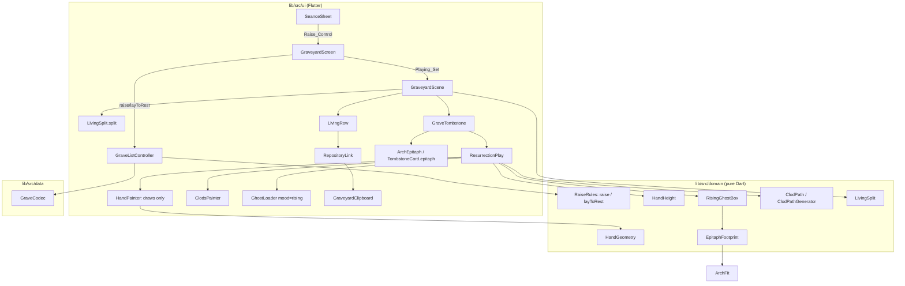
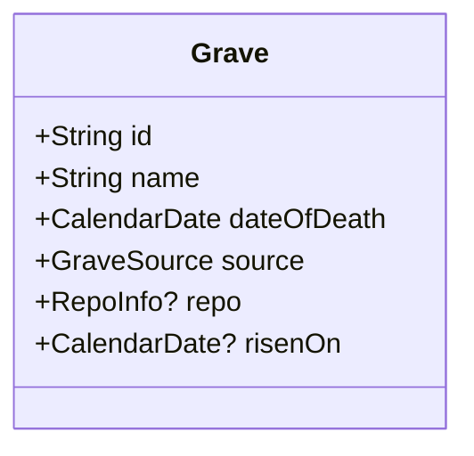

## Overview

This feature adds the Resurrection_Play to `apps/graveyard`: the payoff moment after a séance. A new "Raise it" button in the `Seance_Sheet` sets a `risenOn` date on the `Grave`, closes the sheet, and plays a one-time animation on that `Grave`'s `GraveTombstone` — a skeletal hand bursts from the ground with a few clods of earth, sinks back, a `GhostLoader` with `GhostMood.rising` rises from the grave, and the stone's epitaph changes from "R.I.P." to "RISEN". When the play ends, the `Grave` moves out of the graveyard rows into a small "Back among the living" row above them. A "Lay it back to rest" control, behind a confirmation dialog, undoes the raise.

The risen state is one optional `CalendarDate` field on `Grave` (`risenOn`), encoded by the existing `GraveCodec` under one new key, decoded as absent (not risen) for every record written before this feature. The animation never replays on load: it is driven entirely by an in-memory `Playing_Set` of Grave ids, owned by `GraveyardScene`, never persisted.

Nothing about this feature changes `packages/coffin_core`, `apps/hauntagotchi` or `tool/`. No package is added; `pubspec.lock` stays byte-for-byte unchanged. The Hand, the Clods and the epitaph fade are plain Flutter (`CustomPainter`, `AnimationController`, `Text`); the rising ghost is the existing `GhostLoader(mood: GhostMood.rising)` of `coffin_core`, unmodified. Everything that is pure logic — the risen-state rules, the Hand's motion curve, the Clods' flight paths, and the split of the grave list into graveyard rows and the living row — lives in `apps/graveyard/lib/src/domain`, with no Flutter import, covered by unit tests and glados property tests.

This feature builds on graveyard-core (`Grave`, `GraveCodec`, `CalendarDate`, `Clock`, `GraveListController`, `GraveSorter`), graveyard-scene (`GraveTombstone`, `GraveyardScene`, `RiseProgress`, `Weathering`, `ArchFit`, `ArchEpitaph`, `StableHash`, `StableRandom`, `GraveyardCopy`) and graveyard-seance (`SeanceSheet`, `showSeanceSheet`, `SeanceControl`).

### A difference between the requirements and the real code

The requirements describe `GraveListController` as reusable through "the existing write queue... with the same save status and retry behavior as an added Grave" (Requirement 3.9). Reading `grave_list_controller.dart`, the controller's `_insert` method both re-sorts the grave into the list *and* enqueues it for writing; there is no separate "replace in place, keep position" path — `_insert` always calls `GraveSorter.sort` over the whole list again. Because `GraveSorter` orders by `dateOfDeath` (unaffected by `risenOn`) then by name then by id, re-sorting after a Raise or a Lay_To_Rest is a no-op on order (Requirement 3.9's "keep its position" is satisfied as an emergent property, not because the method preserves index). This design adds a small `replaceGrave(Grave)` method to `GraveListController` that updates the list by id (keeping the array index, not re-inserting) and reuses the existing `_pendingPuts`/`_enqueueWrite` write-queue machinery — see Components and Interfaces. This is an edit to an existing UI file, inside the allowed `apps/graveyard/lib` scope.

## Architecture



### Where the Resurrection_Play fits in the existing tree

`GraveyardScreen` already owns `GraveListController` and passes `controller.graves` to `GraveyardScene`. This feature adds one piece of state to `GraveyardScreen`: the `Playing_Set` (a `Set<String>` of Grave ids). `GraveyardScreen`:

1. Builds the `Seance_Sheet` with an `onRaise` callback (new). Activating `Raise_Control` calls `Navigator.pop()` to close the sheet, then `controller.raise(id)` (new method, see below), then adds the id to the `Playing_Set` and calls `setState`.
2. Passes `playingIds: Playing_Set` and `onPlayEnd: (id) => setState(() => Playing_Set.remove(id))` down to `GraveyardScene`.
3. `GraveyardScene` calls `LivingSplit.split(graves: c.graves, playing: playingIds)` to get `(graveyardRows, livingRow)`, renders `livingRow` in a new `LivingRow` widget in its scrolling header area (same area as the existing title/notices/banners), and passes only `graveyardRows` to the existing row-layout code (`SceneLayout`), unchanged (Requirement 6.9).
4. Each `GraveTombstone` in `graveyardRows` receives `playing: playingIds.contains(grave.id)` (new parameter) and `onPlayEnd` (new parameter), and owns its own `ResurrectionPlay` controllers (below) exactly when `playing` is true.

This keeps `Playing_Set` at the screen level (a `StatefulWidget` that already holds no persisted state besides forwarding to the controller) rather than inside `GraveyardScene` or `GraveListController`, so:

- a delete clears the Grave from `controller.graves`; `GraveyardScreen`'s `_delete` already removes the id from `Playing_Set` in the same `setState` that calls `controller.deleteGrave`, so a disposed `GraveTombstone` never looks orphaned in the `Playing_Set` (Requirement 7.15, 10.7).
- the controller itself never has to know about the play, keeping `GraveListController` exactly as reusable as it is today (Requirement 3.9, 16.6).

### Reused, unchanged `coffin_core`

`GhostLoader` (with `mood: GhostMood.rising`, `reactionKey`, `onReactionEnd`), `GhostMood.rising` (`MoodReaction.risingDurationMs = 2200`), `TombstoneCard` (`epitaph` and `showEpitaph` constructor parameters, already present), `CoffinColorTokens`, `CoffinGlow.decoration`, `CoffinMetrics`, `WcagContrast`, `CoffinTypography`, `FogBackground`. No file under `packages/coffin_core` is edited (Requirement 16.9).

### Reused, unchanged `apps/graveyard`

`Grave`, `GraveSource`, `RepoInfo`, `CalendarDate`, `GraveCodec` (edited, see Data Models), `GraveSorter`, `GraveListController` (edited, one new method), `GraveTombstone` (edited), `GraveyardScene` (edited), `ArchEpitaph`/`ArchFit`, `Weathering`/`CrackGenerator`, `RiseProgress` (reused as the Hand's easing curve, per Requirement 7.6), `StableHash`/`StableRandom` (reused by the new `ClodPathGenerator`, per Requirement 8.2/8.9), `GraveyardCopy` (edited, new strings), `SeanceSheet`/`showSeanceSheet` (edited, adds `Raise_Control`), `GraveyardScreen` (edited, owns `Playing_Set`), `DeleteGraveDialog` (pattern reused for the new `RestDialog`).

### Folder layout

```
apps/graveyard/lib/src/
├── domain/
│   ├── raise_rules.dart                 # new: Grave.raise / Grave.layToRest (pure, static)
│   ├── resurrection/                    # new: everything specific to the play's math
│   │   ├── hand_height.dart             # HandHeight: pure fn of elapsed ms -> 0..1
│   │   ├── hand_geometry.dart           # HandGeometry: Stone_Area size + elapsed ms -> HandShape (the Hand's bones)
│   │   ├── hand_shape.dart              # HandShape: the Hand's bones (polylines of joints) + visible flag (value type)
│   │   ├── stone_point.dart             # StonePoint: x/y in stone coordinates (value type, no dart:ui)
│   │   ├── epitaph_footprint.dart       # EpitaphFootprint: stone width + text scale -> epitaph rect (pure, calls ArchFit)
│   │   ├── rising_ghost_box.dart        # RisingGhostBox: Stone_Area size + text scale + elapsed ms -> GhostBox
│   │   ├── ghost_box.dart               # GhostBox: left/top/width/height + visible (value type)
│   │   ├── clod.dart                    # Clod: immutable value (launch angle, flight ms, peak, size)
│   │   ├── clod_path_generator.dart     # ClodPathGenerator.generate(graveId) -> List<Clod>
│   │   ├── clod_path.dart               # ClodPath: Clod + Size + elapsedMs -> ClodFrame
│   │   ├── clod_frame.dart              # ClodFrame: position, size, visible (value type)
│   │   └── play_timing.dart             # PlayTiming: the fixed milestones (Play_Duration etc.)
│   ├── living_split.dart                # LivingSplit.split(graves, playing) -> (rows, living)
│   └── ... (unchanged graveyard-core / graveyard-scene / graveyard-seance domain files)
├── data/
│   └── grave_codec.dart                 # edited: risen key read/write
├── ui/
│   ├── resurrection_play.dart            # new: the StatefulWidget that owns the play's controllers
│   ├── hand_painter.dart                 # new: CustomPainter that only draws a HandShape (no geometry logic)
│   ├── clods_painter.dart                # new: CustomPainter for the Clods
│   ├── living_row.dart                   # new: "Back among the living" section + LivingEntry
│   ├── rest_dialog.dart                  # new: the Lay_To_Rest confirmation dialog
│   ├── graveyard_clipboard.dart          # new: GraveyardClipboard interface + default impl
│   ├── risen_announcement.dart           # new: the one-shot live-region announcer
│   ├── grave_tombstone.dart              # edited: adds playing/onPlayEnd, epitaph switch, ResurrectionPlay layer
│   ├── graveyard_scene.dart              # edited: LivingSplit, LivingRow, playingIds/onPlayEnd threading
│   ├── graveyard_screen.dart             # edited: owns Playing_Set, raise/layToRest wiring
│   ├── grave_list_controller.dart        # edited: adds raise(id)/layToRest(id)/replaceGrave
│   ├── seance_sheet.dart                 # edited: adds Raise_Control
│   ├── arch_epitaph.dart                 # edited: accepts an optional text override (defaults to "R.I.P.")
│   └── graveyard_copy.dart               # edited: adds every Resurrection_Copy string
```

`RaiseRules`, `HandHeight`, `HandGeometry`, `HandShape`, `StonePoint`, `RisingGhostBox`, `GhostBox`, `EpitaphFootprint`, `Clod`, `ClodPathGenerator`, `ClodPath`, `ClodFrame`, `PlayTiming` and `LivingSplit` are one public class per file in `snake_case.dart`, each with a doc comment on every public member (Requirement 16.1).

## Components and Interfaces

### Domain — risen-state rules

```dart
/// Pure rules for raising and laying a Grave to rest.
abstract final class RaiseRules {
  /// Returns a copy of [grave] with Risen_On set to [today].
  ///
  /// If [grave] is already risen, its existing Risen_On is kept (raising
  /// twice equals raising once — Requirement 2.8). Every other field is
  /// unchanged.
  static Grave raise(Grave grave, CalendarDate today) =>
      grave.risenOn != null ? grave : grave.copyWithRisenOn(today);

  /// Returns a copy of [grave] with Risen_On cleared. A Grave that is
  /// already not risen is returned unchanged (Requirement 2.9's
  /// idempotence).
  static Grave layToRest(Grave grave) =>
      grave.risenOn == null ? grave : grave.copyWithRisenOn(null);
}
```

`Grave` gains the field and a private copy helper:

```dart
final class Grave {
  const Grave._({
    required this.id,
    required this.name,
    required this.dateOfDeath,
    required this.source,
    required this.repo,
    this.risenOn, // new, defaults to null — every existing call site compiles unchanged (Requirement 2.2)
  });
  // Grave.manual(...) and Grave.github(...) unchanged in signature.

  /// The local calendar day this Grave was raised, or null if it is not
  /// Risen (Requirement 2.1).
  final CalendarDate? risenOn;

  /// Returns a copy with [risenOn] replacing the current value. Internal to
  /// the Domain; [RaiseRules] is the public surface for raising/resting.
  Grave copyWithRisenOn(CalendarDate? risenOn) => Grave._(
        id: id, name: name, dateOfDeath: dateOfDeath, source: source,
        repo: repo, risenOn: risenOn,
      );

  // operator ==, hashCode and toString extended to include risenOn
  // (Requirement 2.5).
}
```

`copyWithRisenOn` is `Grave`'s own method (not a free function) so it stays next to the other `Grave` invariants in `grave.dart`, matching the one-class-per-file rule while keeping `RaiseRules` a thin, obviously-total wrapper. `RaiseRules` imports only `grave.dart` and `calendar_date.dart` (Requirement 16.2).

### Domain — the Hand's motion curve

```dart
/// Fixed timing milestones of one Resurrection_Play, all in milliseconds
/// from the start of the play.
abstract final class PlayTiming {
  /// Total length of the play (Requirement 7.2: 2000-3000 ms, >= 2600 ms
  /// fixed here). Chosen as 2800 ms so the 2200 ms rising reaction
  /// (`MoodReaction.risingDurationMs`) fits entirely after the Hand has
  /// sunk back (600 ms burst-and-sink leaves 2200 ms, exactly enough).
  static const int playDurationMs = 2800;
  /// The Hand bursts up from 0 to [handBurstEndMs].
  static const int handBurstEndMs = 300;
  /// The Hand holds fully out from [handBurstEndMs] to [handSinkEndMs].
  static const int handSinkEndMs = 600;
  /// The Rising_Ghost's rising reaction starts here, immediately once the
  /// Hand has sunk back, and (2200 ms later) ends at
  /// `risingGhostStartMs + 2200 = 2800 = playDurationMs`.
  static const int risingGhostStartMs = 600;
  /// The epitaph starts its fade to "RISEN" once the Rising_Ghost has
  /// risen to the point fixed by design: 70% through its reaction.
  static const int epitaphFadeStartMs = 2140; // risingGhostStartMs + 0.7 * 2200
  /// The Rising_Ghost's box starts moving up from the base of the stone
  /// (the same instant the rising reaction starts).
  static const int ghostRiseStartMs = 600;
  /// The Rising_Ghost's box reaches its end position (just below the
  /// epitaph) and holds there until [playDurationMs]. Equal to [epitaphFadeStartMs]: the ghost has arrived
  /// by the time the epitaph starts to change.
  static const int ghostRiseEndMs = epitaphFadeStartMs; // 2140
  /// Length of the epitaph's fade to "RISEN" (Requirement 7.11: 300-600 ms).
  static const int epitaphFadeMs = 400;
}
```

Timeline in milliseconds, all measured from the Raise:

| ms | Event |
| --- | --- |
| 0 | Hand and Clods start bursting up from the ground |
| 300 | Hand fully out (peak height); Clods at their peak/falling |
| 300–600 | Hand sinks back to 0; Clods finish landing and vanish (Requirement 8.8) |
| 600 (`ghostRiseStartMs`) | Hand fully sunk; `GhostLoader`'s `reactionKey` increments, starting the 2200 ms `rising` reaction; the Rising_Ghost box starts moving up from the base of the stone (`RisingGhostBox`, eased with `RiseProgress`) toward its end position just below the epitaph |
| 600–2140 | Ghost-box rise window (1540 ms): the box's top moves from the stone's base to its end position (epitaph bottom + 8 px) and never moves down, so it never reaches the epitaph |
| 2140 (`ghostRiseEndMs` = `epitaphFadeStartMs`) | Ghost box has arrived at its end position, 8 px below the epitaph rectangle, and holds it until 2800 ms. Epitaph starts its 400 ms fade from "R.I.P." to "RISEN" (70% through the rising reaction; the ghost is clearly below the epitaph by then, so the stone "catches up" to what the viewer already sees, and the fading text is never covered) |
| 2540 | Epitaph fade ends; "RISEN" shown fully opaque |
| 2800 (`playDurationMs`) | Rising reaction ends and the ticker completes (`onEnd` fires); the play ends: the Grave id leaves the `Playing_Set`, every controller of the play is disposed, and the Grave moves to the `Living_Row` (Requirement 7.14) |

Requirement 7.2 asks for the design phase to fix one `Play_Duration` of at least 2600 ms; 2800 ms is chosen because it is the suggested value and gives the 600 ms hand burst-and-sink exactly 2200 ms of headroom for the rising reaction with no slack to tune later.

**Why the ghost-box rise window is 600 to 2140 ms.** `GhostMood.rising` only adds a 10 px bump that returns to 0, so the ghost would not read as rising from the grave unless its box moves. The window starts at 600 ms because the Hand has sunk back and the 2200 ms `GhostLoader` rising reaction starts there; moving the box earlier would overlap the Hand. It ends at 2140 ms, the same instant the epitaph fade starts, so the ghost has arrived below the epitaph before the stone's text changes, and it then holds still for the last 660 ms while the `GhostLoader`'s own bump settles and the 400 ms epitaph fade finishes (2540 ms). The window (1540 ms) lies inside the 600 to 2800 ms range, is long enough to read as a slow rise (the design language asks for slow, floaty motion), and ends before `playDurationMs`, so the box holds its final position until the play ends.

```dart
/// Pure function from elapsed milliseconds to the Hand's height, 0 (hidden)
/// to 1 (fully out).
abstract final class HandHeight {
  /// Height of the Hand at [elapsedMs] (Requirement 7.5, 7.6, 7.7, 7.8).
  ///
  /// 0 before the play starts and from [PlayTiming.handSinkEndMs] on
  /// (including every value past [PlayTiming.playDurationMs] — the design
  /// uses no loop past the play). Rises with `RiseProgress.at` from 0 to
  /// [PlayTiming.handBurstEndMs], then falls with the same eased curve back
  /// to 0 by [PlayTiming.handSinkEndMs]. Clamped for any input, including
  /// negative and non-finite values (treated as the nearest clamped bound).
  static double at(int elapsedMs) {
    final int ms = elapsedMs < 0 ? 0 : elapsedMs;
    if (ms <= PlayTiming.handBurstEndMs) {
      return RiseProgress.at(
        (ms * RiseProgress.durationMs / PlayTiming.handBurstEndMs).round(),
      );
    }
    if (ms <= PlayTiming.handSinkEndMs) {
      final int into = ms - PlayTiming.handBurstEndMs;
      final int span = PlayTiming.handSinkEndMs - PlayTiming.handBurstEndMs;
      return 1 - RiseProgress.at((into * RiseProgress.durationMs / span).round());
    }
    return 0;
  }
}
```

`HandHeight.at` rescales elapsed time onto `RiseProgress`'s own 0–600 ms domain so the same ease-in-out cubic curve drives both phases (Requirement 7.6), without copying `RiseProgress`'s formula (Requirement 16.6). `RiseProgress.at` already clamps its input to `[0, durationMs]` and returns a value in `[0, 1]`, so `HandHeight.at` is finite and bounded for every input by construction, and each phase inherits `RiseProgress`'s own monotonicity (Requirement 7.7, 7.8).

### Domain — the Clods

```dart
/// One clump of earth thrown by the Hand. Every field is derived once, by
/// [ClodPathGenerator], from the Grave id, and never changes.
final class Clod {
  const Clod({
    required this.launchAngleRadians, // direction from straight up, +/- spread
    required this.launchMs,           // when it leaves the ground, within the burst
    required this.flightMs,           // >0, how long it is airborne
    required this.peakHeightFraction, // 0..1 of the Stone_Area height (generated 0.10..0.45)
    required this.sizePx,             // 2..8 logical pixels (diameter)
  });
  final double launchAngleRadians;
  final int launchMs;
  final int flightMs;
  final double peakHeightFraction;
  final double sizePx;
}

/// Generates the deterministic list of Clods for one Grave.
abstract final class ClodPathGenerator {
  /// Fewest Clods a Grave gets (Requirement 8.1, 8.4).
  static const int minCount = 4;
  /// Most Clods a Grave gets (Requirement 8.1, 8.4, 8.10).
  static const int maxCount = 7;
  /// Returns 4 to 7 Clods for [graveId], seeded by `StableHash.of(graveId)`
  /// through a `StableRandom`, so the same id always returns an equal list
  /// on every platform (Requirement 8.2, 8.3, 8.9).
  static List<Clod> generate(String graveId) {
    final random = StableRandom(StableHash.of(graveId));
    final count = minCount + random.nextInt(maxCount - minCount + 1);
    return List<Clod>.generate(count, (_) => _oneClod(random));
  }

  static Clod _oneClod(StableRandom random) { /* ...bounded draws... */ }
}

/// The position, size and visibility of one [Clod] at one elapsed time,
/// inside a Stone_Area of a given size.
final class ClodFrame {
  const ClodFrame({required this.center, required this.diameter, required this.visible});
  final Offset center;
  final double diameter;
  final bool visible;
}

/// Pure function from a [Clod], a Stone_Area size and elapsed milliseconds
/// to a [ClodFrame] (Requirement 8.5, 8.6, 8.7, 9.3, 9.4).
abstract final class ClodPath {
  static ClodFrame at({
    required Clod clod,
    required Size stoneArea,
    required int elapsedMs,
  }) {
    final int landMs = clod.launchMs + clod.flightMs;
    if (elapsedMs < clod.launchMs || elapsedMs > landMs) {
      return ClodFrame(center: Offset.zero, diameter: clod.sizePx, visible: false);
    }
    final double t = (elapsedMs - clod.launchMs) / clod.flightMs; // 0..1
    final double baseX = stoneArea.width / 2;
    final double groundY = stoneArea.height;
    final double arcHeight = clod.peakHeightFraction * stoneArea.height;
    // Parabolic arc: up then back down to the ground line, offset sideways
    // by launchAngleRadians, horizontal travel bounded so the clod's full
    // circle (radius sizePx/2) never crosses the Stone_Area edges.
    final double maxReachPx = (stoneArea.width / 2) - (clod.sizePx / 2) - 1;
    final double dx = maxReachPx * math.sin(clod.launchAngleRadians) * t;
    final double dy = -4 * arcHeight * t * (1 - t); // 0 at t=0/1, -arcHeight at t=0.5
    final double cx = (baseX + dx).clamp(clod.sizePx / 2, stoneArea.width - clod.sizePx / 2);
    final double cy = (groundY + dy).clamp(clod.sizePx / 2, stoneArea.height - clod.sizePx / 2);
    return ClodFrame(center: Offset(cx, cy), diameter: clod.sizePx, visible: true);
  }
}
```

Every Clod's `launchMs + flightMs` is generated to land at or before `PlayTiming.handSinkEndMs` (600 ms), so the Clods are always gone by the time the Hand has sunk (Requirement 7.1, 8.8). `ClodPathGenerator`/`Clod`/`ClodPath` import only `dart:math`, `grave`-independent Domain files (`stable_hash.dart`, `stable_random.dart`) and `dart:ui`'s `Offset`/`Size` value types — the requirements' Glossary defines the Domain as excluding `dart:ui`, so this design instead has `ClodPath`'s pure geometry return a small Domain-only value type (`ClodFrame` holding two `double`s for `x`/`y`, not `dart:ui`'s `Offset`) and lets `ClodsPainter` (in `lib/src/ui`) convert to `Offset`/`Size` at the paint boundary. This keeps Requirement 16.2's "no `dart:ui`" literal and exact, at the cost of `ClodFrame` using `double x, y` instead of `Offset` — reflected in the final interface below.

Corrected `ClodFrame`:

```dart
/// The position, size and visibility of one Clod at one elapsed time, in
/// Stone_Area coordinates (origin top-left). Pure Domain value: no `dart:ui`.
final class ClodFrame {
  const ClodFrame({required this.x, required this.y, required this.diameter, required this.visible});
  final double x;
  final double y;
  final double diameter;
  final bool visible;
}
```

### Domain — the Hand's geometry and the Rising_Ghost box

`HandPainter` holds no geometry logic (Requirement 9.3). Every point of the Hand comes from a pure function in `lib/src/domain/resurrection/`, and the painter only turns those points into a `Path` and draws it. The Rising_Ghost's box also comes from a pure function, so Requirement 9.4's "box of the Rising_Ghost" is testable without Flutter. Both files import only `dart:math` and other Domain files (no `dart:ui`, no Flutter).

```dart
/// A point in stone coordinates (origin top-left of the Stone_Area).
final class StonePoint {
  const StonePoint(this.x, this.y);
  final double x;
  final double y;
}

/// The Hand at one instant: its bones, each a polyline of joints.
final class HandShape {
  const HandShape({required this.bones, required this.visible});
  /// The bones; every vertex of a polyline is a joint. Empty when not [visible].
  final List<List<StonePoint>> bones;
  /// False while [HandHeight.at] is 0 (nothing to draw).
  final bool visible;
}

/// Pure function from the Stone_Area size and elapsed milliseconds to the Hand's bones.
abstract final class HandGeometry {
  /// Largest share of the stone height the Hand reaches above the ground line.
  static const double maxReachFraction = 0.35;
  /// Half the Hand's width as a share of the stone width.
  static const double halfWidthFraction = 0.15;

  /// Every point of every bone lies in `[0, width] x [0, height]` for every
  /// positive [width]/[height] and every [elapsedMs] (Requirement 9.3). When
  /// visible there are 7 bones: two forearm bones (ground line to wrist),
  /// four fingers (index, middle, ring, little) and the thumb. Each finger is
  /// a polyline of 4 points: wrist, knuckle, middle joint, tip.
  static HandShape at({
    required double width,
    required double height,
    required int elapsedMs,
  }) {
    // Invisible empty shape for a non-finite or non-positive size, or h <= 0.
    final double h = HandHeight.at(elapsedMs);
    final double cx = width / 2;
    final double half = width * halfWidthFraction;
    final double reach = height * maxReachFraction * h; // extent above the ground line
    // pt(dx, rise) = StonePoint(cx + half * dx, height - reach * rise), with
    // |dx| <= 1.3 and 0 <= rise <= 1, so every point is inside the stone by
    // construction. The wrist is at rise 0.4.
    //  - forearms: (cx -/+ 0.3 half, height) -> pt(-/+ 0.25, 0.4)
    //  - fingers, each [wrist, knuckle, joint, tip], fanned out, tips curled
    //    back toward the center (claw). Tip rise: middle 1.0 (the highest
    //    point), ring 0.95, index 0.94, little 0.82, so lengths order
    //    middle > ring > index > little.
    //  - thumb: starts low on the left of the palm (rise 0.3) and angles
    //    outward to its tip at pt(-1.3, 0.6), below every other fingertip.
    return HandShape(visible: true, bones: <List<StonePoint>>[/* 7 bones */]);
  }
}

/// The box the Rising_Ghost occupies, in stone coordinates.
final class GhostBox {
  const GhostBox({required this.left, required this.top, required this.width, required this.height, required this.visible});
  final double left;
  final double top;
  final double width;
  final double height;
  /// False before [PlayTiming.risingGhostStartMs] and after [PlayTiming.playDurationMs].
  final bool visible;
}

/// Pure function from the Stone_Area size, the text scale and elapsed
/// milliseconds to the Rising_Ghost's box.
abstract final class RisingGhostBox {
  /// Clear space in logical pixels between the bottom of the epitaph
  /// rectangle and the top of the box once the ghost has risen.
  static const double epitaphGapPx = 8;

  /// Least distance in logical pixels the box's top must travel between its
  /// start and end positions, so the ghost always visibly rises.
  static const double minTravelPx = 8;

  /// Smallest box height in logical pixels. A box that would have to be
  /// smaller is not drawn at all (see the extreme case below).
  static const double minBoxHeightPx = 16;

  /// Height of the natural box as a multiple of its width.
  static const double aspect = 1.2;

  /// The natural box is centered, half the stone width wide and
  /// `min(width * 0.5 * aspect, height * 0.7)` tall. The box RISES from
  /// [PlayTiming.ghostRiseStartMs] to [PlayTiming.ghostRiseEndMs]: its top
  /// moves from the base of the stone (box bottom on the bottom edge of the
  /// Stone_Area, `top = height - boxH`) up to the end top
  /// `epitaph.bottom + epitaphGapPx`, where `epitaph` is
  /// `EpitaphFootprint.forStone(stoneWidth: width, textScale: textScale)`,
  /// eased by the existing `RiseProgress` curve, and it holds that final
  /// position until the play ends. The box never moves down and its top is
  /// never above the end top, so it never overlaps the epitaph rectangle at
  /// any time. `left`, `width` and `height` never change.
  ///
  /// Shrinking rule: the box height is
  /// `boxH = min(naturalH, height - endTop - minTravelPx)`. When that is
  /// smaller than `naturalH`, the width is scaled by the same factor
  /// (`boxH / naturalH`), so the box keeps its shape. The `minTravelPx`
  /// term keeps the start top at least 8 px below the end top, so the box
  /// strictly rises.
  ///
  /// Extreme case: when `boxH < minBoxHeightPx` (16 px), or when an input
  /// is not finite or not positive, the box is not drawn. The result is the
  /// zero-area box `GhostBox(left: width / 2, top: height, width: 0,
  /// height: 0, visible: false)` (all zeros for unusable input). It lies on
  /// the bottom edge of the Stone_Area, has no area, and so cannot
  /// intersect the epitaph rectangle. The Hand, the Clods and the epitaph
  /// change still play. This case is outside the property ranges (stones
  /// 120-400 by 160-480, text scales 1.0-2.0), which the margin test below
  /// pins.
  ///
  /// [GhostBox.visible] is true from [PlayTiming.risingGhostStartMs] to
  /// [PlayTiming.playDurationMs] (and the box is not zero-area).
  /// `GhostLoader`'s own rising reaction (a 10 px bump that returns to 0)
  /// moves the ghost inside this box, so the box is the bound on
  /// everything it draws.
  static GhostBox at({
    required double width,
    required double height,
    required double textScale,
    required int elapsedMs,
  }) {
    const hidden = GhostBox(left: 0, top: 0, width: 0, height: 0, visible: false);
    if (!width.isFinite || !height.isFinite || !textScale.isFinite ||
        width <= 0 || height <= 0 || textScale <= 0) {
      return hidden;
    }
    final KeepOutRect epitaph =
        EpitaphFootprint.forStone(stoneWidth: width, textScale: textScale);
    final double endTop = epitaph.bottom + epitaphGapPx;
    final double naturalW = width * 0.5;
    final double naturalH = math.min(naturalW * aspect, height * 0.7);
    final double boxH = math.min(naturalH, height - endTop - minTravelPx);
    if (!(boxH >= minBoxHeightPx)) {
      return GhostBox(left: width / 2, top: height, width: 0, height: 0, visible: false);
    }
    final double boxW = naturalW * (boxH / naturalH);
    final double startTop = height - boxH;       // >= endTop + minTravelPx
    final double top = startTop + (endTop - startTop) * _progress(elapsedMs);
    final bool visible = elapsedMs >= PlayTiming.risingGhostStartMs &&
        elapsedMs <= PlayTiming.playDurationMs;
    return GhostBox(left: (width - boxW) / 2, top: top, width: boxW, height: boxH, visible: visible);
  }

  /// 0 before the rise window, 1 after it, and in between the existing
  /// `RiseProgress` curve rescaled onto its own 0-600 ms domain (the same
  /// rescaling `HandHeight` uses). `RiseProgress` itself is unchanged.
  static double _progress(int elapsedMs) {
    if (elapsedMs <= PlayTiming.ghostRiseStartMs) return 0;
    if (elapsedMs >= PlayTiming.ghostRiseEndMs) return 1;
    final int into = elapsedMs - PlayTiming.ghostRiseStartMs;
    final int span = PlayTiming.ghostRiseEndMs - PlayTiming.ghostRiseStartMs;
    return RiseProgress.at((into * RiseProgress.durationMs / span).round());
  }
}
```

**Can the epitaph rectangle come from domain code only? Not from `ArchFit` alone.** `ArchFit.positionFor` (`lib/src/domain/scene/arch_fit.dart`) is pure Dart: it imports only `dart:math` and `arch_fit_result.dart`, with no Flutter and no `TextPainter`. It returns only `top`, `fontSize` and `truncated`. Its inputs `textWidth` and `lineHeight` are measured by `TextPainter` in `ArchEpitaph._layout` (`lib/src/ui/arch_epitaph.dart`), and so are the final rectangle's width and height (measured again at the fitted font size). `archRise` (140) is a constant of the UI class `ArchEpitaph`. The real rectangle, `ArchEpitaph.rectFor`, is therefore a UI function that pure code cannot call. What is missing is a pure source for the text width and the line height.

**Smallest pure-domain solution: `EpitaphFootprint`.** It is a pure function that calls the real `ArchFit.positionFor` (it does not copy its arithmetic) with text metrics taken from a fixed model instead of a `TextPainter`, and then builds the rectangle the way `ArchEpitaph._layout` does (centered, width clamped to the stone, height scaled with the fitted font size). It lives in `lib/src/domain/resurrection/epitaph_footprint.dart` and imports only `dart:math`, `arch_fit.dart` and `keep_out_rect.dart`.

```dart
/// The epitaph rectangle of a stone, computed without measuring text.
abstract final class EpitaphFootprint {
  /// Arch rise in logical pixels; equal to `ArchEpitaph.archRise`.
  static const double archRise = 140;
  /// Base font size at text scale 1; equal to `ArchEpitaph.baseFontSize`.
  static const double baseFontSize = 20;
  /// Letter spacing in logical pixels; equal to `ArchEpitaph.letterSpacing`.
  static const double letterSpacing = 2;
  /// Line height as a multiple of the font size (an upper bound).
  static const double lineHeightPerFontPx = 1.5;
  /// Glyph advance sum of "R.I.P." per font pixel (an upper bound).
  static const double ripAdvancePerFontPx = 3.6;
  /// Glyph advance sum of "RISEN" per font pixel (an upper bound).
  static const double risenAdvancePerFontPx = 3.4;

  /// The rectangle, in stone coordinates, that covers both epitaph texts
  /// ("R.I.P." and "RISEN") for a stone of [stoneWidth] at [textScale]: the
  /// smallest rectangle enclosing the two per-text rectangles. Never throws;
  /// unusable input returns the zero rectangle at the origin.
  static KeepOutRect forStone({required double stoneWidth, required double textScale});

  static KeepOutRect _forText({
    required double stoneWidth,
    required double scaledBase,   // baseFontSize * textScale
    required double advancePerFontPx,
    required int glyphCount,
  }) {
    final double textWidth = advancePerFontPx * scaledBase + glyphCount * letterSpacing;
    final double lineHeight = lineHeightPerFontPx * scaledBase;
    final fit = ArchFit.positionFor(
      archWidth: stoneWidth, archRise: archRise,
      lineHeight: lineHeight, textWidth: textWidth, fontSize: scaledBase,
    );
    final double scale = fit.fontSize / scaledBase;
    final double w = (fit.truncated ? stoneWidth - 2 * ArchFit.margin : textWidth * scale)
        .clamp(0.0, stoneWidth);
    final double left = (stoneWidth - w) / 2;
    return KeepOutRect(left: left, top: fit.top, right: left + w, bottom: fit.top + lineHeight * scale);
  }
}
```

The three advance and line-height numbers are upper bounds, and the values written here are provisional. The first implementation task measures "R.I.P." and "RISEN" with `TextPainter` and Creepster at 20 px, rounds up, and keeps the numbers only if the cover test below passes. The model is conservative on purpose: it may put the rectangle lower or larger than the real one, never higher or smaller. Three tests tie it to the real code so it cannot drift:

- Constants test: `EpitaphFootprint.archRise`, `baseFontSize` and `letterSpacing` equal `ArchEpitaph.archRise`, `baseFontSize` and `letterSpacing` (example-based).
- Cover test: for stone widths 120 to 400 in steps of 20 and text scales 1.0 to 2.0 in steps of 0.25, `EpitaphFootprint.forStone` covers both `ArchEpitaph.rectFor(text: 'R.I.P.')` and `ArchEpitaph.rectFor(text: 'RISEN')` (left and top at most, right and bottom at least those of each real rectangle). This is what makes "below the model rectangle" imply "below the painted epitaph".
- Equality test: for the same width and text scale, a pure rectangle built from `ArchFit.positionFor` with the measured width and line height (as `ArchEpitaph._layout` does) has the same `top` and `fontSize` as the model's whenever the model's metrics equal the measured ones. This pins that `EpitaphFootprint` passes the arguments to `ArchFit` the way `ArchEpitaph._layout` does.

**Example, a 120 by 160 stone at text scale 1.0** (provisional metrics; archWidth 120, so `rx = 60` and `ry = min(140, 60) = 60`):

| Step | Value |
| --- | --- |
| scaled base font | 20 px |
| "R.I.P." width and line height | 3.6 × 20 + 6 × 2 = 84 px and 1.5 × 20 = 30 px |
| ArchFit for "R.I.P." | fits at 20 px (42 + 4 = 46 < 60); `top` = 60 − 60·√(1 − (46/60)²) + 4 = 25.48 |
| "R.I.P." rectangle | left 18, top 25.48, right 102, bottom 55.48 |
| "RISEN" rectangle | width 78, left 21, top 22.16, right 99, bottom 52.16 (inside the union) |
| epitaph rectangle (union) | left 18, top 22.16, right 102, bottom 55.48 |
| end top | 55.48 + 8 = 63.48 |
| natural box | 60 wide, `min(72, 112)` = 72 tall; room below the epitaph is 160 − 63.48 = 96.52, and 72 ≤ 96.52 − 8 = 88.52, so no shrinking |
| start top | 160 − 72 = 88 |
| box top over time | 88 at 600 ms and before; 75.74 at 1370 ms (midpoint of the rise, curve value 0.5); 63.48 from 2140 ms to 2800 ms |
| end box | left 30, top 63.48, bottom 135.48, 8 px below the epitaph rectangle |

**A shrunk example, 120 by 160 at text scale 2.0** (provisional metrics): "R.I.P." shrinks to 28.1 px and "RISEN" to 30.2 px to fit the arch, so the union's bottom is 99.03 (from "RISEN") and the end top is 107.03. The room is 160 − 107.03 = 52.97, so `boxH = min(72, 52.97 − 8)` = 44.97, a factor of 0.6246 on the natural box, which makes it 37.48 wide. The start top is 160 − 44.97 = 115.03, so the box rises 8 px and ends 8 px below the epitaph. 44.97 is above the 16 px minimum. The margin test (in the Testing Strategy) asserts that `boxH` stays at or above 16 px over the whole property range, so the extreme case cannot happen for the stone sizes and text scales this feature produces.

The box is inside the Stone_Area at every time because `top` lies between `endTop > 0` and `startTop`, `startTop + boxH = height`, and `left = (width - boxW) / 2 >= 0`. The box is always horizontally centered.

`ResurrectionPlay` rebuilds, on every tick of its play controller, a `Positioned` from `RisingGhostBox.at(...)` for the current elapsed ms (`SizedBox(width: box.width, height: box.height)` at `left`/`top`, shown only while `box.visible`) and lays the `GhostLoader` out inside it, so the ghost's box rises from the base of the stone to its place below the epitaph. `HandPainter` strokes each bone of `HandShape.bones` as a polyline with round caps (with a soft glow) and draws a small dot at each joint (every polyline vertex); it has no geometry logic. `ResurrectionPlay` receives the text scale as `textScale`, which `GraveTombstone` computes as `MediaQuery.textScalerOf(context).scale(ArchEpitaph.baseFontSize) / ArchEpitaph.baseFontSize` (1.0 to 2.0 for the linear scalers the app supports). A painter that draws only a `HandShape` cannot move the Hand outside the stone, and the property tests below pin the pure functions that decide where it is.

### Domain — splitting the graveyard

```dart
/// Splits a grave list into the rows still in the graveyard and the row of
/// Graves that have risen and finished their play.
abstract final class LivingSplit {
  /// Returns `(graveyardRows, livingRow)` (Requirement 6.1-6.8).
  ///
  /// A Grave is in [livingRow] exactly when it is Risen
  /// (`risenOn != null`) and its id is not in [playing]; every other Grave
  /// is in [graveyardRows], in the same order as [graves]. [livingRow] is
  /// ordered by Risen_On descending, then by `GraveSorter`'s tie-break
  /// (lower-cased name, then id) — Requirement 5.9, 6.6.
  static (List<Grave> graveyardRows, List<Grave> livingRow) split({
    required List<Grave> graves,
    required Set<String> playing,
  }) {
    final graveyardRows = <Grave>[];
    final livingRow = <Grave>[];
    for (final grave in graves) {
      if (grave.risenOn != null && !playing.contains(grave.id)) {
        livingRow.add(grave);
      } else {
        graveyardRows.add(grave);
      }
    }
    livingRow.sort((a, b) {
      final byDate = b.risenOn!.compareTo(a.risenOn!);
      if (byDate != 0) return byDate;
      final byName = a.name.toLowerCase().compareTo(b.name.toLowerCase());
      return byName != 0 ? byName : a.id.compareTo(b.id);
    });
    return (graveyardRows, livingRow);
  }
}
```

Never throws for any input, including an empty list, ids in `playing` that are not in `graves`, and equal `risenOn` values (Requirement 6.8) — the loop and the sort are both total over any `List<Grave>`/`Set<String>`.

### UI — owning the Playing_Set and the write path

`GraveListController` gains:

```dart
/// Replaces the Grave with [grave.id] in the list, in place (same index),
/// and enqueues it for writing through the existing write queue — the same
/// save-status and retry behavior as [addManual]/[startImport]
/// (Requirement 3.9). A no-op (no write, no notify) if the id is no longer
/// present, so a Raise/Lay_To_Rest on a Grave the user just deleted throws
/// nothing (Requirement 1.8, 4.9).
void replaceGrave(Grave grave) {
  final index = _graves.indexWhere((g) => g.id == grave.id);
  if (index < 0) return;
  _graves = List<Grave>.of(_graves)..[index] = grave;
  _pendingDeletes.remove(grave.id);
  _pendingPuts.add(grave.id);
  _notify();
  _enqueueWrite();
}

/// Raises the Grave with [id] (Requirement 1.6, 2.3) and reports whether a
/// Grave was found and raised, so the caller knows whether to start a
/// Resurrection_Play (Requirement 1.8: no Grave, no play).
bool raise(String id) {
  final index = _graves.indexWhere((g) => g.id == id);
  if (index < 0) return false;
  replaceGrave(RaiseRules.raise(_graves[index], today));
  return true;
}

/// Lays the Grave with [id] back to rest (Requirement 4.5). A no-op,
/// returning normally, if the Grave is no longer present (Requirement 4.9).
void layToRest(String id) {
  final index = _graves.indexWhere((g) => g.id == id);
  if (index < 0) return;
  replaceGrave(RaiseRules.layToRest(_graves[index]));
}
```

`replaceGrave` keeps the array index (Requirement 3.9's "keep its position") rather than calling `_insert`'s re-sort-and-append, which is both simpler and avoids relying on `GraveSorter`'s order being unaffected by `risenOn` (it is, but `replaceGrave` does not need that fact to be correct).

`GraveyardScreen` adds:

```dart
class _GraveyardScreenState extends State<GraveyardScreen> with WidgetsBindingObserver {
  final Set<String> _playing = <String>{};
  int _announceKey = 0; // bumped once per Raise, read by RisenAnnouncement

  Future<void> _raise(Grave grave) async {
    Navigator.of(context).pop(); // close the Seance_Sheet first (Requirement 1.6)
    final started = widget.controller.raise(grave.id);
    if (!started) return; // Requirement 1.8
    setState(() {
      _playing.add(grave.id);
      _announceKey++;
    });
  }

  void _onPlayEnd(String id) => setState(() => _playing.remove(id));

  Future<void> _layToRest(Grave grave, {required FocusNode returnFocusTo}) async {
    final confirmed = await showRestDialog(context, grave.name);
    if (confirmed) widget.controller.layToRest(grave.id);
    if (returnFocusTo.canRequestFocus) returnFocusTo.requestFocus(); // Requirement 4.8
  }
}
```

A "double-activation" guard (Requirement 1.7: activating `Raise_Control` twice raises once, starts one play) falls out of `GraveListController.raise`'s own idempotence (`RaiseRules.raise` of an already-risen Grave returns the same Grave, so `replaceGrave` still runs but writes an equal value) composed with `_playing.add` being a no-op on a `Set` that already contains the id — and because the `Seance_Sheet` is already popped after the first activation, a "quick succession" second activation has no sheet left to act on at all; this is the same idempotence relied on by `RaiseRules` at the Domain layer, now also closing the only UI path that could invoke it twice.

### UI — ResurrectionPlay: controller ownership and disposal

`ResurrectionPlay` is a `StatefulWidget`, built by `GraveTombstone` only when `playing` is true, replacing itself with nothing once the play ends:

```dart
/// Plays the Hand, the Clods, the Rising_Ghost and the epitaph fade once,
/// then calls [onEnd]. Owns every controller of the play and the generation guard of
/// the reduced-motion wait; disposes the controllers in [dispose], however the widget leaves the tree (normal end,
/// delete during the play, or reduced motion kicking in mid-play).
class ResurrectionPlay extends StatefulWidget {
  const ResurrectionPlay({
    super.key,
    required this.graveId,
    required this.stoneSize, // the Stone_Area size, from the parent LayoutBuilder
    required this.textScale, // epitaph text scale (1.0 to 2.0), for RisingGhostBox
    required this.onEnd,     // called exactly once, after dispose-safe cleanup
    required this.onEpitaphRisen, // called once at PlayTiming.epitaphFadeStartMs
  });
}
```

**Ownership.** `ResurrectionPlay`'s `State` is the single owner of:
- one `AnimationController` (`_tickController`, nullable, `vsync: this`, `duration: PlayTiming.playDurationMs` = 2800 ms, created and started by `_startAnimated` on the animated path). It is the one clock of the whole play: its elapsed milliseconds (`value * playDurationMs`) feed `HandGeometry.at`, `ClodPath.at` and `RisingGhostBox.at` through one `AnimatedBuilder`, so the Hand, the Clods and the rising ghost box are all drawn from the same elapsed time. It runs for the full Play_Duration (no loop continues after that, Requirement 7.13). Its tick listener (`_onTick`) is also what ends the play: when elapsed reaches `PlayTiming.playDurationMs` it calls the guarded `_end()`. There is no status or completed listener. (An earlier version of this design stopped the ticker at 600 ms because only the Hand and the Clods moved; the ghost box now moves until 2140 ms, so the ticker must run to the end.)
- the `GhostLoader`'s `reactionKey` (an `int` held in `State`, `0` until the tick listener sees elapsed pass `PlayTiming.risingGhostStartMs` (600 ms), when it sets the key to `1` once so the `rising` reaction starts exactly when the ghost box starts to rise, and ends at 2800 ms with the play. This reuses `GhostLoader` exactly as `coffin_core` ships it, with `MoodReaction.liftAt(rising, ...)` adding its 10 px bump inside the moving box; `GhostLoader.onReactionEnd` is not used as the end signal, the tick listener is. While the box is not `visible` (before 600 ms) the `GhostLoader` is not built),
- one epitaph fade `AnimationController` (`_epitaphFade`, nullable, 400 ms). The tick listener starts it with `forward()` when elapsed reaches `PlayTiming.epitaphFadeStartMs`, at the same moment it calls `onEpitaphRisen` (guarded by `_epitaphAnnounced`). No `Timer` is involved, and
- `_waitGeneration`, an `int` that guards the reduced-motion `Future.delayed` wait (see the Reduced_Motion section).
The two controllers exist only on the animated path. `dispose` runs exactly once per `State`, bumps `_waitGeneration` and disposes both controllers with null checks, covering every teardown path named by the requirements:
- **End of play**: the tick listener sees elapsed reach `playDurationMs` (2800 ms), which is also when the 2200 ms reaction that started at 600 ms ends, and calls `_end()`. `_end()` returns if `_ended` is set or the widget is unmounted, sets `_ended`, stops both controllers first, then calls `widget.onEnd()` exactly once. The parent (`GraveTombstone`) removes the id from the `Playing_Set` via `GraveyardScreen._onPlayEnd`, which causes `ResurrectionPlay` to unmount; `dispose()` then runs and disposes `_tickController`/`_epitaphFade`.
- **Delete during a play**: the delete flow is `GraveyardScreen._delete` → `controller.deleteGrave(id)` and, in the same `setState`, `_playing.remove(id)`; `GraveTombstone` (keyed by Grave id, per the existing `KeyedSubtree` in `GraveyardScene`) is removed from the tree by Flutter's own reconciliation because its Grave is gone from `graveyardRows`; `ResurrectionPlay.dispose()` runs as part of that removal, bumping `_waitGeneration` (so a pending delayed wait is ignored when it fires) and disposing every controller before `onEnd` would otherwise have fired. `_end()` is guarded with `_ended` and `mounted` so `onEnd` is never called after the widget is already gone (Requirement 7.15, 10.7).
- **Reduced_Motion switching on mid-play**: `didChangeDependencies` re-reads `MediaQuery.disableAnimationsOf(context)` every rebuild (the same pattern `MotionLoop`/`GraveyardScene`'s `_reduced` getter already use); on the **first** transition from false to true during an active play, `_switchToReduced` computes the remaining time (`playDurationMs` minus the elapsed time read from the tick controller, never below 0), disposes and nulls `_tickController` and `_epitaphFade`, so the Hand/Clods are no longer painted and the ghost shows its rest pose, and calls `_startReduced(remaining)`. That announces the epitaph at once (`onEpitaphRisen` is called only once overall, guarded by `_epitaphAnnounced`), bumps `_waitGeneration` and starts a new `Future.delayed` for the remaining time, so the play still ends, still exactly once, at the same total `Play_Duration` (Requirement 12.8).
### UI — Reduced_Motion: waiting out Play_Duration with no ticking controller
The wait is a `Future.delayed` with a generation guard, not a `Timer` and not a ticking controller.
While `MediaQuery.disableAnimationsOf(context)` is true (read in `didChangeDependencies`, same pattern as `TombstoneCard`/`MotionLoop`), `ResurrectionPlay` creates **no** `AnimationController` at all for the Hand/Clods/epitaph-fade. `onEpitaphRisen` is called at once, and the remaining time is waited out with a delayed future:
```dart
int _waitGeneration = 0;

void _startReduced(int remainingMs) {
  _announceEpitaph(); // RISEN shown at once (Requirement 12.2)
  final int generation = ++_waitGeneration;
  Future<void>.delayed(
    Duration(milliseconds: remainingMs < 0 ? 0 : remainingMs),
  ).then((_) {
    if (generation != _waitGeneration || !mounted || _ended) return;
    _end();
  });
}

void _end() {
  if (_ended || !mounted) return;
  _ended = true;
  _tickController?.stop();
  _epitaphFade?.stop();
  widget.onEnd();
}

@override
void dispose() {
  _waitGeneration++; // any pending delayed wait becomes stale
  _tickController?.dispose();
  _epitaphFade?.dispose();
  super.dispose();
}
```
A callback is ignored when its generation is stale (a mid-play switch or `dispose` bumped `_waitGeneration`), when the widget is unmounted, or when the play has already ended. On first build under Reduced_Motion the wait is `PlayTiming.playDurationMs`; after a mid-play switch it is the remaining time.

This satisfies Requirement 12.1 ("create no animation controller that ticks") literally: under Reduced_Motion, `_tickController` and `_epitaphFade` are never constructed (nullable fields, built only on the animated path), and the sole mechanism holding the Tombstone in the graveyard for `Play_Duration` (Requirement 12.3) is one delayed future, made harmless after teardown by the generation guard in the same `State` that owns everything else.

**Why a delayed future and not a `Timer`.** The project's source-rule test (`test/source_rules/domain_sources_test.dart`, the `'Timer appears only in http_github_client.dart'` check) forbids `Timer` anywhere under `lib` except `http_github_client.dart`. A `Future.delayed` cannot be cancelled, so the generation guard replaces cancellation.

**How tests control the wait.** `flutter_test` runs widget tests in a `FakeAsync` zone, so `Future.delayed` never waits in real time: `await tester.pump(const Duration(milliseconds: PlayTiming.playDurationMs))` fires the delayed future deterministically within the test. No injected scheduler/clock is introduced for this wait, because:
- `tester.pump` already drives it, as it drives every other timing-dependent widget test in this codebase;
- the new source-rule test (`resurrection_sources_test.dart`, see Testing Strategy) checks that `ResurrectionPlay` uses no `Timer` and that no Domain file introduces one.

Requirement 17.8 ("a widget test... ends within the Play_Duration with a fake clock and no real delay") is satisfied the same way every other timing-dependent widget test in this codebase already is satisfied (e.g. `seance_sheet_test.dart`'s `tester.pump(const Duration(seconds: 4))` past `verdictWaitLimit`): `tester.pump(Duration(milliseconds: ...))` rather than a real-time wait. No test in this feature waits in real time outside a `tester.pump`-driven zone.
### UI — the clipboard seam

```dart
/// The clipboard operation the Repository_Link uses. Testable seam so a
/// widget test can make the copy succeed or throw without touching the
/// platform clipboard (Requirement 5.6, 5.13).
abstract interface class GraveyardClipboard {
  /// Copies [text] to the clipboard. May throw.
  Future<void> copy(String text);
}

/// The real implementation, backed by `Clipboard.setData`
/// (`package:flutter/services.dart`, already a transitive Flutter SDK
/// dependency — no package is added).
final class SystemGraveyardClipboard implements GraveyardClipboard {
  const SystemGraveyardClipboard();
  @override
  Future<void> copy(String text) => Clipboard.setData(ClipboardData(text: text));
}
```

`GraveyardClipboard` is threaded down the same way `CoffinAI seanceAi` already is: a constructor parameter on `GraveyardApp`/`GraveyardScreen`/`GraveyardScene`/`LivingRow`, defaulting to `const SystemGraveyardClipboard()` at the `GraveyardApp` root in `main.dart`, with no default anywhere lower, so a widget test supplies a fake (`ThrowingGraveyardClipboard`, `RecordingGraveyardClipboard` in `test/support/`) at the same single seam `ControllerHarness`-style tests already use for `CoffinAI` and `Clock`. `RepositoryLink`'s `onTap` is:

```dart
Future<void> _copy() async {
  try {
    await widget.clipboard.copy(widget.address);
    _showSnack(GraveyardCopy.linkCopied);
  } catch (_) {
    _showSnack(GraveyardCopy.linkCopyFailed); // Requirement 5.13: no exception escapes
  }
}
```

the `try`/`catch` is the "no-exception guarantee on failure": every call into `GraveyardClipboard.copy` from `RepositoryLink` is wrapped, so a throwing fake (or a real clipboard failure on an unusual platform) never crosses into Flutter's error zone, and the `Living_Entry` itself is never touched (Requirement 5.13's "keep the `Living_Entry` unchanged" — the copy failure only shows a transient `SnackBar`/inline message, built from `GraveyardCopy.linkCopyFailed`, "That link would not copy. Try once more.").

### UI — epitaph plumbing

`ArchEpitaph` gains one optional parameter so it can draw "RISEN" instead of the default:

```dart
class ArchEpitaph extends StatelessWidget {
  const ArchEpitaph({super.key, this.text}); // new: text, defaults to null
  /// The text to engrave. Null draws `GraveyardCopy.epitaph` ("R.I.P."),
  /// unchanged from before this feature (Requirement 11.8).
  final String? text;
  static KeepOutRect rectFor({required double width, required TextScaler textScaler, String? text}) =>
      _layout(width, textScaler, text ?? GraveyardCopy.epitaph).rect;
  // _layout and build read (text ?? GraveyardCopy.epitaph) wherever they
  // previously read GraveyardCopy.epitaph directly.
}
```

`GraveTombstone` computes the current epitaph text once per build from two new parameters (`playing: bool`, `risen: bool`, both derived by the caller from `grave.risenOn != null` and `Playing_Set.contains(grave.id)`) and the `ResurrectionPlay`'s own `_epitaphRisen` flag (surfaced through `onEpitaphRisen`), and passes the **same** computed string to both `TombstoneCard(epitaph: ...)` and `ArchEpitaph(text: ...)`, so the two can never disagree (Requirement 11.3) — this mirrors `GraveTombstone` already passing one `textOf(...)` value to multiple widgets today. `TombstoneCard` itself is **not** edited (Requirement 16.9 forbids editing `coffin_core`); `GraveTombstone` already calls `TombstoneCard(showEpitaph: false, ...)` and draws its own `ArchEpitaph` on top in a `Stack` — the risen text is applied only to that app-owned `ArchEpitaph`, and `TombstoneCard.epitaph`'s own constructor parameter (used only when `showEpitaph` is true, which `GraveTombstone` never sets) is irrelevant to this feature's text. This is a second, smaller difference from the requirements' Requirement 11.3 ("set the Epitaph_Text through the existing `epitaph` setting of `TombstoneCard`"): in the real code, `GraveTombstone` passes `showEpitaph: false` to `TombstoneCard` and draws the epitaph itself via `ArchEpitaph`, so there is no live `TombstoneCard.epitaph` setting to change — the design instead keeps the single string flowing through `ArchEpitaph.text`, which is the actual on-stone renderer, and documents that `TombstoneCard.epitaph`'s default value is never exercised by `GraveTombstone` today, before or after this feature.

### UI — painters and the stone-area clip

`HandPainter` and `ClodsPainter` are `CustomPainter`s composed inside `ResurrectionPlay`, which is itself inserted into `GraveTombstone`'s existing `Stack` (the one already holding `card`, `ArchEpitaph`, and the conditional crack layer), sized by the same `LayoutBuilder` that already measures the Stone_Area for `CrackGenerator`:

```dart
Positioned.fill(
  child: IgnorePointer( // Requirement 9.6
    child: ExcludeSemantics( // Requirement 12.7
      child: RepaintBoundary( // Requirement 9.8
        child: LayoutBuilder(
          builder: (context, constraints) {
            final stoneArea = Size(constraints.maxWidth, constraints.maxHeight);
            return ClipRect( // Requirement 9.2: clip to Stone_Area
              child: ResurrectionPlay(
                graveId: grave.id,
                stoneSize: stoneArea,
                textScale: textScale,
                onEnd: () => widget.onPlayEnd?.call(),
                onEpitaphRisen: () => setState(() => _epitaphRisen = true),
              ),
            );
          },
        ),
      ),
    ),
  ),
)
```

Because this layer sits inside the same `_Tilted` wrapper as `card` and the crack layer (added to the `Stack`'s children list before `_Tilted` wraps them all — see `grave_tombstone.dart`'s existing structure), the Hand/Clods/Ghost tilt and fade with the stone exactly as `Weathering`/`CrackGenerator` already do (Requirement 7.12). `HandPainter.paint` takes a `HandShape` (from `HandGeometry.at`) and only draws it, with no geometry logic of its own. `ClodsPainter.paint` computes every circle from `ClodPath.at` using only the `Size` it is given (the Stone_Area, post-clip but pre-tilt, matching `CrackPainter`'s own coordinate convention), so the painted geometry is provably inside the Stone_Area *before* `ClipRect` even applies, satisfying Requirement 9.2's "lie inside the Stone_Area before the clip is applied" — the `ClipRect` is defense in depth, not the only thing keeping the Hand on the stone.

### UI — the Living_Row

```dart
/// "Back among the living": the header section listing risen Graves whose
/// play has ended. Renders nothing (Requirement 5.3) when [entries] is
/// empty.
class LivingRow extends StatelessWidget {
  const LivingRow({super.key, required this.entries, required this.onLayToRest, required this.clipboard});
  final List<Grave> entries; // already ordered by LivingSplit
  final ValueChanged<Grave> onLayToRest;
  final GraveyardClipboard clipboard;
}

/// One row inside LivingRow: name, "Risen on <date>", optional
/// Repository_Link, and the Lay_To_Rest_Control.
class LivingEntry extends StatelessWidget { /* ... */ }
```

`GraveyardScene` places `LivingRow` in its existing scrolling header `Column`, directly below the title/notice/banner children and above the row-rendering call (`_rows(width)`), matching Requirement 5.1's ordering, and passes it only `livingRow` from `LivingSplit.split`. When `livingRow` and `graveyardRows` are both empty is impossible under the app's existing empty-state handling for `graveyardRows` being empty while `livingRow` is non-empty (Requirement 5.11): `GraveyardScreen._body` currently adds `EmptyGraveyardPanel` whenever `c.graves.isEmpty`; this design changes that condition to `graveyardRows.isEmpty` (computed once per build, after the split) and adds the line "Every grave here has risen." (new `GraveyardCopy.allRisen` constant) as a sibling of `EmptyGraveyardPanel`, shown exactly when `graveyardRows.isEmpty && livingRow.isNotEmpty`, with `EmptyGraveyardPanel` itself shown only when **both** lists are empty (the truly-nothing-buried case).

## Data Models

### `Grave` (extended)



`risenOn` participates in `==`/`hashCode` (Requirement 2.5) and is `null` for a Grave that is not Risen.

### Encoded form (`GraveCodec`)

```dart
@override
JsonMap encode(Grave value) => <String, Object?>{
  'id': value.id,
  'name': value.name,
  'died': value.dateOfDeath.toIso(),
  'source': value.source.name,
  if (value.source == GraveSource.github && value.repo != null) 'repo': <String, Object?>{ /* unchanged */ },
  if (value.risenOn != null) 'risen': value.risenOn!.toIso(), // new, last key (Requirement 3.1)
};

@override
Grave decode(JsonMap json) {
  // ...every existing step unchanged...
  final Object? rawRisen = json['risen'];
  CalendarDate? risenOn;
  if (rawRisen != null) {
    if (rawRisen is! String) {
      throw const FormatException('Grave risen date is not text.');
    }
    final parsed = CalendarDate.tryParse(rawRisen);
    if (parsed == null) {
      throw const FormatException('Grave risen date is not a real date.');
    }
    risenOn = parsed;
  }
  return Grave.manual(..., risenOn: risenOn); // and Grave.github(..., risenOn: risenOn)
}
```

- A Grave with `risenOn == null` encodes to exactly the map written before this feature (no `risen` key) — Requirement 3.2.
- A `Legacy_Record` (no `risen` key at all) decodes with `rawRisen == null`, giving `risenOn = null` — not Risen — Requirement 3.4.
- Any present-but-wrong `risen` value (wrong type, wrong format, an impossible date like month 13 or Feb 30) throws `FormatException`, the same exception type every other malformed field already throws, and no other exception type — Requirement 3.5, 3.6.
- `Grave.manual`/`Grave.github` both gain an optional `risenOn` parameter (default `null`), so every existing call site in the test suite and in `grave_list_controller.dart` compiles unchanged — Requirement 2.2.

### Transient, in-memory state (not persisted)

- `Playing_Set` (`Set<String>`), owned by `GraveyardScreen`, never reaches `GraveListController` or `GraveCodec` (Requirement 10.2).
- `ResurrectionPlay`'s own controllers, the delayed wait and animation progress: owned per-widget, torn down on every exit path, never serialized.

## Correctness Properties

*A property is a characteristic or behavior that should hold true across all valid executions of a system—essentially, a formal statement about what the system should do. Properties serve as the bridge between human-readable specifications and machine-verifiable correctness guarantees.*

### Property 1: Raise then Lay_To_Rest returns the original Grave

For all Graves that are not Risen and for all values of Today, `RaiseRules.layToRest(RaiseRules.raise(grave, today))` equals `grave`.

**Validates: Requirements 2.7**

### Property 2: Raising twice equals raising once

For all Graves and for all values of Today, `RaiseRules.raise(RaiseRules.raise(grave, today), today)` equals `RaiseRules.raise(grave, today)` — and more generally, raising an already-risen Grave with any second Today keeps the Risen_On it already had.

**Validates: Requirements 2.8**

### Property 3: Lay_To_Rest is idempotent

For all Graves, `RaiseRules.layToRest(RaiseRules.layToRest(grave))` equals `RaiseRules.layToRest(grave)`.

**Validates: Requirements 2.9**

### Property 4: Raise and Lay_To_Rest keep every other field

For all Graves and for all values of Today, `RaiseRules.raise(grave, today)` and `RaiseRules.layToRest(grave)` each keep `id`, `name`, `dateOfDeath`, `source` and `repo` equal to the original Grave's.

**Validates: Requirements 2.10, 2.12**

### Property 5: Codec round trip, with and without Risen_On

For all valid Graves, with `risenOn` null and with `risenOn` set to any valid CalendarDate, `GraveCodec().decode(GraveCodec().encode(grave))` equals `grave`.

**Validates: Requirements 3.3**

### Property 6: Legacy records decode as not risen

For all valid encoded maps of a Grave that have no `risen` key (every record `GraveCodec` could produce before this feature, plus any hand-built map omitting the key), `GraveCodec().decode(map).risenOn` is null.

**Validates: Requirements 3.4**

### Property 7: A malformed risen value is rejected with FormatException

For all valid encoded maps of a Grave with the `risen` key replaced by a value that is not a string of the form `YYYY-MM-DD` naming a real calendar date (a non-string type, a wrong format, a month of 13, a 30th of February), `GraveCodec().decode(map)` throws `FormatException` and no other exception type.

**Validates: Requirements 3.5, 3.6**

### Property 8: Living_Split is a partition

For all lists of Graves and for all Playing_Sets (including ids absent from the list), every Grave in the input list appears in exactly one of the two lists `LivingSplit.split` returns, and the two output lists together contain exactly the Graves of the input (as a multiset).

**Validates: Requirements 6.4**

### Property 9: Living_Split never throws and is deterministic

For all lists of Graves and for all Playing_Sets, calling `LivingSplit.split` twice with the same arguments returns equal results, and it never throws, including for an empty list and for a list with equal Risen_On values.

**Validates: Requirements 6.7, 6.8**

### Property 10: Hand_Height stays in range and is monotonic per phase

For all elapsed milliseconds (including negative and very large values), `HandHeight.at(ms)` is a finite number in `[0, 1]`. For all `a <= b` both inside `[0, PlayTiming.handBurstEndMs]`, `HandHeight.at(a) <= HandHeight.at(b)`; for all `a <= b` both inside `[PlayTiming.handBurstEndMs, PlayTiming.handSinkEndMs]`, `HandHeight.at(a) >= HandHeight.at(b)`.

**Validates: Requirements 7.7, 7.8**

### Property 11: The same Grave id always gets the same Clods

For all Grave ids, calling `ClodPathGenerator.generate(id)` twice returns equal lists of Clods.

**Validates: Requirements 8.2, 8.3**

### Property 12: Clods stay inside their bounds

For all Grave ids, `ClodPathGenerator.generate(id)` returns a list whose length is between 4 and 7 inclusive, and every Clod's `flightMs` is positive and `sizePx` is between 2 and 8 inclusive.

**Validates: Requirements 8.4**

### Property 13: Clod_Path stays inside the Stone_Area

For all Grave ids, for all Stone_Area widths from 120 to 400 and heights from 160 to 480 logical pixels, and for all elapsed milliseconds from 0 to `PlayTiming.playDurationMs`, every visible `ClodPath.at(...)` frame's circle (center plus half its diameter in every direction) lies within `[0, width] x [0, height]`.

**Validates: Requirements 8.6, 9.4**

### Property 14: Clods report not-visible outside their flight window

For all Clods, for all elapsed milliseconds strictly before the Clod's `launchMs` or strictly after `launchMs + flightMs`, `ClodPath.at(...).visible` is false.

**Validates: Requirements 8.7**

### Property 15: The Hand stays inside the Stone_Area

For all Stone_Area widths from 120 to 400 and heights from 160 to 480 logical pixels, and for all elapsed milliseconds from 0 to `PlayTiming.playDurationMs`, every point of every bone of the `HandShape` returned by the pure function `HandGeometry.at` lies within `[0, width] x [0, height]`. (The test targets the pure function, never `HandPainter`.)

**Validates: Requirements 7.7, 9.3, 9.4**

### Property 16: The Rising_Ghost box stays inside the Stone_Area

For all Stone_Area widths from 120 to 400 and heights from 160 to 480 logical pixels, for all text scales from 1.0 to 2.0, and for all elapsed milliseconds from 0 to `PlayTiming.playDurationMs`, the `GhostBox` returned by the pure function `RisingGhostBox.at` satisfies `0 <= left`, `0 <= top`, `left + width <= stoneWidth` and `top + height <= stoneHeight`, with positive `width` and `height` (and at least `RisingGhostBox.minBoxHeightPx` of height, so the box is never the zero-area extreme case in this range).

**Validates: Requirements 7.10, 9.4**

### Property 17: The Rising_Ghost box rises and then holds still

For all Stone_Area widths from 120 to 400 and heights from 160 to 480 logical pixels, for all text scales from 1.0 to 2.0, and for all elapsed milliseconds `a <= b` (including values before 0 and after `PlayTiming.playDurationMs`), the `GhostBox` returned by `RisingGhostBox.at` for `b` has `top` less than or equal to the `top` for `a` (the box never moves down), and the same `left`, `width` and `height` as for `a`. For all `a <= b` both at or after `PlayTiming.ghostRiseEndMs`, the two boxes have equal `top`, so the box holds its final position until the play ends. For all sizes and scales, the box's `top` at or before `PlayTiming.ghostRiseStartMs` equals `height - boxHeight`, and its `top` at or after `PlayTiming.ghostRiseEndMs` equals the epitaph rectangle's bottom plus `RisingGhostBox.epitaphGapPx` (8 px), where the epitaph rectangle is `EpitaphFootprint.forStone` for that width and text scale. The start `top` is greater than the end `top` by at least `RisingGhostBox.minTravelPx` (8 px).

**Validates: Requirements 7.10, 7.16, 7.17**

### Property 18: The Rising_Ghost box never covers the epitaph

For all Stone_Area widths from 120 to 400 and heights from 160 to 480 logical pixels, for all text scales from 1.0 to 2.0, and for all elapsed milliseconds from `PlayTiming.ghostRiseEndMs` to `PlayTiming.playDurationMs`, the `GhostBox` returned by `RisingGhostBox.at` does not intersect the epitaph rectangle `EpitaphFootprint.forStone` returns for that width and text scale. Two rectangles intersect when they share an area larger than zero, so the box's `top` is at least the epitaph's `bottom` plus 8 px in every such case. (The same holds at every elapsed time of the play, because the box's top never goes above its end top; the property pins the range in which the "RISEN" text fades in and holds.)

**Validates: Requirements 7.17**

**Property reflection.** A separately considered "Raise sets Risen_On to Today" property was folded into Property 1 and Property 4 together: Property 1 already exercises `raise` as half of a round trip, and a direct "Risen_On equals Today after a fresh raise" claim is better covered as a plain unit test pinning one example, since it is a single equality on a function with no interesting input variation. A considered "Living_Split's graveyard order equals the input order" property was dropped as redundant with Property 8, and the unit test for `LivingSplit` pins one concrete reordering example. A considered property bounding `launchMs + flightMs` against `PlayTiming.handSinkEndMs` was not kept separate: `clod_path_generator_test.dart` pins that landing-before-sink bound with concrete examples, and the timing bound does not vary with Stone_Area size. Properties 13, 15 and 16 each check containment in the Stone_Area, but for three different pure functions (`ClodPath`, `HandGeometry`, `RisingGhostBox`) with different inputs, so none is redundant with another; together they cover the three parts of Requirement 9.4 (Clod circles, Hand points, Rising_Ghost box). Property 17 is not redundant with Property 16: a box that is inside the Stone_Area at every time could still jump down or stand still, and 16 would accept both, so 17 pins the movement (monotonic non-increasing top, start and end positions, hold after the window) while 16 pins the bounds. Property 17 is a single property because the rise and the hold are one monotonicity claim over all `a <= b`; the hold is its equality case after the window. Property 18 is not redundant with Property 17: 17 pins where the end top is as a formula (epitaph bottom plus 8 px), while 18 states the user-visible consequence, no overlap with the epitaph rectangle, as a separate geometric check (a rectangle intersection), so it would still fail if the formula in 17 were changed to a position that looks consistent but overlaps; 18 is also not redundant with 16, which only bounds the box by the stone.

## Error Handling

- `RisingGhostBox.at` and `EpitaphFootprint.forStone` never throw. A non-finite or non-positive width, height or text scale gives the all-zero hidden `GhostBox` (and the zero rectangle), and a stone so small that the box would have to be under 16 px tall gives the zero-area hidden box on the bottom edge, so the ghost is skipped and never overlaps the epitaph; the Hand, the Clods and the epitaph change still play (Requirement 7.17).
- `RaiseRules.raise`/`layToRest` never throw for any `Grave`/`CalendarDate` — both are total, branch-free beyond the idempotence check (Requirement 2.11).
- `GraveCodec.decode` throws exactly `FormatException` for a malformed `risen` value, matching every other field's error handling; the risen check runs after every pre-existing check, so a record invalid for an unrelated reason (bad id, bad name, bad date, unknown source) still fails for that original reason first (Requirement 3.5, 3.7).
- `GraveListController.raise`/`layToRest`/`replaceGrave` are no-ops (return `false`/return normally) when the id is no longer in the list, so a Raise or a Lay_To_Rest racing a delete never throws (Requirement 1.8, 4.9).
- `ResurrectionPlay.dispose()` is written to run cleanly regardless of which phase the play was in (animated or reduced, any elapsed time): the controllers are nullable-checked (`?.dispose()`) and `_waitGeneration` is bumped so a pending delayed wait is ignored so a teardown before a controller was ever created (e.g. disposed within the same frame it was built, in a pathological rebuild) throws nothing (Requirement 7.15, 10.7).
- `RepositoryLink._copy` wraps every call to `GraveyardClipboard.copy` in `try`/`catch`, converting any thrown object into the `linkCopyFailed` message with no exception escaping the widget tree and no change to the `Living_Entry`'s own state (Requirement 5.13).
- `GhostLoader`'s own reduced-motion handling (already shipped in `coffin_core`, unmodified) calls `onReactionEnd` once via `_callEndAfterFrame` when `mood` is a reaction and `MediaQuery.disableAnimations` is true at the moment the reaction would have started; `ResurrectionPlay` does not rely on this path (it takes the delayed-future reduced path instead, see above) but must not *also* react to a stray `onReactionEnd` call from `GhostLoader` under Reduced_Motion, so `onReactionEnd` is wired only on the animated branch (the `GhostLoader` is built with `mood: null` — i.e. not built as a reaction ghost at all, just its final static pose drawn directly by `HandPainter`'s sibling, or more simply: under Reduced_Motion, `ResurrectionPlay` builds a `GhostLoader(mood: GhostMood.rising, reactionKey: 0)` with no `onReactionEnd` callback at all, relying on `MediaQuery.disableAnimationsOf` inside `GhostLoader` itself to show the rest pose with no ticking, exactly mirroring Requirement 12.1's "no moving Rising_Ghost").

## Testing Strategy

**Unit tests** (new, under `apps/graveyard/test/domain/` and `test/domain/resurrection/`, mirroring `lib/src/domain/`):
- `raise_rules_test.dart`: raising a fresh Grave sets `risenOn` to the given Today; raising an already-risen Grave keeps its original date even with a different Today passed in; laying a non-risen Grave to rest is a no-op; laying a risen Grave to rest clears `risenOn`.
- `living_split_test.dart`: a concrete list with some Risen, some playing, some neither; the ordering example (two Risen Graves with different `risenOn`, and a tie on `risenOn` broken by name).
- `resurrection/hand_height_test.dart`: `at(0) == 0`; the peak near `handBurstEndMs`; `at(handSinkEndMs) == 0`; a value past `playDurationMs` is still 0; a negative input is clamped.
- `resurrection/clod_path_generator_test.dart`: two known Grave ids produce two different, but each internally stable, lists; the count is always 4 to 7 across a sample of ids.
- `resurrection/hand_geometry_test.dart`: no bones and `visible == false` at 0 ms and from `handSinkEndMs` on; at `handBurstEndMs` there are 7 bones, the middle fingertip is the highest point of the shape, the thumb tip is lower than every other fingertip, the two forearm bones start on the ground line (`y == height`) and end at the wrist, finger lengths order middle > ring > index > little, the Hand is centered on the stone, a non-finite or non-positive size gives the invisible empty shape, and shapes have value equality including bones.
- `resurrection/epitaph_footprint_test.dart`: for a 120 by 160 stone at text scale 1.0 the union rectangle is left 18, top 22.16, right 102, bottom 55.48 (to two decimals, with the provisional metrics; the calibrated numbers replace them); at text scale 2.0 the bottom is 99.03; the rectangle never leaves `[0, stoneWidth]` horizontally; unusable input returns the zero rectangle.
- `resurrection/rising_ghost_box_test.dart`: `visible` is false before `risingGhostStartMs` and true from there to `playDurationMs`; the box is centered; at 600 ms (and before) its bottom edge rests on the stone's base; at 2140 ms (and after, up to 2800 ms) its top is exactly the epitaph bottom plus 8; at the midpoint of the window (1370 ms) its top is halfway between the two (the `RiseProgress` curve is 0.5 at its midpoint); for a 120 by 160 stone at scale 1.0 the box is 60 by 72, the top is 88 at 600 ms, 75.74 at 1370 ms and 63.48 at 2140 ms; for 120 by 160 at scale 2.0 the box is 37.48 by 44.97 with start top 115.03 and end top 107.03; the extreme case (a 120 by 100 stone at scale 2.0, outside the property range) returns the zero-area hidden box on the bottom edge; a NaN or negative input returns the all-zero hidden box; the margin test: over a grid of widths 120 to 400 step 20, heights 160 to 480 step 40 and scales 1.0 to 2.0 step 0.25, `height` of the box is at least 16 (the calibration guard for the metrics model).
- `ui/epitaph_footprint_cover_test.dart` (widget package test, uses `ArchEpitaph.rectFor`): the constants, cover and equality tests described under "Can the epitaph rectangle come from domain code only?" above.
- `resurrection/clod_path_test.dart`: a Clod outside its flight window is not visible; a frame at the midpoint of flight is at the peak height fraction above the ground line.
- `data/grave_codec_test.dart` (extended, not replacing any existing case): the exact encoded map of a Risen Grave and of a non-Risen Grave; each kind of malformed `risen` value (wrong type, bad format, month 13, Feb 30) throws `FormatException`. No existing codec test file line is edited (Requirement 3.8).

**Property tests** (glados, `apps/graveyard/test/domain/**/*_property_test.dart` and `test/data/*_property_test.dart`), using only Web_Safe_Generators (`anyIntBetween`/`anyListBetween`/`anyCalendarDate`/`anyGrave`-style generators extended in `test/domain/support/grave_generators.dart` with `anyRisenOn` — a generator over `null` and `anyCalendarDate`, and `anyPlayingSet` over small sets of ids drawn from a generated grave list), at least 200 iterations each, tagged:
```dart
// Feature: graveyard-resurrection, Property 5: Codec round trip, with and without Risen_On
// Validates: Requirements 3.3
```
covering every property in Correctness Properties above (Property 15 lives in `resurrection/hand_geometry_property_test.dart`; Properties 16, 17 and 18 all live in `resurrection/rising_ghost_box_property_test.dart`, each as its own `glados` test with its own run counter. Containment (16) draws width and height with `anyIntBetween(120, 400)` / `anyIntBetween(160, 480)` converted to `double`, the text scale as `anyIntBetween(100, 200) / 100`, and elapsed ms with `anyIntBetween(0, PlayTiming.playDurationMs)`. Monotonic top (17) draws the same sizes and scale and two elapsed values `a`, `b` with `anyIntBetween(-500, PlayTiming.playDurationMs + 500)`, ordered inside the test as `a <= b`, so the rise window, both sides of it and the hold are all exercised. No overlap (18) draws the same sizes and scale and elapsed ms with `anyIntBetween(PlayTiming.ghostRiseEndMs, PlayTiming.playDurationMs)`, builds the epitaph rectangle with `EpitaphFootprint.forStone` and checks `box.top >= epitaph.bottom` or, equivalently, that the open rectangles share no area. No `any.int`, `any.intInRange` or `uint*` is used), each of the other properties in its own `*_property_test.dart` file with a `RunCounter`/`expectRuns(200)` pinned the same way `graveyard-seance`'s property tests already do.

**Painter test with a recording canvas** (`test/ui/hand_clods_painter_test.dart`, reusing `test/support/recording_canvas.dart`): drives `HandPainter` (given a `HandShape`) and `ClodsPainter` directly against a `RecordingCanvas` at several elapsed times across the play, asserting every `drawCircle`/`drawPath`/`drawArc` call's geometry (read back from the recorded `Invocation.positionalArguments`) lies inside the given Stone_Area, and that a `ClipRect` call is recorded with a rect equal to the Stone_Area before any Hand/Clod drawing call (Requirement 9.2, 17.6).

**Widget tests** (`apps/graveyard/test/ui/`), using `FakeClock`, `MemoryRecordRepository<Grave>` (via `ControllerHarness`), a fake `CoffinAI`, and new fakes `ThrowingGraveyardClipboard`/`RecordingGraveyardClipboard`:
- `seance_sheet_raise_test.dart`: the Raise_Control's presence/label/tap-target/keyboard activation; activating it closes the sheet, sets `risenOn` to Today in the controller's grave, and starts exactly one play (checked via a `Key` on `ResurrectionPlay` or by finding exactly one running `AnimationController` for that grave); double-activation in quick succession raises once; a Grave removed from the controller before activation closes the sheet with no play and no exception; the Raise_Control does not change the score/band/steps/verdict text already on screen.
- `resurrection_play_test.dart`: the full timeline — the epitaph text is "R.I.P." at `t=0`, still "R.I.P." at `t=600`, "RISEN" by `t=epitaphFadeStartMs + epitaphFadeMs`, and the Grave moves into the Living_Row at `t=playDurationMs` (driven entirely by `tester.pump(Duration(milliseconds: ...))`, ending within `Play_Duration`, Requirement 17.8); no replay after the screen rebuilds mid-play (a second `pumpWidget` with the same controller does not restart the controller's elapsed time); loading a saved Risen Grave starts no play and shows it directly in the Living_Row.
- `lay_to_rest_test.dart`: confirm clears `risenOn`, saves, and moves the Grave back with no play and the epitaph "R.I.P."; cancel leaves the Grave unchanged and Risen; Escape and tap-outside act as cancel; focus returns to the `Lay_To_Rest_Control`; a Grave deleted before confirm closes the dialog with no exception; a second `RestDialog` cannot open while one is open.
- `repository_link_test.dart`: a successful copy shows "Link copied"; a `ThrowingGraveyardClipboard` shows "That link would not copy. Try once more.", throws no exception (checked via `tester.takeException()` after the tap), and leaves the `Living_Entry`'s text/controls unchanged.
- `living_row_test.dart`: "Every grave here has risen." shown and `EmptyGraveyardPanel` hidden when `graveyardRows` is empty and `livingRow` is not; the Living_Row itself hidden with no heading/placeholder when `livingRow` is empty; ordering by most-recent `risenOn` first.
- `resurrection_dispose_test.dart`: deleting a Grave mid-play disposes its `ResurrectionPlay` controllers and ignores its delayed wait (no `tester.takeException()` after settling, and no further animation ticks recorded for that id).
- `resurrection_reduced_motion_test.dart`: with `disableAnimations: true`, a Raise shows "RISEN" and the final ghost pose at once with `tester.hasRunningAnimations` false immediately after the triggering pump; exactly one `Risen_Announcement` semantics update per Raise (checked via the semantics tree's live-region node text, not duplicated by the later move to the Living_Row); switching `disableAnimations` from false to true mid-play finishes the play at the same total elapsed time with no second announcement.
- `layout_test.dart` (extended): the Raise_Control, Living_Row, Rest_Dialog and a running Resurrection_Play render with no overflow at widths 320/360/768/1280 and text scales 1.0/1.5, in both `CoffinTheme.dark()` and a daylight theme.
- `semantics_test.dart` (extended or new `resurrection_semantics_test.dart`): exact-match semantic labels for Requirements 1.3, 4.2, 5.7, 12.4/12.7, 13.1/13.3; a `WcagContrast.ratio` check for the Hand/Clods/Ghost colors against the stone/ground in both themes (Requirement 13.5), and for Living_Row text/icons (Requirement 13.4).

**Source-rule test** (`apps/graveyard/test/source_rules/resurrection_sources_test.dart`, following the existing `domain_sources_test.dart`/`scene_sources_test.dart` pattern): every new file under `lib/src/domain/` and `lib/src/domain/resurrection/` imports no `package:flutter`, `dart:ui`, `dart:io`, `dart:html`, `package:coffin_core`, `package:http` or `package:hive_ce`, and contains no `DateTime.now()`; no file under `lib/` writes `Playing_Set`/play-progress data through `GraveStorage`/`GraveCodec` (a static scan of `grave_codec.dart`'s source for "playing"/"Playing_Set"/"ResurrectionPlay" vocabulary, mirroring `seance_sources_test.dart`'s codec-vocabulary check); the app's `pubspec.yaml` is byte-identical to its state before this feature except for no change at all (asserted by re-reading the file and checking it still lists exactly `flutter`, `coffin_core`, `http` and the unchanged dev deps); `ResurrectionPlay`'s `dispose()` method text disposes every controller field declared in the class and bumps `_waitGeneration`; no file under `lib/` contains a `Timer` outside `http_github_client.dart` (a lightweight structural check, not a behavioral one — the behavioral guarantee is the widget tests above).

**Copy test** (`apps/graveyard/test/ui/graveyard_copy_test.dart`, extended): every new Resurrection_Copy constant checked against Requirement 14: Allowed_Characters only, no emoji, no time-of-day word, none of "failed"/"invalid"/"your fault", no exception text or status code; the Rest_Dialog body is checked to mention the graveyard and not "delete"; `GraveyardCopy.epitaph` is asserted to still equal `'R.I.P.'` unchanged (Requirement 14.8).

**ArchEpitaph regression** (`test/ui/arch_epitaph_test.dart`, extended): `ArchEpitaph()` with no `text` argument still draws "R.I.P." and `ArchEpitaph.rectFor(...)` with no `text` argument still matches its pre-feature geometry, so every existing `arch_epitaph_test.dart`/`tombstone_cracks_test.dart`/`layout_test.dart` assertion continues to pass unchanged (Requirement 11.8, 17.13).

All of this passes `flutter test` in `apps/graveyard` and `flutter test --platform chrome test/domain test/data` before any task of this feature is marked done (Requirement 17.15); `dart format` and `flutter analyze` stay at zero warnings (Requirement 16.7).
