# Design Document: graveyard-scene

## Overview

This feature turns the Graveyard_Screen from a plain `ListView` of `GraveTile` cards into a night scene: a painted sky with a moon and twinkling stars, drifting fog from `coffin_core`'s `FogBackground`, and tombstones standing in rows on a painted ground. Each new tombstone rises once out of the ground. Older graves look weathered (tilted and faded) without losing contrast, and graves older than five years (strictly more than 1825 days) also show one to three thin cracks near the base of the stone, always the same cracks for the same grave. Four existing bugs are fixed in the same tombstone: the clipped epitaph, the duplicated Dead_For_Text and `full_name`, the raw emoji shortcodes, and the unformatted star count.

Per the approved requirement changes:

- The Epitaph is no longer derived from the Dead_For_Text. It is the constant `"R.I.P."` for every grave (`GraveyardCopy.epitaph`), so it is the shortest possible word to fit the arch, and the Dead_For_Text is shown exactly once, in the tile body, in the readable body font, always visible (no more `_maxEpitaphScale` cutoff).
- The emoji-shortcode stripper only removes a token of the exact shape `:name:` (`name` 1-40 characters from `[A-Za-z0-9_+-]`, containing at least one letter) when that token is a whole word — bounded by start/whitespace on the left and whitespace/end on the right.

All scene math (layout, weathering, star field, twinkle, rise, arch fit, shortcode stripping, thousands formatting, the new-grave diff) is pure Dart in `apps/graveyard/lib/src/domain`, with property tests in `glados` using the existing web-safe generator helpers in `test/domain/support/`. `coffin_core`, Hauntagotchi, `tool/`, and every `pubspec.yaml`/`pubspec.lock` stay unchanged; no package is added.

### Key decision: wrapper vs. app-owned tombstone (Requirement 9.10)

**Decision: the app draws its own tombstone shape. It does not use `TombstoneCard`.**

| Option | What it would take | Verdict |
| --- | --- | --- |
| Wrap `TombstoneCard` with `showEpitaph: false` and paint "R.I.P." in a `Positioned` overlay | `TombstoneCard`'s epitaph slot is hard-coded at `top: 56` in a `_archRise` of 140 (`_TombstoneCardState._epitaphTop`, `_archRise`, both `private final` constants, not exposed). An app-level overlay could reuse `archRise = 140` (it is implied by the constructor default and documented, so it is a safe constant to depend on even though it is not exported) and compute its own `Arch_Fit` position independent of the private `_epitaphTop`. This keeps `title`/`dateLine`/`child` layout, tilt-via-`Transform.rotate` wrapping, hover/press/focus glow, and the 300 px max width "for free". The cost: the card interior still reserves `_archRise + 8 = 148` px of top padding (`TombstoneCard`'s own `content` padding) for title+date+child, so the first line of the body text and the Epitaph the app paints occupy independently-sized bands; nothing about the private geometry needs to be read at runtime, only depended on as a documented constant. |
| Build an app-owned tombstone widget (fresh `CustomPaint`/`DecoratedBox` + `TombstoneBorder`-like shape or a reimplementation) | Full control of every pixel, but duplicates glow, border shape, hover/press/focus state machine, and accessibility wiring that `TombstoneCard` already gets right and keeps in sync with `coffin_core`'s token set. |

The wrapper wins: Requirement 9.10 only requires the fix to live in `apps/graveyard`, and `TombstoneCard` already gives correct glow, shape, max width, and keyboard/focus behavior for free; rebuilding that by hand would duplicate `coffin_core` logic in the app, which the architecture and the design principle "`coffin_core` stays unchanged, don't duplicate it" argue against. The one piece `TombstoneCard` cannot give — an epitaph that is *guaranteed* to fit the arch at the minimum content inset `TombstoneCard` reserves — is replaced: the app's `ArchEpitaph` widget turns `showEpitaph` off and paints its own "R.I.P." positioned by `ArchFit` (a pure function, Requirement 9.2) inside the same `archRise = 140` curve that `TombstoneBorder` draws (its arc math is public and reused by the app only as a *value*, 140, not as code). Because the arch's half-ellipse shape is fully described by `rect.width` and `archRise` (see `TombstoneBorder._buildPath`), `ArchFit` can recompute the identical curve in the Domain without importing anything from `coffin_core/src`.

The Grave_Tile_Widget (renamed scene counterpart `GraveTombstone`) therefore wraps `TombstoneCard(showEpitaph: false, title: ..., dateLine: ..., child: ...)` inside a `Stack` that also paints the `ArchEpitaph`, and wraps the whole stack in `Transform.rotate` for the Weathering `Tilt` and `Opacity`/color-lerp for the `Fade`. This satisfies Requirement 9.9 (the Epitaph rotates with the stone, because it is inside the same transformed subtree) without touching `coffin_core`.

## Architecture

```mermaid
flowchart TD
    subgraph UI["lib/src/ui (Flutter)"]
        GSc[GraveyardScreen] --> Scene[GraveyardScene]
        Scene --> Sky[NightSkyPainter via CustomPaint]
        Scene --> Fog[FogBackground (coffin_core, unchanged)]
        Scene --> Rows[TombstoneRow layout]
        Rows --> Tomb[GraveTombstone]
        Tomb --> Arch[ArchEpitaph]
        Tomb --> Cr[CrackPainter]
        Tomb --> Card[TombstoneCard (coffin_core, showEpitaph:false)]
        Scene --> Ground[GroundPainter via CustomPaint]
        Scene --> Still[reduced-motion still frame]
    end
    subgraph DOMAIN["lib/src/domain/scene (pure Dart)"]
        SF[StarField, Star]
        TW[Twinkle]
        SL[SceneLayout]
        WX[Weathering]
        RP[RiseProgress]
        AF[ArchFit]
        NG[NewGraveIds]
        DC[DescriptionCleaner]
        CG[CrackGenerator]
        SH[StableHash]
        FA[TombstoneFacts]
        TF[ThousandsFormatter]
    end
    Scene --> SF
    Scene --> TW
    Scene --> SL
    Tomb --> WX
    Tomb --> RP
    Arch --> AF
    Cr --> CG
    CG --> SH
    WX --> SH
    Tomb --> FA
    Scene --> NG
    Tomb --> DC
    Tomb --> TF
```

### Reused, unchanged `coffin_core`

`FogBackground`, `TombstoneCard` (with `showEpitaph: false`), `GhostLoader`, `CoffinColorTokens`, `SpookyTokens`, `CoffinGlow`, `CoffinMetrics`, `CoffinTypography`, `WcagContrast`, `MotionLoop` mixin (reused for the Twinkle controller and the Rise controller, exactly like `FogBackground` reuses it for its drift loop).

### Folder layout

```
apps/graveyard/lib/src/
├── domain/
│   ├── scene/                         # new: no Flutter import, no dart:ui
│   │   ├── star.dart                  # Star (position, radius, phase)
│   │   ├── star_field.dart            # StarField.generate(seed, width, height, moon)
│   │   ├── twinkle.dart               # Twinkle.opacityAt(phase, elapsedMs)
│   │   ├── scene_layout.dart          # SceneLayout.columnsFor / cellFor / widthFor
│   │   ├── scene_cell.dart            # SceneCell (row, column, left, top, width)
│   │   ├── weathering.dart            # Weathering.of(dayCount, graveId) -> WeatheringResult
│   │   ├── weathering_result.dart     # WeatheringResult (level, tiltRadians, fade)
│   │   ├── rise_progress.dart         # RiseProgress.at(elapsedMs, durationMs)
│   │   ├── new_grave_ids.dart         # NewGraveIds.diff(previous, next)
│   │   ├── arch_fit.dart              # ArchFit.positionFor(...) -> ArchFitResult
│   │   ├── arch_fit_result.dart       # ArchFitResult (top, fontSize, truncated)
│   │   ├── description_cleaner.dart   # DescriptionCleaner.clean(String)
│   │   ├── thousands_formatter.dart   # ThousandsFormatter.format(int)
│   │   ├── stable_hash.dart           # StableHash.of(String) -> int (web-safe)
│   │   ├── stable_random.dart         # StableRandom(seed).nextInt(max) (web-safe)
│   │   ├── keep_out_rect.dart         # KeepOutRect (text area in stone coordinates)
│   │   ├── crack_point.dart           # CrackPoint (integer x, y)
│   │   ├── crack.dart                 # Crack (3 to 5 points)
│   │   ├── crack_generator.dart       # CrackGenerator.generate(...)
│   │   ├── tombstone_fragment_kind.dart # kinds: deadFor, dateLine, title, fullName
│   │   ├── tombstone_fragment.dart    # TombstoneFragment (kind, text)
│   │   └── tombstone_facts.dart       # TombstoneFacts.of(grave, today, dateLine)
│   └── ... (unchanged graveyard-core domain files)
├── ui/
│   ├── graveyard_scene.dart            # new: hosts sky + fog + ground + rows
│   ├── night_sky_painter.dart          # new: CustomPainter for Requirement 1, 2
│   ├── ground_painter.dart             # new: CustomPainter for the ground strip
│   ├── grave_tombstone.dart            # new, replaces most of grave_tile.dart
│   ├── arch_epitaph.dart               # new: paints "R.I.P." positioned by ArchFit
│   ├── crack_painter.dart              # new: foreground CustomPainter for the cracks
│   ├── graveyard_screen.dart           # edited: hosts GraveyardScene instead of ListView
│   ├── graveyard_copy.dart             # edited: epitaph becomes a constant
│   └── ... (unchanged files)
```

`grave_tile.dart` is deleted; its semantics-label building stays (moved into `grave_tombstone.dart`), its layout responsibility moves to `GraveyardScene`/`SceneLayout`.

## Components and Interfaces

### Domain — scene math

**`Star`** (immutable, value equality)
```dart
final class Star {
  const Star({required this.dx, required this.dy, required this.radius, required this.phaseMs});
  final double dx, dy;       // position within the Night_Sky area, in logical pixels
  final double radius;       // 1.0 to 2.5
  final int phaseMs;         // Twinkle_Phase offset, 0 to the star's own period
}
```

**`StarField`**
```dart
abstract final class StarField {
  /// Deterministic star layout for a sky of [width] by [height], with the
  /// moon excluded at [moonCx], [moonCy], [moonRadius]. Count scales with
  /// area between 12 and 60 (Requirement 1.3).
  static List<Star> generate({
    required int seed,
    required double width,
    required double height,
    required double moonCx,
    required double moonCy,
    required double moonRadius,
  });
}
```
Implementation: a local `math.Random(seed combined with a hash of width/height)` — actually seeded as `Random(seed)` re-created fresh on every call (no cached state), so two calls with equal arguments produce equal output (Requirement 1.6, determinism) without touching any ambient mutable state. Count: `(12 + (width * height / 1400).round()).clamp(12, 60)`. Each star is placed by rejection sampling bounded to at most 200 attempts per star (falls back to a deterministic spiral position if rejection never succeeds, so the function always terminates and never loops forever on a degenerate size), inside `0 <= dx <= width`, `0 <= dy <= height * 0.66` (upper two thirds, "above the Ground" per Requirement 1.5 — the Ground occupies the bottom third) and outside the moon circle with a 4 px margin.

**`Twinkle`**
```dart
abstract final class Twinkle {
  /// Opacity in [0.25, 1.0] for a star with [phaseMs] at [elapsedMs],
  /// using a sine wave of period [periodMs] (3000 to 8000).
  static double opacityAt({required int phaseMs, required int elapsedMs, required int periodMs});
}
```
`opacityAt` returns `0.625 + 0.375 * sin(2*pi*(elapsedMs + phaseMs)/periodMs)`. This keeps the range `[0.25, 1.0]` exactly (Requirement 2.2), is periodic in `periodMs` by construction (Requirement 2.3), and because the amplitude (`0.375`) and the fastest allowed period (3000 ms) bound `d(opacity)/dt <= 0.375 * 2*pi/3000 ≈ 0.000785`/ms, the change over 100 ms is at most `≈0.0785`, under the 0.15 ceiling of Requirement 2.4. Each star's own `periodMs` and `phaseMs` are derived once by `StarField.generate` from the same seeded `Random` (period `3000 + random.nextInt(5000)`, phase `random.nextInt(periodMs)`), so `Star` actually carries `phaseMs` and the field also assigns `periodMs` — the design adds a `periodMs` field to `Star` next to `phaseMs` (both ints, both deterministic from the seed).

**`SceneLayout`**
```dart
final class SceneCell {
  const SceneCell({required this.row, required this.column, required this.left, required this.top, required this.width});
  final int row, column;
  final double left, top, width;
}

abstract final class SceneLayout {
  static const double breakpoint = 720;
  static const double minTombstoneWidth = 240;
  static const double maxTombstoneWidth = 300;
  static const double gap = 24;
  static const double rowGap = 32;

  /// Number of columns for [availableWidth] (1 below the breakpoint, else 2-4).
  static int columnsFor(double availableWidth);

  /// Tombstone width for [availableWidth] and [columns].
  static double tombstoneWidthFor(double availableWidth, int columns);

  /// Cell for grave index [index] of [graveCount] at [availableWidth],
  /// including centering of a short last row (Requirement 4.8, 4.9).
  static SceneCell cellFor({
    required int index,
    required int graveCount,
    required double availableWidth,
  });

  /// Total content height for [graveCount] graves given each tombstone's
  /// [tombstoneHeight] (the UI supplies this from a measured or estimated
  /// height, since text height depends on the text scale — Requirement
  /// 4.12 — and SceneLayout stays ignorant of text metrics).
  static double contentHeightFor({
    required int graveCount,
    required double availableWidth,
    required double tombstoneHeight,
  });
}
```
`columnsFor`: below 720, returns 1. At or above 720, picks the largest `c` in `2..4` such that `tombstoneWidthFor(availableWidth, c) >= minTombstoneWidth`, defaulting to 2 if even `c = 2` would be narrower than the minimum (then `tombstoneWidthFor` clamps the width down to the remaining space per Requirement 4.4's exception clause). `tombstoneWidthFor`: `w = (availableWidth - gap*(columns-1)) / columns`, clamped to `[minTombstoneWidth, maxTombstoneWidth]` **unless** `availableWidth - gap*(columns-1)) / columns < minTombstoneWidth` in which case the raw (unclamped-low) value is used, matching Requirement 4.4's stated exception. `cellFor`: `row = index ~/ columns`, `column = index % columns`; the last (possibly short) row's used columns are centered by adding `(columns - usedInLastRow) * (tombstoneWidth + gap) / 2` to `left` when `row` is the final row and `usedInLastRow < columns`; when `graveCount < columns` the *entire* single row is centered the same way (Requirement 4.8 is the `graveCount < columns` case of the general last-row centering in Requirement 4.9, so one code path covers both).

**`Weathering`**
```dart
final class WeatheringResult {
  const WeatheringResult({required this.level, required this.tiltRadians, required this.fade});
  final double level;        // 0..1
  final double tiltRadians;  // |tiltRadians| <= 3° in radians
  final double fade;         // 0..0.25
}

abstract final class Weathering {
  static const int weatheringCeilingDays = 3650; // 10 years
  static const double maxTiltDegrees = 3;
  static const double maxFade = 0.25;

  static WeatheringResult of({required int dayCount, required String graveId});
}
```
`level = (max(0, dayCount) / weatheringCeilingDays).clamp(0, 1)` — monotonic in `dayCount`, 0 at `dayCount <= 0` (Requirement 7.2, 7.9), 1 at `dayCount >= 3650` (Requirement 7.1). `fade = level * maxFade`. `tiltRadians = level * (maxTiltDegrees * pi/180) * sign`, where `sign` is `+1` or `-1` chosen by `StableHash.of(graveId).isEven` (a pure function of the id string that gives the same value on the VM and on the web, unlike `String.hashCode`, which Dart does not promise to keep stable between runs or releases — Requirements 7.7, 7.8, 7.28). `|tiltRadians| <= level*3° <= 3°` always (Requirement 7.5).

**`RiseProgress`**
```dart
abstract final class RiseProgress {
  static const int durationMs = 600;
  /// Eased progress in [0, 1], 0 at elapsedMs<=0, 1 at elapsedMs>=durationMs.
  static double at(int elapsedMs);
}
```
`at` clamps `t = (elapsedMs / durationMs).clamp(0, 1)` then applies `Curves.easeInOut`-equivalent cubic easing reimplemented with no Flutter import: `t < 0.5 ? 4*t*t*t : 1 - pow(-2*t+2, 3)/2` (a standard ease-in-out cubic). Monotonic non-decreasing in `elapsedMs` for `elapsedMs >= 0` by construction (Requirement 5.3). The UI layer maps `progress` to an offset of `24 * (1 - progress)` px and opacity `progress`.

**`NewGraveIds`**
```dart
abstract final class NewGraveIds {
  /// Ids present in [next] but absent from [previous], in the order they
  /// appear in [next]. The scene passes the first loaded list as both
  /// [previous] and [next], so the first load gives an empty list.
  static List<String> diff({required List<String> previous, required List<String> next});
}
```
Implementation: `final seen = previous.toSet(); return [for (final id in next) if (!seen.contains(id)) id];` — a pure set-difference preserving `next`'s order (Requirement 5.12).

**`ArchFit`**
```dart
final class ArchFitResult {
  const ArchFitResult({required this.top, required this.fontSize, required this.truncated});
  final double top;         // vertical position of the line's top edge
  final double fontSize;    // 12..baseFontSize
  final bool truncated;     // true when an ellipsis is needed even at fontSize 12
}

abstract final class ArchFit {
  static const double minFontSize = 12;
  static const double margin = 4;

  /// Position (and, if needed, shrunk font size) for a one-line label of
  /// [textWidth] at [fontSize] and [lineHeight] inside an arch of [archWidth]
  /// and [archRise]. Shrinks fontSize (proportionally scaling textWidth and
  /// lineHeight down with it) before reporting truncation.
  static ArchFitResult positionFor({
    required double archWidth,
    required double archRise,
    required double lineHeight,
    required double textWidth,
    required double fontSize,
  });
}
```
Geometry: the arch is the top half-ellipse of `TombstoneBorder._buildPath`, semi-axes `rx = archWidth/2`, `ry = min(archRise, min(rx, ...))` (height is always well above `archRise` for a tombstone, so `ry = min(archRise, rx)` in practice). A horizontal line of half-width `hw = textWidth/2` centered on the arch's vertical axis, with its top edge at height `top` measured from the arch's widest point (`y = ry`, i.e. `top` grows downward from the ellipse's horizontal diameter), has its two top corners at `(±hw, top - ry)` relative to the ellipse center `(0, ry)`. Requirement 9.3's containment condition is: both corners satisfy the ellipse inequality `(x/rx)^2 + (y/ry)^2 <= 1` where `y = top - ry` is negative (above center) for any `top < ry`. Solving for the largest `top` (closest to the top of the card, matching today's `_epitaphTop = 56` placement near the top) such that the margin-inflated corners (`hw + margin`, `(lineHeight) ... + margin`) stay inside:

```
y_allowed = -ry * sqrt(1 - ((hw + margin)/rx)^2)      // when hw+margin < rx, else no vertical room at all
top = ry + y_allowed + margin                          // top edge of the line, with its own `margin` clearance below the arc at that x
```

When `hw + margin >= rx` (the text is wider than the arch allows even at zero height), `positionFor` returns a result with `fontSize` shrunk (recomputing `hw` at each step) in increments until it fits or `fontSize` reaches `minFontSize`; if it still does not fit at `minFontSize`, `truncated = true` and the UI applies `TextOverflow.ellipsis` (Requirement 9.4). This full search happens inside `positionFor`, which is still a pure, terminating function (at most ~40 fixed shrink steps). The returned `top` always satisfies the Requirement 9.3 containment invariant for the *returned* `fontSize`'s `textWidth`/`lineHeight` (the caller is expected to have measured text width at that exact font size — in practice "R.I.P." at 240-300 px arch widths never needs to shrink below the base size, verified in the Testing Strategy).

**`DescriptionCleaner`**
```dart
abstract final class DescriptionCleaner {
  /// Removes every whole-word Emoji_Shortcode from [description], then
  /// collapses whitespace runs to one space and trims the ends. Never throws.
  static String clean(String description);
}
```
Implementation: a single pass with a regular expression anchored to whole words —
```dart
static final RegExp _shortcode = RegExp(r'(?<=^|\s):[A-Za-z0-9_+-]{1,40}:(?=\s|$)');
```
with an additional runtime check (Dart's lookahead/lookbehind here are fixed-width and supported) that the captured `name` between the colons contains at least one ASCII letter — expressed by splitting the match logic: the regex first finds every whole-word `:token:` candidate, then `clean` keeps only matches whose inner text matches `RegExp(r'[A-Za-z]')`, replacing the surviving matches with a single space, then runs `description.trim()` after collapsing `RegExp(r'\s+')` to `' '`. This never throws (pure string/regex operations on arbitrary input) and is idempotent, because after one pass no whole-word `:name:` survives (the regex consumed every one), and whitespace is already collapsed, so a second pass is a no-op (Requirement 11.8 — `clean(clean(x)) == clean(x)`).

**`ThousandsFormatter`**
```dart
abstract final class ThousandsFormatter {
  /// Formats a non-negative integer with commas; a negative integer is
  /// formatted as its absolute value with a leading '-'. Never throws.
  static String format(int value);
}
```
Implementation: `format` handles the sign, then builds the digit string of `value.abs()` and inserts a comma every three digits counted from the right, with no `intl` dependency: iterate the digit string from the end, emitting a comma before every third digit except at the very start.

**`StableHash` and `StableRandom`**
```dart
abstract final class StableHash {
  /// A hash of [text] that is equal on the Dart VM and on Flutter Web.
  static int of(String text);
}

final class StableRandom {
  StableRandom(int seed);
  /// An integer in [0, max). [max] must be at least 1.
  int nextInt(int max);
}
```
`StableHash.of` starts at `h = 7` and, for each UTF-16 code unit `c`, sets `h = (h * 31 + c) % 2147483648`. Every intermediate value stays below 2^36, far below 2^53, so the result is exact in JavaScript numbers and equal on the VM and on the web. The `%` operator is used instead of `&` so the result does not depend on how a compiler treats 32-bit masks. `StableRandom` is the Park-Miller generator: the state starts at `(seed % 2147483646) + 1` and each call sets `state = state * 48271 % 2147483647` (the product stays below 2^47) and returns `state % max`. The modulo bias is irrelevant for crack shapes. Neither class uses `dart:math`, `DateTime` or `hashCode`.

**`CrackGenerator`**
```dart
final class KeepOutRect {
  const KeepOutRect({required this.left, required this.top, required this.right, required this.bottom});
  final double left, top, right, bottom; // stone coordinates, origin at the stone's top-left corner
}

final class CrackPoint { const CrackPoint(this.x, this.y); final int x, y; }

final class Crack { const Crack(this.points); final List<CrackPoint> points; } // 3 to 5 points, unmodifiable

abstract final class CrackGenerator {
  static const int ageThresholdDays = 1825;  // cracks only WHEN dayCount > 1825
  static const int minCracks = 1;
  static const int maxCracks = 3;
  static const double sideInset = 20;        // 16 (base corner radius) + 4
  static const double baseInset = 6;
  static const double bandHeight = 16;
  static const double gap = 2;               // clearance under the lowest keep-out
  static const double strokeWidth = 1.5;
  static const double minBandHeight = 6;
  static const double minBandWidth = 8;

  static List<Crack> generate({
    required int dayCount,
    required String graveId,
    required double stoneWidth,
    required double stoneHeight,
    required List<KeepOutRect> keepOut,
  });
}
```
Steps (all integer arithmetic after step 2, so the output is identical on the VM and on the web):

1. If `dayCount <= 1825`, return an empty list. The test is strict: 1825 has no cracks, 1826 has cracks (Requirements 7.15, 7.16).
2. If `stoneWidth` or `stoneHeight` is not finite or not positive, return an empty list. Compute `minX = ceil(sideInset)`, `maxX = floor(stoneWidth - sideInset)`, `lowest = max(bottom of every keepOut, 0)`, `bandTop = max(stoneHeight - bandHeight, lowest + gap)`, `minY = ceil(bandTop)` and `maxY = floor(stoneHeight - baseInset)`.
3. If `maxX - minX < minBandWidth` or `maxY - minY < minBandHeight`, return an empty list (Requirement 7.21). The generator never squeezes a crack into the text area.
4. `rng = StableRandom(StableHash.of(graveId))`. `count = 1 + rng.nextInt(3)`. Nothing else seeds the result, so the day count (above the threshold), the clock and the time zone never change the shape (Requirements 7.17, 7.18).
5. For each crack, `pointCount = 3 + rng.nextInt(3)`. The first point is `x = minX + rng.nextInt(maxX - minX + 1)` and `y = maxY - rng.nextInt(3)` (clamped to `minY`), so the crack starts at the base. Each next point adds `dx = rng.nextInt(17) - 8` and `dy = -(2 + rng.nextInt(4))` (the crack climbs 2 to 5 pixels), then clamps `x` to `[minX, maxX]` and `y` to `[minY, maxY]`.

Because every point lies in `[minX, maxX] x [minY, maxY]`, a convex rectangle, every segment between two points also lies inside it (Requirement 7.20 for the stone). The stone's rounded base has a radius of 16, `minX` is 20 and `maxY` is `stoneHeight - 6`, so the rectangle stays inside the outline (the rounded corners reach only 16 px in from each side, and every crack point is at least 20 px in, so no point is in a corner). Because `minY >= lowest + gap = lowest + 2` and the stroke half-width is 0.75, every stroke lies below every keep-out area by at least 1.25 px (Requirement 7.20 for the text). When the keep-out list is empty, `lowest` is 0 and the band is the bottom 16 px.

**Where the keep-out areas come from.** `TombstoneCard` lays out its title, date line and body inside a padding of `EdgeInsets.fromLTRB(20, archRise + 8, 20, 20)`. The tombstone passes two `KeepOutRect`s: the content box `(20, 0, stoneWidth - 20, stoneHeight - 20)` (everything the card's padding keeps text inside, which includes the arch and the Epitaph's band) and the Epitaph rectangle `(epitaphLeft, epitaphTop, epitaphRight, epitaphBottom)` that `ArchEpitaph` computes from `ArchFit`. The Epitaph rectangle lies inside the content box, so it never changes `lowest`; it is passed anyway so that the contract does not depend on the card's padding constant. The 20 px bottom padding of the card is the only empty strip under the text, which is why the band is the bottom 16 px minus the 6 px base inset (10 px high, at least 6 as Requirement 7.21 asks). A widget test checks the painted cracks against the real text rectangles at the widths and text scales of Requirement 9.7.

**`TombstoneFacts`**
```dart
enum TombstoneFragmentKind { deadFor, dateLine, title, fullName }

final class TombstoneFragment {
  const TombstoneFragment(this.kind, this.text);
  final TombstoneFragmentKind kind;
  final String text;
}

final class TombstoneFacts {
  /// Fragments in display order: title, date line, deadFor, then fullName when shown.
  static List<TombstoneFragment> of({required Grave grave, required CalendarDate today, required String dateLine});
}
```
`title` is `grave.name`. A `fullName` fragment exists only when the grave is a GitHub grave and `repo.fullName != grave.name` (Requirements 10.3, 10.4). The `deadFor` fragment is `DeadForFormatter.format(grave.dateOfDeath, today)` (Requirement 10.1). The `dateLine` text is passed in by the caller (`GraveyardCopy.dateLine`, which lives in the UI), so the Domain imports nothing from the UI. `GraveTombstone` builds its `Text` widgets from this list, so what is shown and what is tested are the same list.

### UI

**`GraveyardScene`** — `StatefulWidget` hosting the painted background and the rows. Owns two `AnimationController`s via the `MotionLoop` mixin pattern: one repeating controller for the Twinkle (`loopWanted = true` always, like `FogBackground`), and one `AnimationController` *per newly-added* tombstone's Rise (created on demand when `NewGraveIds.diff` reports a new id, disposed when the Rise completes or the tile is removed — mirroring how `FogBackground` only needs one shared loop, but Rise is inherently per-tombstone and one-shot, so it cannot share a single controller across tombstones the way Twinkle does). Reads `Today` and the grave list from `GraveListController` exactly as `GraveyardScreen` does today; does not read the clock itself (Requirement 7.10).

```dart
class GraveyardScene extends StatefulWidget {
  const GraveyardScene({super.key, required this.graves, required this.today, required this.onDelete});
  final List<Grave> graves;
  final CalendarDate today;
  final void Function(Grave) onDelete;
}
```

Internally tracks `List<String> _previousIds` across `didUpdateWidget` to compute `NewGraveIds.diff` once per rebuild (Requirement 5.11) and to decide, per grave id, whether its `GraveTombstone` should start at `RiseProgress 0` (new) or `1` (already known, including the very first build after a load — Requirement 5.5/5.6, because `_previousIds` is seeded from the *first* `graves` list the widget ever receives, before any diff is computed, so nothing in the first paint is "new").

**`NightSkyPainter`** — `CustomPainter` drawing the gradient, the moon (`Paint` with `MaskFilter.blur` for the glow), and the stars (`Canvas.drawCircle` per `Star`, opacity from `Twinkle.opacityAt` when motion is allowed, or the Requirement 6.2 fixed opacity — e.g. 0.8 — when reduced). Repainted only by its own `RepaintBoundary`/`Listenable` (the Twinkle controller), isolated from the tombstone subtree (Requirement 1.10) by wrapping `CustomPaint(painter: ...)` for the sky in its own `RepaintBoundary`.

**`GroundPainter`** — simple `CustomPainter`: a filled rect/path from a token color, with a soft gradient edge against the sky, stays fixed height, extends under all rows (laid out as the last, full-width item behind the `Stack` that holds the scrollable rows — Requirement 4.11 is satisfied by **not** scrolling the Ground or the Night_Sky at all: both painters live in a non-scrolling background `Stack` child sized to the viewport, while only the tombstone rows live inside the `ListView`/`SingleChildScrollView` on top, matching the existing `FogBackground`-behind-`SafeArea` structure).

**`GraveTombstone`** — replaces `GraveTile`. Computes `deadFor`, `label` (unchanged logic from `GraveTile`), `cleanedDescription = DescriptionCleaner.clean(repo.description ?? '')`, `starsText = ThousandsFormatter.format(repo.stars)`, and the single-display title rule of Requirement 10.3/10.4 (`title = repo == null || repo.fullName != grave.name ? grave.name : repo.fullName`, and the `full_name` source line is shown only when `repo.fullName != grave.name`). Wraps `TombstoneCard(showEpitaph: false, ...)` and `ArchEpitaph` in a `Stack`, the whole thing in `Transform.rotate(angle: weathering.tiltRadians)` and a `ColorFiltered`/`Opacity`-free color blend (the Fade is baked into the `TombstoneCard`'s *computed* `fill`/`tokens.surface` color before it's passed down — since `TombstoneCard` does not accept a color override, the Fade is instead applied as a semi-transparent `DecoratedBox` scrim drawn *between* the card's shape and its glow is avoided; see "Fade implementation" below) and the Rise transform (`Transform.translate` + `Opacity` from `RiseProgress`).

**Fade implementation.** `TombstoneCard`'s fill is unconditionally `tokens.surface` (idle) or `tokens.raised` (pressed), read from `SpookyTokens.of(context)`, which maps only `Theme.of(context).brightness` to `CoffinColorTokens.night`/`.daylight`. There is no constructor parameter and no `InheritedWidget` seam to override that fill per tombstone, so `GraveTombstone` cannot recolor `TombstoneCard`'s own background pixels without a `coffin_core` change, which is out of scope.

Given that constraint, `GraveTombstone` paints the Fade as a translucent, ground-colored halo drawn in the `Stack` **behind** `TombstoneCard`, clipped to the same arch-plus-rounded-rect outline the card draws (reconstructed independently in the UI layer from `archWidth`, `archRise` and `bottomRadius` as plain geometry — the same ellipse-and-arc formula `ArchFit` already uses, not copied code), inflated by a few logical pixels so it reads as a soft fringe around the stone rather than under its opaque interior. Its alpha is `fade` (0 to 0.25) over `tokens.background` (the Ground color). Because `TombstoneCard`'s own fill is opaque and painted on top, this halo is invisible under the stone's interior and visible only at its glow and edges — so it never touches a text, icon or focus-ring pixel (Requirement 8.2 is satisfied structurally, not just numerically) and the contrast of Requirement 8.1/8.3 reduces to the contrast already guaranteed between each text token and the unfaded `tokens.surface`/`tokens.raised`, which `CoffinColorTokens.contrastPairs` already keeps at 4.5:1 or better — well above the 3.0 minimum this feature requires (verified in Correctness Property 16).

The Tilt is the other, independent half of Weathering: `Transform.rotate(angle: weathering.tiltRadians)` around the tombstone's base center (`alignment: Alignment.bottomCenter`), applied to the whole `Stack` (card, halo and `ArchEpitaph` together), so the base stays on the Ground and the Epitaph rotates with the stone (Requirement 9.9, 7.13). A fresh grave (`fade = 0`, `tiltRadians = 0`) and a ten-year-old grave (`fade = 0.25`, `tiltRadians = ±3°`) are visibly different because of the halo and the tilt, satisfying the product goal that age is readable at a glance, without ever risking the contrast of any text (Requirement 8.7: the Dead_For_Text and date line remain the primary, always-legible signal of age; Weathering is a secondary visual cue).

**Cracks (UI).** For a grave older than 1825 days, `GraveTombstone` adds a third layer to the `Stack`, above the `TombstoneCard` and the `ArchEpitaph`, inside the same `Transform.rotate`, so the tilt carries the cracks and the Rise carries them up with the stone:

```dart
Positioned.fill(
  child: IgnorePointer(
    child: ExcludeSemantics(
      child: LayoutBuilder(
        builder: (context, constraints) => RepaintBoundary(
          child: CustomPaint(
            key: ValueKey('cracks-${grave.id}'),
            painter: CrackPainter(
              cracks: CrackGenerator.generate(dayCount: dayCount, graveId: grave.id,
                  stoneWidth: constraints.maxWidth, stoneHeight: constraints.maxHeight, keepOut: keepOut),
              color: tokens.background.withValues(alpha: 0.7),
              strokeWidth: CrackGenerator.strokeWidth,
            ),
          ),
        ),
      ),
    ),
  ),
)
```

`CrackPainter` (in `lib/src/ui/crack_painter.dart`) draws each crack as one `Path` of line segments with `PaintingStyle.stroke`, round caps and round joins. It has no controller, no ticker and no listenable, so it is identical with and without `disableAnimations` (Requirement 7.26). `shouldRepaint` compares the crack lists by value, the color and the stroke width. The color is the `background` token of the active `CoffinColorTokens` (the Ground color, a dark line on the stone in the night theme and a dim line on the pale stone in the daylight theme) at 70% alpha, so the painter holds no hard-coded color (Requirement 7.25, 13.7). The cracks are decoration: the Dead_For_Text and the date line carry the age for every user (Requirement 8.7), so the cracks are excluded from semantics and are not part of the tombstone label (Requirement 7.24).

Contrast: a crack never lies on a text pixel (Property 25), so the color behind every text is still the stone color and Property 16 holds unchanged with cracks (Requirements 8.9, 8.10). The cracks are not text and not a control, so the 3.0 text minimum does not apply to the crack color itself. The painter's `RepaintBoundary` keeps a repaint of the cracks (which only happens on a size or Today change) from repainting the card.

When `refreshToday` changes the day count across 1825, the scene rebuilds the tombstone with the new `dayCount`; the stable Rise bookkeeping (known ids) is untouched, so no Rise replays (Requirement 7.27).

## Data Models

No new persisted data model. `Star`, `SceneCell`, `WeatheringResult`, `ArchFitResult` are transient, recomputed every build/frame from existing `Grave`/`RepoInfo` data and the viewport size; nothing is written to storage, and `GraveCodec` is untouched (Requirement 11.11).

```mermaid
classDiagram
    class Star { +double dx +double dy +double radius +int phaseMs +int periodMs }
    class SceneCell { +int row +int column +double left +double top +double width }
    class WeatheringResult { +double level +double tiltRadians +double fade }
    class ArchFitResult { +double top +double fontSize +bool truncated }
    class Crack { +List~CrackPoint~ points }
    class CrackPoint { +int x +int y }
    class KeepOutRect { +double left +double top +double right +double bottom }
    class TombstoneFragment { +TombstoneFragmentKind kind +String text }
```



## Correctness Properties

*A property is a characteristic or behavior that should hold true across all valid executions of a system—essentially, a formal statement about what the system should do. Properties serve as the bridge between human-readable specifications and machine-verifiable correctness guarantees.*

### Property 1: Star field determinism

For all seeds and scene sizes, calling `StarField.generate` twice with the same arguments returns equal lists of stars.

**Validates: Requirements 1.4, 1.6**

### Property 2: Stars stay inside the sky and outside the moon

For all scene sizes with positive width and height, every star `StarField.generate` returns lies within the sky area above the ground and outside the moon circle.

**Validates: Requirements 1.5**

### Property 3: Star count scales within bounds

For all scene sizes with positive width and height, `StarField.generate` returns between 12 and 60 stars.

**Validates: Requirements 1.3**

### Property 4: Twinkle opacity stays in range

For all phases, periods and elapsed times, `Twinkle.opacityAt` returns a value between 0.25 and 1.0 inclusive.

**Validates: Requirements 2.2**

### Property 5: Twinkle is periodic

For all phases, periods and elapsed times `t`, `Twinkle.opacityAt` at `t` equals its value at `t + periodMs`, within a tolerance of 1e-9.

**Validates: Requirements 2.3**

### Property 6: Twinkle has no hard flicker

For all phases, periods (3000 to 8000 ms) and elapsed times `t`, the absolute difference between `Twinkle.opacityAt` at `t` and at `t + 100` does not exceed 0.15.

**Validates: Requirements 2.4**

### Property 7: Column count stays within bounds

For all available widths from 1 to 4096 and text scales from 1.0 to 2.0, `SceneLayout.columnsFor` returns a value between 1 and 4.

**Validates: Requirements 4.3**

### Property 8: Tombstone rows fit the available width

For all available widths from 1 to 4096, `columns * SceneLayout.tombstoneWidthFor(...) + (columns - 1) * gap` does not exceed the available width minus the side padding, unless the available width minus padding is itself below the minimum tombstone width.

**Validates: Requirements 4.4**

### Property 9: Layout preserves list order

For all column counts and grave counts, `SceneLayout.cellFor` places grave index `i` at row `i ~/ columns` and column `i % columns`.

**Validates: Requirements 4.5**

### Property 10: Layout is injective

For all column counts and grave counts, no two distinct grave indices map to the same cell.

**Validates: Requirements 4.6**

### Property 11: Rise progress stays in range and is monotonic

For all non-negative elapsed times, `RiseProgress.at` returns a value between 0 and 1 inclusive, is 0 at elapsed time 0, is 1 at or after the duration, and never decreases as elapsed time grows.

**Validates: Requirements 5.3**

### Property 12: New-grave diff is a set difference

For all pairs of id lists, `NewGraveIds.diff` returns exactly the ids of the second list that are absent from the first, in the order of the second list, and returns an empty list when the two lists are equal. The scene uses the first loaded list as its own previous list, so nothing loaded from storage is new (Requirement 5.12).

**Validates: Requirements 5.12**

### Property 13: Weathering level stays in range and is monotonic

For all day counts, `Weathering.of(...).level` is between 0 and 1 inclusive, and for any two day counts `a <= b`, the level at `a` is not greater than the level at `b`.

**Validates: Requirements 7.3, 7.4**

### Property 14: Tilt and fade stay within their limits

For all day counts and grave ids, `Weathering.of(...)` returns a tilt whose absolute value does not exceed 3 degrees and does not exceed the level times 3 degrees, and a fade between 0 and 0.25 that does not decrease as the day count grows.

**Validates: Requirements 7.5, 7.6**

### Property 15: Weathering is deterministic

For all day counts and grave ids, calling `Weathering.of` twice with the same arguments returns equal values.

**Validates: Requirements 7.8**

### Property 16: Weathered contrast stays above the minimum

For all day counts, the contrast ratio between each text token (text, muted, primary, secondary, tertiary) and the unfaded stone color stays at or above 3.0, in both `CoffinColorTokens.night` and `CoffinColorTokens.daylight`.

**Validates: Requirements 8.1, 8.5**

### Property 17: Arch fit keeps the line inside the arch

For all arch widths from 120 to 300, arch rises from 60 to 200, line heights from 8 to 60 and text widths from 1 to the arch width, the two upper corners of the line rectangle placed at the position `ArchFit.positionFor` returns lie inside the arch curve.

**Validates: Requirements 9.3**

### Property 18: Visible text fragments are unique

For all graves, days and date-line texts, `TombstoneFacts.of` returns at most one fragment of each kind (dead-for text, date line, title, full name), exactly one dead-for, date-line and title fragment, and a full-name fragment only for a GitHub grave whose project name differs from its full name.

**Validates: Requirements 10.1, 10.3, 10.4, 10.5, 10.10**

### Property 19: Description cleaner removes only whole-word shortcodes

For all descriptions, the output of `DescriptionCleaner.clean` contains no Emoji_Shortcode, contains no leading, trailing or doubled whitespace, and is no longer than the input.

**Validates: Requirements 11.8**

### Property 20: Description cleaner is idempotent

For all descriptions, `DescriptionCleaner.clean` applied twice gives the same result as applied once.

**Validates: Requirements 11.7**

### Property 21: Description cleaner leaves shortcode-free text unchanged apart from whitespace

For all descriptions in which no whitespace-delimited word is an Emoji_Shortcode, `DescriptionCleaner.clean` returns the whitespace-normalised input.

**Validates: Requirements 11.9**

### Property 22: Thousands formatter round-trips

For all non-negative integers below 2^53, removing the commas from `ThousandsFormatter.format` gives the decimal text of the integer.

**Validates: Requirements 12.3**

### Property 23: Thousands formatter groups digits correctly

For all non-negative integers below 2^53, every comma in the output of `ThousandsFormatter.format` is followed by exactly three digits, and the first group has one to three digits with no leading zero except for the integer 0.

**Validates: Requirements 12.4**

### Property 24: Thousands formatter output is digits and commas only

For all non-negative integers below 2^53, the output of `ThousandsFormatter.format` contains no character other than a digit or a comma.

**Validates: Requirements 12.5**

### Property 25: Cracks stay inside the stone, outside the text, and depend on the id only

For all grave ids, day counts, stone widths from 240 to 300, stone heights from 260 to 900 and keep-out lists whose lowest bottom leaves a crack band of at least 6 px (the content box and an epitaph rectangle placed as the tombstone places them):

1. when the day count is 1825 or less, `CrackGenerator.generate` returns an empty list, and when it is greater than 1825, it returns between 1 and 3 cracks of 3 to 5 integer points each;
2. every sampled point of every segment (at least 8 samples per segment, plus both ends) lies at least 20 px from the left and right edges of the stone box and at least 6 px above its base, and, expanded by 0.75 px (half the stroke width), lies outside every keep-out rectangle and inside the stone box;
3. calling `generate` twice with the same arguments returns equal cracks, and calling it with any other day count above 1825 returns the same cracks.

**Validates: Requirements 7.15, 7.16, 7.17, 7.18, 7.19, 7.20, 7.22, 8.9, 8.10**

**Reflection on the properties.** Property 16 subsumes a separately-considered "fade never drops contrast below 3.0" property, because the shipped Fade mechanism never changes the color behind any text (see Components and Interfaces); checking the *unfaded* contrast once per theme per text token is therefore both necessary and sufficient, and a per-day-count sweep would be redundant with Property 13/14's determinism and monotonicity. A separately-considered "moon and stars never overlap" property was folded into Property 2 rather than kept as two properties, since both are containment checks on the same generated list. A considered "scene layout centers short rows" property was dropped in favor of relying on Properties 9 and 10 plus a handful of unit examples (Req 4.8, 4.9), because centering offsets are a simple additive adjustment to `left` that does not change row/column assignment or injectivity, and is easiest to pin down with concrete examples (1 grave at 2-4 columns; 5 graves at 3 columns) rather than a universally quantified property.

The cracks are covered by a single property, number 25. The considered split into three properties (count and threshold, containment and clearance, determinism) was folded into one because all three clauses are checked on the same generated output of one pure function, and splitting would triple the generator work for no new failure mode. Property 25 does not duplicate Property 15: Property 15 is about the tilt and fade of `Weathering.of`, and the cracks use their own function and their own hash. Property 16 is not extended for cracks, because a crack never lies on a text pixel (Property 25, clause 2), so the color behind every text is unchanged and the existing check of the unfaded stone against each text token stays necessary and sufficient. The crack strokes themselves are decoration and are not text or a control, so they have no 3.0 check; the rendered check that the painted crack bounds miss every real text rectangle is a widget test, because the real text rectangles depend on font metrics that the Domain does not know. The unit tests pin the exact 1824, 1825 and 1826 day boundary, because a property over random day counts would rarely hit it. `StableHash` and `StableRandom` get unit tests with fixed values and are exercised through Property 25 and Property 15.

## Error Handling

- `StarField.generate` with `width <= 0` or `height <= 0` returns an empty list rather than throwing (a degenerate layout during the first frame before `LayoutBuilder` reports a size).
- `ArchFit.positionFor` never throws; a pathological `archWidth <= 0` returns `top = 0, fontSize = minFontSize, truncated = true` so the UI always has a position to use.
- `DescriptionCleaner.clean` never throws on any `String`, including empty, all-whitespace, unterminated colons, or strings containing lone surrogate code units (Dart `String` operations used — `replaceAllMapped`, `trim`, regex — never throw on malformed UTF-16).
- `ThousandsFormatter.format` never throws, including for `0` and for `-0` (treated as `0`).
- `CrackGenerator.generate` never throws: a non-finite or non-positive stone size, a band shorter than 6 px or narrower than 8 px, or any day count (including a negative one) returns an empty list or the normal result. It never draws a crack where it has no clear band, rather than shrink the keep-out areas. `StableHash.of` accepts every string, including the empty string and strings with lone surrogate code units (it reads UTF-16 code units only). `StableRandom.nextInt` with `max < 1` returns 0.
- `GraveyardScene` disposes every per-tombstone Rise `AnimationController` in `dispose()` and in the moment a grave is removed from the list (via `didUpdateWidget` diffing), guarded so a double-dispose (Rise completes in the same frame the grave is deleted) is a no-op, matching `TombstoneCard`'s own `_TombstoneCardState.dispose` pattern of disposing exactly once.
- If `MediaQuery.disableAnimationsOf` flips to `true` mid-Rise or mid-Twinkle, both controllers are stopped (`.stop()`), not disposed, via the same `syncLoop`-style check `MotionLoop` already uses for `FogBackground`, and the scene redraws the Still_Scene on the next frame without needing the controller's value.

## Testing Strategy

**Unit tests** (new, under `apps/graveyard/test/domain/scene/` mirroring `lib/src/domain/scene/`):
- `star_field_test.dart`: zero/negative size returns empty; a fixed small size's exact star count and positions (snapshot-style, pinned to the seed).
- `weathering_test.dart`: `dayCount = 0` gives `level 0, tilt 0, fade 0` (Requirement 7.2); a negative `dayCount` behaves like 0 (Requirement 7.9); `dayCount = 3650` and above give `level = 1`.
- `arch_fit_test.dart`: the shipped "R.I.P." at 240, 270, 300 px arch widths and text scales 1.0-2.0 never needs truncation (confirms the Correctness Property 17 search space includes this exact case); a pathological 0-width arch returns the documented fallback.
- `description_cleaner_test.dart`: the examples of Requirements 11.4 and 11.5 (`"10:30 to 11:45"`, `"10:30:45"`, `"localhost:8080"`, `"a:b:c"` unchanged; `":atom: The hackable text editor"` → `"The hackable text editor"`; `"Fast :rocket: builds"` → `"Fast builds"`).
- `thousands_formatter_test.dart`: the examples of Requirement 12.2 and the negative case of 12.6.
- `scene_layout_test.dart`: column counts at widths 319, 320, 719, 720, 1000, 1280, 4096; empty and single-grave layouts; the centering of a short last row and of a grave count below the column count.
- `new_grave_ids_test.dart`: empty-previous gives empty diff; a mixed before/after list.
- `stable_hash_test.dart`: fixed strings give fixed integers (the empty string, `g1`, a 200-character string, a non-ASCII string, a lone surrogate), and `StableRandom` gives a fixed sequence for a fixed seed and stays in `[0, max)`. The pinned values are the same on the VM and on Chrome.
- `crack_generator_test.dart`: Day_Counts 1824, 1825 (empty) and 1826 (one to three cracks), 0 and a negative day count (empty); a pinned crack list for one fixed id at width 270 and height 480; an empty keep-out list; a keep-out list that leaves no band (empty); a zero and a non-finite stone size (empty); different ids give different crack lists for at least 8 of 10 fixed ids; the same id at 1826 and 3650 days gives the same list.
- `tombstone_facts_test.dart`: a manual grave (3 fragments), an imported grave whose name equals its `full_name` (3 fragments, no full-name line), an imported grave with a different name (4 fragments), and the `atom/atom` example.

**Property tests** (glados, `apps/graveyard/test/domain/scene/*_property_test.dart`), each using `anyIntBetween`/`anyListBetween` from the existing `test/domain/support/grave_generators.dart` (extended with a small `anyDouble` helper built the same way, via `Random.nextDouble()` scaled into a range, and an `anyGraveId`/`anyDescription`/`anyCrackInput` generator added to that same support file; `anyCrackInput` builds a stone width of 240 to 300, a stone height of 260 to 900, a day count from -5 to 4000 with the fixed edge days 1824, 1825 and 1826, a grave id, and the keep-out list as the tombstone builds it, all from `anyIntBetween`), at least 100 (configured at 200, matching graveyard-core's convention) iterations each, tagged:
```dart
// Feature: graveyard-scene, Property 7: Column count stays within bounds
// Validates: Requirements 4.3
```

**Widget tests** (`apps/graveyard/test/ui/`):
- `graveyard_scene_test.dart`: the states empty/loading/list/load-error/Memory_Notice/save-error render on top of the Night_Sky and Fog_Layer without overflow at 320/360/768/1280 and text scale 1.5; one column at 360, 2-4 columns at 768/1280; Rise plays on an added grave and not on loaded graves (`ControllerHarness` seeds graves, then calls `addManual`/import to add one more, pumping fixed durations instead of real waits — Requirement 17.7's existing convention carries over); no Rise on delete; the Still_Scene renders with `disableAnimations: true` and `tester.hasRunningAnimations` is false after the first frame.
- `grave_tombstone_test.dart` (replaces `grave_tile_test.dart`): the Epitaph "R.I.P." at widths 240/270/300 and text scales 1.0/1.5/2.0, asserting the painted text's bounds lie inside the arch region (via `tester.getRect` on the Epitaph's `Text` compared against a geometric check mirroring `ArchFit`); the single display of the Dead_For_Text and of `owner/repo`; the cleaned `atom/atom` description; `"60,681"` for `atom/atom`'s star count; semantic labels; 48×48 delete target; dark and daylight theme renders with a contrast assertion (`WcagContrast.ratio` on sampled pixel colors or, more practically, on the known token values per Property 16) for a fresh and a ten-year-old grave.
- `crack_painter_test.dart` and the cracks group of `grave_tombstone_test.dart`: a grave of 1826 days has a `CustomPaint` with the key `cracks-<id>` and 1 to 3 cracks, and a grave of 1825 days has none; at the widths 240, 270 and 300 and the text scales 1.0, 1.5 and 2.0 the bounds of every painted crack (from the painter's cracks, expanded by 0.75) do not intersect the rect of any rendered text (`tester.getRect` of the title, date line, Dead_For_Text, description and Epitaph, in the tombstone's coordinates); the same cracks after a rebuild and after a resize to another width class for the same width; the cracks under `disableAnimations: true` equal the cracks with animations on, and no frame is scheduled by the painter; the crack layer adds no semantics node and the tombstone label does not mention cracks; the painter's color equals the `background` token of the theme in the dark and the daylight theme; the delete control keeps its 48 by 48 target and its hit test is not taken by the crack layer; and `refreshToday` across the threshold adds the cracks without a Rise (no running animation).
- `graveyard_screen_test.dart` (edited): updated to expect the single Dead_For_Text/`full_name` display and the new scene structure instead of the old `ListView` of `GraveTile`.

All widget tests use `FakeClock`, `FakeGitHubClient`, `MemoryRecordRepository` and `ControllerHarness`/`sheet_host.dart` exactly as the existing suite does; no real Hive, network, or wall-clock wait is introduced. `test/source_rules/domain_sources_test.dart`'s banned-import scan already walks all of `lib/src/domain` recursively, so the new `domain/scene/` files are covered without edits to that test (confirmed by reading `_libDir`/`domain` construction in `domain_sources_test.dart`, which uses `Directory('${lib.path}/src/domain')` and `listSync(recursive: true)`).
