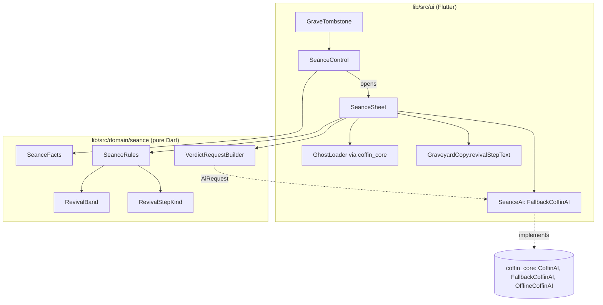
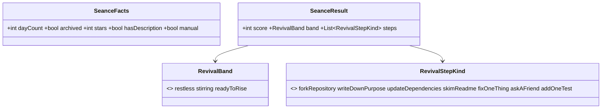

# Design Document: graveyard-seance

## Overview

This feature adds a séance ritual to the Graveyard app. Each Tombstone gets a "Hold a séance" control that opens a `Seance_Sheet`: a modal bottom sheet showing a Revival_Score (0 to 100), a Revival_Band ("Restless", "Stirring", "Ready to rise"), three Revival_Steps, and one Verdict_Line. The score, the band and the steps come from a new pure-Dart rules module, `SeanceRules`, that reads only the facts a `Grave` already carries — how long it has been dead, archived or not, star count, whether it has a description, and whether it was buried by hand or imported from GitHub — and never calls the clock. The Verdict_Line comes from the existing `CoffinAI` interface of `coffin_core`, through a `FallbackCoffinAI` whose primary and secondary are both `OfflineCoffinAI`, so it works offline with no key and no network call.

Nothing about this feature changes `packages/coffin_core`, Hauntagotchi or `tool/`. No package is added; `pubspec.lock` stays byte-for-byte unchanged. The result is never stored: `SeanceRules.evaluate` is a pure function of a `Grave` and `Today`, recomputed every time the sheet opens.

## Architecture



### Reused, unchanged `coffin_core`

`CoffinAI`, `AiRequest`, `AiReply`, `AiPurpose.seanceVerdict`, `AiFactKeys.projectName`, `AiFactKeys.daysSinceLastCommit`, `FallbackCoffinAI`, `OfflineCoffinAI`, `GhostLoader`, `CoffinColorTokens`/`SpookyTokens`, `CoffinGlow`, `CoffinMetrics`, `WcagContrast`. Nothing in `packages/coffin_core` is edited (Requirement 5.11, 13.3).

### Reused, unchanged `apps/graveyard`

`Grave`, `GraveSource`, `RepoInfo`, `CalendarDate`, `DeadFor` (for the Day_Count arithmetic convention — `SeanceRules` uses `Grave.dateOfDeath.daysUntil(today)` clamped at 0, the same clamp `GraveTombstone` already applies before calling `Weathering.of`), `StableHash` (`lib/src/domain/scene/stable_hash.dart`, reused unchanged to derive the verdict seed), `DescriptionCleaner` (reused unchanged to decide "has a description", so a description that is only an emoji shortcode or whitespace counts as no description, consistent with how the Tombstone already hides it), `GraveTombstone`, `GraveyardScene`, `GraveyardCopy`, `CoffinColorTokens`.

### Folder layout

```
apps/graveyard/lib/src/
├── domain/
│   ├── seance/                          # new: no Flutter, no dart:ui, no coffin_core, no import from ui/
│   │   ├── seance_facts.dart            # SeanceFacts (dayCount, archived, stars, hasDescription, source)
│   │   ├── revival_band.dart            # RevivalBand enum + RevivalBand.forScore(int)
│   │   ├── revival_step_kind.dart       # RevivalStepKind enum (pure; no text)
│   │   ├── revival_steps.dart           # RevivalSteps: chooses three kinds, fixed order
│   │   ├── seance_result.dart           # SeanceResult (score, band, steps) — no verdict
│   │   ├── seance_rules.dart            # SeanceRules.evaluate(grave, today) -> SeanceResult
│   │   └── verdict_request_builder.dart # VerdictRequestBuilder.forGrave(grave, today) -> AiRequest
│   └── ... (unchanged graveyard-core / graveyard-scene domain files)
├── ui/
│   ├── seance_control.dart              # new: the "Hold a séance" button on a Tombstone
│   ├── seance_sheet.dart                # new: the modal bottom sheet
│   ├── seance_ai.dart                   # new: builds the default Seance_Ai (FallbackCoffinAI)
│   ├── grave_tombstone.dart             # edited: adds the SeanceControl outside the stone area
│   ├── graveyard_copy.dart              # edited: adds every Seance_Copy string, incl. revivalStepText(RevivalStepKind)
│   └── ... (unchanged files)
```

`SeanceRules`, `RevivalBand`, `RevivalStepKind`, `RevivalSteps`, `SeanceResult` and `VerdictRequestBuilder` are one public class per file, in `snake_case.dart`, each with a doc comment on every public member (Requirement 13.1).

## Components and Interfaces

### Domain — séance rules

**`SeanceFacts`** (immutable, value equality) — the only input `SeanceRules` reads besides `Today`.

```dart
/// The facts a séance reads from a Grave. Built once per Seance_Sheet
/// opening; never read from storage or the clock itself.
final class SeanceFacts {
  const SeanceFacts({
    required this.dayCount,
    required this.archived,
    required this.stars,
    required this.hasDescription,
    required this.manual,
  });

  /// Days from the date of death to Today, from `Grave.dateOfDeath.daysUntil`,
  /// clamped to 0 (Requirement 2.9).
  final int dayCount;

  /// Whether the repository is archived. Always `false` for a manual grave.
  final bool archived;

  /// The star count. Always `0` for a manual grave.
  final int stars;

  /// Whether `DescriptionCleaner.clean(repo?.description ?? '')` is
  /// non-empty. Always `false` for a manual grave.
  final bool hasDescription;

  /// Whether the Grave was buried by hand (`GraveSource.manual`).
  final bool manual;

  /// Builds the facts of one Grave on one Today. The Grave id and name are
  /// never read (Requirement 2.2).
  factory SeanceFacts.of({required Grave grave, required CalendarDate today}) {
    final int rawDays = grave.dateOfDeath.daysUntil(today);
    final RepoInfo? repo = grave.source == GraveSource.github ? grave.repo : null;
    return SeanceFacts(
      dayCount: rawDays < 0 ? 0 : rawDays,
      archived: repo?.archived ?? false,
      stars: repo?.stars ?? 0,
      hasDescription: repo == null
          ? false
          : DescriptionCleaner.clean(repo.description ?? '').isNotEmpty,
      manual: grave.source == GraveSource.manual,
    );
  }
}
```

`SeanceFacts.of` lives in the Domain and takes only `Grave` and `CalendarDate`, so it imports `grave.dart`, `grave_source.dart`, `repo_info.dart`, `calendar_date.dart` and `scene/description_cleaner.dart` — all existing Domain files — and nothing from Flutter or `coffin_core` (Requirement 13.2).

**`RevivalBand`**

```dart
/// The word band of a Revival_Score.
enum RevivalBand {
  restless,
  stirring,
  readyToRise;

  /// Maps a score from 0 to 100 to its band (Requirement 3.1).
  /// Scores outside 0 to 100 are clamped first, so this never throws.
  static RevivalBand forScore(int score) {
    final int s = score < 0 ? 0 : (score > 100 ? 100 : score);
    if (s <= 39) return RevivalBand.restless;
    if (s <= 69) return RevivalBand.stirring;
    return RevivalBand.readyToRise;
  }
}
```

The display word ("Restless", "Stirring", "Ready to rise") is Seance_Copy, so it lives in `GraveyardCopy.revivalBandLabel(RevivalBand)`, not in this enum (Requirement 12.1).

**`SeanceRules` — the scoring formula.**

The score is the sum of four integer components, clamped into 0 to 100. Every component is computed with integer arithmetic only. Recency matters most (up to 70 points), stars help only a little (up to 10), and a small flat bonus rewards remembering what the project was. Each component moves the total only in the direction Requirements 2.5 to 2.8 name.

**Key decision: scoring weights and the manual bonus.** The first weights (age up to 45, stars up to 20) put "Ready to rise" out of reach for real side projects: it needed a death within 30 days and about 16,000 stars, a 10-star described project dead six months scored 36, and a manual grave (0 stars, no description) could never pass 45. Abandoned side projects mostly have under 50 stars, so stars cannot carry the score.

| Option | Trade-off |
| --- | --- |
| Keep the first weights and lower the band edges | Requirement 3.1 fixes the edges at 39/69. Rejected. |
| Raise age to 70 points, cut stars to 10, keep a small bonus | Recency decides the band, stars only nudge. A 10-star project dead a month scores Ready to rise, dead six months scores Stirring. Chosen. |

**Manual bonus rule (documented, not accidental):** the Remembered_Bonus of +6 applies when the Grave is described **or** was buried by hand. A manual Grave always gets it, even though it carries no description, because the user typed the name and date themselves ("you remember what it was"). A GitHub Grave gets it only when its cleaned description is non-empty. The rule reads only `hasDescription` and `manual`, both already in the Seance_Facts, so no new fact is added and requirements.md needs no change (the glossary says a manual Grave has "no description", which stays true; the bonus comes from the source, not from a description).

1. **Age points** — a non-increasing staircase of `dayCount`, so an older death never scores higher (Requirement 2.5):

   | `dayCount` | Age points |
   | --- | --- |
   | 0 to 30 | 70 |
   | 31 to 90 | 66 |
   | 91 to 180 | 56 |
   | 181 to 365 | 46 |
   | 366 to 730 | 34 |
   | 731 to 1095 | 24 |
   | 1096 to 1825 | 14 |
   | 1826 to 3650 | 6 |
   | 3651 or more | 0 |

   A negative `dayCount` cannot occur (`SeanceFacts.of` clamps it to 0), so the first row also covers Requirement 2.9.

2. **Star points** — `0` when `stars <= 0`, else `min(10, (stars + 1).bitLength)`, using Dart's `int.bitLength` (exact integer operation, safe on Web for any `stars` below 2^53, no floating-point logarithm, so no VM/Web difference — Requirement 2.11). `bitLength` is non-decreasing, and `_starPoints(0) = 0 <= _starPoints(1) = 2`, so more stars never score lower (Requirement 2.7). The cap is reached at 1,023 stars (`1024.bitLength = 11`, capped to 10; 511 stars gives `512.bitLength = 10`). A manual Grave always has 0 stars, so it gets 0 star points.

3. **Remembered_Bonus** — flat `+6` when `hasDescription || manual`, else `+0`. A fixed non-negative addition can only raise or hold the score (Requirement 2.8). Toggling `hasDescription` on a manual Grave changes nothing, because the bonus is already granted.

4. **Archived penalty** — flat `-25` when `archived` is true, `0` otherwise. A fixed non-positive addition can only lower or hold the score (Requirement 2.6).

```dart
abstract final class SeanceRules {
  /// Computes the Revival_Score, Revival_Band and Revival_Steps for one
  /// Grave on one Today. Pure, deterministic, never throws.
  ///
  /// Age carries up to 70 points, stars up to 10, the Remembered_Bonus 6
  /// (a described GitHub Grave, or any manual Grave) and an archived
  /// repository costs 25. The sum is clamped to 0 to 100.
  static SeanceResult evaluate(SeanceFacts facts) {
    final int raw = _agePoints(facts.dayCount) +
        _starPoints(facts.stars) +
        (facts.hasDescription || facts.manual ? 6 : 0) -
        (facts.archived ? 25 : 0);
    final int score = raw < 0 ? 0 : (raw > 100 ? 100 : raw);
    return SeanceResult(
      score: score,
      band: RevivalBand.forScore(score),
      steps: RevivalSteps.choose(facts),
    );
  }

  static int _agePoints(int dayCount) {
    if (dayCount <= 30) return 70;
    if (dayCount <= 90) return 66;
    if (dayCount <= 180) return 56;
    if (dayCount <= 365) return 46;
    if (dayCount <= 730) return 34;
    if (dayCount <= 1095) return 24;
    if (dayCount <= 1825) return 14;
    if (dayCount <= 3650) return 6;
    return 0;
  }

  static int _starPoints(int stars) {
    if (stars <= 0) return 0;
    final int bits = (stars + 1).bitLength;
    return bits > 10 ? 10 : bits;
  }
}
```

`SeanceRules.evaluate` takes only a `SeanceFacts` — no `Grave`, no id, no name (Requirement 2.2) — and performs no I/O and no randomness, so two calls with equal facts always return equal results (Requirement 2.4, 7.4). The raw sum ranges from `0 + 0 + 0 - 25 = -25` to `70 + 10 + 6 - 0 = 86`. The upper clamp can never fire with these weights, and the lower clamp fires for an archived Grave whose other points total under 25 (for example an archived manual-free repository dead over 3,650 days). Requirement 2.1 only requires the result to lie in 0 to 100 inclusive, which it always does. The clamp is a non-decreasing function of the raw sum, so every monotonicity property that holds for the raw sum also holds for the clamped score.

**`RevivalStepKind` — the pure step identifier.** The Domain never holds step text. It returns kinds, and the UI maps each kind to its wording.

```dart
/// The kind of one Revival_Step. Carries no user-facing text; the UI maps
/// each kind to its wording through `GraveyardCopy.revivalStepText`.
enum RevivalStepKind {
  /// Condition step: the repository is archived.
  forkRepository,

  /// Condition step: the Grave was buried by hand.
  writeDownPurpose,

  /// Condition step: dead for more than 365 days.
  updateDependencies,

  /// General fill step 1.
  skimReadme,

  /// General fill step 2.
  fixOneThing,

  /// General fill step 3.
  askAFriend,

  /// General fill step 4.
  addOneTest,
}
```

**`RevivalSteps` — the three-step choice.**

```dart
abstract final class RevivalSteps {
  /// The fixed general kinds, tried in this order to fill any remaining
  /// place (Requirement 4.7).
  static const List<RevivalStepKind> generalKinds = <RevivalStepKind>[
    RevivalStepKind.skimReadme,
    RevivalStepKind.fixOneThing,
    RevivalStepKind.askAFriend,
    RevivalStepKind.addOneTest,
  ];

  /// Chooses exactly three distinct kinds, highest-priority
  /// condition-driven kinds first, filled from the fixed general list.
  static List<RevivalStepKind> choose(SeanceFacts facts) {
    final List<RevivalStepKind> conditionKinds = <RevivalStepKind>[
      if (facts.archived) RevivalStepKind.forkRepository,
      if (facts.manual) RevivalStepKind.writeDownPurpose,
      if (facts.dayCount > 365) RevivalStepKind.updateDependencies,
    ];
    final List<RevivalStepKind> chosen = conditionKinds.take(3).toList();
    for (final RevivalStepKind kind in generalKinds) {
      if (chosen.length == 3) break;
      if (!chosen.contains(kind)) chosen.add(kind);
    }
    return chosen;
  }
}
```

The condition list is built in a single fixed order (archived, manual, old). When more than three conditions apply (Requirement 4.8), `conditionKinds.take(3)` keeps the first three in that priority order: `forkRepository`, then `writeDownPurpose`, then `updateDependencies`. With at most three conditions possible in this version of the rules, `take(3)` is a no-op today but is the seam where the priority order lives if a fourth condition is added. `generalKinds` is iterated in a fixed order and skipped when already chosen, so the result always has exactly three distinct kinds (Requirements 4.1, 4.2, 4.7) with no randomness (Requirement 4.3). Enum values compare by identity, so no `==` override is needed.

**Key decision: the Domain imports nothing from `ui/`, with no exception.** Step text is Seance_Copy and Seance_Copy lives in `GraveyardCopy` (`lib/src/ui/graveyard_copy.dart`), so the Domain cannot reference the text constants. The Domain returns `RevivalStepKind` values only, and the UI turns each kind into text.

| Option | Trade-off |
| --- | --- |
| Domain `RevivalStep` wraps `GraveyardCopy` constants | Needs a Domain import of a `ui/` file. Rejected by the user: the import rule stays strict. |
| Domain returns `RevivalStepKind`; `GraveyardCopy.revivalStepText(kind)` maps it | Domain stays free of `ui/`, Flutter and `coffin_core`. Chosen. |

**Mapping in `GraveyardCopy`** (the one place the kind-to-text table exists):

```dart
/// The Seance_Copy text of one Revival_Step kind.
static String revivalStepText(RevivalStepKind kind) => switch (kind) {
  RevivalStepKind.forkRepository => stepForkRepository,
  RevivalStepKind.writeDownPurpose => stepWriteDownPurpose,
  RevivalStepKind.updateDependencies => stepUpdateDependencies,
  RevivalStepKind.skimReadme => stepSkimReadme,
  RevivalStepKind.fixOneThing => stepFixOneThing,
  RevivalStepKind.askAFriend => stepAskAFriend,
  RevivalStepKind.addOneTest => stepAddOneTest,
};
```

The `switch` expression has no default branch, so Dart's exhaustiveness check makes adding an enum value without adding its text a compile error. `graveyard_copy.dart` imports `revival_step_kind.dart` (UI to Domain, the allowed direction).

Every step text is at most 48 characters, uses only Allowed_Characters, is written in the imperative and never shames the user (Requirements 4.10, 12.6):

| Kind | Text | Length |
| --- | --- | --- |
| `forkRepository` | "Fork the repository before you touch anything" | 45 |
| `writeDownPurpose` | "Write down what the project was meant to do" | 43 |
| `updateDependencies` | "Update dependencies before writing new code" | 43 |
| `skimReadme` | "Open the repository and skim the README" | 39 |
| `fixOneThing` | "Pick one small bug or TODO to fix first" | 39 |
| `askAFriend` | "Ping a friend to co-revive it with you" | 38 |
| `addOneTest` | "Add one test before changing any code" | 37 |

(The 48-character maximum comes from Requirement 4.9: at the Seance_Sheet's content width of at least 320 logical px at the default text scale, the longest line above fits on one line with headroom for later copy edits.)


**`SeanceResult`**

```dart
/// The outcome of a séance, without the Verdict_Line (which is async and
/// comes from `CoffinAI`, not from `SeanceRules`).
final class SeanceResult {
  const SeanceResult({required this.score, required this.band, required this.steps});
  final int score;
  final RevivalBand band;
  final List<RevivalStepKind> steps;

  @override
  bool operator ==(Object other) =>
      other is SeanceResult &&
      other.score == score &&
      other.band == band &&
      other.steps.length == steps.length &&
      _sameOrder(other.steps, steps);
  @override
  int get hashCode => Object.hash(score, band, Object.hashAll(steps));
}
```

### Key decision: where the verdict request builder lives

Requirement 13.2 bans `package:coffin_core` from every file under `domain/`. Building the `AiRequest` needs `AiRequest`, `AiPurpose.seanceVerdict` and `AiFactKeys`, all from `coffin_core`. So the request builder cannot be a Domain file, even though it is pure and deterministic.

| Option | Trade-off |
| --- | --- |
| Put the builder in `domain/seance/` anyway, as `VerdictRequestBuilder` | Violates Requirement 13.2 outright; `test/source_rules/domain_sources_test.dart`'s existing recursive scan of `domain/` would fail the build. Rejected. |
| Put it in `lib/src/ui/seance_ai.dart` as a top-level function `buildVerdictRequest({required Grave grave, required SeanceFacts facts})` | `SeanceFacts` and `Grave` are both plain Domain data with no Flutter dependency, so a UI-layer file can depend on them and on `coffin_core` at the same time with no boundary violation (the existing `grave_tombstone.dart` already imports both `coffin_core` and several `domain/` files). The function is still pure and still gets a unit test and the deterministic-seed property test (Requirement 14.1, 14.13) — Requirement 13.2 only restricts the **Domain**, not every pure function in the app. |

**Decision: `buildVerdictRequest` lives in `lib/src/ui/seance_ai.dart`**, not under `domain/seance/`. The folder layout above reflects this: `domain/seance/` holds only `seance_facts.dart`, `revival_band.dart`, `revival_step.dart`, `revival_steps.dart`, `seance_result.dart` and `seance_rules.dart` — none of which import `coffin_core` — and `seance_ai.dart` holds both `buildVerdictRequest` and `buildSeanceAi` (below).

```dart
/// Builds the `AiRequest` for the Verdict_Line (Requirement 5.1-5.3).
AiRequest buildVerdictRequest({required Grave grave, required SeanceFacts facts}) {
  final int seed = StableHash.of(grave.id) % (AiRequest.maxSeed + 1);
  return AiRequest(
    purpose: AiPurpose.seanceVerdict,
    facts: <String, Object?>{
      AiFactKeys.projectName: grave.name,
      AiFactKeys.daysSinceLastCommit: facts.dayCount,
    },
    maxLength: verdictMaxLength,
    seed: seed,
  );
}

const int verdictMaxLength = 140;
```

`StableHash.of` returns a non-negative `int` below 2^31 (`% 2147483648` in its own implementation), so `% (AiRequest.maxSeed + 1)` (`AiRequest.maxSeed` is `4294967295`) is a no-op range reduction that only guards the contract at the type level; the result is always in `0` to `AiRequest.maxSeed`, is a pure function of `grave.id`, and is therefore the same for the same Grave on every opening on the same day (Requirement 5.3) — `Today` does not enter the seed, by design, since the id alone is enough to keep the line stable across openings within the same session, and "on the same day" in the requirement is satisfied trivially because nothing about the request changes between two openings with no change to the Grave. `maxLength` is `140`, inside the required 16 to 140 range.

### UI

**`SeanceControl`** — the "Hold a séance" button on a Tombstone.

```dart
class SeanceControl extends StatelessWidget {
  const SeanceControl({super.key, required this.grave, required this.onPressed});
  final Grave grave;
  final VoidCallback onPressed;
}
```

Rendered as an `OutlinedButton` (or `TextButton`, matching the existing Delete button's `TextButton.icon` pattern in `GraveTombstone`) with `minimumSize: Size(48, 48)` and `tapTargetSize: MaterialTapTargetSize.padded` (Requirement 1.2), `Semantics(button: true, label: GraveyardCopy.seanceControlLabel(grave.name))` giving "Hold a séance for &lt;name&gt;" (Requirement 1.3), and the label text `GraveyardCopy.seanceControlText` = "Hold a séance" (Requirement 1.1). Flutter's `TextButton`/`OutlinedButton` already provide a focus ring, a hover overlay and a pressed overlay from the ambient `Theme`, and are keyboard-activatable on Enter and Space by default (`ElevatedButton`/`TextButton`/`OutlinedButton` all build on `ButtonStyleButton`, which wires `Focus` + `Actions` for `ActivateIntent`) — satisfying Requirement 1.4 and 1.5 with no new state. `GraveTombstone` places it in the `Column` **below** the delete button (both outside the `Stack` that holds the stone, exactly where the delete button already sits today), so it lies outside the stone area and cannot overlap the stone's text or the delete control (Requirement 1.6); `onPressed` calls `showSeanceSheet(context, grave: grave, today: today, seanceAi: ...)`.

**`showSeanceSheet`** (in `seance_sheet.dart`) opens the sheet with `showModalBottomSheet<void>` (matching `showAddGraveSheet`'s and `showDeleteGraveDialog`'s existing pattern of a module-level `show...` function around a `StatefulWidget`), `isScrollControlled: true`, and a `useRootNavigator`/route-settings pairing that gives the route the name "Séance for &lt;name&gt;" (Requirement 10.4) via `RouteSettings(name: GraveyardCopy.seanceRouteName(grave.name))`. `GraveTombstone` tracks a local `bool _seanceOpen` (or simply relies on `showModalBottomSheet`'s own single-route-at-a-time behavior: a second tap while the sheet's route is on the stack is a no-op because the button sits behind the modal barrier the first sheet already raised) to satisfy Requirement 1.8 — concretely, the barrier that `showModalBottomSheet` raises over the whole screen already makes the control itself unreachable once a sheet is open, which is simpler than new state and is the same mechanism `showAddGraveSheet` already relies on for "only one sheet at a time".

**`SeanceSheet`** — `StatefulWidget`.

```dart
class SeanceSheet extends StatefulWidget {
  const SeanceSheet({super.key, required this.grave, required this.today, required this.seanceAi});
  final Grave grave;
  final CalendarDate today;
  final CoffinAI seanceAi;
}
```

`initState` computes `final SeanceFacts facts = SeanceFacts.of(grave: grave, today: today);` and `final SeanceResult result = SeanceRules.evaluate(facts);` once, synchronously, so the first `build` already has the score, band and steps (Requirement 6.1, 7.1). It also calls `seanceAi.ask(buildVerdictRequest(grave: grave, facts: facts))` once in `initState` (not in `build`, so it is not re-sent on every rebuild) and stores the `Future<AiReply>`. A `_VerdictState` (`pending`, `ready(String)`, `fallback`) `ValueNotifier` (or plain `setState`, since `ListenableBuilder`/`ChangeNotifier` is the project's only allowed state tool, and a three-value `setState` is simpler than a `ChangeNotifier` for state fully local to one widget) starts at `pending` and is flipped by the future's `then`/`catchError`, guarded by a `_disposed` flag checked before every `setState` so a reply that arrives after the sheet closes is dropped without touching a disposed widget (Requirement 5.10). The `FallbackCoffinAI`'s own `timeout` (see `SeanceAi`, below) already resolves the future with the Safe_Verdict_Line path inside `coffin_core`'s fallback logic when the primary is slow, but because both the primary and the secondary here are the same `OfflineCoffinAI` (synchronous, in-memory, no I/O), the Verdict_Wait_Limit in practice is reached only if a reply is unusable (blank or over `maxLength`) or throws — the ghost loader therefore shows for at most one microtask in the common case, and the sheet still always renders its `pending` branch in the first frame so the contract holds even if a future test substitutes a slower fake `CoffinAI` (Requirement 5.9, 6.2).

Layout, in order (Requirement 8.2): a title row with the Grave name and the close button; the Revival_Score and Revival_Band as text (`"${result.score} / 100 · ${GraveyardCopy.revivalBandLabel(result.band)}"`, with the numeric and the word both always on screen, never color-only — Requirement 3.4, 3.5); a numbered list of the three Revival_Steps (each kind shown as `GraveyardCopy.revivalStepText(kind)`); the Verdict_Line area (a `GhostLoader(caption: GraveyardCopy.seanceThinkingCaption)` while `pending`, the reply text while `ready`, or `GraveyardCopy.safeVerdictLine` while `fallback`). The whole result block is wrapped once in a `FadeTransition` driven by a single non-repeating `AnimationController` (`vsync: this`, duration from `CoffinMetrics`'s existing 300 to 600 ms range, `Curves.easeInOut`) that plays once in `initState` unless `MediaQuery.disableAnimationsOf(context)` is true, in which case the controller is created already at `value: 1` and never animated (Requirement 8.3, 8.4) — the same `syncLoop`-style reduced-motion check `FogBackground`/`GraveyardScene` already use, applied to a one-shot controller instead of a repeating one. The controller is disposed in `dispose()`, guarded against a double-dispose if the sheet is popped mid-reveal (Requirement 8.7), mirroring `GraveyardScene`'s per-tombstone Rise controller disposal.

Colors come from `SpookyTokens.of(context)`/`CoffinColorTokens` only (Requirement 8.5); the sheet's `Material`/`Container` uses `BorderRadius.circular(16)` and `CoffinGlow.decoration` or an equivalent soft-glow decoration already used by `TombstoneCard`/`AddGraveSheet`, consistent with the rest of the app's modals. Scroll control: the sheet's content is wrapped in a `SingleChildScrollView` inside a `DraggableScrollableSheet`-free `BottomSheet` (matching `AddGraveSheet`'s existing simpler pattern — a fixed-anchor modal sheet with internal scrolling, not a draggable sheet with a scroll handle), with `SafeArea` padding and a `ConstrainedBox(maxWidth: 560)` centered via `Center` (Requirement 8.1, 11.2).

Closing: the sheet is a standard `showModalBottomSheet` route, so Escape, a tap outside and a drag-to-dismiss on the sheet's own drag handle all already pop the route via Flutter/Material's own `BottomSheet` and `ModalRoute` behavior; the explicit close button (`IconButton`/`TextButton`, 48×48, `Semantics(label: GraveyardCopy.closeSeanceLabel)`) calls `Navigator.pop` (Requirement 9.1, 9.2). `autofocus` on the close button (or the title, wrapped in a `FocusScope`/`Semantics(namesRoute: false)` node marked as the initial focus) satisfies Requirement 9.3; Flutter's modal route already traps focus inside the route's `FocusScope` for Requirement 9.5, and already restores focus to the widget that had it before `showModalBottomSheet` was awaited — which is the `SeanceControl` that was tapped, because nothing else claims focus in between — for Requirement 9.4, as long as the `SeanceControl`'s `BuildContext`/`FocusNode` is still in the tree (the requirement's own "WHERE that control is still in the tree" clause matches exactly what Flutter's own focus-restore already does and does not do if the Tombstone was deleted while the sheet was open).

Accessibility: one `Semantics` node around the score/band row with `label: GraveyardCopy.revivalScoreLabel(result.score, result.band)` → "Revival score &lt;n&gt; out of 100, &lt;band&gt;" (Requirement 10.1), `ExcludeSemantics` wrapping the row's raw `Text` children so the label is not read twice; each step row wrapped in its own `Semantics(label: GraveyardCopy.revivalStepLabel(index + 1, 3, GraveyardCopy.revivalStepText(kind)))` → "Step &lt;k&gt; of 3: &lt;text&gt;" (Requirement 10.2); the Verdict_Line area wrapped in `Semantics(liveRegion: true)` (Requirement 10.3); `ExcludeSemantics` around the `GhostLoader`'s own graphic and around the `FadeTransition`'s child during the reveal, so no decorative node is exposed (Requirement 10.5); the route name from `RouteSettings` above (Requirement 10.4); every text styled from `CoffinTypography`/`textTheme`, already proven to hold `WcagContrast.ratio >= 4.5` for text against `surface`/`raised`/`background` in both themes by `CoffinColorTokens.contrastPairs` (the same guarantee `graveyard-scene`'s Property 16 already leans on), checked again here as Property 9 below because the sheet uses its own `raised`/`surface` combination for its background (Requirement 10.6); text wraps (no `maxLines`/`overflow: ellipsis` on the score, band, step or verdict text) and the sheet scrolls, so a 2.0 text scale never clips (Requirement 10.7, 11.1).

If the Grave is deleted from the list while its sheet is open, the sheet keeps the `Grave` instance it was built with as a `final` field, not a live lookup into `GraveListController`, so it keeps showing the same result until the user closes it (Requirement 8.8); `GraveyardScene`/`GraveListController` are otherwise untouched by this feature, so the scene's scroll position and Tombstones are unaffected by opening or closing a sheet (Requirement 9.6, 13.7).

**`SeanceAi`** (`lib/src/ui/seance_ai.dart`) — the default wiring, alongside `buildVerdictRequest` above:

```dart
/// The default Seance_Ai: two Offline engines behind one fallback, so the
/// séance works with no network and no key (Requirement 5.4, 5.5).
CoffinAI buildSeanceAi() => FallbackCoffinAI(
  primary: const OfflineCoffinAI(),
  secondary: const OfflineCoffinAI(),
  timeout: verdictWaitLimit,
);

/// The longest time the Seance_Sheet waits before showing the
/// Safe_Verdict_Line (Requirement 5.4's "at most 3 seconds").
const Duration verdictWaitLimit = Duration(seconds: 3);
```

`GraveyardScreen`/`main.dart` build one `CoffinAI` with `buildSeanceAi()` and pass it down to `GraveyardScene` → `GraveTombstone` → `SeanceControl`/`showSeanceSheet` as a constructor argument, so a widget test can substitute a fake `CoffinAI` at the same seam (Requirement 5.6) — mirroring how `GraveListController` is itself built once in `main.dart` and threaded down through `GraveyardScreen`'s constructor today.

## Data Models

No new persisted data model. `SeanceFacts` and `SeanceResult` are transient, recomputed every time a `Seance_Sheet` opens, and are never written to `GraveStorage`/`GraveCodec`, which stay untouched (Requirement 7.2, 7.3, 11.11-equivalent for this feature: Requirement 7.2).



## Worked examples

Reference day for every example: **Today = 2024-01-15**. `dayCount = max(0, dateOfDeath.daysUntil(today))`. Score = `age + stars + bonus - archived`, clamped to 0 to 100, where `age` is the table above, `stars = 0` if `stars <= 0` else `min(10, (stars + 1).bitLength)`, `bonus = 6` if described or manual else `0`, and `archived = 25` if archived else `0`.

| # | Grave (facts) | Age | Stars | Bonus | Archived | Raw = score | Band |
| --- | --- | --- | --- | --- | --- | --- | --- |
| 1 | Side project, GitHub, 10 stars, described, dead **30 days** (died 2023-12-16) | 70 (`<=30`) | `(11).bitLength = 4` → 4 | +6 | 0 | `70+4+6-0 = 80` | **Ready to rise** |
| 2 | Side project, GitHub, 10 stars, described, dead **182 days** (died 2023-07-17) | 46 (`181-365`) | 4 | +6 | 0 | `46+4+6-0 = 56` | **Stirring** |
| 3 | Manual grave, dead **60 days** (died 2023-11-16) | 66 (`31-90`) | 0 | +6 (manual) | 0 | `66+0+6-0 = 72` | **Ready to rise** |
| 4 | Manual grave, dead **4,015 days** (about 11 years) | 0 (`>=3651`) | 0 | +6 (manual) | 0 | `0+0+6-0 = 6` | **Restless** |
| 5 | `flutter/flutter`, GitHub, dead **0 days**, 181,400 stars, active, described | 70 | `(181401).bitLength = 18` → capped 10 | +6 | 0 | `70+10+6-0 = 86` | **Ready to rise** |
| 6 | `atom/atom`, GitHub, archived, dead **1,095 days**, 60,680 stars, described | 24 (`731-1095`) | `(60681).bitLength = 16` → capped 10 | +6 | −25 | `24+10+6-25 = 15` | **Restless** |
| 7 | `mojombo/grit`, GitHub, not archived, dead **1,095 days**, 2,000 stars, described | 24 | `(2001).bitLength = 11` → capped 10 | +6 | 0 | `24+10+6-0 = 40` | **Stirring** (low edge: 40 is the first Stirring score) |
| 8 | `octocat/Hello-World`, GitHub, not archived, **no description**, 4,000 stars, dead **730 days** (died 2022-01-15) | 34 (`366-730`) | `(4001).bitLength = 12` → capped 10 | +0 | 0 | `34+10+0-0 = 44` | **Stirring** |

Steps (the existing choice: archived → fork, manual → write-down, `dayCount > 365` → update dependencies, then general fill in the order skim README, fix one thing, ask a friend, add one test):

| # | Revival_Steps, in order (kinds, with the text each maps to in `GraveyardCopy`) |
| --- | --- |
| 1 | 1. `skimReadme` ("Open the repository and skim the README") 2. `fixOneThing` ("Pick one small bug or TODO to fix first") 3. `askAFriend` ("Ping a friend to co-revive it with you") |
| 2 | Same as row 1 (182 days is not over 365, not archived, not manual) |
| 3 | 1. `writeDownPurpose` ("Write down what the project was meant to do") 2. `skimReadme` ("Open the repository and skim the README") 3. `fixOneThing` ("Pick one small bug or TODO to fix first") |
| 4 | 1. `writeDownPurpose` ("Write down what the project was meant to do") 2. `updateDependencies` ("Update dependencies before writing new code") 3. `skimReadme` ("Open the repository and skim the README") |
| 5 | Same as row 1 |
| 6 | 1. `forkRepository` ("Fork the repository before you touch anything") 2. `updateDependencies` ("Update dependencies before writing new code") 3. `skimReadme` ("Open the repository and skim the README") |
| 7 | 1. `updateDependencies` ("Update dependencies before writing new code") 2. `skimReadme` ("Open the repository and skim the README") 3. `fixOneThing` ("Pick one small bug or TODO to fix first") |
| 8 | Same as row 7 (730 days is over 365) |

**Stability of the "1 month", "2 months" and "6 months" rows.** The chosen day counts are not edge cases. For row 1, 28 to 30 days score 80 and 31 days scores `66+4+6 = 76`, so 28 to 31 days all stay Ready to rise (the band edge is 70, so a 10-star described project stays Ready to rise through 90 days: `66+4+6 = 76`; at 91 days it is `56+4+6 = 66`, Stirring). For row 2, 180 days scores `56+4+6 = 66` and 181 to 184 days score 56, so 180 to 184 days all stay Stirring. For row 3, 59 to 62 days all fall in the 31 to 90 bracket and score 72, so they stay Ready to rise (91 days would score `56+0+6 = 62`, Stirring).

**What the table shows.** A 10-star described side project is Ready to rise within about three months and Stirring until a year (`46+4+6 = 56` at 365 days; at 366 days `34+4+6 = 44`, still Stirring; it reaches Restless around 731 days, `24+4+6 = 34`). A manual grave reaches Ready to rise (row 3), Stirring (365 days: `46+0+6 = 52`) and Restless (row 4). An archived repository stays Restless even with many stars (row 6). Row 8 is an honest result: no description and no archive flag, 4,000 stars, two years dead, gives Stirring at 44 because stars add at most 10 points. Row 7 sits exactly on the Stirring floor, so a change of one point in any weight would flip its band; the unit test pins the facts and the exact score.

This table becomes `apps/graveyard/test/domain/seance/worked_examples_test.dart` (mirroring `lib/src/domain/seance/`), one unit test per row (all eight), each constructing the `SeanceFacts` shown (manual rows: `manual: true, archived: false, stars: 0, hasDescription: false`) and asserting that `SeanceRules.evaluate(facts)` equals the exact score, band and the three `RevivalStepKind` values in the order shown. The text each kind maps to is checked once in the copy test, not here, so this Domain test imports nothing from `ui/`.

## Correctness Properties

*A property is a characteristic or behavior that should hold true across all valid executions of a system—essentially, a formal statement about what the system should do. Properties serve as the bridge between human-readable specifications and machine-verifiable correctness guarantees.*

### Property 1: Revival_Score stays in range

For all Seance_Facts, `SeanceRules.evaluate(facts).score` is an integer between 0 and 100 inclusive.

**Validates: Requirements 2.1, 2.10, 14.4**

### Property 2: Evaluation is deterministic

For all Seance_Facts, calling `SeanceRules.evaluate` twice with the same facts returns equal `SeanceResult`s.

**Validates: Requirements 2.4, 7.4, 14.5**

### Property 3: Older death never scores higher

For all pairs of Seance_Facts that are equal except for `dayCount`, the facts with the larger `dayCount` has a score less than or equal to the score of the facts with the smaller `dayCount`.

**Validates: Requirements 2.5, 14.6**

### Property 4: Archived never scores higher

For all Seance_Facts, the score of the facts with `archived = true` is less than or equal to the score of the same facts with `archived = false` and every other field unchanged.

**Validates: Requirements 2.6, 14.7**

### Property 5: More stars never scores lower

For all pairs of Seance_Facts that are equal except for `stars`, the facts with the larger `stars` has a score greater than or equal to the score of the facts with the smaller `stars`.

**Validates: Requirements 2.7**

### Property 6: A description never scores lower

For all Seance_Facts, the score of the facts with `hasDescription = true` is greater than or equal to the score of the same facts with `hasDescription = false` and every other field unchanged.

**Validates: Requirements 2.8**

### Property 7: Exactly three distinct steps

For all Seance_Facts, `RevivalSteps.choose(facts)` returns exactly three `RevivalStepKind` values, and they are pairwise distinct.

**Validates: Requirements 4.1, 4.2, 14.8**

### Property 8: Revival_Band is total and monotonic

For all Revival_Scores from 0 to 100, `RevivalBand.forScore` returns exactly one band, and for any two scores `a <= b`, the band of `a` is not "higher" than the band of `b` in the order Restless < Stirring < Ready to rise.

**Validates: Requirements 3.2, 3.3, 14.9**

### Property 9: Revival_Step text obeys the copy rules for every kind

For all `RevivalStepKind` values (the enum is finite, so the test iterates `RevivalStepKind.values`), `GraveyardCopy.revivalStepText(kind)` is at most 48 characters and contains only Allowed_Characters. Because `RevivalSteps.choose` returns only kinds, this covers the text of every step any Seance_Facts can produce.

**Validates: Requirements 4.9, 12.6, 14.10**

### Property 10: Verdict request facts and seed are stable

For all Graves and all Seance_Facts, `buildVerdictRequest(grave: grave, facts: facts).facts` contains exactly the two keys `AiFactKeys.projectName` and `AiFactKeys.daysSinceLastCommit` with the Grave's name and the facts' `dayCount`, and for any two calls with the same Grave id, the returned seed is the same regardless of `facts` or the Grave's other fields.

**Validates: Requirements 5.2, 5.3, 14.13**

### Property 11: Manual graves get the Remembered_Bonus and can reach every band

For all Day_Counts, the facts of a manual Grave (`manual = true`, `archived = false`, `stars = 0`, with `hasDescription` either true or false) have a score equal to `clamp(agePoints(dayCount) + 6)`, which equals the score of a GitHub Grave with the same Day_Count, 0 stars, not archived and a description. The score of a manual Grave never differs between `hasDescription = true` and `hasDescription = false`. The representative examples `dayCount = 60` (72, Ready to rise), `dayCount = 365` (52, Stirring) and `dayCount = 4015` (6, Restless) show that a manual Grave reaches every band.

**Validates: Requirements 2.1, 2.8, 3.1, 4.6**

**Reflection on the properties.** A separately-considered "a Grave with a larger dayCount, more stars, a description and not archived always lands in a band at least as high" property was dropped in favor of Properties 3 to 6 plus Property 8, because the per-field monotonicity of the score (3 to 6) composed with the band's own monotonicity (8) already implies the combined claim — testing it again as its own property would duplicate the same generators and catch no failure the component properties miss. A considered "the Day_Count-0 case returns a valid score" property was dropped as redundant with Property 1 (which already quantifies over all Seance_Facts, including `dayCount = 0`) plus the dedicated unit test pinning that exact boundary; Requirement 2.9 is about the *clamp before* `SeanceRules` ever runs (`SeanceFacts.of`'s `rawDays < 0 ? 0 : rawDays`), so it is better covered by a `SeanceFacts.of` unit test with a future date of death than by a property on `SeanceRules` itself, which never sees a negative `dayCount` by construction. A considered "fill-in steps keep the result at three when zero, one, two or three conditions apply" property was folded into Property 7, since Property 7's "exactly three, pairwise distinct" claim already has to hold across the full space of Seance_Facts, which includes zero-, one-, two- and three-condition facts as ordinary generated cases — a separate property would only relabel the same check. Properties 1 and 3 to 6 hold for the clamped score because each holds for the raw sum (a sum of terms that are each non-increasing or non-decreasing in the changed fact, or fixed) and the clamp is non-decreasing. Property 11 is kept separate from Property 6 because it pins the manual rule (bonus independent of `hasDescription`) and the band reach, which Property 6's `>=` claim does not. Property 10 covers both Requirement 5.2 (the facts) and 5.3 (the seed) in one property because they are two assertions about the same single function call on the same generated input, and splitting them would double the generator machinery for the same `VerdictRequestBuilder`/`buildVerdictRequest` under test twice.

## Error Handling

- `SeanceRules.evaluate` never throws: every branch of `_agePoints`/`_starPoints` is total over all integers, and the final clamp guarantees a 0-100 result even if future tuning changes the weights (Requirement 2.10).
- `SeanceFacts.of` never throws: `daysUntil` can return a negative number (a future date of death, Requirement 2.9's trigger) and is clamped to 0; `DescriptionCleaner.clean` already never throws on any `String` (established by `graveyard-scene`'s design).
- `RevivalSteps.choose` never returns fewer than three steps: `RevivalSteps.generalKinds` has four entries, strictly more than the at most three condition kinds ever taken, so the fill loop always has an unused general step to reach for.
- If `seanceAi.ask` throws synchronously or its `Future` completes with an error, `SeanceSheet` catches it in the `catchError` attached once in `initState` and sets `_VerdictState.fallback`; no error text, icon or retry control is ever built (Requirement 5.8, 6.4).
- If `seanceAi.ask`'s `Future` has not completed by the time `verdictWaitLimit` elapses, that is `FallbackCoffinAI`'s own internal timeout racing its primary; because both the primary and the secondary configured by `buildSeanceAi()` are an `OfflineCoffinAI` (synchronous and total), this path is only reachable in tests that inject a slower fake primary — in that case `FallbackCoffinAI.ask` itself resolves to the secondary's (fake) reply or throws `AiFallbackError`, and `SeanceSheet` treats either outcome the same as any other reply/error path above (Requirement 5.9).
- If the `SeanceSheet` is popped (closed) before `seanceAi.ask`'s future completes, the `_disposed` flag set in `dispose()` is checked before the `then`/`catchError` callbacks call `setState`, so a late reply is silently dropped and no "setState after dispose" exception is thrown (Requirement 5.10).
- If the Grave the sheet was opened for is deleted from `GraveListController` while the sheet is open, the sheet does not re-read the controller; it keeps its own `final Grave grave` field, so it has nothing to fail to find (Requirement 8.8).

## Testing Strategy

**Unit tests** (new, under `apps/graveyard/test/domain/seance/` mirroring `lib/src/domain/seance/`, plus one UI-adjacent file for the request builder):
- `seance_facts_test.dart`: a manual grave gives `archived = false, stars = 0, hasDescription = false`, regardless of what its (absent) `repo` would otherwise say; a GitHub grave with no `description` gives `hasDescription = false`; a GitHub grave whose description is only an emoji shortcode (cleans to empty) gives `hasDescription = false`; a future `dateOfDeath` gives `dayCount = 0`.
- `seance_rules_test.dart`: the exact age-point table boundaries 0, 30, 31, 90, 91, 180, 181, 365, 366, 730, 731, 1095, 1096, 1825, 1826, 3650, 3651; `stars = 0` gives 0 star points exactly (not `bitLength(1) = 1`); `stars = 1` gives 2 points and `stars = 1023` and above give exactly 10; the Remembered_Bonus is 6 for a manual Grave with `hasDescription` true or false and for a described GitHub Grave, and 0 for an undescribed GitHub Grave; the raw maximum `70+10+6-0 = 86` stays below 100, and an archived Grave with `dayCount = 4015` and no bonus has raw `-25` and clamps to 0.
- `revival_band_test.dart`: the band edges 0, 39, 40, 69, 70, 100 (Requirement 3.1, 14.9's example half).
- `revival_steps_test.dart`: zero conditions (three general kinds, in `generalKinds` order); exactly one, two and three conditions each produce that many condition kinds followed by general-list fill; all three conditions at once keeps all three in priority order `forkRepository`, `writeDownPurpose`, `updateDependencies` (no fourth condition exists today, so Requirement 4.8's "more than three" branch has no live example — noted here rather than tested, since there is nothing to construct it from with the current rules).
- `worked_examples_test.dart` (`apps/graveyard/test/domain/seance/worked_examples_test.dart`): all eight rows of the Worked examples table above (including the nearby day counts 28 to 31, 59 to 62 and 180 to 184 for rows 1 to 3), each asserting the exact score, band and the three kinds in order.
- `seance_ai_test.dart` (`apps/graveyard/test/ui/seance_ai_test.dart`, since `buildVerdictRequest`/`buildSeanceAi` live in `lib/src/ui/seance_ai.dart`): `buildVerdictRequest`'s facts map has exactly the two required keys with the right values; the same Grave id gives the same seed across two calls with different `facts`; `buildSeanceAi()` returns a `FallbackCoffinAI` whose `primary`/`secondary` are both `OfflineCoffinAI` and whose `timeout` equals `verdictWaitLimit` (3 seconds).

**Property tests** (glados, `apps/graveyard/test/domain/seance/*_property_test.dart`), using Web_Safe_Generators built from `anyIntBetween`/`anyListBetween` in the existing `test/domain/support/grave_generators.dart`, extended with an `anySeanceFacts` generator (`dayCount` from `anyIntBetween(0, 20000)` with the fixed edges 0, 30, 31, 90, 91, 180, 181, 365, 366, 730, 731, 1095, 1096, 1825, 1826, 3650, 3651 folded in the way `anyDayCount`/`anyCrackInput` already fold fixed edges into a `Generator`; `stars` from `anyIntBetween(0, 1048576)` with the fixed values 0, 1, 511, 1023, 2000, 60680, 181400 folded in; a separate `anyManualFacts` generator (`manual = true`, `archived = false`, `stars = 0`, `hasDescription` random) for Property 11; `archived`/`hasDescription`/`manual` from a small `anyBool`-equivalent built on `anyIntBetween(0, 1).map((n) => n == 1)`), at least 200 iterations each (matching `graveyard-scene`'s convention, above the 100-iteration minimum), tagged:
```dart
// Feature: graveyard-seance, Property 3: Older death never scores higher
// Validates: Requirements 2.5, 14.6
```

**Widget tests** (`apps/graveyard/test/ui/`), using `FakeClock`, `MemoryRecordRepository<Grave>` (via the existing `ControllerHarness`) and a fake `CoffinAI` built for this feature (`FakeCoffinAI` in `test/support/`, configurable to reply immediately, reply after a pumped delay, throw, or return a blank/over-length reply):
- `seance_control_test.dart`: the control's label, semantic label with the Grave's name, 48×48 tap target, and that activating it opens a `SeanceSheet` (found by its route name or a `Key`).
- `seance_sheet_test.dart`: the score/band/steps are present in the very first frame with a `FakeCoffinAI` configured to never complete; the Verdict_Line replaces the ghost loader once the fake's future is completed and pumped, without moving the score/steps (`tester.getTopLeft` unchanged); the Safe_Verdict_Line shows on a `FakeCoffinAI` configured to throw and on one configured to never complete past `verdictWaitLimit` (pumped past 3 seconds with `tester.pump(const Duration(seconds: 4))`); no error text/icon/retry control is ever found; the close button, Escape key, tap-outside and drag-down all close the sheet; focus starts on the close button/title and returns to the `SeanceControl` on close; the semantic labels of Requirement 10.1-10.4 exact-match; no overflow at widths 320/360/768/1280 and text scales 1.0/1.5/2.0 (including the Requirement 11.1 default-and-1.5 pair, extended here to the 2.0 text-scale case required by Requirement 10.7); `disableAnimations: true` shows the result with no running animation on the first frame (`tester.hasRunningAnimations` is false immediately) while the same test without `disableAnimations` shows a running animation for at least one pumped frame before settling; opening a second `SeanceControl` while a sheet is open is a no-op (the barrier blocks the tap) — Requirement 1.8.
- `seance_sheet_dispose_test.dart`: closing the sheet before a delayed `FakeCoffinAI` completes, then letting the delayed future resolve after the route is popped, throws nothing and triggers no late `setState` (checked via `tester.takeException()` being null after pumping past the delay).

All widget tests reuse the project's existing `FakeClock`, `ControllerHarness`, `sheet_host.dart`-style page scaffolding and `MemoryRecordRepository`; none introduce real Hive, real network, or a real wall-clock wait (`tester.pump(Duration(...))` only), consistent with Requirement 14.16.

**Source-rule test** (`apps/graveyard/test/source_rules/`, extending the existing scan): `domain_sources_test.dart` already walks `lib/src/domain` recursively, so it covers the new `domain/seance/` files. A new assertion in that same file checks, for every file under `lib/src/domain/seance/`, that it imports no `package:flutter`, no `dart:ui`, no `package:coffin_core`, and nothing from `lib/src/ui` (no `import` whose path contains `/ui/` or `ui/`, and no `graveyard_copy.dart`). There is no exception: the Domain-to-UI rule is strict, and the test has no allow-list. A new `seance_storage_test.dart` under `test/source_rules/` asserts, by reading `grave_codec.dart`'s source text, that it contains no reference to "seance", "revival" or "verdict" (Requirement 7.2 as a static check, mirroring how `import_rules_test.dart`/`http_rules_test.dart` check boundaries by reading source text).

**Copy test** (`apps/graveyard/test/ui/graveyard_copy_test.dart`, extended, not replaced): every new Seance_Copy constant (`seanceControlText`, `seanceControlLabel`, `revivalBandLabel` for each band, `revivalScoreLabel`, `revivalStepLabel`, `safeVerdictLine`, `seanceThinkingCaption`, `closeSeanceLabel`, `seanceRouteName`, every `stepXxx` constant, and `revivalStepText(kind)` for every value of `RevivalStepKind.values`) is checked against Requirement 12.2-12.6: Allowed_Characters only, no emoji, no time-of-day word, none of "failed"/"invalid"/"your fault", `safeVerdictLine` is at most 140 characters and contains no `{` (no leftover template placeholder) and no Grave name token, `revivalStepText(kind)` is at most 48 characters for every kind. A second assertion checks the mapping is total and injective: every kind maps to a non-empty text and no two kinds share a text. Exhaustiveness itself is enforced at compile time by the `switch` expression.

All of this passes `flutter test` in `apps/graveyard` and `flutter test --platform chrome test/domain test/ui` (the Domain and the relevant UI suites) before any task of this feature is marked done (Requirement 14.17); `dart format` and `flutter analyze` stay at zero warnings (Requirement 13.6).
