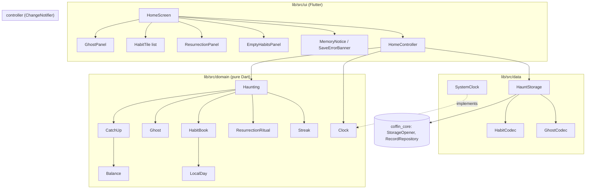
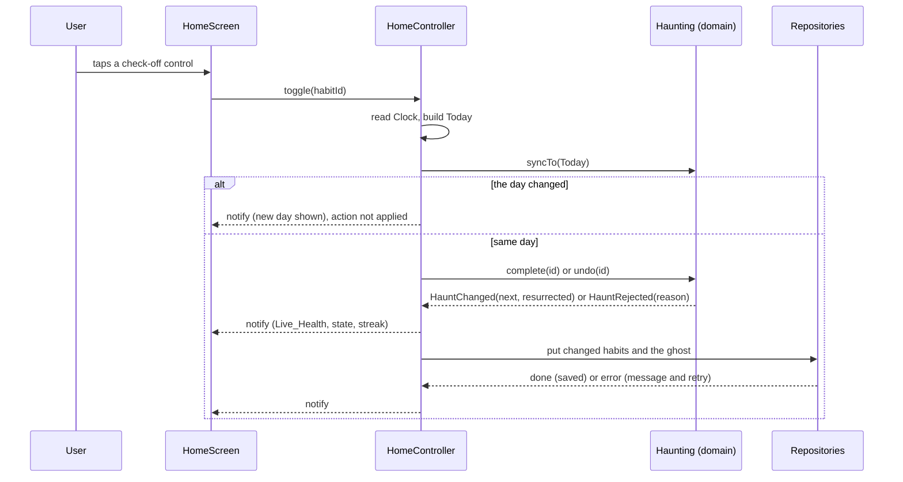

# Design Document: hauntagotchi-core

## Overview

This feature builds the core loop of Hauntagotchi in `apps/hauntagotchi`. The user keeps 3 to 5 daily habits and ticks them off. A ghost gains health from completed habits, loses health on days with nothing done, can die, and can be brought back through a gentle ritual. Habits and the ghost are saved on the device. One screen at `/` shows everything. The ghost is drawn with the existing `GhostLoader`.

Outside `apps/hauntagotchi/lib` and `apps/hauntagotchi/test`, the feature makes exactly three edits (Requirements 13.8 and 15):

| # | File | Edit |
| --- | --- | --- |
| 1 | `.kiro/steering/tech.md` | one line: the state-management line |
| 2 | `tool/templates/app/.kiro/steering/tech.md.tmpl` | the same one line |
| 3 | `apps/hauntagotchi/pubspec.yaml` | one added line, `glados: 1.1.7`, under `dev_dependencies` |

Edits 1 and 2 are the first change of the feature. Nothing changes in `coffin_core`, Graveyard, `pubspec.lock` or `CREDITS.md`.

### Design principles

- **Rules are pure Dart.** Every number and every decision lives in `lib/src/domain`, which imports no Flutter library and no `dart:io`. Widgets only show values and forward taps.
- **Days are calendar values, not durations.** A `LocalDay` is year, month and day. Day counting uses integer calendar arithmetic and never `Duration`, so daylight saving cannot move a day.
- **Time comes from one injected `Clock`.** Only `SystemClock` (in `lib/src/data`) calls `DateTime.now()`.
- **Catch-up, not timers.** The app settles every missed day when it opens, resumes, or before any action. Nothing runs while the tab is closed.
- **One immutable aggregate.** `Haunting` holds the habits, the ghost and Today, and every user action is a method on it that returns a new `Haunting` or a rejection. The controller wraps it and saves the result. This keeps every rule property-testable without Flutter.
- **State is derived, never stored.** Ghost state, Live_Health, ritual progress and Streak are computed from stored facts.

### Decisions that were open

| Topic | Decision | Reason |
| --- | --- | --- |
| Property tests | `glados: 1.1.7` added to `apps/hauntagotchi` `dev_dependencies` | Approved. Same version as `coffin_core`, already in `pubspec.lock`. |
| State management | `ChangeNotifier` plus `ListenableBuilder`, no package | Approved. Riverpod is not a dependency of the app. |
| Steering line | Corrected in the repo steering and in the raise template, as the first change | The template copies the line into every raised app, which also lacks Riverpod. |
| Max and min habits | 5 active at most; below 3 only a gentle nudge | Approved. |
| Archived day | `archivedDay` on `Habit`; archived habits keep completions | Approved. |
| No active habit | A day with no active habit changes nothing | Approved. |
| Day checks | On open, on app resume, and before every action | Approved. |
| Ghost name | Fixed default `Wisp`, no rename screen | Approved. |
| `PlaceholderScreen` | Removed, with its test | Approved. |

## Research summary

Facts read from the repository (not from memory). They shape the design.

1. **Storage API.** `StorageOpener(initializer:)` has `open<T>({boxName, codec, currentVersion, location, migrate, repositoryIssues})` and returns `OpenedRepository<T>` with `repository` and `isPersistent`. It never throws: on any failure it returns an in-memory repository with `isPersistent` false. `RecordRepository<T>` has `get`, `getAll`, `put(key, record)`, `delete`, `clear`, `watch`, `close`. `RecordCodec<T>` has `encode(T) -> JsonMap` and `decode(JsonMap) -> T`. `MemoryRecordRepository` is exported and takes `codec` and `currentVersion`. Keys must be non-empty, at most 255 characters, ASCII only (`KeyValidator`, exported).
2. **Corrupt entries.** The repository skips an entry whose codec throws on decode and reports a `StorageIssue`. A codec that throws on bad data is therefore the way to reject corrupt records (Requirement 8.5).
3. **Same-origin boxes.** `hiveFlutterInitializer([String? subDir])` documents that both apps may be served from one origin. Hauntagotchi passes the sub directory `'hauntagotchi'` so its boxes cannot collide with Graveyard.
4. **Widgets available from the barrel.** `GhostLoader({size, caption, bobPeriodMs, bobAmplitude})` draws a still frame under `MediaQuery.disableAnimations` and exposes one live-region semantics node. `TombstoneCard({title, dateLine, child, onTap, semanticLabel, showEpitaph, epitaph})`, `FogBackground`, `FlickerText`, `CoffinTheme.dark()/light()`, `CoffinColorTokens`, `CoffinGlow`, `CoffinMetrics`, `FogRouter`, `AppRoute`, `GoRouter` are exported. `GhostLoader` has no mood input, so the ghost looks the same in every state. A later spec adds moods.
5. **Existing app files that change.** `apps/hauntagotchi/lib/main.dart` has `HauntagotchiApp` with a `const` constructor and a global `appRoutes`. `lib/src/ui/app_routes.dart`, `lib/src/ui/placeholder_screen.dart`, and the tests `test/ui/app_routes_test.dart`, `test/ui/gallery_route_test.dart`, `test/ui/placeholder_screen_test.dart` use them. `lib/src/domain/.gitkeep` and `lib/src/data/.gitkeep` hold the two empty folders.
6. **glados 1.1.7 on web.** `any.intInRange` and `any.listWithLengthInRange` throw in Chrome (`1 << 32` is 0 in JavaScript). `coffin_core/test/storage/support/storage_generators.dart` has `anyIntBetween` and `anyListBetween`, built with `any.simple` and `Random.nextInt`, safe for ranges below 2^32. Hauntagotchi keeps its own copy under `test/domain/support/` (Apps may not import `coffin_core` test code).
7. **The steering line and what guards it** (Requirement 15). The line is `- State management: **Riverpod** (`flutter_riverpod`). No other state libraries.` at line 10 of `.kiro/steering/tech.md` and line 9 of `tool/templates/app/.kiro/steering/tech.md.tmpl`. Tests in `tool/` that touch these files are listed in the Verification plan. None asserts the state-management text.

## Architecture



### Data flow of one action



The in-memory change is shown at once. The "saved" state is reported only after the writes finish (Requirement 8.7).

### Folder layout

```
apps/hauntagotchi/lib/
├── main.dart                       wiring only
└── src/
    ├── domain/    local_day.dart, clock.dart, name_rules.dart, habit.dart, habit_book.dart,
    │              habit_rejection.dart, habit_result.dart, habit_changed.dart, habit_rejected.dart,
    │              ghost.dart, ghost_state.dart, recent_history.dart, ghost_state_rules.dart,
    │              balance.dart, catch_up.dart, resurrection_ritual.dart, ritual_progress.dart,
    │              streak.dart, haunting.dart, haunt_result.dart, haunt_changed.dart, haunt_rejected.dart
    ├── data/      system_clock.dart, habit_codec.dart, ghost_codec.dart, haunt_storage.dart
    └── ui/        app_routes.dart, home_controller.dart, home_status.dart, save_status.dart,
                   home_screen.dart, ghost_panel.dart, habit_tile.dart, habit_name_dialog.dart,
                   archive_dialog.dart, empty_habits_panel.dart, resurrection_panel.dart,
                   memory_notice.dart, save_error_banner.dart, load_error_view.dart, haunt_copy.dart
apps/hauntagotchi/test/              mirrors lib; test/support/ holds FakeClock and a throwing repository;
                                     test/domain/support/ holds the web-safe generators;
                                     test/source_rules/ holds every test that reads source files
                                     with dart:io; test/domain and test/data never import dart:io
```

Removed: `lib/src/ui/placeholder_screen.dart`, `test/ui/placeholder_screen_test.dart`, `lib/src/domain/.gitkeep`, `lib/src/data/.gitkeep`.

## Components and Interfaces

All public APIs below get a doc comment. One public class per file.

### Domain

**`LocalDay`** (immutable, `Comparable<LocalDay>`, value equality)

```dart
final class LocalDay implements Comparable<LocalDay> {
  const LocalDay._(this.year, this.month, this.day);
  factory LocalDay(int year, int month, int day);           // throws ArgumentError if not a real date, year 1..9999
  factory LocalDay.fromDateTime(DateTime local);             // reads year, month, day only
  factory LocalDay.fromEpochDay(int epochDay);
  static LocalDay? tryParse(String iso);                     // strict 'YYYY-MM-DD', real dates only
  final int year, month, day;
  int get epochDay;                                          // days since 1970-01-01 (civil calendar, integers only)
  LocalDay get next;
  LocalDay get previous;
  LocalDay addDays(int n);                                   // n may be negative
  int daysUntil(LocalDay other);                             // other.epochDay - epochDay
  String toIso();                                            // 'YYYY-MM-DD'
}
```

`epochDay` uses the integer "days from civil" algorithm (era of 400 years, 146,097 days; no `DateTime`, no `Duration`, no division of milliseconds). `fromEpochDay` is its inverse. Leap years follow the Gregorian rule. A `DateTime` is touched only in `fromDateTime`, and only for its three calendar fields.

**`Clock`**

```dart
abstract interface class Clock {
  DateTime now();   // local time
}
```

**`NameRules`**: `static const int maxLength = 40; static String? violation(String raw)` returns `null` when the trimmed text has 1 to 40 characters. A character is a Unicode code point (`runes.length`). `static String normalize(String raw) => raw.trim()`.

**`Habit`** (immutable)

```dart
final class Habit {
  const Habit({required this.id, required this.name, required this.createdDay,
      this.completedDays = const <LocalDay>{}, this.archivedDay});
  final String id;               // valid storage key, e.g. 'h1'
  final String name;             // trimmed, 1..40
  final LocalDay createdDay;
  final Set<LocalDay> completedDays;   // unmodifiable
  final LocalDay? archivedDay;
  bool get isActive;
  bool isActiveOn(LocalDay d);   // createdDay <= d && (archivedDay == null || d < archivedDay)
  bool isCompletedOn(LocalDay d);
  // ==, hashCode, copy helpers
}
```

`isActiveOn` is the single definition of "was active that day" used by catch-up (Requirement 4.9). A habit archived on day A is not active on A, so completions it holds for A do not feed the ghost when A is settled, and Live_Health on A excludes it as soon as it is archived. The two agree.

**`HabitBook`** (immutable list of habits, in creation order)

```dart
final class HabitBook {
  const HabitBook(List<Habit> habits);
  factory HabitBook.restore(Iterable<Habit> stored, {required LocalDay today});
  static const int maxActive = 5;
  static const int suggestedMin = 3;
  List<Habit> get all;
  List<Habit> get active;
  int get activeCount;
  bool get canAdd;
  int get missingToSuggested;    // max(0, 3 - activeCount)
  HabitResult add(String rawName, {required LocalDay today});
  HabitResult rename(String id, String rawName);
  HabitResult archive(String id, {required LocalDay today});
  HabitResult complete(String id, LocalDay day, {required LocalDay today});
  HabitResult undo(String id, LocalDay day, {required LocalDay today});
  int activeCountOn(LocalDay d);
  int completedCountOn(LocalDay d);    // completions on d by habits active on d
  bool anyCompletedOn(LocalDay d);     // any habit, archived or not
}
```

- `add` makes the next free id `h1`, `h2`, ... (smallest number not used by any habit, archived included). Ids are therefore unique, deterministic and valid storage keys, and no random source is needed.
- `complete` and `undo` reject any `day` other than `today` with `HabitRejection.notToday` (Requirement 1.10).
- `HabitBook.restore` is the loader's entry point. If hand-edited storage holds more than 5 active habits, it keeps the 5 oldest (by `createdDay`, then `id`) and archives the rest on `today`. This keeps Requirement 1.13 true at all times. It cannot happen through the app.

**`HabitRejection`** (enum): `nameEmpty`, `nameTooLong`, `limitReached`, `unknownHabit`, `habitArchived`, `alreadyCompleted`, `notCompleted`, `notToday`.

**`HabitResult`** (sealed): `HabitChanged(HabitBook book)` and `HabitRejected(HabitRejection reason)`.

**`Ghost`** (immutable)

```dart
final class Ghost {
  const Ghost({required this.name, required this.health,
      required this.lastSettledDay, this.resurrectionCount = 0});
  factory Ghost.fresh(LocalDay today);   // 'Wisp', 100, lastSettledDay = today.previous, 0
  final String name;
  final int health;                      // 0..100
  final LocalDay lastSettledDay;
  final int resurrectionCount;
  bool get isDead;                       // health == 0
}
```

**`GhostState`** (enum, ordered worst to best): `dead`, `fading`, `hungry`, `content`, `thriving`. Not stored.

**`RecentHistory`**: `const RecentHistory({required this.idleDays})` where `idleDays` is the number of consecutive Neglect_Days ending yesterday, or 0 when any habit is completed Today.

**`GhostStateRules`**: `static GhostState derive(int health, RecentHistory history)`. It takes the health band from the table below, then caps the result: `idleDays >= 1` caps at `content`, `idleDays >= 3` caps at `hungry`. A cap never goes below `hungry`, so `fading` and `dead` come from Health alone. Because both inputs to the cap are the same for two ghosts that share a history, a lower Health is never healthier (Requirement 3.6).

**`Balance`** (the numbers, in one file, `abstract final class`): see "Game numbers".

**`CatchUp`**

```dart
abstract final class CatchUp {
  static Ghost run(Ghost ghost, HabitBook book, LocalDay today);
  static int settleDay(int health, int activeCount, int completedCount);   // one day's rule
}
```

`run` behaviour:
1. `target = today.previous`. If `ghost.lastSettledDay >= target`, return the ghost unchanged (already current, or the clock moved backward: Requirements 4.3, 4.6).
2. If the ghost is dead, return it with `lastSettledDay = target` (no loop).
3. Otherwise, for each day `d` from `lastSettledDay.next` to `target` in order: `health = settleDay(health, book.activeCountOn(d), book.completedCountOn(d))`. Stop looping once health reaches 0, then set `lastSettledDay = target`. A dead ghost stays at 0, so the early stop gives the same result as looping on.
4. A gap of 10,000 days costs at most 10,000 cheap iterations (each checks at most 5 habits), so it finishes at once (Requirement 4.7).

`settleDay(health, n, c)`: `n == 0` returns `health`; `c == 0` returns `max(0, health - 15)`; otherwise `min(100, health + feed(n, c))`.

**`ResurrectionRitual`** and **`RitualProgress`**

```dart
final class RitualProgress { const RitualProgress({required this.done, required this.needed}); ... bool get isComplete; }
abstract final class ResurrectionRitual {
  static RitualProgress? progress(HabitBook book, LocalDay today);   // null when no active habit
  static Ghost? apply(Ghost ghost, HabitBook book, LocalDay today); // the revived ghost, or null
}
```

**`Streak.compute(HabitBook book, LocalDay today) -> int`**

**`Haunting`**: the aggregate.

```dart
final class Haunting {
  const Haunting({required this.book, required this.ghost, required this.today});
  factory Haunting.open({required HabitBook book, Ghost? ghost, required LocalDay today});
  final HabitBook book; final Ghost ghost; final LocalDay today;

  Haunting syncTo(LocalDay newToday);      // CatchUp.run, then ritual check; returns this if nothing changes
  int get liveHealth;                      // 0 when dead, else min(100, ghost.health + feed(activeToday, completedToday))
  RecentHistory get history;
  GhostState get state;                    // GhostStateRules.derive(liveHealth, history)
  int get streak;
  RitualProgress? get ritual;

  HauntResult addHabit(String rawName);
  HauntResult renameHabit(String id, String rawName);
  HauntResult archiveHabit(String id);
  HauntResult complete(String id);
  HauntResult undo(String id);
}
```

Every method that changes the habits runs the ritual check afterwards (`complete` and `archiveHabit` can both fulfil it, because archiving an unticked habit lowers the number of candles needed; `addHabit`, `renameHabit` and `undo` cannot raise the count of lit candles, but the check still runs after them, so the rule does not depend on which operation ran). `Haunting.open` creates `Ghost.fresh(today)` when `ghost` is null (Requirement 3.8), then calls `syncTo(today)`. Both `HauntChanged` and `HauntRejected` live in files of their own, under the sealed `HauntResult`. `HauntChanged` carries `Haunting next` and `bool resurrected`.

`history.idleDays` is 0 when any habit is completed Today. Otherwise it counts back from yesterday over days `d` where `activeCountOn(d) > 0` and `completedCountOn(d) == 0`, and stops at the first day that does not match. The count stops at 7, because the state caps only distinguish 0, 1 to 2, and 3 or more.

### Data

**`SystemClock`** implements `Clock` with `DateTime.now()`. It is the only place that calls it.

**`HabitCodec`** and **`GhostCodec`** implement `RecordCodec`. See Data Models.

**`HauntStorage`**

```dart
final class HauntStorage {
  const HauntStorage({required this.habits, required this.ghost, required this.isPersistent});
  static Future<HauntStorage> open(StorageOpener opener);   // two opens, version 1
  final RecordRepository<Habit> habits;
  final RecordRepository<Ghost> ghost;
  final bool isPersistent;                                  // both repositories persistent
  static const String ghostKey = 'ghost';
  static const String habitsBox = 'hauntagotchi_habits';
  static const String ghostBox = 'hauntagotchi_ghost';
  Future<void> close();
}
```

`open` calls `opener.open<Habit>(boxName: habitsBox, codec: const HabitCodec(), currentVersion: 1)` and the same for the ghost. In production, `main.dart` builds `StorageOpener(initializer: () => hiveFlutterInitializer('hauntagotchi'))`. Tests build a `HauntStorage` directly from two `MemoryRecordRepository` objects, so no real Hive is used.

### Controller and UI

**`HomeController extends ChangeNotifier`**

```dart
HomeController({required Clock clock, required Future<HauntStorage> Function() openStorage});
HomeStatus get status;            // loading, ready, loadError
SaveStatus get saveStatus;        // saved, saving, saveError
Haunting? get haunting;           // null until ready
bool get isPersistent;
String? get welcomeBack;          // set once when a ritual completes, cleared by dismissWelcome()
Future<void> load();              // open storage, read, build Haunting, save the fresh ghost if new
Future<void> refresh();           // read the Clock, syncTo, save if changed (app resume)
Future<HabitRejection?> addHabit(String name);
Future<HabitRejection?> renameHabit(String id, String name);
Future<void> archiveHabit(String id);       // the screen asks for confirmation first
Future<void> toggle(String id);             // complete or undo
Future<void> retrySave();                   // rewrite every record
void dismissWelcome();
Future<void> disposeStorage();              // closes repositories
```

Rules of the controller:
- **Before every action** it reads the Clock and calls `syncTo`. If the day changed, it notifies and **does not apply** the tap. The user then sees the new day first, so a tap meant for a stale list never lands on the new day.
- It changes the in-memory `Haunting` first, notifies, then saves. It saves the habits whose value changed (compared by equality) and always the ghost, one after another, then sets `saveStatus` to `saved`.
- If a save throws, it keeps the in-memory state, sets `saveError`, and `retrySave()` rewrites all records.
- Loading errors from `getAll()` or `get()` set `HomeStatus.loadError`; `load()` doubles as the retry.
- It owns no timer. The screen calls `refresh()` from `WidgetsBindingObserver.didChangeAppLifecycleState(resumed)`. On Flutter Web, a tab becoming visible again is reported as `resumed`.

**Screen widgets** (each a file, each takes the controller or plain values):

| Widget | Shows |
| --- | --- |
| `HomeScreen` | Scaffold with `FogBackground`; a centered column of max width 560 in a `ListView`; wraps the body in `ListenableBuilder`; registers the lifecycle observer. |
| `GhostPanel` | `GhostLoader` with the ghost name as caption, Health as `Health 85 / 100`, a bar with the number, the state in words, the Streak line. One `Semantics` node with label `Wisp, health 85 of 100, thriving`. |
| `HabitTile` | A 48 by 48 check-off control (check icon when done, empty circle when not), the habit name, a 48 by 48 menu (Rename, Archive). The check-off semantics label is `Read a page, done today` or `Read a page, not done yet`. |
| `HabitNameDialog` | Used for add and rename. Keeps the typed text and shows the reason on a rejection. |
| `ArchiveDialog` | Confirmation before archive. |
| `EmptyHabitsPanel` | Invitation and a button that opens the add dialog (no habit, or only archived ones). |
| `ResurrectionPanel` | The dead state: explains the ritual, shows progress (`1 of 2 candles lit`), shows the Resurrection_Count. |
| `MemoryNotice` | Gentle note under Memory_Fallback. |
| `SaveErrorBanner` | Gentle save message with a Retry button. |
| `LoadErrorView` | Gentle error with a Retry button. |
| `HauntCopy` | Every user-facing string, so copy is reviewed in one file. |

**Routing.** `appRoutes` (a global list) becomes `List<AppRoute> buildAppRoutes(HomeController controller)`. `/` builds `HomeScreen(controller: controller)`. `/gallery` is unchanged. `HauntagotchiApp` takes a required `HomeController`, calls `load()` once in `initState`, and calls `disposeStorage()` in `dispose`. `main()` builds the real controller with `SystemClock` and the real opener.

## Data Models

### Stored records

Habit, key = habit id (`h1`, `h2`, ...):

```json
{ "id": "h1", "name": "Read a page", "created": "2026-03-01",
  "completed": ["2026-03-01", "2026-03-02"], "archived": null }
```

Ghost, key = `ghost`:

```json
{ "name": "Wisp", "health": 85, "lastSettled": "2026-03-07", "resurrections": 0 }
```

Both repositories use `currentVersion` 1 and no migration. Every value is JSON-safe: strings, integers, a list of strings, `null`. Days are `YYYY-MM-DD` strings. The completed list is sorted, so encoding is deterministic.

### Decode rules (throw `FormatException` on any violation)

| Field | Rule |
| --- | --- |
| any | field present with the right JSON type |
| `id` | passes `KeyValidator.isValid` |
| `name` | `NameRules.violation(name) == null`; decoded value is the trimmed text |
| `created`, `completed[i]`, `archived`, `lastSettled` | `LocalDay.tryParse` succeeds |
| `archived` | `null` or not before `created` |
| `completed[i]` | not before `created` |
| `health` | integer 0 to 100 |
| `resurrections` | integer 0 or more |

### Game numbers

All numbers sit in `Balance`. They are the whole balance of the game.

| Name | Value | Meaning |
| --- | --- | --- |
| `maxHealth` | 100 | Top of the scale |
| `fullFeed` | 20 | Health gained on a day when every active habit is done |
| `neglectLoss` | 15 | Health lost on a Neglect_Day |
| `freshStartHealth` | 40 | Health after the ritual |
| `candlesNeeded` | 2 | Ritual size, `min(2, activeCount)` |
| `qualifyingPercent` | 60 | Used only by tests: a day qualifies when `5 * c >= 3 * n` |
| `defaultGhostName` | `Wisp` | Name of the first ghost |

**Feeding.** On a day with `n` active habits of which `c` are completed (`n` is 1 to 5), the feed is `feed(n, c) = (20 * c) ~/ n` (integer division). Gain is credited on that day, so Live_Health today is `min(100, settledHealth + feed(n, c))`.

| active `n` | c=1 | c=2 | c=3 | c=4 | c=5 |
| --- | --- | --- | --- | --- | --- |
| 1 | 20 | | | | |
| 2 | 10 | 20 | | | |
| 3 | 6 | 13 | 20 | | |
| 4 | 5 | 10 | 15 | 20 | |
| 5 | 4 | 8 | 12 | 16 | 20 |

Because `n` is at most 5, `feed(n, 1)` is at least 4, so every completion raises Live_Health unless it is already 100 (Requirement 5.1). Undo recomputes from the same settled value, so it returns Live_Health to the earlier number (5.2).

**Neglect.** A Neglect_Day settles as `max(0, health - 15)`.

**Health bands and states.**

| Band (Health) | Base state | Word shown |
| --- | --- | --- |
| 0 | `dead` | "Gone, for now" |
| 1 to 24 | `fading` | "Fading" |
| 25 to 49 | `hungry` | "Hungry" |
| 50 to 79 | `content` | "Content" |
| 80 to 100 | `thriving` | "Thriving" |

Caps from Recent_History: `idleDays >= 1` gives at most `content`; `idleDays >= 3` gives at most `hungry`. So a ghost at 85 after one idle day shows "Content".

The state is also shown by words, not color alone: the word, the number, and a different icon for each state (Requirement 12.6).

### Why these numbers satisfy the balance targets

Let `n` be the active habits that day and `c` the completed ones.

- **5.1 and 5.2.** `feed(n, 1) >= 4 > 0` for `n <= 5`. Live_Health is a function of settled Health and the day's `c` and `n`, so undo restores it.
- **5.3.** A Neglect_Day loses 15, which is above 0 for any Health above 0.
- **5.4.** A qualifying day (`5c >= 3n`) has `20c >= 12n`, so `feed >= 12`. Take any run where every 7 consecutive days have at most 2 days that do not qualify (counting from the first day, any shorter prefix has at most 2 as well). A non-qualifying day changes Health by `-15` at worst. Let `s` be the last day on which Health was 100 (the start counts). Between `s` and any later day `t` Health is never clamped, so `health_t = 100 + sum of daily changes`. Group the days after `s` into blocks of 7 counted backward from `t`. Each full block adds at least `5 * 12 - 2 * 15 = +30`. The leftover block at the front holds at most 2 bad days (the 7-day window that ends on its last day holds at most 2), so it adds at least `-30`. Therefore `health_t >= 100 - 30 = 70`. Three idle days in a row would put 3 bad days inside one window, so `idleDays <= 2`, the cap is at most `content`, and with Health 70 or more the state is `content` or `thriving`. The ghost never reaches `fading` or `dead`.
- **5.5.** From 100, `k` Neglect_Days give `max(0, 100 - 15k)`: 85, 70, 55, 40, 25, 10, then 0 on day 7. It is alive after days 1 to 3 (85, 70, 55) and dead by day 7.
- **5.6.** For living Health `h` from 1 to 84, the gain is `min(100, h + 20) - h`. Either `h + 20 <= 100` and the gain is 20, or the cap applies and the gain is `100 - h`, which is at least 16.
- **5.7.** `feed(n, n) = 20 > 15`.

### Resurrection ritual: "Light two candles"

The ghost is dead (Health 0). The user lights candles by completing habits Today. Archiving an unticked habit also counts when it lowers the candles needed to a number already lit. The ritual needs `min(2, activeCount)` completed active habits Today, so a user with one habit lights one candle. The ritual needs at least one active habit.

- Progress is shown as `1 of 2 candles lit`.
- The moment the count is reached, after any habit change (a `complete`, or an `archive` that lowers `min(2, activeCount)` to a number already lit; for example 2 active habits with 1 ticked, then the unticked one is archived: 1 candle is needed and 1 is lit), `ResurrectionRitual.apply` returns `Ghost(name: same, health: 40, lastSettledDay: today.previous, resurrectionCount: count + 1)`, and `HauntChanged.resurrected` is true.
- Live_Health right after the ritual is `40 + feed(n, c)` (for 2 of 4 habits, `40 + 10 = 50`). When the next day settles today, it adds the same `feed`, so the number does not jump.
- Undoing a completion afterwards leaves the ghost alive with its stored Health 40 and its count (Requirement 6.6), because death is only decided at settlement.
- While dead, completions, undos and archives that do not fulfil the ritual do not raise Health (the Live_Health is 0 until the ritual completes) and catch-up never changes it.
- With no active habit the dead panel says: "Add a habit to begin the ritual."
- Copy: "Wisp is gone, for now. Light 2 candles today by finishing 2 habits and Wisp drifts back."

### Worked 14-day example

User with 4 habits for the whole 14 days. Feed per day: `c=0` is -15, `c=1` +5, `c=2` +10, `c=3` +15, `c=4` +20. A day qualifies when `c >= 3` (75%). Health is shown at the end of each settled day, starting at 100.

**Track A: steady effort with two rough patches** (bad days: 3, 4, 10, 11).

| Day | c of 4 | Change | Health | Note |
| --- | --- | --- | --- | --- |
| 1 | 4 | +20 | 100 | clamped |
| 2 | 3 | +15 | 100 | clamped |
| 3 | 0 | -15 | 85 | Neglect_Day |
| 4 | 0 | -15 | 70 | lowest point, state Content (idle 2) |
| 5 | 3 | +15 | 85 | |
| 6 | 4 | +20 | 100 | clamped |
| 7 | 3 | +15 | 100 | |
| 8 | 3 | +15 | 100 | |
| 9 | 4 | +20 | 100 | |
| 10 | 0 | -15 | 85 | |
| 11 | 0 | -15 | 70 | |
| 12 | 4 | +20 | 90 | 5.6: all done from 70 gives +20 |
| 13 | 4 | +20 | 100 | clamped |
| 14 | 3 | +15 | 100 | |

Check against the targets. Every 7-day window has at most 2 bad days (days 3 and 4; days 10 and 11). Health never drops below 70 (5.4, state never Fading or Dead). Day 12 gains 20, at least 15 (5.6). The gain of an all-done day, 20, beats the loss of a Neglect_Day, 15 (5.7).

**Track B: a week away, then the ritual** (the app is closed on days 1 to 7, opened on day 8).

| Day | What happens | Change | Health at day end | State the next morning |
| --- | --- | --- | --- | --- |
| 1 | no habit done | -15 | 85 | Content (idle 1) |
| 2 | none | -15 | 70 | Content |
| 3 | none | -15 | 55 | Hungry (idle 3 caps it) |
| 4 | none | -15 | 40 | Hungry |
| 5 | none | -15 | 25 | Hungry |
| 6 | none | -15 | 10 | Fading |
| 7 | none | -15 | 0 | Gone, for now |
| 8 | opens the app: one catch-up settles days 1 to 7 and gives 0, the same as seven one-day catch-ups. The user completes 2 of 4 habits. Ritual met: Health 40, count 1. Live_Health 50. | +10 | 50 | Content |
| 9 | 4 | +20 | 70 | Content |
| 10 | 3 | +15 | 85 | Thriving |
| 11 | 0 | -15 | 70 | Content |
| 12 | 4 | +20 | 90 | Thriving |
| 13 | 3 | +15 | 100 | clamped |
| 14 | 4 | +20 | 100 | clamped |

Check against the targets. Seven neglect days take 100 to 0 (5.5), and the ghost is alive through day 3 (55). A single catch-up over 7 days equals 7 single days (4.4). The ritual brings the ghost back to 40 and the count to 1 (6.4, 6.8). Day 9 gains 20 from 50 (5.6).

## Correctness Properties

*A property is a characteristic or behavior that should hold true across all valid executions of a system-essentially, a formal statement about what the system should do. Properties serve as the bridge between human-readable specifications and machine-verifiable correctness guarantees.*

Testing with generated inputs applies to the Domain and the codecs: pure functions over large input spaces (days, books, ghosts, operation sequences). It does not apply to the screens, the controller wiring or the source scans, which use example tests. Property reflection merged overlapping criteria, so each property below adds distinct coverage.

### Property 1: LocalDay round trip

*For any* valid `LocalDay` `d`, `LocalDay.tryParse(d.toIso())` equals `d` and `LocalDay.fromEpochDay(d.epochDay)` equals `d`. *For any* string that is not a real `YYYY-MM-DD` date, `tryParse` returns null.

**Validates: Requirements 2.6**

### Property 2: Calendar arithmetic counts calendar days

*For any* `LocalDay` `d` (the generator includes month ends, leap days, year ends, and the daylight saving change dates 2026-03-08, 2026-03-29, 2026-10-25 and 2026-11-01) and any `n` from 0 to 800, `d.addDays(n).daysUntil` from `d` is `n`, stepping `next` `n` times equals `d.addDays(n)`, and a catch-up from `d` to `d.addDays(n + 1)` settles each of the `n` days after `d` exactly once.

**Validates: Requirements 2.3, 2.4, 14.5**

### Property 3: Time of day does not matter

*For any* calendar date and any two times on that date, `LocalDay.fromDateTime` gives equal days, and `Haunting.open` for the same book and ghost gives equal results for both times.

**Validates: Requirements 2.2, 2.5, 14.4**

### Property 4: Health stays in range

*For any* starting ghost, book and sequence of operations (add, rename, archive, complete, undo, advance by 0 to 5 days, with an occasional jump of up to 10,000 days), after every step `ghost.health` and `liveHealth` are integers from 0 to 100.

**Validates: Requirements 3.2, 4.7, 14.2**

### Property 5: Dead if and only if Health is zero

*For any* Health from 0 to 100 and any `RecentHistory`, `GhostStateRules.derive` returns `dead` exactly when Health is 0, and returns the same value when called twice with equal inputs.

**Validates: Requirements 3.3, 3.4, 3.5, 3.7**

### Property 6: Lower Health is never healthier

*For any* `RecentHistory` and any two Health values `a <= b`, the state of `a` is not healthier than the state of `b`, in the order dead, fading, hungry, content, thriving.

**Validates: Requirements 3.6**

### Property 7: One catch-up equals many single catch-ups

*For any* ghost, book, start day with `lastSettledDay` before it, and `N` from 0 to 60, `CatchUp.run` for `start + N` equals applying `CatchUp.run` for each of the days `start + 1` to `start + N` in turn, and the resulting `lastSettledDay` is the day before the final Today.

**Validates: Requirements 4.2, 4.4, 14.3**

### Property 8: Catch-up is a no-op when nothing is missed

*For any* ghost, book and Today such that `today.previous <= ghost.lastSettledDay` (already current, or the clock moved backward), `CatchUp.run` returns an equal ghost and does not throw. *For any* ghost, running `CatchUp.run` twice for the same Today gives the same ghost as running it once.

**Validates: Requirements 4.3, 4.6**

### Property 9: A settled day depends only on the habits active that day

*For any* book, any day `d`, and any later change that adds a habit created after `d` or archives a habit on a day after `d`, `activeCountOn(d)` and `completedCountOn(d)` are unchanged. *For any* Health `h`, `CatchUp.settleDay(h, 0, 0)` equals `h`.

**Validates: Requirements 4.8, 4.9**

### Property 10: Feeding raises Health and neglect lowers it

*For any* active count `n` from 1 to 5, completed count `c` from 1 to `n`, and Health `h` from 1 to 99, `min(100, h + feed(n, c))` is above `h`. *For any* `n` from 1 to 5 and `h` from 1 to 100, `settleDay(h, n, 0)` is below `h`.

**Validates: Requirements 5.1, 5.3**

### Property 11: Complete then undo restores the day

*For any* book and `Haunting`, and any active habit not yet completed Today, completing it and then undoing it returns a book equal to the original, the same `liveHealth`, the same `streak`, and the same ghost Health unless the complete resurrected the ghost (which is excluded from this property and covered by Property 16). Completing a habit adds Today to its completed days.

**Validates: Requirements 1.7, 1.9, 1.12, 5.2, 7.6**

### Property 12: A neglect run from full Health

*For any* run length `k` from 0 to 10, settling `k` Neglect_Days from Health 100 gives `max(0, 100 - 15 * k)`; the ghost is alive for every `k <= 3` and dead for every `k >= 7`.

**Validates: Requirements 5.5**

### Property 13: A fully done day beats a neglect day

*For any* `n` from 1 to 5, `feed(n, n) = 20` and is greater than the neglect loss 15. *For any* living Health `h` from 1 to 84, `min(100, h + feed(n, n)) - h` is at least 15.

**Validates: Requirements 5.6, 5.7**

### Property 14: Steady effort keeps the ghost out of danger

*For any* sequence of days, each with an active count `n` from 1 to 5 and a completed count `c` from 0 to `n`, normalised so that every window of 7 consecutive days (and every shorter prefix) holds at most 2 days with `5 * c < 3 * n`, simulating from Health 100 never gives Health below 70, and the derived state on every day is `content` or `thriving`.

**Validates: Requirements 5.4**

### Property 15: A dead ghost stays dead until the ritual

*For any* ghost and book where the ghost reaches Health 0 during catch-up, the count is unchanged by that catch-up; and *for any* later sequence of catch-ups, adds, renames, archives, completes and undos in which the ritual condition never holds after any step (fewer than `min(2, activeCount)` active habits completed Today, or no active habit; the condition is evaluated after every step, so an archive that lowers the number needed counts as fulfilling it when the lit candles then suffice), `ghost.health` and `liveHealth` stay 0 and the state stays `dead`.

**Validates: Requirements 6.1, 6.2, 14.6**

### Property 16: The ritual brings the ghost back once

*For any* dead ghost and book with at least one active habit, the first step (a `complete` or an `archive`) after which at least `min(2, activeCount)` active habits are completed Today gives a ghost with Health 40, the same name, the same habits (the archived one stays archived), `lastSettledDay` equal to yesterday, and a count one higher, with `resurrected` true on exactly that step; undoing one of those completions afterwards leaves the ghost alive with the same count. Archiving an unticked habit when exactly one of two active habits is ticked is a covered case. *For any* operation sequence of adds, renames, archives, completes and undos, the count never decreases and rises by exactly 1 on each step where `resurrected` is true and by 0 on every other step.

**Validates: Requirements 6.4, 6.5, 6.6, 6.8**

### Property 17: Streak equals the run ending Today or yesterday

*For any* completion record over all habits (archived included) and any Today, let the anchor be Today if some habit is completed on it, otherwise yesterday if some habit is completed on it. The streak is 0 when there is no anchor. Otherwise the streak is `k`, every one of the `k` days ending at the anchor has a completion, and the day before that run has none.

**Validates: Requirements 7.1, 7.2, 7.3, 7.4, 7.5**

### Property 18: Rejections change nothing and the limit holds

*For any* book and any operation that is rejected (empty or over-40 name after trimming, add at 5 active habits, complete of an already completed habit, undo of an uncompleted one, any day other than Today, an archived or unknown id), the result is `HabitRejected` with the matching reason and the book is unchanged. *For any* operation sequence, the active count is at all times from 0 to 5.

**Validates: Requirements 1.2, 1.3, 1.8, 1.10, 1.11, 1.13**

### Property 19: Add, rename and archive keep what they should

*For any* book with fewer than 5 active habits and any valid name (with arbitrary surrounding whitespace), `add` creates an active habit with a new unique id, the trimmed name, Today as created day and no completions, and leaves the other habits equal. *For any* active habit, `rename` changes only the name (trimmed); `archive` sets `archivedDay` to Today, keeps every completion, removes it from `active`, and a book that was at 5 active habits can add one again.

**Validates: Requirements 1.1, 1.4, 1.5, 1.6**

### Property 20: Habit codec round trip

*For any* valid `Habit`, `decode(encode(h))` equals `h`, the encoded map holds only JSON-safe values with days as strings, and the same holds after `jsonDecode(jsonEncode(encode(h)))`.

**Validates: Requirements 8.2, 8.3**

### Property 21: Ghost codec round trip

*For any* valid `Ghost`, `decode(encode(g))` equals `g`, the encoded map holds only JSON-safe values, and the same holds after a trip through JSON text.

**Validates: Requirements 8.2, 8.4**

### Property 22: Corrupt records are rejected

*For any* valid encoded habit or ghost and any one corruption from the list (name empty or whitespace only, name longer than 40, Health -1 or 101, malformed or impossible date such as `2026-02-30`, negative Resurrection_Count, one missing field, a field of the wrong type, `archived` before `created`), `decode` throws.

**Validates: Requirements 8.5**

### Property 23: Live Health is what the next day settles

*For any* living `Haunting` on day `d` with no further changes, the stored Health after `syncTo(d.next)` equals the `liveHealth` shown on `d`.

**Validates: Requirements 4.2, 5.1, 5.2**

## Error Handling

| Situation | Behaviour |
| --- | --- |
| Storage cannot open (private window, blocked IndexedDB) | `StorageOpener` returns in-memory repositories with `isPersistent` false. The app runs and shows the Memory_Notice: "Your ghost can't keep this between visits here. It will remember while this tab stays open." |
| `getAll()` or `get()` throws on load | `HomeStatus.loadError`. A gentle view with a Retry button. Retry calls `load()` again. No blank screen. |
| A stored record is corrupt | The codec throws, the repository skips it and reports an issue. Missing ghost: a fresh ghost is created and saved. Skipped habits: the rest are kept. |
| More than 5 active habits in storage (hand-edited) | `HabitBook.restore` keeps the 5 oldest and archives the rest on Today. |
| A write throws | In-memory state is kept. `SaveStatus.saveError` shows "Couldn't tuck that into the crypt. Your changes are still here." with a Retry button that rewrites all records. |
| Invalid habit name or sixth habit | `HabitRejected` with a reason. The dialog stays open with the typed text and shows kind wording. |
| Clock moved backward | `CatchUp` returns the ghost unchanged. Nothing throws. |
| Day changes between taps | `toggle` syncs first and, if the day changed, shows the new day and ignores that tap. |
| Very long absence | Catch-up stops looping when Health reaches 0. A 10,000-day gap is fast. |
| Dead ghost, no active habit | Panel text: "Add a habit to begin the ritual." |
| Controller disposed during a save | Writes finish on the repository; the controller checks a `_disposed` flag before notifying. |

No copy uses "failed", "your fault", or blame.

## Testing Strategy

**Why property-based tests apply here.** The Domain is pure Dart with numeric rules and invariants (health, decay, scores, streaks), and the codecs are serializers. Both are the best fit for glados. Screens, wiring and source rules are tested with examples, because rendering and I/O do not have a meaningful "for all inputs" statement.

**Library and configuration.** `glados: 1.1.7` (approved). Each property is one `Glados(...).test(...)` with `ExploreConfig(numRuns: 200)` (the minimum is 100). Each test carries a comment:

```dart
// Feature: hauntagotchi-core, Property 7: One catch-up equals many single catch-ups
// Validates: Requirements 4.2, 4.4, 14.3
```

Every property file counts its runs with a small `RunCounter` and asserts it equals `numRuns`, so a silent skip cannot pass.

**Web-safe generators** (Requirement 14.8) live in `test/domain/support/haunt_generators.dart`, with their own test:

- Copies of `anyIntBetween(min, max)` and `anyListBetween(min, max, item)` built on `any.simple` and `Random.nextInt` (ranges below 2^32). No use of `any.int`, `any.intInRange`, `any.list`, `any.listWithLengthInRange`, string generators or `uint*`. A test in `test/source_rules/` (not in `test/domain`) scans `test/` for the banned names, because it reads files with `dart:io`.
- `anyLocalDay`: epoch day from 10957 (2000-01-01) to 47482 (2099-12-31), with fixed edge values (leap days, month and year ends, the four daylight saving dates).
- `anyHabitName`: built from a piece list (ASCII, accents, CJK, an emoji, spaces) up to 45 pieces, so both valid and over-40 names occur, and whitespace-only strings occur.
- `anyHealth`: 0 to 100 with extra weight on 0, 1, 24, 25, 49, 50, 79, 80, 100.
- `anyBook(today)`: 0 to 6 habits, with created offsets, optional archive offsets, and completion offsets as small integer lists. Active habits are limited to 5 by running the habits through `HabitBook.restore`.
- `anyDayPlan`: `(n 1..5, c 0..n)` per day, plus `normalizeSteady(List<DayPlan>)`, which walks the list and turns a day into a qualifying day whenever leaving it bad would put 3 bad days inside any 7-day window or prefix. Integers stay far below 2^53 everywhere (the largest is an epoch day of about 47,482 plus 10,000).
- `anyOperation`: a sealed set of operations for Properties 4, 15, 16 and 18, interpreted by a pure test helper `applyOp(Haunting, Operation)`.

**Unit tests (example based)** by area, each covering the listed criteria:

| File (under `test/`) | Covers |
| --- | --- |
| `domain/local_day_test.dart` | Leap years, invalid dates, `tryParse` strictness, year bounds, month ends (Req 2) |
| `domain/habit_book_test.dart` | Each criterion of Requirement 1 with named examples, `missingToSuggested` 0 to 5, id reuse never happens |
| `domain/ghost_state_rules_test.dart` | Band edges 0, 1, 24, 25, 49, 50, 79, 80, 100 and both caps |
| `domain/catch_up_test.dart` | Fresh ghost, 5 days away equals 5 single days, 10,000 days, backward clock, no active habit |
| `domain/resurrection_ritual_test.dart` | One habit needs one candle, two or more need two, progress values, no active habit, archive fulfils the ritual (2 habits, 1 ticked, archive the other) |
| `source_rules/generator_rules_test.dart` | Banned glados generators (`any.int`, `any.intInRange`, `any.list`, `any.listWithLengthInRange`, string generators, `uint*`) appear nowhere under `test/` (Req 14.8) |
| `domain/streak_test.dart` | Examples with archived habits, today only, yesterday only, gap |
| `domain/balance_test.dart` | The constants and the feed table equal the tables in this document, and the worked 14-day tracks A and B reproduce the numbers above exactly |
| `source_rules/domain_sources_test.dart` | No `package:flutter`, no `dart:io`, no `DateTime.now` under `lib/src/domain` (Req 2.1, 13.2); no `Timer` anywhere in `lib` (4.5) |
| `data/habit_codec_test.dart`, `data/ghost_codec_test.dart` | Each failure in Requirement 8.5, key sets (8.9) |
| `data/haunt_storage_test.dart` | Box names, version 1, `isPersistent` from both repositories, with a fake `StorageOpener` (8.1) |
| `ui/home_controller_test.dart` | Load with no data, with habits only, resume, day change ignoring a tap, save order, failed write and retry, memory fallback, load error |
| `ui/home_screen_test.dart` | Empty, normal, dead, welcome back, Memory_Notice, check-off and undo, add limit, archive confirmation, invalid name keeps text, 360 px at text scale 1.5, reduced motion, semantics labels, 48 px targets |
| `ui/app_routes_test.dart`, `ui/gallery_route_test.dart` | `/` shows `HomeScreen`, `/gallery` shows `CryptGallery` and returns to `/`, not-found page still works (Req 10.11, 14.12) |
| `ui/haunt_copy_test.dart` | No "failed" or "your fault" in any string (11.6) |

The widget tests use `FakeClock` (in `test/support/`) and `MemoryRecordRepository` with the real codecs. They never use real Hive. A `ThrowingRecordRepository` test double (in `test/support/`) implements `RecordRepository` and throws on `put` or `getAll` for the error cases.

**Running.** `flutter test` in `apps/hauntagotchi` for everything. Nothing under `test/domain` or `test/data` imports `dart:io` (every source-scanning test lives in `test/source_rules/`, which also runs under the VM only), so `flutter test --platform chrome test/domain test/data` runs the domain and codec tests in Chrome, which proves the generators are web-safe. `test/source_rules/` itself includes a check that no file under `test/domain` or `test/data` contains `dart:io`. A feature task is done only when `flutter test` passes.

## Verification plan

Checks to run when the feature is built. They back the guards in Requirements 13 and 15.

**A. Steering line (first change)**

1. Replace the line in both files with exactly `- State management: Flutter's built-in ChangeNotifier with ListenableBuilder. No state-management packages.`
2. `git diff -U0 -- .kiro/steering/tech.md tool/templates/app/.kiro/steering/tech.md.tmpl` shows one removed and one added line in each file, and nothing else.
3. `grep -rniI riverpod .kiro/steering tool/templates` finds nothing.
4. `flutter test` in `tool/` passes. These tests read the edited files and must keep passing:
   - `test/template/template_integrity_test.dart`: `design.md.tmpl` equals `.kiro/steering/design.md` byte for byte (untouched); no template contains the words `Hauntagotchi`, `hauntagotchi`, `Graveyard`, `séance` or `habit` (the new line has none); every `{{placeholder}}` is known (none added); the tech template keeps its headings `# Tech Stack & Conventions`, `## Stack`, `## Code style`, `## Testing rules`, `## Dependencies`; the rendered template `pubspec.yaml` lines for `coffin_core` and `flutter_lints` match Hauntagotchi's (the added `glados` line is not one of the compared prefixes, and the first `path:` line is still the `coffin_core` path).
   - `test/raise/raiser_test.dart`: a raise writes the exact file set, including `.kiro/steering/tech.md` (no file is added or removed).
   - `test/repo_guard/repo_guard_test.dart`: snapshots every file under `apps/` and the root `pubspec.yaml` before and after generator runs. It fails if `apps/` changes while it runs, so run the `tool/` tests when no other process is editing `apps/`.
5. `flutter test --tags raise-check --run-skipped` in `tool/` passes (`test/raise_check/raise_check_test.dart`, tagged `raise-check`, skipped by default, timeout 10x). It raises a temporary app from the template and runs `flutter pub get --offline`, `dart format --output=none --set-exit-if-changed .`, `flutter analyze --no-pub` (must print `No issues found!`) and `flutter test --no-pub` in it. It copies the root `pubspec.lock`, so the lock must be unchanged and offline resolution must still work.

**B. Dependency line**

1. Add `glados: 1.1.7` to `dev_dependencies` of `apps/hauntagotchi/pubspec.yaml`, after `flutter_lints`.
2. `git diff -U0 -- apps/hauntagotchi/pubspec.yaml` shows exactly one added line.
3. `flutter pub get --enforce-lockfile` at the repo root succeeds. This command fails if the lock file would change.
4. `git diff --exit-code -- pubspec.lock` exits 0 (the lock diff is empty). If it does not, stop and ask: the feature must not change the lock.

**C. Scope guard**

1. `git status --short` lists only: the two steering files, `apps/hauntagotchi/pubspec.yaml`, files under `apps/hauntagotchi/lib` and `apps/hauntagotchi/test`, and `.kiro/specs/hauntagotchi-core`. Nothing in `packages/`, `apps/graveyard/`, `tool/` (other than the template line), `CREDITS.md`, `pubspec.lock` or the root `pubspec.yaml`.
2. `dart format --output=none --set-exit-if-changed .` and `flutter analyze` in `apps/hauntagotchi` report nothing.
3. `grep -rl "dart:io" apps/hauntagotchi/test/domain apps/hauntagotchi/test/data` finds nothing, and `flutter test --platform chrome test/domain test/data` in `apps/hauntagotchi` passes. Source-scan tests live only in `apps/hauntagotchi/test/source_rules/`.
4. `flutter test` passes in `apps/hauntagotchi`, in `packages/coffin_core` (unchanged) and in `tool/`.

## Risks and notes

- **`GhostLoader` has no moods.** The ghost looks the same in every state. State is carried by words, the number and an icon. The dead panel dims the ghost. Moods belong to a later spec.
- **Adding a habit lowers today's Live_Health.** The feed depends on the share of habits done (`c / n`), so a fourth habit added after 3 of 3 are done lowers today's feed from 20 to 15. The copy for the add dialog says "A new habit joins today's feeding." This keeps the 60 percent balance target simple. It is a trade-off, not a bug.
- **Archiving a habit on the day it was ticked removes that tick from today's feed**, on purpose, so Live_Health today and the settled Health tomorrow agree (Property 23). The Streak still counts the tick.
- **A web tab left open past midnight** shows the old day until the user returns to the tab or taps something. The first tap shows the new day and is ignored (see Error Handling).
