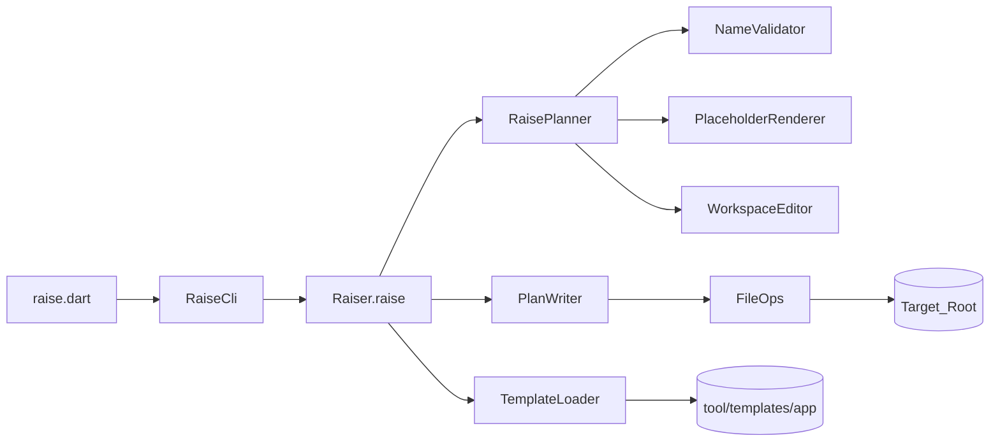
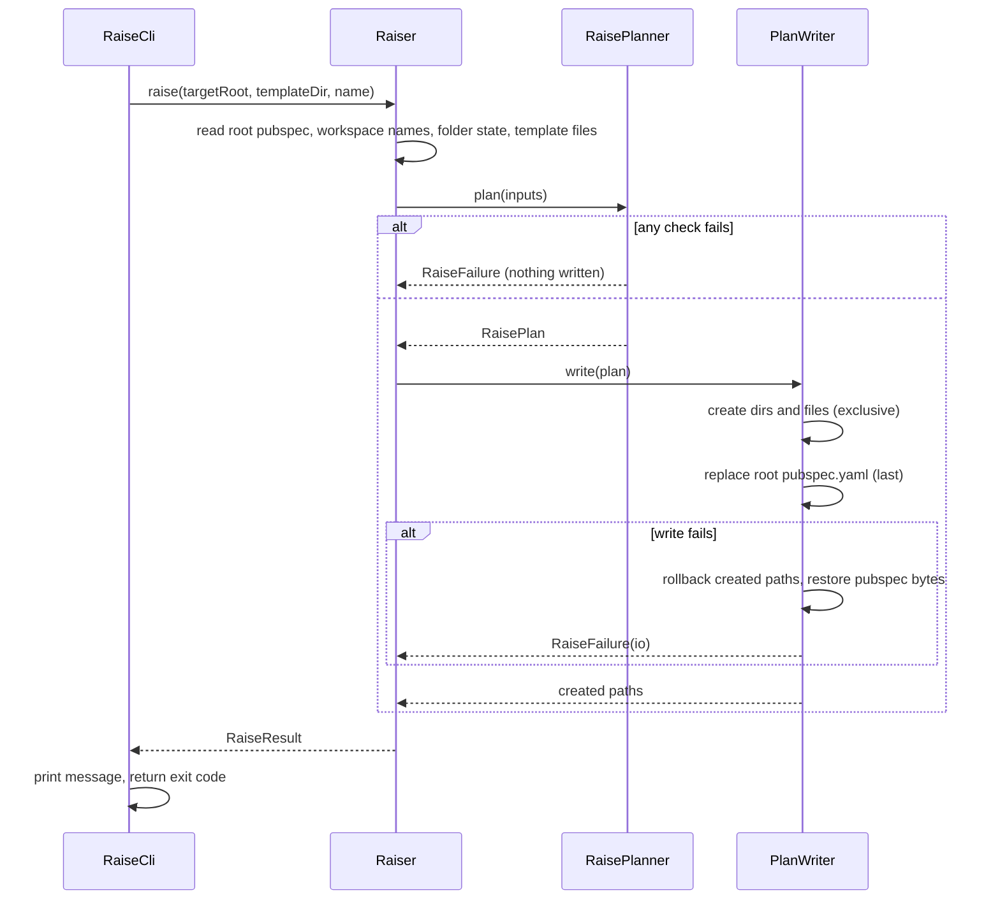

# Design Document: raise-app

## Overview

`dart run tool/raise.dart <app_name>` creates `apps/<app_name>/` from one template folder, adds one line to the root `pubspec.yaml`, and prints the next commands. The generator is a new workspace package, `coffin_raise`, in `tool/`. It is plain Dart (`dart:io`, `dart:convert`, `dart:core` only).

The design splits the work into three layers so most of it is pure and testable without a disk:

| Layer | Contents | Touches disk? |
| --- | --- | --- |
| Pure rules | `NameValidator`, `NameSuggester`, `DisplayNames`, `PlaceholderRenderer`, `WorkspaceEditor`, `RaisePlanner` | No |
| Disk | `TemplateLoader`, `FileOps` (`DiskFileOps`), `PlanWriter`, `Raiser` | Yes, through `FileOps` |
| Shell | `raise.dart`, `RaiseCli`, `RaiseMessages` | Prints and exits |

Principles:

- **Plan first, write last.** Every check runs before the first byte is written. The root `pubspec.yaml` is the last write.
- **Template is the only source of content.** The Raiser has no string literals that end up in a Raised_App.
- **Fail without a trace.** All writes go through a tiny `FileOps` interface that records what it created, so rollback is exact and failure can be injected in tests.
- **Target_Root is a parameter.** Tests raise into a temporary directory and never touch the real repo.

### Research summary

Facts checked in this repo (Dart 3.13.7, Flutter 3.47.9) or in a throwaway copy of it under `/tmp`. They shape the design.

1. **`dart run tool/raise.dart` works for a workspace member with a `flutter_test` dev dependency.** In a copy with `tool` in the root `workspace:` list, `flutter pub get --offline` resolved, and `dart run tool/raise.dart` ran from the root. `Platform.script` was `file:///…/tool/raise.dart`, and `package:coffin_raise/…` imports resolved through the root `.dart_tool/package_config.json`. The script also runs from inside `tool/`, so the Raise_Tool must check that its Target_Root is a workspace root (Requirement 6.3 covers this).
2. **Adding the `tool` member leaves `pubspec.lock` byte-identical** (`diff` printed no difference). `glados 1.1.7` and `flutter_test` are already locked. This satisfies the Dependency Notice.
3. **`dart pub get` also worked in that copy**, but `flutter pub get` stays the documented command, matching the README and the Flutter-based members.
4. **The `raise-check` tag cannot be skipped with `exclude_tags`.** With `exclude_tags: raise-check` in `dart_test.yaml`, `flutter test --tags raise-check` fails with "No tests match the requested tag selectors" (include and exclude both name the tag). With `tags: raise-check: skip: "…"`, a default `flutter test` skips the test and `flutter test --tags raise-check --run-skipped` runs it. `flutter test` supports `--run-skipped`. This is the chosen mechanism. See Risk R1.
5. **`dart format` only touches `.dart` files and the analyzer only analyzes `.dart` files.** Giving every text template a `.tmpl` suffix keeps `{{placeholders}}` out of both tools without relying on config alone.
6. **`File.create(exclusive: true)` exists** and fails when the file exists. `Directory.create` has no exclusive mode and succeeds on an existing directory. The no-overwrite guarantee therefore rests on exclusive file creation, plus a re-check after creating the app folder.
7. **Hauntagotchi (the model for the template)**: `main.dart` builds `FogRouter.create(routes: appRoutes)` once in a `State`, disposes it, and uses `MaterialApp.router` with `CoffinTheme.dark()`. `appRoutes` is a `List<AppRoute>` in `lib/src/ui/app_routes.dart`. Its `pubspec.yaml` has `flutter`, `coffin_core` (path `../../packages/coffin_core`), `flutter_test`, `flutter_lints: ^6.0.0`. Its `analysis_options.yaml` excludes `build/**` and `web/**` and includes `../../analysis_options.yaml`. Its `web/` holds `index.html`, `manifest.json`, `favicon.png` and four icons. The web files still say "hauntagotchi" and "A new Flutter project.", so the template needs its own edited copies.
8. **The existing hook** (`.kiro/hooks/format-analyze-dart-on-save.json`) runs `dart format packages apps && flutter analyze`, which does not work from inside one app. The app hook uses `dart format lib test && flutter analyze`.
9. **Repo steering** `design.md` contains no `{{`, and the word "graveyard" only in lowercase ("moonlit graveyard"). A case-sensitive forbidden-word test therefore passes on a byte-for-byte copy of it.
10. **`TombstoneCard`, `GhostLoader`, `FogBackground`** are exported by the barrel. `TombstoneCard` takes `title`, optional `dateLine`, `child`, `onTap`, `semanticLabel`.

## Architecture





### Package layout

```
tool/
├── pubspec.yaml               # name: coffin_raise, resolution: workspace
├── analysis_options.yaml      # includes ../analysis_options.yaml, excludes templates/**
├── dart_test.yaml             # raise-check tag: skip + timeout
├── raise.dart                 # entry point, ~15 lines
├── lib/
│   ├── coffin_raise.dart      # barrel (exports below)
│   └── src/
│       ├── cli/               # raise_cli.dart, raise_messages.dart, exit_codes.dart
│       ├── names/             # name_validator.dart, name_issue.dart, name_issue_kind.dart,
│       │                      # name_suggester.dart, display_names.dart, dart_reserved_words.dart
│       ├── template/          # template_file.dart, template_loader.dart,
│       │                      # placeholders.dart, placeholder_renderer.dart
│       ├── workspace/         # workspace_editor.dart, workspace_edit_result.dart
│       ├── plan/              # raise_planner.dart, raise_plan.dart, planned_file.dart
│       └── raise/             # raiser.dart, raise_result.dart, raise_error_kind.dart,
│                              # file_ops.dart, disk_file_ops.dart, plan_writer.dart
├── templates/app/             # the Template_Folder (see below)
└── test/                      # mirrors lib/src, plus raise_check/ and repo_guard/
```

`tool/pubspec.yaml`:

```yaml
name: coffin_raise
description: Generator that raises a new Coffin app.
publish_to: none
environment:
  sdk: ^3.13.0
resolution: workspace
dev_dependencies:
  flutter_test:
    sdk: flutter
  flutter_lints: ^6.0.0
  glados: 1.1.7
```

`flutter_lints` is already in the lock file (root and every member use it). It gives `tool/analysis_options.yaml` the same `include: ../analysis_options.yaml` as every other member. The root `pubspec.yaml` gains `  - tool` as the last workspace line.

`tool/raise.dart` holds no logic:

```dart
import 'dart:io';
import 'package:coffin_raise/coffin_raise.dart';

Future<void> main(List<String> args) async {
  exitCode = RaiseCli.run(
    args,
    targetRoot: Directory.current,
    templateDir: RaiseCli.defaultTemplateDir(Platform.script),
    out: stdout,
    err: stderr,
  );
}
```

`defaultTemplateDir` returns `<dir of script>/templates/app`.

### Template_Folder layout, placeholders and exclusion

Layout of `tool/templates/app/`. A path maps to the same path under `apps/<name>/` after Placeholder replacement and removal of a trailing `.tmpl`.

```
templates/app/
├── pubspec.yaml.tmpl
├── analysis_options.yaml.tmpl
├── web/
│   ├── index.html.tmpl
│   ├── manifest.json.tmpl
│   ├── favicon.png                 # binary, copied as is
│   └── icons/Icon-192.png, Icon-512.png, Icon-maskable-192.png, Icon-maskable-512.png
├── lib/
│   ├── main.dart.tmpl
│   └── src/ui/app_routes.dart.tmpl, home_screen.dart.tmpl
├── test/ui/home_screen_test.dart.tmpl
└── .kiro/
    ├── README.md.tmpl
    ├── steering/product.md.tmpl, tech.md.tmpl, structure.md.tmpl, design.md.tmpl
    └── hooks/format-analyze-dart-on-save.json.tmpl
```

**Rules for the loader.**

- A file ending in `.tmpl` is text. It is decoded as UTF-8, rendered, re-encoded, and written without the suffix.
- Any other file is binary and copied byte for byte (Requirement 3.6). The icons and favicon are copies of the files in `apps/hauntagotchi/web/` (Flutter's default icons, BSD-3 licensed). `CREDITS.md` gains one line for them (Requirement 4.12).
- Placeholders are also replaced in path segments, so a path like `lib/src/{{package_name}}_x.dart.tmpl` is legal. The v1 template does not need one, but the renderer handles it uniformly.

**Placeholder syntax:** `{{name}}`, where `name` is `[a-z_]+`. One regex, `\{\{([a-z_]+)\}\}`, one pass, no nesting and no escaping. Replacement values never contain `{`, so output cannot contain a new placeholder.

| Placeholder | Value | Example for `bone_shop` |
| --- | --- | --- |
| `{{package_name}}` | the App_Name | `bone_shop` |
| `{{display_name}}` | words split on `_`, first letter upper-cased | `Bone Shop` |
| `{{class_name}}` | the same words joined, no spaces | `BoneShop` |
| `{{sdk_constraint}}` | the `sdk:` value of the Target_Root's root `pubspec.yaml` | `^3.13.0` |

The list lives in one documented constant, `Placeholders.known`, in `placeholders.dart`. `{{sdk_constraint}}` makes Requirement 4.2 ("same SDK constraint as the root") true by construction instead of by a hard-coded copy. If the root pubspec has no `sdk:` line, the Raiser refuses with a `pubspecProblem` (Requirement 6.3 wording).

A text template whose text contains a `{{x}}` with `x` not in `Placeholders.known` makes planning fail with `templateProblem`, naming the file and `x`. This runs before any write (Requirement 3.5).

**Exclusion from analyze and format (Requirement 3.7).** Two layers:

1. Every text template ends in `.tmpl`, so `dart format` and the analyzer never see a `.dart` file there. No config is needed for this to hold.
2. `tool/analysis_options.yaml` also lists `templates/**` under `analyzer: exclude:`, so a future template named without `.tmpl` cannot break `flutter analyze`.

The `templates/app/` folder has no `pubspec.yaml` (only `pubspec.yaml.tmpl`), so pub never mistakes it for a package.

**How the Flutter-dependent template is validated.** `coffin_raise` is pure Dart and never imports Flutter, so its own tests cannot compile the template. The template is validated in two steps:

- *Cheap, on every test run:* string-level tests on the rendered output (no `src/` imports, no forbidden names, display name present, `design.md` byte-equal to the repo steering file, `flutter_lints` and `coffin_core` lines equal to Hauntagotchi's pubspec).
- *Full, on demand:* the `raise-check` test raises an app into a temp copy and runs `flutter pub get`, `flutter analyze`, `dart format` and `flutter test` there. `flutter_test` is a dev dependency of `coffin_raise` only because `flutter test` is the repo's test runner and `glados` builds on it.

**Content of the Raised_App (from the template).** Modeled on Hauntagotchi, with the Hauntagotchi copy removed:

- `main.dart`: `{{class_name}}App` (a `StatefulWidget`, router built once in `late final`, disposed), `MaterialApp.router(title: '{{display_name}}', theme: CoffinTheme.dark(), routerConfig: _router)`.
- `app_routes.dart`: `final List<AppRoute> appRoutes = [AppRoute(path: '/', name: 'home', builder: …HomeScreen)]`.
- `home_screen.dart`: `Scaffold` over `FogBackground`, a `GhostLoader`, and a `TombstoneCard` titled with the Display_Name. Its body says which file to edit to add a screen (`lib/src/ui/app_routes.dart`). Copy example: "Nothing lives here yet. Add a route in app_routes.dart and wake something up." The card has a `semanticLabel`, and the ghost and fog already switch to static states under `MediaQuery.disableAnimations` (that logic lives in `coffin_core`). Any button added to the home screen uses `ConstrainedBox(minWidth/minHeight: 48)`.
- `home_screen_test.dart`: pumps `{{class_name}}App`, `pumpAndSettle` is avoided because the ghost loops, so it uses `pump(const Duration(milliseconds: 100))`, then asserts `HomeScreen`, `GhostLoader`, `TombstoneCard` and the dark theme `colorScheme`. A second test sets `disableAnimations: true` and asserts the screen still renders.

**Kiro files in the template.**

| File | Source |
| --- | --- |
| `steering/design.md.tmpl` | byte-for-byte copy of `.kiro/steering/design.md` (a test compares bytes) |
| `steering/tech.md.tmpl` | the repo's `tech.md` with the monorepo paragraph reworded to one app that depends on `coffin_core`, and the Hauntagotchi examples ("ghost health decay", "streaks") replaced by neutral ones ("domain rules") |
| `steering/structure.md.tmpl` | the app's own tree (`lib/main.dart`, `lib/src/domain|data|ui`, `test/` mirrors `lib/`), plus the import rules |
| `steering/product.md.tmpl` | fill-in template: headings for name (`{{display_name}}`), what it is, who it is for, product principles, hard rules, each with a one-line prompt |
| `hooks/format-analyze-dart-on-save.json.tmpl` | same shape as the repo hook, command `dart format lib test && flutter analyze` |
| `README.md.tmpl` | under one page. The first "how to start" step is exactly `Open this app's folder in Kiro so it loads this .kiro/` (Requirement 5.10). Then: fill in `product.md`, ask Kiro for a spec, review requirements, design, tasks in order, run tasks one at a time; specs go in `.kiro/specs/` |

**Root `README.md` section (Requirement 10).** One short section under 15 lines excluding code blocks: the command with an example name, one sentence on what it creates, one sentence on the name rules, how to run the new app, and one sentence saying the developer must open `apps/<app_name>` in Kiro to load its steering, because opening the repo root loads the root `.kiro/` instead. The repo layout listing gains `tool/` and `tool/templates/app/`. No other README section changes.

## Components and Interfaces

All public classes carry doc comments and live one per file. Signatures are shown together here for reading.

### Names (pure)

```dart
enum NameIssueKind { empty, tooLong, badCharacters, badStart, badUnderscore,
  reservedWord, takenByPackage, folderExists }

final class NameIssue { final NameIssueKind kind; final String reason; }

final class NameValidator {
  /// Returns null when [name] is acceptable, else the first issue found.
  static NameIssue? validate(String name, {
    Set<String> takenNames = const {},
    bool folderExists = false,
  });
}

final class NameSuggester {
  /// A valid name derived from [input], or null when none can be derived.
  static String? suggest(String input, {Set<String> takenNames = const {}});
}

final class DisplayNames {
  static String displayName(String packageName); // bone_shop -> Bone Shop
  static String className(String packageName);   // bone_shop -> BoneShop
}
```

`validate` is pure: the Raiser looks at the disk and passes `folderExists` and `takenNames`.

Rules, checked in this order so the first message is the most useful: empty; longer than 64; characters outside `[a-z0-9_]` (this covers separators, dots, whitespace and non-ASCII); first character not `a-z`; leading, trailing or doubled underscore; reserved word; taken name; folder exists.

`dart_reserved_words.dart` lists Dart's reserved words and built-in identifiers (`abstract`, `as`, `assert`, `async`, `await`, `break`, `case`, `catch`, `class`, `const`, `continue`, `covariant`, `default`, `deferred`, `do`, `dynamic`, `else`, `enum`, `export`, `extends`, `extension`, `external`, `factory`, `false`, `final`, `finally`, `for`, `get`, `hide`, `if`, `implements`, `import`, `in`, `interface`, `is`, `late`, `library`, `mixin`, `new`, `null`, `of`, `on`, `operator`, `part`, `required`, `rethrow`, `return`, `sealed`, `set`, `show`, `static`, `super`, `switch`, `sync`, `this`, `throw`, `true`, `try`, `typedef`, `var`, `void`, `when`, `while`, `with`, `yield`). The implementation lists only lowercase words.

`takenNames` is built by the Raiser from: the `name:` of every `pubspec.yaml` found at a root `workspace:` entry, plus a fixed set of names that would break resolution if used as the app's own name: `coffin_core`, `coffin_raise`, `flutter`, `flutter_test`, `flutter_lints`, `go_router`, `hive_ce`, `hive_ce_flutter`, `meta`, `glados`, `test`. The fixed set is the approved extension of Requirement 2.3, for the same reason (a package cannot depend on or sit beside a package with its own name).

`NameSuggester.suggest`: lower-case ASCII letters, turn every run of characters outside `[a-z0-9]` into one `_`, trim `_`, prefix `app_` if it starts with a digit, truncate to 64 and trim `_` again, append `_app` if reserved. The result is returned only if `validate` accepts it (with the given `takenNames`), else null. `Bone-Shop` gives `bone_shop`.

### Template (pure renderer, disk loader)

```dart
final class TemplateFile {
  final String relativePath; // POSIX separators, as stored (may contain .tmpl)
  final List<int> bytes;
  bool get isText => relativePath.endsWith('.tmpl');
}

final class TemplateLoader {
  /// Reads every file under [dir], sorted by path. Throws FileSystemException.
  static List<TemplateFile> load(Directory dir);
}

final class PlaceholderRenderer {
  PlaceholderRenderer(Map<String, String> values);
  /// Replaces every {{key}}. Returns the text, or the first unknown key.
  RenderOutcome render(String text);
}
```

`RenderOutcome` is a small sealed type: `Rendered(String text)` or `UnknownPlaceholder(String key)`.

### Workspace editor (pure)

```dart
final class WorkspaceEditor {
  /// Appends "  - apps/<name>" to the workspace list in [pubspec].
  static WorkspaceEditResult addApp(String pubspec, String name);
  /// The value of the root `sdk:` line, or null.
  static String? sdkConstraint(String pubspec);
  /// The entries of the workspace list, in order.
  static List<String> entries(String pubspec);
}
```

`WorkspaceEditResult` is `Edited(String pubspec)` or `NotEdited(WorkspaceProblem)`, with problems `noWorkspaceList` and `alreadyListed`. Missing file is the Raiser's job.

How `addApp` works (no YAML parser, so nothing else can be reformatted):

1. Split into lines but keep each line's terminator. The line ending (`\n` or `\r\n`) is the terminator of the `workspace:` line.
2. Find the line that is exactly `workspace:` (optional trailing spaces or comment) at column 0.
3. The list is the run of lines directly after it that match `^(\s+)-\s+(\S.*)$`. If the run is empty, there is no usable list: `noWorkspaceList`.
4. If any item value, with quotes and a trailing comment removed, equals `apps/<name>`: `alreadyListed`.
5. Insert `<indent>- apps/<name><eol>` after the last item, using that item's indent. If the last item is the last line of the file without a terminator, add `<eol>` to it first, and the new line has no terminator, so the file's end-of-file state is preserved.

Every byte outside the inserted line is unchanged (Requirement 6.2).

### Plan (pure)

```dart
final class PlannedFile { final String relativePath; final List<int> bytes; }

final class RaisePlan {
  final String appName;
  final List<PlannedFile> files;     // paths relative to apps/<name>/
  final String newRootPubspec;
}

final class RaiseInputs {
  final String appName;
  final String rootPubspec;          // text, as read
  final Set<String> takenNames;
  final bool folderExists;
  final List<TemplateFile> template;
}

final class RaisePlanner {
  /// Runs every check and renders every file, or returns the failure.
  static RaiseOutcome plan(RaiseInputs inputs);
}
```

`plan` runs, in order: name validation, root pubspec edit (computes the new text), render of every template file and path, and path safety. Path safety (Requirement 7.7): after rendering and removing `.tmpl`, a path is rejected if it is empty, absolute, contains a backslash or a NUL, has a `..` or empty segment, or has a drive prefix like `C:`. Two files with the same final path are also rejected. The failure kinds are `invalidName`, `folderExists`, `pubspecProblem`, `templateProblem`, `unsafePath`.

### Raiser, FileOps and PlanWriter (disk)

```dart
abstract interface class FileOps {
  void createDirectory(String path);                  // non-recursive, parent exists
  void createFileExclusive(String path, List<int> bytes); // fails if it exists
  void replaceFile(String path, List<int> bytes);     // temp sibling + rename
  void deleteFile(String path);
  void deleteEmptyDirectory(String path);
  List<int>? readFile(String path);                   // null when missing
  FileSystemEntityType typeOf(String path);           // no symlink following
}

final class Raiser {
  Raiser({FileOps? ops});   // default DiskFileOps
  RaiseResult raise({
    required Directory targetRoot,
    required Directory templateDir,
    required String appName,
  });
}

sealed class RaiseResult {}
final class RaiseSuccess extends RaiseResult { final List<String> createdPaths; }
final class RaiseFailure extends RaiseResult {
  final RaiseErrorKind kind;  // invalidName, folderExists, pubspecProblem,
                              // templateProblem, unsafePath, ioError
  final String message;       // plain, no spooky copy
  final String? suggestion;
}
```

`Raiser.raise` catches every `FileSystemException` and returns a result. It never prints and never calls `exit` (Requirement 8.3). It reads `Directory.current` nowhere (Requirement 8.1).

Steps inside `raise`:

1. Read `<root>/pubspec.yaml` through `ops` (missing gives `pubspecProblem`). Read workspace entries and their package names into `takenNames`. Check `apps/<name>` with `typeOf` (a directory, file or link all count as existing).
2. `TemplateLoader.load(templateDir)`; an I/O error is `ioError`, an empty folder is `templateProblem`.
3. `RaisePlanner.plan`. On failure, return it. Nothing has been written.
4. `PlanWriter.write(plan)`.

`PlanWriter.write`:

1. Keep two lists, `createdFiles` and `createdDirs`, in creation order.
2. If `apps/` is missing, create it and record it. Create `apps/<name>` and record it. Immediately list it: if it is not empty, someone else created it in the gap. Do not record it (so it is never deleted) and return `folderExists` (Requirement 7.3).
3. Create each needed sub-directory (parents first, recorded), then each file with `createFileExclusive`, recorded after it succeeds.
4. Re-read the root `pubspec.yaml`. If its bytes differ from the bytes the plan was built from, stop with `ioError` ("pubspec.yaml changed while raising"). Otherwise `replaceFile` it with the new text (Requirement 7.5: last).
5. On any exception: restore the root pubspec bytes if step 4's replace had already happened, delete `createdFiles` in reverse, delete `createdDirs` in reverse with `deleteEmptyDirectory` (a non-empty directory is left alone and never force-deleted). Return `ioError` with the message "Nothing was changed."

**Why not just `Directory.delete(recursive: true)` on the app folder:** it would delete files the Raiser did not create if the race in step 2 had been lost. Per-path tracking costs a few lines and makes "only what it created" literally true.

`replaceFile` writes `pubspec.yaml.coffin-tmp` next to the target with an exclusive create, then renames over the target, then (on failure) removes the temp file. A reader never sees a half-written root pubspec.

### CLI (shell)

```dart
final class RaiseCli {
  /// Parses [args], runs the Raiser, prints, returns the exit code.
  static int run(List<String> args, {
    required Directory targetRoot, required Directory templateDir,
    required StringSink out, required StringSink err, Raiser? raiser,
  });
  static Directory defaultTemplateDir(Uri script);
}
abstract final class ExitCodes { static const ok = 0, usage = 64, badInput = 65, ioError = 74; }
```

Arguments: exactly one positional name, or `--help` / `-h`. No arguments or more than one: usage on `err`, 64. `--help`: usage on `out`, 0, listing all four exit codes (Requirement 1.7). Failure kinds map to codes: `invalidName`, `folderExists`, `pubspecProblem`, `templateProblem`, `unsafePath` give 65; `ioError` gives 74. `RaiseMessages` holds the short, slightly spooky copy ("`class` is a word the Dart crypt keeps sealed. Try `class_app`."), always followed by the plain reason from `NameIssue.reason`. Errors go to `err`.

The success message (Requirement 1.2):

```
Raised apps/bone_shop. It lives.
Next:
  flutter pub get
  (cd apps/bone_shop && flutter run -d chrome)
  (cd apps/bone_shop && flutter test)
Open apps/bone_shop in Kiro to load its steering
```

The last line is exact (Requirement 1.8). `RaiseMessages.success(name)` builds it as `'Open apps/$name in Kiro to load its steering'`. It is needed because the App_Kiro_Folder takes effect only when `apps/<name>` is opened as its own folder in Kiro; opening the repo root loads the root `.kiro/` instead.

### Test configuration

`tool/dart_test.yaml`:

```yaml
tags:
  raise-check:
    timeout: 10x
    skip: "slow. Run: flutter test --tags raise-check --run-skipped"
```

(`timeout: 10x` multiplies the 30 s default to 5 minutes. Use `timeout: 10m` if a fixed value is preferred; the implementation should pick one and keep it.)

Behavior verified in the throwaway copy: plain `flutter test` skips the tagged test and runs the rest; `flutter test --tags raise-check --run-skipped` runs it. This matches Requirements 9.7 and 9.8 (see R1, approved).

### Raise_Check_Test (temp-copy strategy)

File: `tool/test/raise_check/raise_check_test.dart`, one `test(..., tags: 'raise-check')`.

1. Create a unique temp dir with `Directory.systemTemp.createTemp('raise_check_')`. `addTearDown` deletes it recursively, so it is removed on pass and on fail (Requirement 9.4).
2. Locate the real repo root as the parent of the test's `tool/` directory (found from `Directory.current`, which `flutter test` sets to the package dir).
3. Copy into the temp dir: `analysis_options.yaml`, `pubspec.lock` (keeps versions pinned and allows `--offline`), and `packages/coffin_core` limited to `pubspec.yaml`, `analysis_options.yaml`, `lib/` and `assets/` (no `build/`, `.dart_tool/` or `test/`).
4. Write the root `pubspec.yaml` copy with its `workspace:` list filtered to entries whose folder exists in the temp dir. The result lists only `packages/coffin_core`; `tool`, `apps/hauntagotchi` and `apps/graveyard` are dropped (Requirement 9.6). `tool/pubspec.yaml` is not copied, because the Raiser runs in the test process, not from the copy, and the template is read from the real repo path.
5. `Raiser().raise(targetRoot: tmp, templateDir: <real tool/templates/app>, appName: 'raise_check_app')`. Expect `RaiseSuccess`.
6. In the temp root run `flutter pub get --offline`. In `apps/raise_check_app` run `dart format --output=none --set-exit-if-changed .`, `flutter analyze --no-pub`, and `flutter test --no-pub`. Each must exit 0, and the analyze output must contain `No issues found!` (Requirement 9.2: infos count, and `flutter analyze` also fails on infos by default).
7. On a non-zero exit the test prints stdout and stderr of the failing command.

Everything runs with the pinned SDK on `PATH`. The only network the run could use is whatever `pub get` needs for packages missing from the pub cache; `--offline` makes a miss a clear failure instead of a hang (Requirement 9.5).

### Repo guard test (Requirement 8.5)

`tool/test/repo_guard/repo_guard_test.dart` snapshots the real `apps/` folder (excluding `build/` and `.dart_tool/`) and the root `pubspec.yaml` as a map of path to a 64-bit FNV-1a hash of the bytes, runs the whole generator test group against temp roots, and compares the snapshot afterwards. FNV-1a is a ten-line helper in `tool/test/support/`, so no hashing package is needed. All tests build roots with a `tempRoot()` helper in `tool/test/support/` that registers deletion with `addTearDown`.

## Data Models

| Type | Fields | Notes |
| --- | --- | --- |
| `TemplateFile` | `relativePath`, `bytes` | Text when the path ends in `.tmpl` |
| `RaiseInputs` | name, root pubspec text, taken names, folder-exists flag, template files | Everything `RaisePlanner` needs, no I/O |
| `RaisePlan` | name, files, new root pubspec text | Immutable |
| `RaiseResult` | `RaiseSuccess(createdPaths)` or `RaiseFailure(kind, message, suggestion)` | Returned, never thrown |
| `NameIssue` | `kind`, `reason` | `reason` is plain; spooky copy is added by the CLI |

All are immutable (`final` fields, `const` constructors where possible).

## Correctness Properties

*A property is a characteristic or behavior that should hold true across all valid executions of a system-essentially, a formal statement about what the system should do. Properties serve as the bridge between human-readable specifications and machine-verifiable correctness guarantees.*

Prework reflection: the many name-rule criteria (2.1, 2.3, 2.4, 2.5) collapse into one oracle property. Rollback criteria 7.1, 7.4, 7.5 and 7.6 collapse into one failure-injection property. Criteria 6.1, 6.2 and 6.4 collapse into one edit property. Binary copy (3.6) and text replacement (3.4) are separate because the code paths differ.

### Property 1: Name validation matches the package-name rules

For any string `s`, `taken` set and `folderExists` flag, `NameValidator.validate(s, takenNames: taken, folderExists: folderExists)` returns null if and only if `s` matches `^[a-z](?:[a-z0-9]|_(?=[a-z0-9]))*$`, is at most 64 characters, is not in the reserved-word list, is not in `taken`, and `folderExists` is false.

**Validates: Requirements 2.1, 2.2, 2.3, 2.4, 2.5, 2.6**

### Property 2: A suggestion is always a valid name

For any string `s` and `taken` set, if `NameSuggester.suggest(s, takenNames: taken)` returns a name `n`, then `NameValidator.validate(n, takenNames: taken)` returns null. For any valid name `v`, `suggest(v)` returns `v`.

**Validates: Requirements 2.7**

### Property 3: Derived names are well formed

For any valid App_Name `n`, `DisplayNames.displayName(n)` has no underscore, one space-separated word per underscore-separated segment, and each word starts with an upper-case letter or a digit. `DisplayNames.className(n)` matches `^[A-Z][A-Za-z0-9]*$`, and removing the spaces from the display name gives the class name.

**Validates: Requirements 3.3, 4.4**

### Property 4: Success message names the folder, the three commands and the Kiro line

For any valid App_Name `n`, the success message contains `apps/<n>`, the three command lines `flutter pub get`, `flutter run -d chrome` inside `apps/<n>`, and `flutter test` inside `apps/<n>`, and the exact line `Open apps/<n> in Kiro to load its steering`.

**Validates: Requirements 1.2, 1.8, 1.9**

### Property 5: Rendering replaces every known placeholder and preserves everything else

For any sequence of literal segments (text without `{{`) interleaved with known placeholders, rendering with any value map (values without `{`) returns the same text as concatenating the segments with the placeholders replaced by their values, and the result contains no `{{`. For any list of bytes in a non-`.tmpl` file, the planned file has exactly those bytes. For any text without `{{`, rendering returns it unchanged.

**Validates: Requirements 3.2, 3.4, 3.6**

### Property 6: Unknown placeholders are rejected and named

For any template text containing `{{k}}` where `k` is not a known placeholder, rendering returns `UnknownPlaceholder(k)` (the first such key), and `RaisePlanner.plan` fails with `templateProblem` whose message contains the file path and `k`, and the Target_Root is unchanged.

**Validates: Requirements 3.5**

### Property 7: A raised app only names itself and only imports the barrel

For any valid App_Name `n`, in the rendered template every file under `web/` contains the Display_Name, no rendered file contains `Hauntagotchi`, `hauntagotchi` or `Graveyard`, and no rendered `.dart` file imports `package:coffin_core/src/` or any `package:` other than `flutter`, `flutter_test`, `coffin_core` (barrel only) and the app's own name.

**Validates: Requirements 4.4, 4.9**

### Property 8: Workspace edit adds exactly one last line and nothing else

For any root pubspec text with a workspace list (random preamble, comments, list of zero-or-more distinct entries followed by at least one item, random tail, LF or CRLF endings, with or without a final newline) and any valid name `n` not already listed, `WorkspaceEditor.addApp` returns an edit such that: `entries(result)` equals `entries(original) + ['apps/<n>']`; removing the single inserted line from the result gives the original text byte for byte; and the inserted line uses the file's own line ending.

**Validates: Requirements 6.1, 6.2, 6.4**

### Property 9: Workspace edit refuses unusable files

For any pubspec text without a `workspace:` list, `addApp` returns `noWorkspaceList`. For any pubspec text that already lists `apps/<n>` (plain, quoted, or with a trailing comment), `addApp` returns `alreadyListed`. In both cases `Raiser.raise` returns `pubspecProblem` and writes nothing.

**Validates: Requirements 6.3**

### Property 10: Planned paths stay inside the app folder

For any template whose paths may contain `..`, empty segments, absolute roots, backslashes or drive prefixes, `RaisePlanner.plan` either fails with `unsafePath`, or every planned file path is relative, has no `..` or empty segment, and resolves inside `apps/<n>/`. After a successful `Raiser.raise`, the set of paths that differ from the starting Target_Root is exactly the files of the plan under `apps/<n>/` (with the directories above them) plus the root `pubspec.yaml`.

**Validates: Requirements 6.5, 7.2, 7.7**

### Property 11: A failed raise leaves the Target_Root unchanged

For any valid name, any template, and any index `k` at which a `FileOps` write operation is made to throw, `Raiser.raise` returns `RaiseFailure(ioError)` and the Target_Root (every path, type and byte) equals its state before the call. For any input that fails a pre-write check (bad name, existing folder, bad pubspec, bad template), the Target_Root is likewise unchanged. When no failure is injected, the root `pubspec.yaml` is the last operation recorded by `FileOps`.

**Validates: Requirements 7.1, 7.4, 7.5, 7.6**

## Error Handling

| Situation | Result kind | Exit code | Where caught |
| --- | --- | --- | --- |
| No argument, or more than one | (CLI usage) | 64 | `RaiseCli` |
| `--help` | (CLI usage) | 0 | `RaiseCli` |
| Name fails a rule, or the folder exists | `invalidName`, `folderExists` | 65 | `RaisePlanner` and `PlanWriter` step 2 |
| Root `pubspec.yaml` missing, no workspace list, already lists the app, no `sdk:` | `pubspecProblem` | 65 | `Raiser`, `WorkspaceEditor` |
| Template folder empty, or unknown placeholder | `templateProblem` | 65 | `Raiser`, `PlaceholderRenderer` |
| Template path escapes `apps/<n>/` | `unsafePath` | 65 | `RaisePlanner` |
| Any `FileSystemException` while reading or writing | `ioError` | 74 | `Raiser` (catch-all around loader and writer) |
| Root `pubspec.yaml` changed during the run | `ioError` | 74 | `PlanWriter` step 4 |

Rules:

- A failure before step 4 of the writer has written nothing. A failure after has rolled back before the result is returned.
- If rollback itself fails (for example the disk disappears), the failure message lists the paths that could not be removed so the developer can delete them. The result is still `ioError`. This is the one case where the guarantee cannot hold, and it is stated rather than hidden.
- Messages are short and a little spooky, never blaming ("That name is already buried at apps/bone_shop."), and always carry the plain reason.
- Errors are written to `stderr`. Only the success message goes to `stdout`.

## Testing Strategy

`flutter test` in `tool/` uses only `flutter_test` and `glados` (Requirement 8.6). Test files mirror `lib/src/`. Every test builds its Target_Root in a unique temp dir with deletion registered in `addTearDown` (Requirement 8.4).

**Property-based tests (glados 1.1.7, at least 100 iterations each).** One test per property, each tagged with a comment:
`// Feature: raise-app, Property N: <title>`.

| Property | Test file | Generator notes |
| --- | --- | --- |
| 1 | `test/names/name_validator_property_test.dart` | strings from mixed alphabets (a-z, digits, `_`, upper-case, `-`, `.`, `/`, space, `é`), lengths 0 to 80; names drawn from the reserved list; random taken sets |
| 2 | `test/names/name_suggester_property_test.dart` | arbitrary strings |
| 3 | `test/names/display_names_property_test.dart` | valid names built from segments |
| 4 | `test/cli/raise_messages_property_test.dart` | valid names; asserts the three command lines and the exact Kiro line |
| 5, 6 | `test/template/placeholder_renderer_property_test.dart` | literal segments without `{{`, known keys, unknown keys, random bytes |
| 7 | `test/plan/rendered_template_property_test.dart` | valid names; renders the real template through `RaisePlanner` |
| 8, 9 | `test/workspace/workspace_editor_property_test.dart` | line lists with comments, random entries, LF or CRLF, final newline or none |
| 10 | `test/plan/raise_planner_property_test.dart` | template path segments from `a`, `..`, ``, `/`, `\`, `C:` |
| 11 | `test/raise/raiser_rollback_property_test.dart` | fixture roots and templates, failing `FileOps` that throws on the k-th call (a decorator over `DiskFileOps`) |

Properties 8 and 9 also cover Windows line endings. Property 11 uses a recording `FileOps` decorator, so "pubspec is the last write" is read from the recorded call list.

**Example and smoke tests (not property-based):**

- `RaiseCli`: no args, two args, `--help` (exit codes 64, 64, 0, and the four codes listed), a bad name (stderr text, exit 65), success (exit 0, stdout message), I/O failure (exit 74).
- `NameValidator`: every word in the reserved list is rejected (loop, not a property).
- Existing `apps/<n>` as a directory, a file and a symbolic link is rejected and unchanged (Requirement 2.6). Losing the creation race (a non-empty `apps/<n>` appearing after the check, simulated through `FileOps`) returns `folderExists` and deletes nothing.
- Template integrity: `design.md.tmpl` equals `.kiro/steering/design.md` byte for byte (Requirement 5.9). No file in `templates/app/` contains `Hauntagotchi`, `hauntagotchi` or `Graveyard` (case-sensitive), `séance`, or the word `habit`/`habits` (Requirement 3.8). Every `{{x}}` in the template is a known placeholder. The rendered pubspec has the same `flutter_lints` and `coffin_core` lines as `apps/hauntagotchi/pubspec.yaml`, the same SDK as the root, and no other dependency (Requirements 4.2, 4.12). The product, tech, structure files and README have the required headings (Requirements 5.1 to 5.8). The first "how to start" step of `README.md.tmpl` equals `Open this app's folder in Kiro so it loads this .kiro/` exactly (Requirements 5.10, 5.11). The hook command contains `dart format lib test`.
- Plan contents: one raise of the real template into a temp root gives the file list of Requirement 4.1, and `flutter_test` and `flutter_lints` are the only dev dependencies.
- The repo guard test (above) covers Requirement 8.5.
- A scan of `tool/lib` and `tool/raise.dart` confirms no `stdin`, `HttpClient` or `Socket` use (Requirement 1.3) and no `Hauntagotchi`/`Graveyard` name (Requirement 11.5).

**Integration test (`raise-check`).** Described in the Components section. It covers Requirements 1.5, 1.6 (through the generated widget test), 4.10, 4.11 and 9. It runs with `flutter test --tags raise-check --run-skipped` from `tool/`, at the final checkpoint and in the nightly job. It is not part of the default run.

**Checks that need a human or a git diff (not automated here):** Requirement 10 (README section length and scope, including the sentence about opening `apps/<app_name>` in Kiro, and CREDITS edits) and Requirement 11.1 to 11.3 (no changes under the apps or `coffin_core`, the one-line root `pubspec.yaml` change, one new pubspec, unchanged lock). The final task should run `git diff --stat` and `git status` to confirm them.

## Risks and Open Points

- **R1 (resolved, approved): `--run-skipped` is needed to run the raise-check.** `exclude_tags` in `dart_test.yaml` cannot be combined with `--tags` (verified), so the tag is skipped through `skip:` instead. The command that runs it is `flutter test --tags raise-check --run-skipped`, as Requirement 9.8 now states.
- **R2: `dart run` needs a resolved workspace.** `dart run tool/raise.dart` works only after `flutter pub get` (or `dart pub get`) has produced `.dart_tool/package_config.json` at the root, and only from the repo root. The success path of the README section must show `flutter pub get` first. Running from another directory returns `pubspecProblem` instead of writing anywhere.
- **R3: `dart run` from the root was verified on a copy, not on the real repo.** Adding `tool` to the real workspace is the first task of the plan, followed by a re-check (`flutter pub get`, `git diff pubspec.lock` empty, `dart run tool/raise.dart --help`).
- **R4: directory creation is not exclusive.** The design checks before and after creating `apps/<n>` and never deletes a directory it did not create. A process that creates files under `apps/<n>` between those two steps and after the emptiness check is not detectable. Exclusive file creation still stops any overwrite of a file.
- **R5: rename over the root pubspec on Windows.** `File.rename` over an existing file works on current Dart for Windows, but this was not tested here (macOS only). If it fails, the Raiser returns `ioError` and rolls back; the fallback is an in-place write after a backup copy of the bytes, which the rollback already keeps in memory.
- **R6: the app `.kiro/` folder in the template.** The nested `.kiro` is stored as a real `.kiro` directory under `tool/templates/app/`. All its text files end in `.tmpl`, so Kiro does not load the template's steering or hook as live config for the repo. If a tool ignores dot-folders when copying the repo (for example a zip step), the template would lose it; the template integrity test fails in that case.
- **R7: `pubspec.lock` may change after a raise.** Allowed by Requirement 1.5. The raise-check uses the real lock file and `--offline`, so a stale lock shows up there first.
- **R8: icon licensing.** The icons are copies of the Flutter default web icons already in Hauntagotchi. `CREDITS.md` gets a line for them in the tasks.
