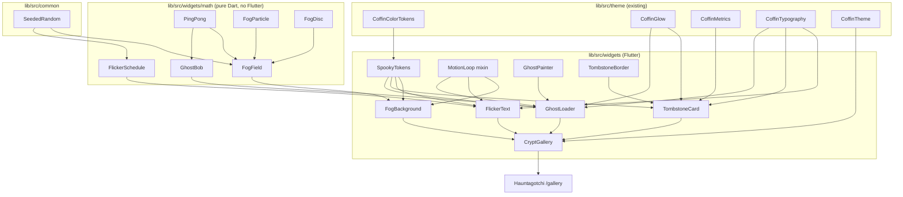
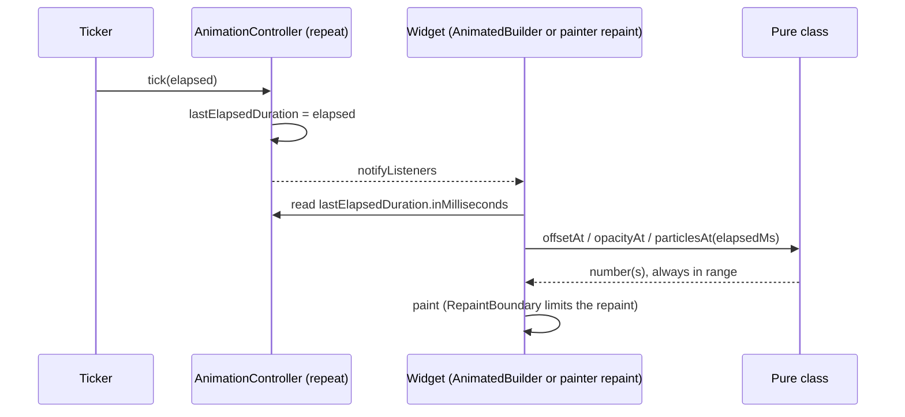

# Design Document: spooky-widgets

## Overview

This feature adds four spooky widgets, a public ghost painter and a gallery page to `coffin_core`, serves the gallery from Hauntagotchi at `/gallery`, and first moves `SeededRandom` to a shared `lib/src/common/` folder.

| Piece | Kind | Where |
| --- | --- | --- |
| `SeededRandom` (moved, unchanged) | pure Dart, internal | `lib/src/common/seeded_random.dart` |
| `PingPong`, `GhostBob`, `FlickerSchedule`, `FogParticle`, `FogDisc`, `FogField` | pure Dart, internal | `lib/src/widgets/math/` |
| `SpookyTokens`, `MotionLoop` | Flutter helpers, internal | `lib/src/widgets/` |
| `GhostPainter`, `GhostLoader`, `TombstoneBorder`, `TombstoneCard`, `FlickerText`, `FogBackground`, `CryptGallery` | Flutter | `lib/src/widgets/` |
| `/gallery` route | Hauntagotchi | `apps/hauntagotchi/lib/src/ui/app_routes.dart` |

Principles that shape every choice below:

- **Pure math first.** Every number that moves (bob offset, flicker opacity, fog position) comes from a plain Dart class that is checked with glados on the VM and in Chrome. The widgets only turn those numbers into pixels.
- **Web-safe by construction.** All seeded values come from `SeededRandom`. All math is exact integer arithmetic until one division, followed by `+ - * /` on doubles. No `sin`, `cos`, `pow`, `dart:math` or `Random`.
- **One timing source.** Each looping widget owns one repeating `AnimationController`. The widget reads `lastElapsedDuration` in milliseconds and gives it to the pure class, which wraps it with a non-negative modulo. The controller's own `value` is never used, so a change of period or seed never restarts the loop.
- **Theme only.** Colors come from the `CoffinColorTokens` set that matches the ambient theme. Glows come from `CoffinGlow`, sizes from `CoffinMetrics`, text from `CoffinTypography.textTheme`. No hard-coded color.

### Research summary

Facts checked in the repository and in the installed Flutter 3.47.9 SDK. They shape the design.

1. **`SeededRandom`** (`lib/src/ai/seeded_random.dart`) is Mulberry32 with a 16-bit-part multiply. It is internal (not in the Barrel). Only `lib/src/ai/offline_engine.dart` imports it. Its tests are `test/ai/seeded_random_test.dart` (fixed values for seeds 0, 1, 42, 4294967295) and `test/ai/seeded_random_property_test.dart`.
2. **`ShapeDecoration.shadows`** paints each `BoxShadow` along `shape.getOuterPath`. A tombstone `ShapeBorder` therefore gets the `CoffinGlow` values for free, which answers Q4 without any change to `CoffinGlow`.
3. **`AnimationController.lastElapsedDuration`** is set on every tick from the ticker's elapsed time. `repeat()` uses a repeating simulation inside one ticker run, so the elapsed time keeps growing across loops. `stop()` sets it to null, and a new `repeat()` starts it at zero.
4. **`CoffinTheme`** builds a `ColorScheme` from the tokens, but only part of it maps back (`surfaceContainerLowest` is `background`, `surfaceContainerHigh` is `raised`, `onSurface` is `text`, `onSurfaceVariant` is `muted`). `ThemeData.brightness` is available directly.
5. **`FogRouter` and `AppRoute`** already exist. `AppRoute(path, name, builder)` is all a route needs. `apps/hauntagotchi/test/ui/app_routes_test.dart` is the only test that asserts the route count (`hasLength(1)`).
6. **Source-scan tests** that touch the new code: `theme_sources_test.dart` fails when any file under `lib/` contains the text `apps/`, `package:hauntagotchi` or `package:graveyard`, comments included. `ai_sources_test.dart` scans `lib/src/ai`, the Barrel's AI exports, and every app `lib` and `test` file for AI API names.
7. **glados web rules** from coffin-ai: no `any.int`, `any.intInRange`, `any.list`, `any.listWithLengthInRange`, string generators or `uint*` generators on Chrome. `anyIntBetween` and `anyListBetween` (in `test/ai/support/ai_generators.dart`) are the web-safe replacements, and every property file counts its runs with a `RunCounter`.
8. **Run-count convention** of the earlier specs: 300 for pure value and rule properties, 500 for the heaviest offline properties, 200 for sweeps and wrappers.
9. **Baseline.** `flutter test` in `packages/coffin_core` passes 985 tests today (run while writing this design).

## SeededRandom move (Requirement 22)

### What moves

```text
packages/coffin_core/lib/src/ai/seeded_random.dart      ->  lib/src/common/seeded_random.dart   (byte-identical)
packages/coffin_core/test/ai/seeded_random_test.dart          ->  test/common/seeded_random_test.dart
packages/coffin_core/test/ai/seeded_random_property_test.dart ->  test/common/seeded_random_property_test.dart
```

`SeededRandom` stays internal. The Barrel does not export it, and the existing AI source scan keeps `SeededRandom` in its list of names that must never be exported.

### Edits, file by file

| # | File | Edit | Kind |
| --- | --- | --- | --- |
| 1 | `lib/src/ai/offline_engine.dart` | `import 'seeded_random.dart';` becomes `import '../common/seeded_random.dart';` | import path |
| 2 | `test/common/seeded_random_test.dart` | `package:coffin_core/src/ai/seeded_random.dart` becomes `package:coffin_core/src/common/seeded_random.dart` | import path |
| 3 | `test/common/seeded_random_property_test.dart` | same package import, and `support/ai_generators.dart` becomes `../ai/support/ai_generators.dart` | import path |
| 4 | `test/ai/ai_sources_test.dart` | **one allow-list branch in `_importProblems`, plus one self-check assertion inside the existing test "import rules flag bad directives"** | **FLAGGED and approved (N1): beyond an import path** |

The tests move to `test/common/` because the structure steering says tests mirror `lib/`. Moving them is treated as an import-path-only change: no assertion, fixed value or run count changes. Row 3 reaches into `test/ai/support/` for the generators. This is the only cross-folder test import in the feature. The widget tests use their own copy (Assumption A4).

### FLAGGED: the AI source scan needs one non-import edit

The user asked that the 985 existing tests stay unchanged apart from import paths. Reading `ai_sources_test.dart` and `support/source_scanner.dart` shows that this cannot be met exactly. One test must change.

- **What the scan does.** `ai_sources_test.dart` scans every `.dart` file of `lib/src/ai` (discovered by directory listing, not by a hard-coded file list, so adding or removing a file does not break it). Its test "imports are limited to the allowed set" accepts an import only when it is `dart:core`, `dart:async` (two files), `package:meta/meta.dart`, or a bare sibling file name (`!uri.contains('/')` and listed in `siblings`).
- **Why the move breaks it.** After the move, `offline_engine.dart` imports `../common/seeded_random.dart`. That URI contains `/`, so the rule reports `import "../common/seeded_random.dart" not allowed` and the test fails. A re-export shim left in `lib/src/ai/` would not help: the same rule flags an `export` of a path with `/`.
- **Minimal edit (the flagged item).** In `_importProblems`, add one branch before the final `else`:

  ```dart
  } else if (name == 'offline_engine.dart' &&
      uri == '../common/seeded_random.dart') {
    continue;
  }
  ```

  The branch allows exactly one import in exactly one file, so every other rule stays as strict as before.
- **Self-check (approved with the branch, N1).** The existing test "import rules flag bad directives" (in the `group` that already holds the scan self-checks) gets two more `expect` lines **inside its body**. It is NOT a new `test(...)`, so the test count stays 985:

  ```dart
  // the moved generator may be imported by offline_engine.dart only
  expect(
    _importProblems('offline_engine.dart', "import '../common/seeded_random.dart';", sib),
    isEmpty,
  );
  expect(
    _importProblems('a.dart', "import '../common/seeded_random.dart';", sib),
    isNotEmpty,
  );
  ```

  The first line pins that the one allowed import is accepted. The second pins that the same import is still rejected in any other file (`a.dart` stands for every other file name). Both lines are assertions in an existing test body: no new test, no changed assertion, no changed fixed value.
- **Everything else in the scan is unaffected** (checked line by line):
  - "no file contains a forbidden word" and "no seedless Random": the moved file contains none of the words. The scan simply no longer reads it.
  - "no `.hashCode` access in the generator files": the filter `_hashCodeFile` still lists `seeded_random.dart`, but the file is no longer in `lib/src/ai`, so the scan reads one file less (the list stays non-empty, so `_assertScanned` passes). The self-check `_hashCodeFile('seeded_random.dart')` still passes. The `.hashCode` check for the moved file is restored by the new widget source scan (Requirement 13.6).
  - "each file declares at most one public class", "no file imports an app": unaffected.
  - Barrel test: `SeededRandom` and `seeded_random` stay in `_internalNames` and `_internalFiles`. The new widget exports are outside `src/ai/`, so only the "kept exports" and "every export uses show" rules see them, and both hold.
  - Secrets scan of `test/ai`: it reads two files fewer (the moved tests). Neither holds a URL or token. The count check `all.length - files.length == _secretExclusions.length` uses only the three exclusions, so it still holds.
  - `source_scanner.dart` and its own test: unaffected. Its `SeededRandom` samples are plain strings.
- **Historical note.** `.kiro/specs/coffin-ai/tasks.md` task 14.1 lists `test/ai/seeded_random_test.dart` and `test/ai/seeded_random_property_test.dart` as files of its Chrome run, and task 1.x describes `lib/src/ai/seeded_random.dart`. That spec is not edited. After this feature its file list is historical. The moved tests run in the Chrome list of this feature (Checkpoint A) instead.

### Verification of the move

The move is the first task and has its own run in `packages/coffin_core`: `dart format` (no changes), `flutter analyze` (zero warnings) and the full `flutter test`. The expected result is **exactly 985 tests, all passing**. The count stays 985 because the moved tests keep their names and number, the allow-list branch is helper code of the scan (not a test), and the self-check is two `expect` lines inside an existing test (N1). If the count is 986 or any other number, the task stops (see tasks.md).

Byte-identity of the moved file: `git hash-object packages/coffin_core/lib/src/ai/seeded_random.dart` before the move must equal `git hash-object packages/coffin_core/lib/src/common/seeded_random.dart` after it. The move is done with `git mv`, so `git diff --cached -M --stat` must show that file as a pure rename (100 percent similarity, no changed lines). The recorded fixed values of `SeededRandom` (seeds 0, 1, 42, 4294967295, first three `nextUint32` values) must not change. The same check applies to the two moved tests, except for their import lines (rows 2 and 3 above).

## Architecture



Dependency rules:

- Files under `lib/src/widgets/math/` and `lib/src/common/` import nothing from Flutter, `dart:ui`, `dart:math` or `dart:io`. They import each other with relative paths only.
- Widgets import the pure classes, the theme files and Flutter. Nothing imports `ai/`, `storage/` or `router/`.
- `crypt_gallery.dart` is the only file that imports `CoffinTheme`.

### Animation data flow



The controller is created with a 1 s period only so that it ticks. Its `value` is not read. Because the pure class does the wrapping, a period that changes at runtime (`bobPeriodMs`) takes effect on the next frame with no restart (Requirement 12.6).

## Components and Interfaces

### File layout

```text
packages/coffin_core/lib/src/
  common/
    seeded_random.dart            SeededRandom                 (moved, internal)
  widgets/
    coffin_mark.dart              (unchanged)
    math/
      ping_pong.dart              PingPong                     (internal)
      ghost_bob.dart              GhostBob                     (internal)
      flicker_schedule.dart       FlickerSchedule              (internal)
      fog_particle.dart           FogParticle                  (internal)
      fog_disc.dart               FogDisc                      (internal)
      fog_field.dart              FogField                     (internal)
    spooky_tokens.dart            SpookyTokens                 (internal)
    motion_loop.dart              MotionLoop (mixin)           (internal)
    ghost_painter.dart            GhostPainter                 (exported)
    ghost_loader.dart             GhostLoader                  (exported)
    tombstone_border.dart         TombstoneBorder              (internal)
    tombstone_card.dart           TombstoneCard                (exported)
    flicker_text.dart             FlickerText                  (exported)
    fog_background.dart           FogBackground                (exported)
    crypt_gallery.dart            CryptGallery                 (exported)
    crypt_gallery_panel.dart      CryptGalleryPanel            (internal)

packages/coffin_core/test/
  common/        seeded_random_test.dart, seeded_random_property_test.dart   (moved)
  widgets/
    coffin_mark_test.dart        (unchanged)
    math/        ping_pong_*, ghost_bob_*, flicker_schedule_*, fog_field_*, seed_masking_*, fixed_values_test.dart
    support/     widget_generators.dart (+ self-test), pump_spooky.dart
    ghost_painter_test.dart, ghost_loader_test.dart, tombstone_border_test.dart,
    tombstone_card_test.dart, flicker_text_test.dart, fog_background_test.dart,
    crypt_gallery_test.dart, widgets_barrel_test.dart, widgets_sources_test.dart (VM only)

apps/hauntagotchi/
  lib/src/ui/app_routes.dart            (one added route)
  test/ui/app_routes_test.dart          (route count assertion updated)
  test/ui/gallery_route_test.dart       (new)
```

Rules that follow from the structure steering: one public class per file, snake_case names, a doc comment on every public member, `final` everywhere it is possible, and no file imports from `apps/`. The word `apps/` must not appear in any file under `lib/`, comments included (the existing `theme_sources_test` rule).

### PingPong (pure, internal)

File `lib/src/widgets/math/ping_pong.dart`. The one easing function shared by the bob and the fog.

```dart
abstract final class PingPong {
  /// Eased back-and-forth value in [0, 1] for a phase inside one period.
  ///
  /// The value rises from 0 at phase 0 to 1 at half the period and falls
  /// back to 0 at the end. Precondition: 1 <= periodMs <= 90000 and
  /// 0 <= phaseMs < periodMs.
  static double at(int phaseMs, int periodMs);
}
```

Formula. Let `P = periodMs`, `p = phaseMs`.

```text
n = 2 * p
if (n > P) n = 2 * P - n            // fold the second half: n is in [0, P]
at = n * n * (3 * P - 2 * n) / (P * P * P)
```

This is `smoothstep(u) = u * u * (3 - 2 * u)` evaluated at `u = n / P`, with the polynomial scaled to integers. Facts used by the properties:

- `n` is in `[0, P]`, so the numerator `n * n * (3 * P - 2 * n)` is in `[0, P^3]` (it increases with `n` on `[0, P]`, because its derivative `6 * n * (P - n)` is not negative). With `P <= 90000`, `P^3 <= 7.29e14 < 2^53`. All intermediates are exact on the VM and in JavaScript doubles.
- There is exactly one division, so the result is a correctly rounded double, identical on every platform. It lies in `[0, 1]` exactly, because the numerator never exceeds the denominator.
- `at(p) == at(P - p)` for `0 < p < P` (the fold is symmetric), `at(0) == 0`, and `at(P / 2) == 1` for even `P`.
- The slope is at most `1.5` times the average slope: `d(smoothstep)/du <= 1.5`, and `u` changes by `2 / P` per millisecond, so `|d at / d p| <= 3 / P`.

### GhostBob (pure, internal)

File `lib/src/widgets/math/ghost_bob.dart`.

```dart
final class GhostBob {
  /// Creates a bob. [periodMs] is clamped into 2500..5000, [amplitude] into 2..10.
  /// A NaN amplitude becomes the default of 6.
  GhostBob({int periodMs = defaultPeriodMs, double amplitude = defaultAmplitude});

  static const int minPeriodMs = 2500, maxPeriodMs = 5000, defaultPeriodMs = 3600;
  static const double minAmplitude = 2, maxAmplitude = 10, defaultAmplitude = 6;
  /// Offset used for the static frame under reduced motion.
  static const double staticOffset = 0;

  final int periodMs;        // clamped
  final double amplitude;    // clamped

  /// Vertical offset in logical pixels, in [-amplitude, amplitude]. Positive is down.
  double offsetAt(int elapsedMs);
}
```

Formula.

```text
phase    = (elapsedMs + periodMs ~/ 4) % periodMs     // Dart '%' is never negative
offsetAt = amplitude * (2 * PingPong.at(phase, periodMs) - 1)
```

- The quarter-period shift makes the bob start near 0 and go down first, so a loop that starts when reduced motion is switched off does not jump from the static offset 0 by more than a fraction of a pixel (`|offsetAt(0)| <= amplitude * 2 * 3 / periodMs * 1`, below 0.03 px for the allowed ranges).
- Range: `PingPong.at` is in `[0, 1]`, so `2 * at - 1` is in `[-1, 1]` exactly and the offset is in `[-amplitude, amplitude]`.
- Loop: `(t + P) % P == t % P` as integers, so `offsetAt(t) == offsetAt(t + P)` holds with exact double equality.
- Negative and huge `elapsedMs`: `%` returns a non-negative remainder for every `int`, so any input gives an in-range, finite result and nothing throws. For `|elapsedMs| > 2^53` on the web the integer itself is already imprecise, so only "in range and no throw" holds there. The documented domain is `|elapsedMs| <= 2^40`.
- Speed bound (Requirement 7.5): the peak speed is `amplitude * 2 * (3 / P)` per ms, so between two times 16 ms apart the offset changes by at most `6 * amplitude * 16 / periodMs`. The property test allows `+ 1e-9`. For the extreme (amplitude 10, period 2500) that is 0.384 px per 16 ms frame.

### FlickerSchedule (pure, internal)

File `lib/src/widgets/math/flicker_schedule.dart`.

```dart
final class FlickerSchedule {
  /// Builds the schedule for [seed]. The seed is masked with 0xFFFFFFFF.
  FlickerSchedule(int seed);

  static const int levelCount = 16, stepMs = 400, loopMs = 6400;
  static const int minPercent = 75, maxPercent = 100;
  static const double minOpacity = 0.75, maxOpacity = 1.0;
  /// Opacity used for the static frame under reduced motion.
  static const double staticOpacity = 1.0;

  final int seed;                  // masked
  /// The 16 level opacities, unmodifiable, each a whole percent divided by 100.
  List<double> get levels;

  /// Opacity in [0.75, 1.0] at [elapsedMs]. Never throws.
  double opacityAt(int elapsedMs);
}
```

Level generation (the constructor, run once):

```text
r = SeededRandom(seed & 0xFFFFFFFF)
percent[i] = 75 + r.nextInt(26)          for i = 0..15      // 75..100
if min(percent) > 90:  percent[indexOfFirstMin]  = 85      // keeps a visible dip
if max(percent) != 100: percent[indexOfFirstMax] = 100     // returns to full brightness
```

The two repairs run in this order. They cannot touch the same index: after the first repair the minimum is 85, and the first maximum of the remaining levels (all above 90) is a different index. Every level stays in `[75, 100]`, so a step between neighbors changes the percent by at most 25, which is 0.25 (Requirement 8.7).

Evaluation (integer numerators, one division):

```text
phase  = elapsedMs % 6400
seg    = phase ~/ 400                    // 0..15
w      = phase - seg * 400               // 0..399, time inside the step
a      = percent[seg],  b = percent[(seg + 1) % 16]     // the last step eases back to level 0
s      = w * w * (1200 - 2 * w)          // smoothstep numerator, in [0, 63998802]; denominator 400^3 = 64000000
opacityAt = (a * 64000000 + (b - a) * s) / 6400000000
```

- All numerators stay below `6.4e9`, which is exact in a double and an `int` on every platform.
- At `w = 0` the result is `a * 64000000 / 6400000000`, which is the correctly rounded `a / 100`. So `levels[i]` and `opacityAt(i * 400)` are the same double.
- The numerator is a convex combination of `a` and `b` scaled by `64000000`, with `s` between 0 and `64000000`, so the result is between `min(a, b) / 100` and `max(a, b) / 100`, hence in `[0.75, 1.0]` exactly.
- Extrema: the smoothstep has zero slope at both ends of a step and is monotone inside it, so local extrema occur only at the 16 level times, 400 ms apart. A window of 1000 ms holds at most 3 of them (Requirement 8.8). That is at most 2.5 changes per second on average and at most 3 flashes per second in any window.
- Loop closure (Decision D2): step 15 eases from `percent[15]` back to `percent[0]`, so `opacityAt(t) == opacityAt(t + 6400)` exactly.
- Sample values from an independent Python port written while designing (the tests derive their own expected values from a BigInt reference, as the AI feature did): seed 0 gives percents `93, 76, 91, 83, 93, 80, 78, 81, 80, 87, 100, 80, 96, 88, 79, 89` (index 10 repaired to 100). Sixteen seeds from 0 to 15 give sixteen different schedules, and seeds 0, 1, 4, 6, 9 to 13 and 15 needed the "return to 1.0" repair. No seed from 0 to 15 needed the "dip" repair.

### FogParticle, FogDisc (pure, internal)

```dart
/// One fog blob in unit coordinates. Immutable, with value equality.
final class FogParticle {
  const FogParticle({required this.x, required this.y, required this.radius, required this.alpha});
  final double x;       // 0..1 of the width
  final double y;       // 0..1 of the height
  final double radius;  // 0.35..0.60 of the longer side
  final double alpha;   // 0.03..0.04, constant over time
  // ==, hashCode (Object.hash), toString
}

/// One fog blob in pixels. Immutable, with value equality.
final class FogDisc {
  const FogDisc({required this.x, required this.y, required this.radius});
  final double x, y, radius;
}
```

### FogField (pure, internal)

File `lib/src/widgets/math/fog_field.dart`.

```dart
final class FogField {
  /// Builds a field. [seed] is masked; [count] is clamped into 0..24.
  FogField({required int seed, int count = defaultCount});

  static const int maxCount = 24, defaultCount = 5;
  static const int minPeriodMs = 30000, maxPeriodMs = 90000;

  final int seed;    // masked
  final int count;   // clamped

  /// Exactly [count] particles at [elapsedMs]. Never throws.
  List<FogParticle> particlesAt(int elapsedMs);

  /// The particles of the static frame: `particlesAt(0)`.
  List<FogParticle> get staticParticles;

  /// Maps a unit particle to pixels inside a [width] by [height] box.
  /// A dimension that is negative, NaN or infinite counts as 0.
  static FogDisc toBounds(FogParticle particle, double width, double height);
}
```

Per-particle parameters (drawn once in the constructor from one `SeededRandom`, in this exact order for particle `i = 0..count-1`):

| Draw | Formula | Range |
| --- | --- | --- |
| 1 to 4 | `ax = r.nextInt(1001)`, `ay = r.nextInt(1001)`, `bx = r.nextInt(1001)`, `by = r.nextInt(1001)` | end points in thousandths of the unit square |
| repair | if `abs(bx - ax) < 100` then `bx = ax <= 500 ? ax + 300 : ax - 300` | guarantees a horizontal drift of at least 0.1 and keeps `bx` in 201..800 |
| 5 | `radius = (350 + r.nextInt(251)) / 1000` | 0.35 to 0.60 of the longer side |
| 6 | `alpha = (30 + r.nextInt(11)) / 1000` | 0.030 to 0.040 |
| 7 | `periodMs = 30000 + 1000 * r.nextInt(61)` | 30000 to 90000 |
| 8 | `startMs = r.nextUint32() % periodMs` | 0 to `periodMs - 1` |

Because one generator is read sequentially and nothing depends on `count`, the particles of a field with count `N` are the first `N` particles of a field with the same seed and any larger count (a metamorphic property, Property 9).

Position at time `t`:

```text
phase = (t + startMs) % periodMs
e     = PingPong.at(phase, periodMs)                 // 0..1
x     = clamp(ax + (bx - ax) * e, 0, 1000) / 1000     // same for y with ay, by
```

- Each coordinate is a convex combination of two end points in `[0, 1000]`, so it is in `[0, 1]`. The explicit `clamp` guards against a last-bit rounding step. At `e = 1` the value is exactly `bx`.
- `particlesAt(t) == particlesAt(t + periodMs_i)` per particle, because the phase is the same integer.
- The slowest particle has a 90 s period and the fastest 30 s (Requirement 6.6). The speed is far below the bob's.
- Negative `t` is wrapped by `%`. The static frame is `particlesAt(0)`: the positions still depend on `startMs`, so the seed still shapes the static fog.

Pixel mapping:

```text
w = (width  is finite and >= 0) ? width  : 0
h = (height is finite and >= 0) ? height : 0
x01 = clamp(particle.x, 0, 1) ; y01 likewise ; r01 = clamp(particle.radius, 0, 1)   // NaN becomes 0
longer = (w > 0 && h > 0) ? max(w, h) : 0
FogDisc(x: x01 * w, y: y01 * h, radius: r01 * longer)
```

`x01 * w <= w` holds in IEEE arithmetic because `x01 <= 1`, so the center is inside the box, and `radius <= 0.60 * max(w, h) <= max(w, h)` (a blob may reach past the box edge; the painter clips it). For `w = 0.5` the disc is tiny but valid. For `w = 0` or `h = 0` all values are 0, and the widget paints nothing.

### SpookyTokens (internal)

File `lib/src/widgets/spooky_tokens.dart`.

```dart
abstract final class SpookyTokens {
  /// The Coffin token set that matches the brightness of the ambient Theme.
  static CoffinColorTokens of(BuildContext context);

  /// The ghost body color for a Token_Set: `text` for a dark set, `primary`
  /// for a light set. Keeping the rule here lets Hauntagotchi reuse it.
  static Color ghostBody(CoffinColorTokens tokens);
}
```

It uses an exhaustive switch on `Theme.of(context).brightness` (dark returns `CoffinColorTokens.night`, light returns `CoffinColorTokens.daylight`). This is the answer to Requirement 13.3 (see "Decisions and rejected alternatives"). `ghostBody` returns `tokens.text` when `tokens.brightness == Brightness.dark` and `tokens.primary` otherwise (decision N3).

### MotionLoop (internal mixin)

File `lib/src/widgets/motion_loop.dart`. It exists so that the three Loop_Widgets share one tested lifecycle instead of three copies.

```dart
mixin MotionLoop<T extends StatefulWidget> on State<T>, SingleTickerProviderStateMixin<T> {
  /// Repeating controller. Its value is never read; only its ticks and elapsed time matter.
  late final AnimationController loopController =
      AnimationController(vsync: this, duration: const Duration(seconds: 1));

  /// True when MediaQuery.maybeDisableAnimationsOf(context) is true (null counts as false).
  bool get reducedMotion;

  /// Milliseconds since the loop (re)started; 0 when the controller is stopped.
  int get elapsedMs => loopController.lastElapsedDuration?.inMilliseconds ?? 0;
}
```

Behavior:

- `didChangeDependencies` reads `MediaQuery.maybeDisableAnimationsOf(context) ?? false`. When it is true, the mixin calls `loopController.stop()`. When it is false and the controller is not animating, it calls `loopController.repeat()`. This runs again whenever `MediaQuery` changes, so toggling reduced motion while mounted stops or restarts the loop without a parent rebuild (Requirement 11.6).
- `dispose` disposes the controller before `super.dispose()` (Requirement 12.1).
- `SingleTickerProviderStateMixin` obeys `TickerMode`, so an off-screen route pauses the ticker (Requirement 12.4).
- The mixin creates no `Timer` and no `Future.delayed` (Requirement 12.7).
- Interpretation of "runs no AnimationController" (Decision D4): the controller object exists but is stopped, so `tester.binding.transientCallbackCount` is 0.

### GhostPainter (public)

File `lib/src/widgets/ghost_painter.dart`. Exported from the Barrel.

```dart
class GhostPainter extends CustomPainter {
  /// Draws one ghost. It has no mood or state parameter.
  const GhostPainter({
    required this.bodyColor,     // `text` token in night, `primary` token in daylight (N3)
    required this.eyeColor,      // `background` token
    this.glow = const <BoxShadow>[],
    this.bobOffset = 0,
    this.headroom = 0,
    super.repaint,
  });

  final Color bodyColor;
  final Color eyeColor;
  final List<BoxShadow> glow;    // from CoffinGlow.decoration(...).boxShadow
  final double bobOffset;        // logical pixels, positive is down
  final double headroom;         // vertical space kept free above and below the ghost
}
```

Geometry for a given `size` (all in logical pixels):

```text
H  = size.height - 2 * headroom             // ghost height
W  = min(size.width, 0.8 * H)               // ghost width, aspect 0.8
cx = size.width / 2 ;  left = cx - W/2 ;  right = cx + W/2
top    = headroom + dy ;  bottom = top + H
dy     = bobOffset clamped into [-headroom, headroom]      (NaN becomes 0)
path   = head: half circle of radius W/2 on top (from the left edge up over to the right edge)
         sides: straight down to bottom - W/6
         hem:   three downward half circles of radius W/6 from right to left
eyes   = two circles of radius 0.07 * W at (cx -/+ 0.18 * W, top + 0.40 * W)
```

- `paint` returns at once when `size.width <= 0`, `size.height <= 0`, `H <= 0` or `W <= 0`, or when any of them is not finite. It never throws (Requirement 2.6).
- Glow: for each `BoxShadow s` in `glow`, `canvas.drawPath(path.shift(s.offset), s.toPaint())`, then the body is filled with `bodyColor`, then the eyes with `eyeColor`. The glow therefore follows the ghost outline with the same values `CoffinGlow` gives to rectangles.
- Because `dy` is clamped to `headroom` and the box height is `H + 2 * headroom`, the ghost never leaves the box (Requirement 1.10).
- `shouldRepaint(old)` returns true when `bodyColor`, `eyeColor`, `bobOffset`, `headroom` or `glow` (compared with `listEquals`) differ, and false otherwise (Requirement 2.5).
- Colors (Requirement 2.7, decision N3). The painter takes plain colors and picks nothing itself. `GhostLoader` passes **the `text` token (bone white) as the body in the night Token_Set and the `primary` token as the body in the daylight Token_Set**, the `background` token as the eyes, and a glow built from the **`primary` token** in both sets (`CoffinGlow.decoration(color: tokens.primary, intensity: 0.5)`, Requirement 1.7). The classic look is a white ghost with a purple glow, and it is the ghost that Hauntagotchi will reuse. The body choice lives in one internal helper, `SpookyTokens.ghostBody(tokens)`, so the later spec uses the same rule.
- Measured contrast (Requirement 2.7), computed with the `WcagContrast.ratio` formula from the real tokens in `lib/src/theme/coffin_color_tokens.dart`. The ratio is symmetric, so "eyes on body" and "body on background" are the same number because the eyes use the `background` token:

  | Token_Set | Body token | Body vs `background` (behind the ghost) | Eyes (`background`) vs body | Body vs `surface` | Body vs `raised` | Result (minimum 3.0) |
  | --- | --- | --- | --- | --- | --- | --- |
  | night | `text` `#EDE6F5` | **15.99** | **15.99** | 14.64 | 13.37 | pass |
  | daylight | `primary` `#6B3FD4` | **5.84** | **5.84** | 6.39 | 5.22 | pass |

  Every pair is at least 3.0, so no other token had to be chosen. (The first draft's `primary` body gave 5.51 in night and 5.84 in daylight.) The unit test of `GhostLoader` recomputes these pairs with `WcagContrast` from the live tokens and asserts at least 3.0, so a later token change cannot break the rule silently.

### GhostLoader (public)

File `lib/src/widgets/ghost_loader.dart`.

```dart
class GhostLoader extends StatefulWidget {
  const GhostLoader({
    super.key,
    this.size = 64,                              // ghost height, clamped into 24..256 (NaN becomes 64)
    this.caption,
    this.bobPeriodMs = GhostBob.defaultPeriodMs, // clamped by GhostBob
    this.bobAmplitude = GhostBob.defaultAmplitude,
  });
  final double size; final String? caption; final int bobPeriodMs; final double bobAmplitude;
}
```

Build outline (state class uses `SingleTickerProviderStateMixin` and `MotionLoop`):

```text
tokens = SpookyTokens.of(context)
Semantics(label: caption ?? 'Loading', liveRegion: true, container: true,
  child: ExcludeSemantics(
    child: Column(mainAxisSize: min, [
      SizedBox(width: 0.8 * size, height: size + 2 * bob.amplitude,
        child: RepaintBoundary(
          child: reducedMotion
            ? CustomPaint(painter: GhostPainter(..., bobOffset: GhostBob.staticOffset, headroom: bob.amplitude))
            : AnimatedBuilder(animation: loopController, builder: (_, __) =>
                CustomPaint(painter: GhostPainter(..., bobOffset: bob.offsetAt(elapsedMs), headroom: bob.amplitude))))),
      if (caption != null) Padding(top: 8, child: Text(caption, style: textTheme.bodyMedium, textAlign: center)),
    ])))
```

- `bob` is a `GhostBob` held in the state. `didUpdateWidget` rebuilds it when `bobPeriodMs` or `bobAmplitude` changes. The controller is untouched.
- The painter arguments marked `...` above are `bodyColor: SpookyTokens.ghostBody(tokens)` (`text` in night, `primary` in daylight), `eyeColor: tokens.background` and `glow`.
- The glow is `CoffinGlow.decoration(color: tokens.primary, intensity: 0.5).boxShadow!`, built once per build. The glow token is `primary` in both Token_Sets.
- With no caption the column holds only the ghost box and reserves nothing for text (Requirement 1.4). The caption does not move with the bob (Requirement 1.5) because only the painter's offset changes.
- Semantics: one node. The label is the caption or "Loading". `liveRegion` makes assistive technology announce it once. The painted ghost and the caption text are excluded so that nothing is read twice (Requirements 1.8 and 1.9).
- The text style comes from `CoffinTypography.textTheme(tokens).bodyMedium` (text token on the ambient background, a guaranteed pair).

### TombstoneBorder (internal)

File `lib/src/widgets/tombstone_border.dart`. This is the choice that Requirement 3 left to the design: a `ShapeBorder` (an `OutlinedBorder`), not a custom painter.

```dart
final class TombstoneBorder extends OutlinedBorder {
  const TombstoneBorder({super.side = BorderSide.none, this.archRise = 140,
                         this.bottomRadius = CoffinMetrics.cornerRadius});
  final double archRise;       // vertical radius of the arch
  final double bottomRadius;   // radius of the two bottom corners
  // getOuterPath, getInnerPath, paint, scale, copyWith, ==, hashCode, dimensions
}
```

Path for a rect `w` by `h` (empty path when `w <= 0` or `h <= 0`):

```text
rx = w / 2
br = min(bottomRadius, w / 2, h / 2)
ry = min(archRise, rx, h - br)
start (left, top + ry)
arc to (right, top + ry) with an elliptical radius (rx, ry), clockwise      // the arch
line to (right, bottom - br);  arc to (right - br, bottom), radius br       // bottom right corner
line to (left + br, bottom);   arc to (left, bottom - br), radius br        // bottom left corner
close
```

- The arch is a half ellipse with `archRise` 140 px on a card at most 300 px wide (rx 150), so it is close to a half circle. The 48 px arch of the first version read as a loaf of bread.
- `paint` strokes the path of `rect.deflate(side.width / 2)` with `side.toPaint()` when the side is visible.
- Used with `ShapeDecoration(shape: TombstoneBorder(...), color: fill, shadows: glow)`, the fill and the glow both follow the tombstone outline (Requirements 3.2 and 3.5, Q4). Content is clipped with `ClipPath(clipper: ShapeBorderClipper(shape: border), clipBehavior: Clip.antiAlias)`.

### TombstoneCard (public)

File `lib/src/widgets/tombstone_card.dart`.

```dart
class TombstoneCard extends StatefulWidget {
  const TombstoneCard({super.key, required this.title, this.dateLine, this.child,
                       this.onTap, this.semanticLabel, this.showEpitaph = true,
                       this.epitaph = 'R.I.P.'});
  final String title; final String? dateLine; final Widget? child;
  final VoidCallback? onTap; final String? semanticLabel;
  final bool showEpitaph;  // decorative epitaph in the arch
  final String epitaph;    // text of the epitaph, default 'R.I.P.'
}
```

Layout, top to bottom, inside the shape (Requirements 3.6 to 3.10, 15.3, 15.4):

```text
Align(center) > ConstrainedBox(maxWidth: 300, [minWidth/minHeight 48 when interactive]) >
  ClipPath(shape) > DecoratedBox(ShapeDecoration) > SingleChildScrollView > LayoutBuilder >
    ConstrainedBox(minHeight: child != null ? width * 1.2 : 0) > Padding(left 20, top archRise + 8, right 20, bottom 20) > Column(center, min) [
      Text(title,    style: headlineSmall, maxLines: 3, overflow: ellipsis, textAlign: center),
      if dateLine:  Text(dateLine, style: bodySmall, maxLines: 2, overflow: ellipsis, textAlign: center),
      if child:     Padding(top 12, child),
    ]
```

Epitaph (Requirement 3.10): when `showEpitaph` is true, the padded content is wrapped in a `Stack` with a `Positioned(top: 56, left: 0, right: 0)` holding `ExcludeSemantics(Center(Text(epitaph, maxLines: 1)))`, where `epitaph` defaults to `'R.I.P.'` (so the default renders exactly as before, and a custom text is decorative and excluded from semantics too). The style is `fontFamily: Creepster` (package `coffin_core`), size 20, letter spacing 2, color `muted`, and a 1 px `Shadow` in `background` that gives the engraved look. At the top padding of 148 px the text (about 24 px high at 20 px) ends well above the title and sits in the arch. `muted` on `surface` and `raised` are listed contrast pairs, so it is at least 4.5:1 in both Token_Sets. The Stack is sized by the content, so the card height does not change.
The `SingleChildScrollView` scrolls when the parent's height is bounded and smaller than the content, and sizes to the content when the height is unbounded. Nothing overflows the shape.

Visual states (all colors from the Token_Set, glow from `CoffinGlow.decoration(...).boxShadow`):

| State | Glow intensity | Fill | Outline |
| --- | --- | --- | --- |
| resting | 0.30 | `surface` | 1 px `muted` |
| hover (mouse over, interactive only) | 0.55 | `surface` | 1 px `muted` |
| pressed (pointer or Enter/Space held, interactive only) | 0.80 | `raised` | 1 px `muted` |
| focused (interactive only) | state above | state above | `CoffinMetrics.focusRingWidth` (2 px) in `primary` |

The intensity order resting < hover < pressed gives Requirements 4.3 and 4.4. `muted` text on `raised` is a listed contrast pair, so the date line stays at least 4.5:1 while pressed.

Animation (Requirements 4.9 to 4.11): two `TweenAnimationBuilder`s (a `double` for the glow intensity, a `Color?` with `ColorTween` for the fill) with `duration: 300 ms`, `curve: Curves.easeInOut`. Under Reduced_Motion the duration is `Duration.zero`, so states switch at once and are still shown. These builders run one-shot controllers that finish, so a resting card leaves no running ticker. The card has no looping controller.

Interaction (only when `onTap != null`; otherwise the whole branch is absent):

```text
Focus(canRequestFocus: false, skipTraversal: true, onKeyEvent: _onKey,   // Enter, NumpadEnter, Space
  child: FocusableActionDetector(
    mouseCursor: SystemMouseCursors.click,
    onShowHoverHighlight: ..., onShowFocusHighlight: ...,
    child: GestureDetector(behavior: opaque, onTapDown, onTapUp, onTapCancel, onTap: widget.onTap, child: card)))
```

- `_onKey`: `KeyDownEvent` of Enter or Space sets `pressed = true` and is handled; `KeyUpEvent` clears it and calls `onTap` once; `KeyRepeatEvent` is handled and ignored. One press gives one `onTap`.
- If `onTap` becomes null while hovered or pressed, `didUpdateWidget` clears all three flags in the same frame (Requirement 4.12).
- Semantics, interactive: `Semantics(button: true, enabled: true, focusable: true, label: semanticLabel ?? (dateLine == null ? title : '$title, $dateLine'), onTap: onTap, child: ExcludeSemantics(child: card))`. Non-interactive: no `Semantics` wrapper, so the title, date line and child are read as plain text and nothing claims to be a button.
- The interactive branch is the only one that adds the 48 by 48 minimum constraint (Requirement 4.2).

### FlickerText (public)

File `lib/src/widgets/flicker_text.dart`.

```dart
/// Text that flickers like a dying candle. For emphasis only: use it on short lines.
class FlickerText extends StatefulWidget {
  const FlickerText(this.text, {super.key, this.style, this.textAlign, this.maxLines,
                                this.overflow, this.seed = 0});
}
```

Build:

```text
tokens = SpookyTokens.of(context)
text   = Text(widget.text, style: style ?? textTheme(tokens).bodyLarge, textAlign, maxLines, overflow)
Semantics(label: widget.text, container: true,
  child: ExcludeSemantics(child: RepaintBoundary(
    child: reducedMotion ? text
      : AnimatedBuilder(animation: loopController,
          child: text,
          builder: (_, child) => Opacity(opacity: schedule.opacityAt(elapsedMs), child: child)))))
```

- Only `Opacity` changes between frames. Size, position and color do not change, and layout is identical for every opacity (Requirements 5.4 and 5.5). The `child` text is built once and is not rebuilt by the animation.
- `schedule` is a `FlickerSchedule(seed)` held in the state and rebuilt in `didUpdateWidget` when `seed` changes (Requirement 12.6).
- Two widgets with the same seed and the same elapsed time show the same opacity (Requirement 5.8), because the schedule is pure.
- The semantic label is exactly `text` for every frame and does not depend on `seed`, opacity or reduced motion (Requirements 5.6 and 5.7).
- Reduced_Motion shows the text at full opacity with the controller stopped.
- Legibility (Requirement 8.13): the dimmest frame is `text` at opacity 0.75. Measured over `background`, `surface` and `raised` with the blended color rounded to 8 bits per channel:

| Token_Set | over `background` | over `surface` | over `raised` |
| --- | --- | --- | --- |
| night | 9.12 | 8.64 | 8.10 |
| daylight | 7.57 | 7.87 | 7.05 |

The minimum is 7.05, above 4.5, so the floor of 0.75 stays (no change to Requirements 8.3 and 8.4).

### FogBackground (public)

File `lib/src/widgets/fog_background.dart`.

```dart
/// Slow drifting fog behind [child].
///
/// Put long body text on an opaque surface, not straight on the fog; the 4.5:1 guarantee covers up to 5 overlapping blobs.
class FogBackground extends StatefulWidget {
  const FogBackground({super.key, required this.child, this.seed = 0,
                       this.particleCount = FogField.defaultCount});
  final Widget child; final int seed; final int particleCount;
}
```

Build:

```text
tokens = SpookyTokens.of(context)
Stack(fit: StackFit.passthrough, children: [
  Positioned.fill(child: IgnorePointer(child: ExcludeSemantics(child: RepaintBoundary(
    child: CustomPaint(painter: _FogPainter(field, tokens.primary, reduced ? null : loopController, () => reduced ? 0 : elapsedMs)))))),
  widget.child,
])
```

- The fog is the first, positioned child, so it is painted behind `child`. The only non-positioned child is `widget.child`, so the stack takes exactly the size the child would have alone: layout is unchanged (Requirement 6.3). With unbounded constraints on one axis the stack sizes to the child on that axis and nothing throws (Requirement 15.5).
- `_FogPainter` (a private class in the same file) has `super(repaint: loopController)`, so a frame repaints only the fog layer inside its own `RepaintBoundary`, and neither the child nor the widget rebuilds (Requirements 12.2, 12.3 and 12.5).
- Paint: `canvas.clipRect(Offset.zero & size)`. For each `FogParticle p` of `field.particlesAt(elapsed)`, `d = FogField.toBounds(p, size.width, size.height)` and a `Paint` whose shader is `ui.Gradient.radial(center, d.radius, [primary at p.alpha, primary at 0.45 * p.alpha, primary at 0], [0, 0.5, 1])` fills `drawCircle(center, d.radius)`. The radial fade means each blob is strongest at its center and zero at its edge.
- A box with `width == 0` or `height == 0` paints nothing (`size.isEmpty`), as does a radius of 0 (Requirement 6.9).
- `field` is rebuilt in `didUpdateWidget` when `seed` or `particleCount` changes. `shouldRepaint` compares the field's seed and count and the color.
- Reduced_Motion paints `field.staticParticles` once, with the controller stopped and no repaint listenable.
- Readability is derived in "Fog readability" below.

### CryptGallery and CryptGalleryPanel (public and internal)

File `lib/src/widgets/crypt_gallery.dart`:

```dart
class CryptGallery extends StatefulWidget {
  /// A page that shows every spooky widget in the night and the daylight theme.
  const CryptGallery({super.key, this.onBack});
  final VoidCallback? onBack;
}
```

File `lib/src/widgets/crypt_gallery_panel.dart` holds the internal `CryptGalleryPanel` (title, `ThemeData`, tapped callback).

Page structure:

```text
Scaffold(body: SafeArea(child: SingleChildScrollView(padding: 16, child: Center(child: ConstrainedBox(maxWidth: 1200,
  child: Column(crossAxisAlignment: stretch, [
    Semantics(header: true, child: Text('Crypt gallery', style: headlineMedium)),   // page title
    Text(short spooky subtitle, style: bodyMedium),
    if onBack != null: Align(start, ConstrainedBox(minWidth/minHeight 48, child: FilledButton(onPressed: onBack, child: Text('Back to the crypt')))),
    LayoutBuilder: width >= 900 ? Row(crossAxisAlignment: start, [Expanded(night), SizedBox(16), Expanded(daylight)])
                                : Column([night, SizedBox(16), daylight]),
  ]))))))
```

`CryptGalleryPanel(title, theme)` wraps its content in `Theme(data: theme, child: Builder(...))` and `Material(color: tokens.surface, shape: RoundedRectangleBorder(borderRadius: 16, side: BorderSide(color: tokens.muted)), clipBehavior: antiAlias, child: Padding(16, Column(...)))`. The two `ThemeData` values (`CoffinTheme.dark()` and `CoffinTheme.light()`) are built once in the page's state. Inside the panel `SpookyTokens.of` therefore sees the panel's brightness, so each widget uses the right Token_Set, and the daylight panel shows daylight colors inside a dark app (Requirement 16.3).

Panel content, in order, with the same seeds in both panels (Requirement 16.7):

1. Panel heading `Semantics(header: true)`: "Night" or "Daylight", `titleLarge`.
2. `GhostLoader(caption: 'Summoning your ghost…')` and `GhostLoader()` with no caption.
3. A non-interactive `TombstoneCard(title: 'Old Todo App', dateLine: 'Died 214 days ago', child: Text('This project has been dead for 214 days'))`.
4. An interactive `TombstoneCard(title: 'Weather Widget', dateLine: 'Abandoned last March', onTap: ...)`. The tap shows `SnackBar(content: Text('The grave stirs, but nothing rises. Yet.'))` through `ScaffoldMessenger.of(context)` and does not navigate (Requirement 16.4).
5. `FlickerText('The candle is not out yet…', seed: 7)`.
6. `FogBackground(seed: 13, child: <padded sample text on the panel surface, 240 px high>)`.

Snack bar theme (in `CoffinTheme`, not in the gallery): `SnackBarThemeData(behavior: floating, backgroundColor: tokens.raised, contentTextStyle: bodyMedium in tokens.text, actionTextColor: tokens.primary, elevation: 0, shape: 16 px rounded)`. Both text colors have at least 4.5:1 against `raised` in both Token_Sets (a test in `coffin_theme_test.dart` checks it).
The gallery adds no controller of its own (Requirement 11.7). It needs no `GoRouter` (Requirement 16.8): `onBack` is a plain callback. The page uses the page's ambient `Scaffold`, so the snack bar works in any `MaterialApp`.

Responsive checks (Requirement 15): at 320 px the panel content is 288 px wide (16 px page padding, 16 px panel padding), which every widget fits. At 900 px and above the panels sit side by side. The page scrolls vertically at every width. With a text scale of 1.5 every text wraps (titles at most 3 lines, dates at most 2) and nothing is in a fixed-height box except the ghost box and the fog sample.

### Hauntagotchi route

`apps/hauntagotchi/lib/src/ui/app_routes.dart` gets a second route. The home route and `PlaceholderScreen` are unchanged, and no link is added (Decision Q2).

```dart
final List<AppRoute> appRoutes = <AppRoute>[
  AppRoute(path: '/', name: 'home', builder: (context, state) => const PlaceholderScreen()),
  AppRoute(
    path: '/gallery',
    name: 'gallery',
    builder: (context, state) => CryptGallery(onBack: () => context.go('/')),
  ),
];
```

`context.go` comes from `GoRouterHelper`, which the Barrel already exports. The file imports only `package:coffin_core/coffin_core.dart`. The route is shown inside the existing `FogTransitionPage`, and the fog transition honors reduced motion already.

Test changes in the app:

- `test/ui/app_routes_test.dart`: the test "the home route is the only declared route" becomes "the app declares the home and gallery routes": `hasLength(2)`, paths `['/', '/gallery']`, names `['home', 'gallery']`. The other three tests are unchanged.
- New `test/ui/gallery_route_test.dart`: opening `/gallery` shows `CryptGallery` and not `NotFoundPage`; tapping "Back to the crypt" returns to `PlaceholderScreen`; opening `/gallery` through `HauntagotchiApp` with an initial location works.
- The scan "no app file references the AI API" in `ai_sources_test.dart` reads these files, so they must not contain any AI API name.

### Barrel exports

New lines, added after `src/widgets/coffin_mark.dart` in sorted order, each with `show`:

```dart
export 'src/widgets/crypt_gallery.dart' show CryptGallery;
export 'src/widgets/flicker_text.dart' show FlickerText;
export 'src/widgets/fog_background.dart' show FogBackground;
export 'src/widgets/ghost_loader.dart' show GhostLoader;
export 'src/widgets/ghost_painter.dart' show GhostPainter;
export 'src/widgets/tombstone_card.dart' show TombstoneCard;
```

Not exported (internal, Assumption A3): `SeededRandom`, `PingPong`, `GhostBob`, `FlickerSchedule`, `FogParticle`, `FogDisc`, `FogField`, `SpookyTokens`, `MotionLoop`, `TombstoneBorder`, `CryptGalleryPanel`. The barrel test `test/widgets/widgets_barrel_test.dart` follows `ai_barrel_test.dart`: it imports only `package:coffin_core/coffin_core.dart`, builds each exported widget under `CoffinTheme.dark()`, and draws a `GhostPainter` on a `PictureRecorder` canvas. It also checks that every export in the Barrel still uses `show`.

## Data Models

All pure values are immutable and have no behavior beyond equality.

| Type | Fields | Invariants |
| --- | --- | --- |
| `GhostBob` | `periodMs: int`, `amplitude: double` | `2500 <= periodMs <= 5000`, `2 <= amplitude <= 10` |
| `FlickerSchedule` | `seed: int`, 16 level percents (private) | seed in `0..4294967295`, each percent in `75..100`, at least one `<= 90`, at least one `== 100` |
| `FogParticle` | `x`, `y`, `radius`, `alpha` | `x, y` in `[0, 1]`, `radius` in `[0.35, 0.60]`, `alpha` in `[0.03, 0.04]` |
| `FogDisc` | `x`, `y`, `radius` (pixels) | `0 <= x <= width`, `0 <= y <= height`, `0 <= radius <= min(width, height)` |
| `FogField` | `seed: int`, `count: int`, per-particle specs (private) | `0 <= count <= 24`, every spec's end points in `0..1000`, period in `30000..90000` |

Constants in one place (all in the classes above, none in widgets): bob period 3600 ms and amplitude 6 px; flicker 16 levels, 400 ms, 6400 ms loop, 0.75 to 1.0; fog count 5 (max 24), alpha 0.03 to 0.04, radius 0.35 to 0.60 of the longer side, period 30 to 90 s; tombstone arch 140 px, maximum width 300 px, portrait ratio 1.2 with a child, glow 0.30 / 0.55 / 0.80; gallery breakpoint 900 px.

### Fog readability (Requirement 6.10, Decision Q5)

The fog color is the `primary` token, which is the color the requirement names. `text` and `muted` are the two colors drawn over the page. Fog sits behind the child, so the surfaces it can touch are `background` (the page) and `surface` (a transparent card that lets fog through). `raised` is not used: raised surfaces such as dialogs and the pressed tombstone are opaque.

Method. With WCAG relative luminance `L` (the formula of `WcagContrast`), contrast is `(L_light + 0.05) / (L_dark + 0.05)`. Compositing `n` fog layers of alpha `a` and color `f` over a base `c0` is, per channel:

```text
c_n = f + (c0 - f) * (1 - a)^n          (the closed form of n repeated "source over" steps)
```

Revision V1: five overlapping blobs at the peak alpha is now the worst case that Requirement 6.10 names (see "Revision V1" below; the tables here show the original four-blob numbers). Originally four overlapping blobs were the worst case that Requirement 6.10 named (the radial fade makes every real overlap weaker than four peaks). For `a = 0.05`, `(1 - a)^4 = 0.8145`.

Worked example, night over `background` (`c0 = (14, 11, 22)`, `f = (155, 107, 255)`):

```text
R = 155 - 141 * 0.8145 = 40.15      G = 107 - 96 * 0.8145 = 28.81      B = 255 - 233 * 0.8145 = 65.22
L(composite) = 0.01708
L(text  EDE6F5) = 0.81191  ->  (0.81191 + 0.05) / (0.01708 + 0.05) = 12.85
L(muted 9A90AB) = 0.29757  ->  (0.29757 + 0.05) / (0.01708 + 0.05) =  5.18
```

Daylight over `background` (`c0 = (247, 243, 252)`, `f = (107, 63, 212)`): composite `(221.0, 209.6, 244.6)`, `L = 0.67845`, `text` `L = 0.00890` gives `(0.67845 + 0.05) / (0.00890 + 0.05) = 12.37`, `muted` `L = 0.08910` gives `0.72845 / 0.13910 = 5.24`.

Results (contrast of `muted`, which is the binding one; `text` is at least 8.9 in every row):

| Token_Set | Base | alpha 0.08 (old max) | 0.07 | 0.06 | 0.055 | **0.05 (chosen)** |
| --- | --- | --- | --- | --- | --- | --- |
| night | `background` | **4.41 (fails)** | 4.65 | 4.91 | 5.05 | **5.18** |
| night | `surface` | **3.93 (fails)** | 4.14 (fails) | 4.37 (fails) | 4.49 (fails) | **4.61** |
| daylight | `background` | **4.48 (fails)** | 4.72 | 4.97 | 5.10 | **5.24** |
| daylight | `surface` | 4.83 | 5.09 | 5.38 | 5.53 | **5.68** |

(Values are for the unrounded composite. Repeating the check with the composite rounded to 8 bits per layer, as the GPU does, gives night `background` 5.17, night `surface` 4.61, daylight `background` 5.21 and daylight `surface` 5.67. The 8-bit rounding changes no result by more than 0.03.)

Final values:

| Token_Set | Fog color | Maximum alpha | Minimum alpha | Worst contrast (muted, 4 blobs) | Worst contrast (text, 4 blobs) |
| --- | --- | --- | --- | --- | --- |
| night | `primary` | **0.05** | 0.03 | 4.61 (over `surface`) | 11.43 (over `surface`) |
| daylight | `primary` | **0.05** | 0.03 | 5.21 (over `background`, 8-bit) | 12.31 (over `background`, 8-bit) |

Findings that shape the decision:

- The night Token_Set is the limiting one. Its `muted` color is bright, so light fog on a dark surface eats its contrast. At 0.055 the night `surface` case drops to 4.49, below 4.5. So 0.05 is the largest round value that passes.
- Daylight would allow up to 0.06 (all of `background`, `surface` and `raised` pass at 0.06; `raised` is 4.51). The user's suggestion to make the daylight fog fainter than the night fog would therefore go the wrong way here. One shared range of 0.03 to 0.05 is used because it passes in both sets, keeps `FogParticle.alpha` independent of the theme, and so keeps `FogField` free of any token knowledge. The painter uses `p.alpha` as it is.
- Cost: the night fog is very faint (an alpha of 0.05 over `0E0B16`). It stays visible as a soft purple haze because the blobs are large (12 to 30 percent of the shorter side) and the fade is radial.
- The 0.03 lower bound is kept. The property test checks every `n` from 1 to 4 and every alpha from 0.030 to 0.050 in steps of 0.001.
- **Revision V1 (larger blobs).** The fog now has 5 blobs of 0.35 to 0.60 of the longer side, so up to 5 peaks can overlap. Recomputed with `WcagContrast` and the 8-bit blend of `blendRepeated` for 5 layers: worst case at alpha 0.04 is 4.65 (night `surface`, `muted`); other combinations are night `background` 5.18, daylight `background` 5.25, daylight `surface` 5.67 (`muted`) and at least 11.5 for `text`. At 0.043 the worst case is 4.52, at 0.044 it is 4.51 and from 0.045 it fails (4.45), so the cap is 0.04, the largest round value with margin. The alpha range is 0.03 to 0.04. The painter adds a middle gradient stop (peak, 0.45 of peak at half the radius, then 0) for a softer edge; this never raises the peak, so the guarantee holds.
- Limit of the guarantee (original four-blob text; now five): it covers four overlapping peaks, as Requirement 6.10 states. More overlap lowers `muted` contrast: night `background` still passes with 6 peaks (4.55) and fails with 7 (4.27); night `surface` passes with 4 peaks only (4.32 with 5). With the maximum of 24 particles stacked on one point, contrast would fall to about 1.9 to 2.2 (measured at alpha 0.05). This limit is accepted (decision N2): the fog paints behind the child, so text on an opaque surface card is never affected. Only text drawn directly over fog is at risk, and the radial fade keeps real overlaps below the peak. The limit is documented in the `FogBackground` doc comment: "Put long body text on an opaque surface, not straight on the fog; the 4.5:1 guarantee covers up to 5 overlapping blobs." No alpha scaling and no count cap is added.

## Correctness Properties

*A property is a characteristic or behavior that should hold true across all valid executions of a system-essentially, a formal statement about what the system should do. Properties serve as the bridge between human-readable specifications and machine-verifiable correctness guarantees.*

Glados tests cover the pure math classes and the contrast rules that depend on their output. Widget painting, layout, semantics and routing use example-based widget tests instead (see Testing Strategy).

### Prework analysis of the testable requirements

Analysis that was run for each acceptance criterion with computable behavior. Criteria about painting, layout, copy, semantics and routing are classified as EXAMPLE or SMOKE and covered by widget tests.

| Criterion | Class | Reason |
| --- | --- | --- |
| 6.5, 6.9 (pixel mapping, zero bounds) | PROPERTY (via 9.9, 9.10) | `toBounds` is a pure function over all sizes |
| 6.10 (fog legibility) | PROPERTY | contrast over a range of alpha and overlap counts |
| 7.2 to 7.8 (bob) | PROPERTY | numeric invariants over period, amplitude, time |
| 8.3 to 8.13 (flicker) | PROPERTY | invariants over all seeds and times |
| 8.10, 9.13 (seed has an effect) | EXAMPLE | "at least two seeds in 0..15 differ" is a fixed check, not universal |
| 9.1 to 9.12 (fog field) | PROPERTY | invariants over seed, count, time, size |
| 10.1, 10.6, 10.7 (no Random, no clock, immutable) | SMOKE / PROPERTY | source scan for the first two, repeated-call property for immutability |
| 10.3 (seed masking) | PROPERTY | equivalence over all integers |
| 10.5 (fixed values) | EXAMPLE | pinned outputs for seeds 0, 1, 42, 4294967295 |
| 1.x to 5.x, 11.x (widgets) | EXAMPLE / EDGE_CASE | widget tests |
| 13.5, 13.6 (source scan) | SMOKE | VM-only scan |
| 16.x, 17.x (gallery, route) | EXAMPLE | widget tests |
| 22.x (move) | EXAMPLE / SMOKE | the existing 985 tests plus the build |

Reflection on overlap: "same particles for the same seed" and "loop closure" are combined with the prefix property into one fog property so each fog claim has one test. "Flicker never below 0.75" and "flicker contrast at 0.75" stay separate because one is about the schedule and the other about the colors. The bob range and loop closure share one property; the speed bound is separate because it needs a second time sample.

### Property 1: Ping-pong shape

For any period `P` in 2 to 90000 and any phase `p` in `[0, P)`, `PingPong.at(p, P)` is a finite number in `[0, 1]`; `at(0, P) == 0`; `at(p, P) == at(P - p, P)` for `0 < p < P`; and `at` does not decrease as `p` grows from 0 to `P / 2`.

**Validates: Requirements 7.3, 7.6, 9.6**

### Property 2: Bob stays in range and loops

For any period (including values outside 2500 to 5000), any amplitude (including values outside 2 to 10), and any elapsed time from minus 2^40 to 2^40, `GhostBob.offsetAt(t)` is finite and within the closed range from minus the clamped amplitude to plus the clamped amplitude, the exposed period and amplitude are the clamped values, and `offsetAt(t) == offsetAt(t + periodMs)`.

**Validates: Requirements 7.2, 7.3, 7.4, 7.7**

### Property 3: Bob moves smoothly

For any period, amplitude and elapsed time from minus 2^40 to 2^40 (negative times included), `abs(offsetAt(t + 16) - offsetAt(t)) <= 6 * amplitude * 16 / periodMs + 1e-9`.

**Validates: Requirements 7.5, 7.7**

### Property 4: Flicker opacity stays in range

For any seed from 0 to 4294967295 and any elapsed time from minus 2^40 to 2^40, `FlickerSchedule(seed).opacityAt(t)` is finite and within 0.75 to 1.0 inclusive, and every exposed level is a whole percent from 75 to 100 divided by 100.

**Validates: Requirements 8.3, 8.4, 8.11**

### Property 5: Flicker is deterministic and loops

For any seed and any elapsed time, two separately built schedules from the same seed give the same opacity, and `opacityAt(t) == opacityAt(t + 6400)`.

**Validates: Requirements 8.5, 8.6**

### Property 6: Flicker is safe to look at

For any seed, sampling `opacityAt` every 10 ms over one loop (and wrapping into the next) shows at most 3 local extrema in every 1000 ms window, a change between neighboring levels of at most 0.25, at least one level at or below 0.90, and at least one level equal to 1.0.

**Validates: Requirements 8.7, 8.8, 8.9**

### Property 7: Fog particles are valid

For any seed, any particle count (negative, 0 to 24, and above 24) and any elapsed time from minus 2^40 to 2^40, `particlesAt(t)` returns exactly `clamp(count, 0, 24)` particles, each with `x` and `y` in `[0, 1]`, radius in `[0.35, 0.60]` and alpha in `[0.03, 0.04]`.

**Validates: Requirements 9.1, 9.2, 9.3, 9.4**

### Property 8: Pixel mapping stays inside the box

For any seed, count and elapsed time, and any width and height that are finite and at least 0 (including 0 and values below 1, up to 4000), every `FogField.toBounds` result has `0 <= x <= width`, `0 <= y <= height` and `0 <= radius <= min(width, height)`; and for any negative, NaN or infinite dimension the result equals the result for 0 and nothing throws.

**Validates: Requirements 9.9, 9.10, 6.9**

### Property 9: Fog is deterministic, loops, and extends by prefix

For any seed, count and elapsed time, two separately built fields give equal particles; each particle at `t` equals the particle at `t + period_i` of that particle; and the particles of the field with count `N` are the first `N` particles of the field with the same seed and any count `M >= N`.

**Validates: Requirements 9.5, 9.7, 9.8, 9.11**

### Property 10: Seed masking

For any integer seed (negative, zero, and up to 2^40), `FlickerSchedule` and `FogField` built from the seed give the same results as the same classes built from `seed & 0xFFFFFFFF`, and building them does not throw.

**Validates: Requirements 10.3**

### Property 11: Flicker keeps text readable

For any seed, any elapsed time, and each of `background`, `surface` and `raised` in both Token_Sets, the `text` token drawn at `opacityAt(t)` over that token (blended and rounded to 8 bits per channel) has a `WcagContrast` ratio of at least 4.5.

**Validates: Requirements 8.13**

### Property 12: Fog keeps text readable

For any overlap count from 1 to 5, any fog alpha from 0.030 to 0.040 in steps of 0.001, both Token_Sets, and each of `background` and `surface`, the `text` and `muted` tokens have a `WcagContrast` ratio of at least 4.5 against the `primary` fog blended over that base the given number of times (rounded to 8 bits per layer).

**Validates: Requirements 6.10**

### Run counts

Following the earlier specs: 300 runs for Properties 1 to 5, 7 to 10 (pure and cheap); 200 for Property 6 (about 640 samples per run), Property 11 and Property 12 (small domains). Each file increments a `RunCounter` in the body and a plain test asserts `runs > 0 && runs == numRuns`.

## Error Handling

Every pure function and painter accepts any input and never throws. There is no exception type in this feature. Bad input is turned into the nearest valid value, and the rule is tested.

| Input | Behavior |
| --- | --- |
| `GhostBob` period outside 2500..5000, amplitude outside 2..10 | clamped; NaN amplitude becomes 6; the clamped values are exposed |
| `elapsedMs` negative or huge (all pure classes) | wrapped with Dart's non-negative `%`; the result is in range; on the web, `|t| > 2^53` has no precision guarantee but still returns an in-range value |
| `FlickerSchedule` / `FogField` seed negative or above 2^32 | masked with `0xFFFFFFFF` before use |
| `FogField` count below 0 or above 24 | clamped into 0..24; 0 returns an empty list |
| `FogField.toBounds` width or height negative, NaN or infinite | treated as 0; the disc is at the origin with radius 0 |
| `FogField.toBounds` particle with NaN or out-of-range values | each unit value is clamped into its range, NaN becomes 0 |
| `GhostLoader.size` below 24, above 256 or NaN | clamped into 24..256; NaN becomes 64 |
| `GhostPainter.paint` with a zero, negative or non-finite size, or no room after `headroom` | draws nothing |
| `GhostPainter` with `bobOffset` NaN or beyond `headroom` | the offset is clamped into `[-headroom, headroom]`; NaN becomes 0 |
| `TombstoneBorder` with a zero-size rect | empty path; corner and arch radii are clamped to the rect so the arcs never invert |
| `TombstoneCard.onTap` becomes null while hovered or pressed | the three state flags are cleared in `didUpdateWidget`; the card is plain and non-interactive |
| `FogBackground` with zero width or height | `size.isEmpty` is true, nothing is painted |
| `FogBackground` with unbounded constraints on one axis | the stack sizes to the child on that axis |
| Reduced motion turns on while a Loop_Widget is mounted | the controller stops and the static frame shows; no rebuild by the parent; no exception |
| Widget removed while looping | the controller is disposed in `dispose`; no ticker remains |

Web risk that cannot be checked without a Chrome run: Property 10 masks seeds up to 2^40 with `& 0xFFFFFFFF`. In JavaScript the `&` operator takes the low 32 bits of any integer below 2^53, so this is expected to hold. If the Chrome run of Checkpoint A shows a difference, the property's range shrinks to the signed 32-bit range and the rule "a seed outside 0..2^32-1 is not portable" is written into the doc comments. This is a known risk, and the user's decision (N4) is to verify it at Checkpoint A and, if it fails, to shrink the property range and document the limit (in the property test, in the doc comments of the two classes, and in this section).

## Testing Strategy

Both kinds of test are used. Property tests prove the numeric rules over many inputs. Example and widget tests prove painting, semantics, layout and wiring.

### Property tests (glados)

- Library: glados (already a dev dependency, pinned). No custom property-test framework.
- Files: `test/widgets/math/ping_pong_property_test.dart`, `ghost_bob_property_test.dart`, `flicker_schedule_property_test.dart`, `fog_field_property_test.dart`, `seed_masking_property_test.dart`, `flicker_contrast_property_test.dart`, `fog_contrast_property_test.dart`.
- Web-safe generators only, in an independent copy `test/widgets/support/widget_generators.dart` with its own self-test (Assumption A4): `anyIntBetween`, `anyListBetween`, `RunCounter`, plus `anySeed` (0 to 4294967295), `anyWideInt` (minus 2^40 to 2^40), `anyElapsed` (minus 2^40 to 2^40), `anyCount` (minus 5 to 40), `anySize` (0 to 4000, built from integer thousandths, plus fixed edge values 0, 0.5, 1) and `anyAmplitude` (integer thousandths, minus 5 to 40). They are built with `any.simple` and `combineN`. Not used: `any.int`, `any.intInRange`, `any.list`, `any.listWithLengthInRange`, string generators, `uint*`.
- Tag format in each test name or comment: `Feature: spooky-widgets, Property N: <title>`.
- Run counts: see "Run counts" above.
- Contrast properties use `WcagContrast.ratio` on 8-bit colors. The blend helper (`round(fg * a + bg * (1 - a))` per channel) lives in the test support file.

### Unit tests (examples and edges)

- `SeededRandom`: the moved tests, unchanged.
- Fixed values (Requirement 10.5), one file `test/widgets/math/fixed_values_test.dart`, runs in Chrome too: first 16 levels of `FlickerSchedule` for seeds 0, 1, 42, 4294967295 (seed 0 starts `93, 76, 91, 83`); `FogField` first particle parameters and `particlesAt(0)` for the same seeds; `GhostBob.offsetAt` at 0, quarter, half, three quarters and one period for the default bob. Expected numbers are produced by an independent BigInt reference written in the test, as the AI feature did, and then pinned.
- Clamping and edges: period 2499 and 5001, amplitude 1.99 and 10.01, NaN amplitude; count -1, 0, 24, 25; size 0, 0.5, infinite, NaN; seeds 0 to 15 give at least two different schedules and two different fields (Requirements 8.10 and 9.13).
- `TombstoneCard` epitaph: shown by default ('R.I.P.') in muted Creepster, centered and above the title; a custom `epitaph` is shown instead of 'R.I.P.'; absent with `showEpitaph: false` (also with a custom `epitaph`); excluded from semantics (default and custom text); `muted` contrast on `surface` and `raised`.
- `TombstoneBorder`: path bounds for 360 by 200 (plus an arch check on 300 by 400), 320 by 120 and 10 by 10 rects; empty path for zero size.
- `GhostPainter`: `shouldRepaint` is true for each changed field and false for equal inputs; painting on zero sizes records no draw calls.
- Ghost colors (N3, Requirement 2.7): for both Token_Sets, `WcagContrast.ratio(SpookyTokens.ghostBody(t), t.background)` is at least 3.0 (recorded 15.99 night, 5.84 daylight) and `WcagContrast.ratio(t.background, SpookyTokens.ghostBody(t))` is at least 3.0. `ghostBody` returns `text` for night and `primary` for daylight. Under each theme the `GhostLoader` painter receives that body color, `background` as the eye color and a glow in `primary`.

### Widget tests (flutter_test, VM)

A helper `pumpSpooky(tester, child, {brightness, width, textScale, reducedMotion})` in `test/widgets/support/pump_spooky.dart` builds a `MaterialApp` with `CoffinTheme.dark()` or `light()`, a `MediaQuery` override for width, text scale and `disableAnimations`, and a fixed-size host. Loop widgets are pumped with explicit durations, never `pumpAndSettle` (Requirement 20.12).

| Requirement | Test |
| --- | --- |
| 20.1 | under reduced motion each Loop_Widget shows its static frame and `tester.binding.transientCallbackCount == 0` after a pump |
| 20.2 | under normal motion the transient callback count is at least 1; the ghost offset, the flicker opacity and the fog positions differ between pumps of different elapsed time (read from the painter or the `Opacity` widget) |
| 20.3 | after replacing a Loop_Widget with `SizedBox`, `transientCallbackCount == 0` and no exception |
| 20.4 | toggling `disableAnimations` while mounted stops and restarts the ticker |
| 20.5 | semantics: loader label is the caption or "Loading" and a live region; tombstone interactive has button flag, tap action and label "title, date line" (or `semanticLabel`); non-interactive has neither; flicker is one node whose label is the text for several pumps and seeds; fog adds no nodes and leaves the child's node alone |
| 20.6 | interactive card has a render size of at least 48 by 48 with a tiny child; non-interactive card does not constrain to 48 |
| 20.7 | hover (mouse `TestGesture`), pressed (`startGesture`), focus (Tab) change the painted glow and fill; Enter and Space call `onTap` once per press; a tap calls `onTap` once |
| 20.8 | every widget and the gallery at 320, 360 and 1280 px wide and text scales 1.0 and 1.5: `tester.takeException()` is null; also a tombstone in a 60 px high parent and a fog background in an unbounded-height `ListView` |
| 20.9 | every widget and the gallery under dark and light themes; the painter receives the colors of the matching token set |
| 20.10 | gallery shows two panels, stacks them below 900 px and places them side by side at 900 px and above |
| 20.11 | no golden tests |

Further widget tests: the interactive card in the gallery shows a snack bar and does not navigate; `onBack` is called by the "Back to the crypt" button (at least 48 by 48); changing `seed`, `particleCount` or `bobPeriodMs` keeps the controller running without a restart (the elapsed time keeps growing); `FogBackground` lays its child out at the same size with and without the fog; `IgnorePointer` lets a tap reach the child.

### Source scan (VM only)

`test/widgets/widgets_sources_test.dart` carries `@TestOn('vm')`. It reads `lib/src/widgets/**` and `lib/src/common/seeded_random.dart` with `dart:io` and does its own scanning (no import from `test/ai`):

- Fails on `Color(0x`, `Colors.` (as a whole word), `Color.fromARGB`, `Color.fromRGBO`, `dart:io`, `package:hive`, the text `apps/`, `package:hauntagotchi`, `package:graveyard`, a URL, or an API-key pattern, in any file under `lib/src/widgets/`.
- Fails when a file under `lib/src/widgets/math/` or `lib/src/common/` imports `package:flutter`, `dart:ui`, `dart:math` or `dart:io`, contains a seedless `Random(` or `Random.secure`, or has a `.hashCode` member access (this keeps the check that `ai_sources_test.dart` applied to `seeded_random.dart` before the move).
- Includes self-checks that each rule flags a bad sample.

### Chrome run

`CHROME_EXECUTABLE="/Applications/Google Chrome.app/Contents/MacOS/Google Chrome" flutter test --platform chrome` on exactly the pure files: `test/common/seeded_random_test.dart`, `test/common/seeded_random_property_test.dart`, everything under `test/widgets/math/`, and `test/widgets/support/widget_generators_test.dart`. The VM-only source scans and all widget tests stay out. Widget code is checked on the web by the two `flutter build web` runs of the final Checkpoint (Assumption A6).

### Task order (fixed by the user; tasks.md follows it exactly)

1. **Move `SeededRandom`** (Requirement 22): `git mv` the file and the two tests, fix the import paths, add the N1 allow-list branch and the self-check assertion (inside the existing test, so the count stays 985) to `ai_sources_test.dart`. Also record the pubspec baseline hashes. Own run: `dart format`, `flutter analyze`, full `flutter test` in `packages/coffin_core` expecting exactly 985 passing tests, the recorded `SeededRandom` fixed values unchanged, and the moved file byte-identical.
2. **Pure math**: `PingPong`, `GhostBob`, `FlickerSchedule`, `FogParticle`/`FogDisc`/`FogField`, the web-safe generators copied under `test/widgets/support/`, and their unit and property tests.
3. **Checkpoint A**: format, analyze, VM tests, and the Chrome run (`CHROME_EXECUTABLE="/Applications/Google Chrome.app/Contents/MacOS/Google Chrome" flutter test --platform chrome`) of the pure math tests and the moved `test/common` tests. N4 is verified here. If it fails, the Property 10 range shrinks and the limit is documented.
4. **Widgets**: `SpookyTokens` and `MotionLoop`, `GhostPainter` and `GhostLoader`, `TombstoneBorder` and `TombstoneCard`, `FlickerText`, `FogBackground`, with widget tests, and the VM-only widget source scan.
5. **Checkpoint B**: format, analyze, all `coffin_core` tests.
6. **Gallery, route, barrel**: `CryptGallery` and `CryptGalleryPanel`, the Hauntagotchi `/gallery` route (route-count test updated to 2), the six Barrel export lines and the barrel test.
7. **Final checkpoint**: format at the root, analyze and test in `coffin_core` and both apps, the Chrome run of the pure tests, `flutter build web` for both apps, pubspec and lockfile hashes unchanged against the baseline of task 1, a git scope check, a secrets grep, and a plain "not verified" statement.

## Requirement coverage

| Requirement | Where it is designed |
| --- | --- |
| 1 GhostLoader | GhostLoader, GhostBob, GhostPainter |
| 2 GhostPainter | GhostPainter |
| 3, 4 TombstoneCard | TombstoneBorder, TombstoneCard |
| 5 FlickerText | FlickerText, FlickerSchedule |
| 6 FogBackground | FogBackground, Fog readability |
| 7 Ghost_Bob | PingPong, GhostBob, Properties 1 to 3 |
| 8 Flicker_Schedule | FlickerSchedule, Properties 4 to 6, 11 |
| 9 Fog_Field | FogField, Properties 7 to 9 |
| 10 Determinism | PingPong, FlickerSchedule (integer numerators), Property 10, fixed-value tests |
| 11 Reduced motion | MotionLoop, each widget's static frame |
| 12 Lifecycle | MotionLoop, RepaintBoundary placement |
| 13 Theme and tokens | SpookyTokens, source scan |
| 14 Accessibility | semantics of each widget, gallery headers |
| 15 Responsive | layout notes, widget tests at 320, 360 and 1280 |
| 16 CryptGallery | CryptGallery and CryptGalleryPanel |
| 17 Route | Hauntagotchi route |
| 18 Barrel and structure | File layout, Barrel exports |
| 19 Property tests | Correctness Properties, Testing Strategy |
| 20 Widget tests | Widget tests table |
| 21 Quality gates | Task order |
| 22 Seeded_Move | SeededRandom move |

## Decisions and rejected alternatives

**Decided by the user (recorded in requirements.md):**

- **Q1** Move `SeededRandom` to `lib/src/common/`. Rejected: importing it from `lib/src/ai/` (widgets would depend on the AI folder); a widgets-local copy (duplicated code, and Graveyard and Hauntagotchi would need a third copy).
- **Q2** Direct URL only. Rejected: a link on the placeholder screen.
- **Q3** `CryptGallery` in `coffin_core`, exported. Rejected: placing it in the Hauntagotchi app.
- **Q4** Reuse the `CoffinGlow` values along the tombstone path through `ShapeDecoration.shadows`. Rejected: a new `CoffinGlow` helper for arbitrary paths.
- **Q5** Readability wins, alpha range 0.03 to 0.05 (now 0.03 to 0.04, see Revision V1) (see "Fog readability").
- **N1** Approved: one allow-list branch for exactly `offline_engine.dart` importing `../common/seeded_random.dart`, plus a self-check assertion inside the existing test (count stays 985). Rejected: leaving `SeededRandom` in `lib/src/ai/` (undoes Q1); a re-export shim (the same import rule rejects an `export` with a path).
- **N2** Accepted, option (a). Rejected: (b) scaling each blob's alpha by `min(1, 4 / count)` (a count of 10 would give blobs at 0.012 to 0.020, too faint); (c) capping the effective count at 8. The limit is documented in the `FogBackground` doc comment.
- **N3** Ghost body is `text` (bone white) in night and `primary` in daylight, eyes in `background`, glow in `primary`. Rejected: the `primary` purple in both sets (first draft). Contrast values are in the GhostPainter section; all are at least 5.84.
- **N4** Accepted: verified at Checkpoint A in Chrome. If it fails, the Property 10 range shrinks and the limit is documented.

**Decided in this design:**

- **Token_Set source (Requirement 13.3).** An exhaustive switch on `ThemeData.brightness`: `Brightness.dark` gives `CoffinColorTokens.night`, `Brightness.light` gives `CoffinColorTokens.daylight` (D5). Rejected: reading the `ColorScheme` that `CoffinTheme` builds, because it maps only some tokens back (`background` and `raised` appear as Material container slots), and a custom `ColorScheme` would silently give non-Coffin colors that break the guaranteed contrast pairs. The cost is that a non-Coffin theme gets the night or daylight tokens by brightness, which is documented on each widget.
- **Timing source.** `lastElapsedDuration` of one repeating controller, with the wrapping done by the pure classes. Rejected: using `controller.value` with one controller per period (fog particles have 61 different periods, so no controller length makes every loop seamless), and rejected: a `Ticker` or `Timer` of our own (Requirement 12.7 and `TickerMode` support).
- **Easing math.** An integer-scaled smoothstep ping-pong. Rejected: `sin` and `cos` (not guaranteed identical between the VM and JavaScript, and Requirement 7.6 forbids them); a linear triangle wave (visible turn-around jerk); a cosine lookup table (more code, no gain).
- **Flicker interpolation.** Smoothstep between levels, not linear. A linear ramp gives a sharp corner at every level time; the eased step reads as mist and still has extrema only at level times. Rejected: holding each level flat (Requirement 8.2's first wording), which looks like a stuttering blink.
- **Fog periods.** 61 whole-second periods from 30 s to 90 s, not a fixed small menu. The pure classes wrap time themselves, so no common multiple is needed.
- **Fog alpha range.** One shared 0.03 to 0.04 range (was 0.03 to 0.05 before Revision V1) for both Token_Sets, not a per-set mapping. A per-set mapping would put theme knowledge into the pure class or add a scaling layer to the painter for a gain of 0.01 in daylight only.
- **Tombstone shape.** A `ShapeBorder` used with `ShapeDecoration`. Rejected: a `CustomPainter` path (would duplicate fill, outline, shadow and clip logic that `ShapeDecoration` and `ShapeBorderClipper` already provide); `InkWell` ripples (Material ink does not follow a custom path cleanly, and the design language asks for glows, not ripples).
- **Half-ellipse arch of 140 px.** A full semicircle would be 150 px tall on a 300 px card; 140 px reads as a grave. The first version used 48 px on 360 px and looked like a loaf of bread.
- **Shared `MotionLoop` mixin.** Rejected: three copies of the reduced-motion and dispose logic.
- **Repaint strategy.** `AnimatedBuilder` over a small subtree for the ghost and the text, `CustomPainter(repaint:)` for the fog. Rejected: `setState` per frame (Requirement 12.5).
- **No Barrel export of the pure classes.** Hauntagotchi's later ghost-states spec can ask for `GhostBob` (Assumption A3).
- **Keyboard handling.** Own `onKeyEvent` on key up, not `Shortcuts` and `ActivateIntent`, so that Enter and Space give one activation per press and also drive the pressed state (Requirement 4.4). If this fails in a widget test, the fallback is `ActivateIntent` with an explicit `shortcuts` map.

**Requirement changes made during design** (already applied in requirements.md, listed under "Design-phase adjustments"): 6.4, 6.10, 9.4, 19.9 (alpha 0.03 to 0.05); 7.5 (speed bound 6 times, D1); 8.2 and 8.6 (eased loop, D2); 10.4 (integer numerators, D3); 11.2 to 11.4 (stopped controller, D4); plus Requirement 22 and the plan order in 21.5, 21.6 and 21.10.

## Resolved decisions (former open questions)

The user answered the four open questions. Nothing is open.

- **N1: approved.** The one allow-list branch in `_importProblems` for exactly `offline_engine.dart` and `../common/seeded_random.dart` is applied, together with the self-check: two `expect` lines added **inside the existing test** "import rules flag bad directives", so the same import is still rejected in every other file. No new test is created, so the count after the move is **985**, not 986. *Changed in this document:* "Edits, file by file" row 4, "FLAGGED", "Verification of the move", "Task order".
- **N2: accepted, option (a).** The fog paints behind the child, so text on opaque surface cards is never affected. Only text drawn directly over fog is at risk, and the radial fade keeps real overlaps below the peak. The `FogBackground` doc comment carries the line "Put long body text on an opaque surface, not straight on the fog; the 4.5:1 guarantee covers up to 5 overlapping blobs." *Changed:* FogBackground section, "Fog readability" limit bullet, Requirement 6.11 (new).
- **N3: ghost body is the `text` token in night and the `primary` token in daylight.** The eyes stay in `background`, and the glow uses `primary` in both sets. Measured with `WcagContrast` on the real tokens: night body versus `background` 15.99 and eyes versus body 15.99; daylight body versus `background` 5.84 and eyes versus body 5.84. All are above 3.0. *Changed:* GhostPainter and GhostLoader sections, `SpookyTokens.ghostBody`, Testing Strategy, Requirement 2.7.
- **N4: accepted.** Property 10 (seed masking up to 2^40) is verified in Chrome at Checkpoint A. If it fails, the property range shrinks to the signed 32-bit range and the limit is documented in the property test, in the doc comments of `FlickerSchedule` and `FogField`, and in "Error Handling". *Changed:* Error Handling, Task order.
