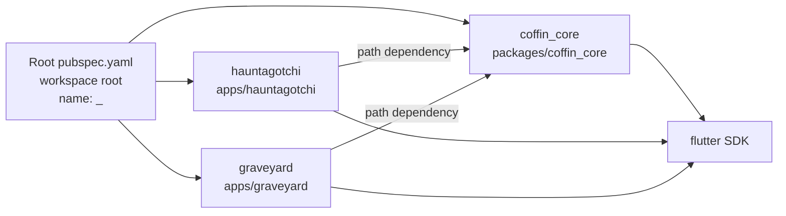
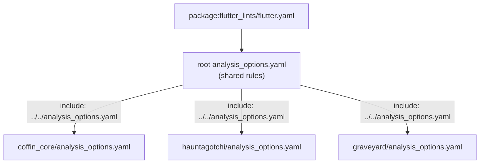

# Design Document

## Introduction

This design covers the `workspace-setup` feature: the initial scaffold of the Coffin monorepo as a Dart pub workspace. It establishes the shared `coffin_core` package and the `hauntagotchi` and `graveyard` Flutter apps, wires them together with a single shared dependency resolution, and proves the wiring with a placeholder screen in each app and a passing test in every member.

The scope is deliberately the skeleton only. It does not implement the design-token theme, go_router routing, hive_ce storage, the `CoffinAI` interface, ghost-pet logic, or séance scoring. Each of those lands in its own spec. This scaffold is complete when `flutter analyze` reports zero issues, `dart format` requires no changes, every member has a passing test, and both apps launch in Chrome.

The design follows the Dart pub workspace model documented at [dart.dev/tools/pub/workspaces](https://dart.dev/tools/pub/workspaces). Per the official guidance, a workspace root declares a `workspace:` list of member paths, and every member declares `resolution: workspace` with a shared SDK constraint so all members resolve to one consistent set of dependencies from a single root `pubspec.lock`.

## Overview

Coffin is a monorepo with one reusable package and two apps:

- **coffin_core** (`packages/coffin_core`): a Flutter package exposing a single public barrel, `package:coffin_core/coffin_core.dart`. For the scaffold it exports exactly one placeholder symbol — a small `CoffinMark` widget — so apps can prove they consume the shared API before any real UI exists.
- **hauntagotchi** (`apps/hauntagotchi`): a Flutter app with web enabled. Its `main.dart` runs a `PlaceholderScreen` that renders `CoffinMark` from `coffin_core`.
- **graveyard** (`apps/graveyard`): a Flutter app with web enabled, structurally identical to hauntagotchi for the scaffold, rendering the same `CoffinMark`.

A root `pubspec.yaml` lists all three as workspace members. A shared root `analysis_options.yaml` applies `flutter_lints` to every member, and each member includes that file via a relative `include:` directive so one ruleset governs the monorepo. A root `.gitignore` excludes Flutter build artifacts while keeping `.kiro/` tracked. Empty prescribed subdirectories under each member's `lib/src/` carry a `.gitkeep` file so the structure survives in version control from day one.

### Design decisions and rationale

- **Root pubspec uses `name: _` and `publish_to: none`.** This is the documented convention for a non-published workspace root that owns no source code. It exists only to enumerate members and pin a shared SDK constraint.
- **Every member declares `resolution: workspace`.** This forces a single shared `pubspec.lock` at the root and prevents version skew between members, which is the whole point of a pub workspace.
- **Apps depend on `coffin_core` via a `path:` dependency.** Pub auto-resolves workspace interdependencies to local members regardless of source, but an explicit `path:` dependency is unambiguous and also works if a member is ever resolved outside the workspace. Since `coffin_core` is never published, `path:` is the correct source.
- **The placeholder symbol is a widget (`CoffinMark`), not a constant.** A widget lets each app render it in a `PlaceholderScreen` and lets us write a real widget test. It is intentionally tiny and uses default Material styling — not the Coffin design tokens — so the scaffold stays decoupled from the theme spec.
- **A shared root `analysis_options.yaml` with a per-member `include:` chain.** Keeps one source of truth for lint rules while satisfying the requirement that every member has its own `analysis_options.yaml` that includes the shared one.
- **`flutter_lints: ^6.0.0`.** The latest stable release, compatible with Dart 3.13 (it requires Dart ≥3.8). It is the official Flutter team lint set and matches what `flutter create` generates.
- **`.gitkeep` in empty `lib/src/` subdirectories.** Preserves the prescribed folder layout in Git before real code lands in each folder.
- **Web is enabled by generating the `web/` directory with `flutter create --platforms web --no-pub`.** The `--no-pub` flag prevents `flutter create` from running `pub get` inside the app folder, which would create a stray `pubspec.lock` and `.dart_tool/` directory there. Instead, `flutter pub get` runs once at the workspace root afterwards, producing a single shared `pubspec.lock` and `.dart_tool/` at the root only. The tool-generated `web/` scaffold (entry `index.html`, `manifest.json`, `icons/`) is reliable and committed; hand-authoring it against the version-specific `flutter.js` loader would be brittle.
- **`flutter test` is run per member, not at the root.** Pub workspaces do not recurse tests into members, so each member is tested in its own directory.
- **`strict-casts` and `strict-raw-types` enabled in the shared analyzer config.** Supports the "zero warnings" goal by catching loose typing early, and the scaffold's simple code already complies.

## Architecture

### Workspace layout

The monorepo is a single Dart pub workspace. The root `pubspec.yaml` is the workspace root; `packages/coffin_core`, `apps/hauntagotchi`, and `apps/graveyard` are members. Running `flutter pub get` anywhere in the repo creates one shared `pubspec.lock` and one shared `.dart_tool/package_config.json` at the root, mapping every package name to its on-disk location.



### Dependency resolution

Each member declares `resolution: workspace` and the same SDK constraint (`^3.13.0`). When `flutter pub get` runs at the root, pub resolves the union of all members' dependencies once. Because `coffin_core` is a workspace member, the apps' `path:` dependency on it resolves to the local on-disk package rather than any registry version. Editing `coffin_core` is therefore picked up live by a running app with no republish step.

### Import boundaries

The steering rules are enforced structurally:

- Apps import only `package:coffin_core/coffin_core.dart`, never anything under `package:coffin_core/src/`.
- `coffin_core` imports only its own sources and external packages; it never imports from an app.
- The two apps never import from each other.

The barrel `lib/coffin_core.dart` is the only public surface; it uses `export ... show CoffinMark` so nothing leaks from `src/` accidentally. App-to-app independence is guaranteed because neither app's pubspec references the other.

### Analysis configuration chain

One shared ruleset flows to every member through a relative include chain:



The root file includes `package:flutter_lints/flutter.yaml` and adds project-wide analyzer settings. Each member's `analysis_options.yaml` includes the root file by relative path. The `package:flutter_lints/flutter.yaml` include resolves in each member's analysis context, so every member lists `flutter_lints` as a dev_dependency.

## Components and Interfaces

### File inventory

Every file this scaffold creates, grouped by location. Files marked *generated* are produced by `flutter create --platforms web --no-pub` and committed; the rest are hand-authored.

**Repository root**

| File | Purpose |
| --- | --- |
| `pubspec.yaml` | Workspace root: `name: _`, `publish_to: none`, SDK `^3.13.0`, `workspace:` list, `flutter_lints` dev dep. |
| `analysis_options.yaml` | Shared lints: includes `package:flutter_lints/flutter.yaml`, enables `strict-casts` and `strict-raw-types`, project overrides. |
| `.gitignore` | Excludes Flutter build artifacts; keeps `.kiro/` tracked. |

**packages/coffin_core**

| File | Purpose |
| --- | --- |
| `pubspec.yaml` | Flutter package, `resolution: workspace`, `flutter` dep, `flutter_test` + `flutter_lints` dev deps, `uses-material-design: true`. |
| `analysis_options.yaml` | `include: ../../analysis_options.yaml`. |
| `lib/coffin_core.dart` | Public barrel; `export 'src/widgets/coffin_mark.dart' show CoffinMark;`. |
| `lib/src/widgets/coffin_mark.dart` | The `CoffinMark` placeholder widget. |
| `lib/src/theme/.gitkeep` | Empty-folder placeholder. |
| `lib/src/router/.gitkeep` | Empty-folder placeholder. |
| `lib/src/storage/.gitkeep` | Empty-folder placeholder. |
| `lib/src/ai/.gitkeep` | Empty-folder placeholder. |
| `test/widgets/coffin_mark_test.dart` | Widget test asserting `CoffinMark` renders. |

**apps/hauntagotchi**

| File | Purpose |
| --- | --- |
| `pubspec.yaml` | Flutter app, `resolution: workspace`, `coffin_core` path dep, `flutter_test` + `flutter_lints` dev deps, `uses-material-design: true`. |
| `analysis_options.yaml` | `include: ../../analysis_options.yaml`. |
| `lib/main.dart` | Entry point; runs `HauntagotchiApp` showing `PlaceholderScreen`. |
| `lib/src/ui/placeholder_screen.dart` | `PlaceholderScreen` using `CoffinMark` from `coffin_core`. |
| `lib/src/domain/.gitkeep` | Empty-folder placeholder. |
| `lib/src/data/.gitkeep` | Empty-folder placeholder. |
| `test/ui/placeholder_screen_test.dart` | Widget test asserting the screen shows `CoffinMark`. |
| `web/index.html`, `web/manifest.json`, `web/icons/*` | *generated* web platform scaffold, committed. |

**apps/graveyard**

Mirrors hauntagotchi exactly, with `GraveyardApp` in `main.dart` and the title `Graveyard`. Same `web/` scaffold.

### Root pubspec.yaml

```yaml
# Root of the Coffin Dart pub workspace.
# This package owns no source code; it exists to declare the workspace
# members and pin a shared SDK constraint.
name: _
publish_to: none

environment:
  sdk: ^3.13.0

workspace:
  - packages/coffin_core
  - apps/hauntagotchi
  - apps/graveyard

dev_dependencies:
  flutter_lints: ^6.0.0
```

`name: _` is the documented placeholder name for a non-published workspace root. The `workspace:` list enumerates the three members. `flutter_lints` is listed here so the root's own analysis context can resolve the `package:flutter_lints/flutter.yaml` include.

### coffin_core pubspec.yaml

```yaml
name: coffin_core
description: The reusable skeleton for the Coffin spooky Flutter starter kit.
publish_to: none
version: 0.1.0

environment:
  sdk: ^3.13.0

resolution: workspace

dependencies:
  flutter:
    sdk: flutter

dev_dependencies:
  flutter_test:
    sdk: flutter
  flutter_lints: ^6.0.0

flutter:
  uses-material-design: true
```

`resolution: workspace` opts the package into the shared root resolution. `uses-material-design: true` makes the Material icons font available for `CoffinMark` and its widget test.

### coffin_core barrel — lib/coffin_core.dart

```dart
/// Public API surface for the Coffin skeleton.
///
/// Apps import `package:coffin_core/coffin_core.dart` and must never
/// import files under `src/`.
export 'src/widgets/coffin_mark.dart' show CoffinMark;
```

The `show` clause guarantees only the intended symbol is public; anything else added under `src/` later must be exported explicitly.

### coffin_core placeholder — lib/src/widgets/coffin_mark.dart

```dart
import 'package:flutter/material.dart';

/// A small spooky brand-mark shown by apps in their placeholder screens.
///
/// This is a temporary scaffold widget. It intentionally uses default
/// Material styling rather than the Coffin design tokens, which arrive
/// in a later spec. It exists so apps can prove they consume the
/// `coffin_core` public API before any real UI is built.
class CoffinMark extends StatelessWidget {
  /// Creates a [CoffinMark].
  const CoffinMark({super.key});

  @override
  Widget build(BuildContext context) {
    return const Column(
      mainAxisAlignment: MainAxisAlignment.center,
      mainAxisSize: MainAxisSize.min,
      children: [
        Icon(Icons.nightlight_round, size: 64),
        SizedBox(height: 16),
        Text('Coffin'),
      ],
    );
  }
}
```

The whole `Column` is `const` because every child has a `const` constructor. No theme tokens, no configuration — just enough to render and to test.

### App pubspec.yaml (hauntagotchi shown; graveyard mirrors it)

```yaml
name: hauntagotchi
description: A ghost pet that thrives or fades on your daily habits.
publish_to: none
version: 0.1.0+1

environment:
  sdk: ^3.13.0

resolution: workspace

dependencies:
  flutter:
    sdk: flutter
  coffin_core:
    path: ../../packages/coffin_core

dev_dependencies:
  flutter_test:
    sdk: flutter
  flutter_lints: ^6.0.0

flutter:
  uses-material-design: true
```

The `path:` dependency points at the local `coffin_core`; the workspace resolver still treats it as a workspace member. `graveyard`'s `pubspec.yaml` is identical except for `name`, `description`, and `version`.

### App entry point — apps/hauntagotchi/lib/main.dart

```dart
import 'package:coffin_core/coffin_core.dart';
import 'package:flutter/material.dart';

import 'src/ui/placeholder_screen.dart';

/// Entry point for the Hauntagotchi app.
void main() {
  runApp(const HauntagotchiApp());
}

/// Root widget for the Hauntagotchi app.
class HauntagotchiApp extends StatelessWidget {
  /// Creates the [HauntagotchiApp].
  const HauntagotchiApp({super.key});

  @override
  Widget build(BuildContext context) {
    return const MaterialApp(
      title: 'Hauntagotchi',
      home: PlaceholderScreen(),
    );
  }
}
```

Package imports come first (sorted: `coffin_core` before `flutter`), then the relative import to the app's own `src/`, matching the `directives_ordering` lint. `graveyard`'s `main.dart` is the same with `GraveyardApp` and title `Graveyard`.

### App placeholder screen — apps/hauntagotchi/lib/src/ui/placeholder_screen.dart

```dart
import 'package:coffin_core/coffin_core.dart';
import 'package:flutter/material.dart';

/// Temporary launch screen shown until real Hauntagotchi features arrive.
class PlaceholderScreen extends StatelessWidget {
  /// Creates the [PlaceholderScreen].
  const PlaceholderScreen({super.key});

  @override
  Widget build(BuildContext context) {
    return const Scaffold(
      body: Center(child: CoffinMark()),
    );
  }
}
```

This is the app-specific screen that consumes the shared `CoffinMark` symbol, satisfying the requirement that each app renders a placeholder using a `coffin_core` export. `graveyard`'s `placeholder_screen.dart` is structurally identical.

### Shared analysis_options.yaml (root)

```yaml
# Shared analysis configuration for every member of the Coffin workspace.
# Each member's analysis_options.yaml includes this file via a relative
# `include:` so one ruleset governs the whole monorepo.
include: package:flutter_lints/flutter.yaml

analyzer:
  language:
    strict-casts: true
    strict-raw-types: true

linter:
  rules:
    prefer_single_quotes: true
```

### Member analysis_options.yaml (same content in all three members)

```yaml
include: ../../analysis_options.yaml
```

The relative path resolves to the root file from `packages/coffin_core/`, `apps/hauntagotchi/`, and `apps/graveyard/` alike (two levels up in each case).

### .gitignore (root)

```gitignore
# Flutter / Dart build artifacts
.dart_tool/
.flutter-plugins
.flutter-plugins-dependencies
build/
.pub-cache/
.pub/

# Coverage
coverage/

# Platform build outputs
**/android/.gradle/
**/ios/Pods/
**/ios/Flutter/

# OS / editor cruft
.DS_Store
.idea/

# NOTE: .kiro/ is intentionally tracked — specs, hooks, and steering live
# there and must be versioned with the code. Do not ignore it.
```

It excludes `.dart_tool/` and `build/` (Req 8.1) and never ignores `.kiro/` (Req 8.2).

### .gitkeep strategy

Git does not track empty directories. The prescribed `lib/src/` subdirectories that have no source file yet each receive an empty `.gitkeep` so the layout is committed:

- `coffin_core`: `lib/src/theme/`, `lib/src/router/`, `lib/src/storage/`, `lib/src/ai/` get `.gitkeep`. `lib/src/widgets/` already holds `coffin_mark.dart`, so it needs none.
- Each app: `lib/src/domain/` and `lib/src/data/` get `.gitkeep`. `lib/src/ui/` already holds `placeholder_screen.dart`.

Each `test/` directory is non-empty because it holds a test file (Req 11), so no `.gitkeep` is needed there.

### Web platform configuration

Each app's `web/` directory is generated by `flutter create --platforms web --no-pub` and committed. It contains the Flutter web entry `web/index.html`, `web/manifest.json`, and `web/icons/`. The `--no-pub` flag prevents `flutter create` from running `pub get` inside the app folder, which would create a stray `pubspec.lock` and `.dart_tool/` directory there. Instead, `flutter pub get` runs once at the workspace root afterwards, producing a single shared `pubspec.lock` and `.dart_tool/` at the root only. Flutter 3.x enables web by default, so the presence of the `web/` directory plus a valid Flutter app pubspec is sufficient for `flutter run -d chrome` to launch. No per-app platform registration is required.

## Data Models

This scaffold introduces no persisted data models and no storage layer. The only structured value is the `CoffinMark` widget, which is a UI component rather than a data model. Later specs will introduce serializable models (ghost state, projects, séance scores) behind repository interfaces over `hive_ce`; none of that belongs in this scaffold.

## Error Handling

The scaffold has no runtime business logic, so there are no domain error paths. The error handling of concern is build- and verification-time failure, which the design prevents structurally:

- **Dependency resolution failures.** Shared `resolution: workspace` produces one `pubspec.lock`; conflicting constraints surface as a single `flutter pub get` error at the root rather than silent version skew between members.
- **Missing workspace member.** A path in the `workspace:` list that has no `pubspec.yaml` fails `flutter pub get` loudly. Any stray `pubspec.yaml` between the root and a member also fails, per pub workspace rules.
- **Import-boundary violations.** The barrel's `show CoffinMark` clause and the absence of any app-to-app dependency make boundary breaks compile errors, not silent leaks.
- **Lint/analysis failures.** The shared analyzer config with `strict-casts` and `strict-raw-types` turns loose typing into analyzer issues caught before merge.
- **Untracked empty folders.** `.gitkeep` files ensure the prescribed structure is never silently dropped by Git.

Runtime errors from the placeholder apps (e.g., a missing font) are out of scope; the widgets use only default Material primitives that are always available.

## Testing Strategy

### Dual testing approach

This scaffold uses **widget/unit tests** for each member. **Property-based testing is not applicable** and is intentionally omitted, for the reasons below.

### Why property-based testing does not apply

Property-based testing validates universal properties over a large or infinite input space for pure functions or transformations. This scaffold contains none of that:

- There is no pure logic with input-dependent behavior — `CoffinMark` and the placeholder screens are static UI with no input.
- The remaining work is configuration validation (pubspec, analysis_options, `.gitignore`), package structure, import boundaries, and one-shot verification (`flutter analyze`, `dart format`, web launch). These are exactly the cases the PBT guidance excludes: configuration validation, UI rendering, and one-shot/side-effect-only operations.
- "For all inputs X, P(X) holds" cannot be meaningfully stated for any acceptance criterion here.

Accordingly, no Correctness Properties section is defined. Verification relies on example-based widget tests plus build/analysis gates.

### Unit/widget tests (one per member, Req 11)

**coffin_core — `test/widgets/coffin_mark_test.dart`**

```dart
import 'package:flutter/material.dart';
import 'package:flutter_test/flutter_test.dart';
import 'package:coffin_core/coffin_core.dart';

void main() {
  testWidgets('CoffinMark renders the wordmark and an icon', (tester) async {
    await tester.pumpWidget(
      const MaterialApp(home: Scaffold(body: Center(child: CoffinMark()))),
    );

    expect(find.byType(CoffinMark), findsOneWidget);
    expect(find.byType(Icon), findsOneWidget);
    expect(find.text('Coffin'), findsOneWidget);
  });
}
```

**hauntagotchi — `test/ui/placeholder_screen_test.dart`**

```dart
import 'package:coffin_core/coffin_core.dart';
import 'package:flutter/material.dart';
import 'package:flutter_test/flutter_test.dart';
import 'package:hauntagotchi/src/ui/placeholder_screen.dart';

void main() {
  testWidgets('PlaceholderScreen shows the Coffin brand mark', (tester) async {
    await tester.pumpWidget(const MaterialApp(home: PlaceholderScreen()));

    expect(find.byType(PlaceholderScreen), findsOneWidget);
    expect(find.byType(CoffinMark), findsOneWidget);
    expect(find.text('Coffin'), findsOneWidget);
  });
}
```

**graveyard — `test/ui/placeholder_screen_test.dart`** mirrors the hauntagotchi test, importing `package:graveyard/src/ui/placeholder_screen.dart` instead.

Each test imports the app's own `src/` file via a `package:` URI, which is the standard pattern for tests (they live outside `lib/`, so `prefer_relative_imports` does not apply).

### Verification gates (Req 9, 10, 11)

These commands are the scaffold's acceptance gate. They are run manually (not as watch processes):

1. `flutter pub get` at the repository root — produces the shared `pubspec.lock` and `.dart_tool/package_config.json` (Req 1.3).
2. `flutter analyze` at the repository root — must report zero issues across all members (Req 9.1).
3. `dart format --set-exit-if-changed .` at the repository root — must report no pending formatting changes (Req 9.2).
4. `flutter test` run inside each member directory (`packages/coffin_core`, `apps/hauntagotchi`, `apps/graveyard`) — must pass with zero failures. Pub workspaces do not recurse tests into members, so each member is tested in its own directory (Req 11.1). Each member has at least one passing test (Req 11.2).
5. `flutter run -d chrome` in each app directory — must launch and render the placeholder screen (Req 10.1, 10.2).

### Implementation approach

1. Author the root `pubspec.yaml`, `analysis_options.yaml`, and `.gitignore`.
2. Hand-author `packages/coffin_core` (pubspec, analysis_options, barrel, `CoffinMark`, `.gitkeep` files, and its widget test).
3. For each app, run `flutter create --platforms web --no-pub <path>` to obtain the `web/` scaffold and a valid Flutter app shell, then overlay the hand-authored `pubspec.yaml`, `analysis_options.yaml`, `lib/main.dart`, `lib/src/ui/placeholder_screen.dart`, `lib/src/{domain,data}/.gitkeep`, and `test/ui/placeholder_screen_test.dart`, replacing the generated counter `main.dart` and widget test and removing the generated app-level `.gitignore` in favor of the root one. The `--no-pub` flag prevents stray `pubspec.lock` and `.dart_tool/` in the app folder.
4. Run `flutter pub get` at the root, then the verification gates above.

## Requirements Coverage

| Requirement | Covered in |
| --- | --- |
| 1. Workspace config (root pubspec, SDK, local resolution) | Architecture; Root pubspec.yaml |
| 2. coffin_core skeleton + src subdirs + `.gitkeep` | Components; File inventory; `.gitkeep` strategy |
| 3. coffin_core public API (barrel + placeholder symbol) | Components; barrel; `CoffinMark` |
| 4. App skeletons, web enabled, src subdirs + `.gitkeep` | Components; App pubspec; Web platform config |
| 5. Placeholder screens using a `coffin_core` export | Components; placeholder screens |
| 6. Import boundaries | Architecture; barrel `show` clause |
| 7. Shared `flutter_lints` + include chain | Components; Analysis config chain |
| 8. `.gitignore` excludes artifacts, keeps `.kiro/` | Components; `.gitignore` |
| 9. `flutter analyze` zero issues, `dart format` clean | Testing Strategy; verification gates |
| 10. Both apps run in Chrome | Testing Strategy; verification gates; Web platform config |
| 11. `flutter test` per member, one passing test each | Testing Strategy; Unit/widget tests |
