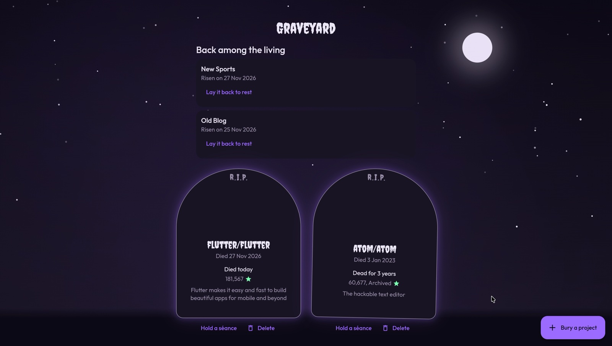
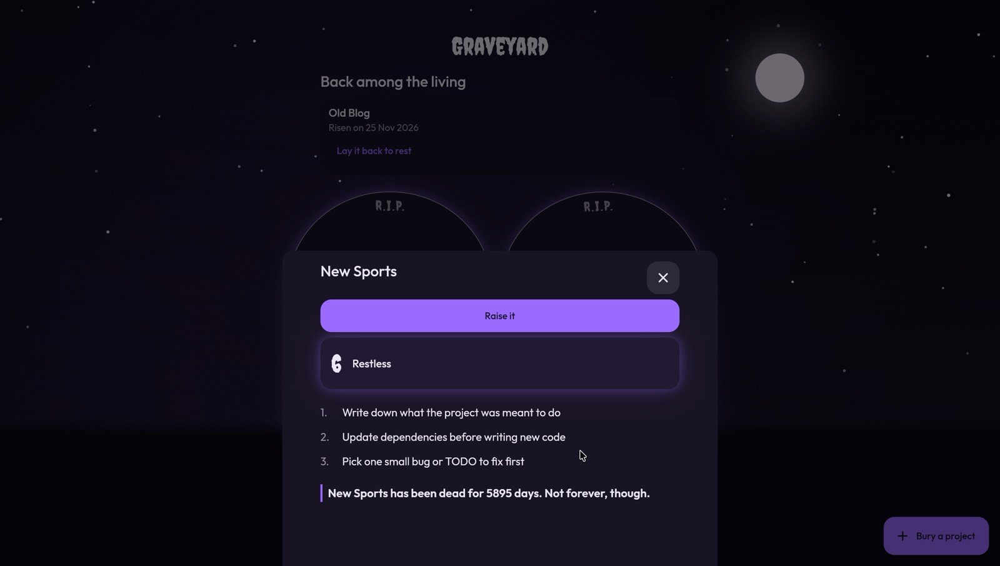
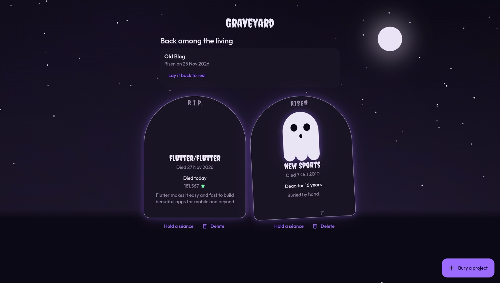
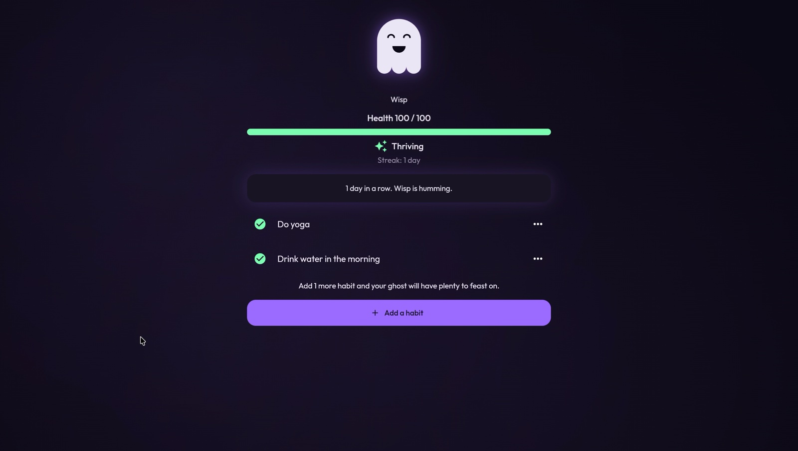

# 💀 Coffin

A Flutter starter kit that raises apps from the dead. Built for Kiroween 2026, **Skeleton Crew** category.

## Live demo

**https://anuka28.github.io/coffin/**

- Hauntagotchi: https://anuka28.github.io/coffin/hauntagotchi/
- Graveyard: https://anuka28.github.io/coffin/graveyard/

No account and no API key. The ghost's voice and the séance run offline.

## Screenshots

| | |
|---|---|
|  |  |
| Graveyard: abandoned projects stand as tombstones. | Séance: a revival score and a three-step plan. |
|  |  |
| Resurrection: a raised project rises from its grave. | Hauntagotchi: a ghost pet that lives on your habits. |

## The two apps

Both apps are built on `coffin_core` and import only its public barrel.

**[Hauntagotchi](apps/hauntagotchi/README.md)** is a ghost pet that thrives or fades with your daily habits. You keep 3 to 5 habits and tick them off each day. Wisp, the ghost, gains health when you finish them and loses it when you skip. With enough neglect it dies, and a small ritual resurrects it. Wisp is drawn differently for each mood and shows one short line that reacts to its mood and streak. Progress is saved on the device.

**[Graveyard](apps/graveyard/README.md)** turns abandoned side projects into tombstones. Add a grave by hand or import a public GitHub repository (the last push becomes the date of death). Hold a séance on any grave to get a revival score from 0 to 100, three revival steps and a verdict line. Then raise the project: a hand bursts from the ground, a ghost rises and the stone changes from "R.I.P." to "RISEN". GitHub import is the only feature that needs a network.

## What `coffin_core` gives every app

- **Theme:** dark "night" and light "daylight" themes from shared color tokens, bundled fonts (Creepster for titles, Outfit for body text), soft glows (`CoffinGlow`) and WCAG contrast checks.
- **Fog router:** a `go_router` wrapper with fog page transitions, a reduced-motion variant and a spooky `NotFoundPage`.
- **Crypt storage:** a `RecordRepository` interface with a `hive_ce` implementation and an in-memory one, a schema version and a migration hook.
- **Offline AI:** the `CoffinAI` interface, `OfflineCoffinAI` (templates, no network, no key) and `FallbackCoffinAI`. Apps never call an LLM directly.
- **Spooky widgets:** `GhostLoader` (a bobbing ghost with moods via `GhostMood`), `TombstoneCard`, `FlickerText`, `FogBackground` and a `CryptGallery` that shows them all.

**The rule:** apps import only `package:coffin_core/coffin_core.dart`, never files under `src/`. `coffin_core` never imports from an app, and the two apps never import from each other.

## Raise a new app

```sh
dart run tool/raise.dart <name>
flutter pub get
(cd apps/<name> && flutter run -d chrome)
```

The generator creates `apps/<name>` as a workspace member on `coffin_core`, with its own `.kiro/` steering and format hook. The name must be a valid Dart package name and must not already exist.

**Timed proof:** a new app (`bone_shop`) went from nothing to running in Chrome in 31 seconds. See [Day 15 in DIARY.md](DIARY.md).

## How Kiro built it

- **Specs:** every feature is a spec with requirements, design and tasks, in `.kiro/specs/`:
  - `workspace-setup`: the pub workspace with `coffin_core` and the two apps.
  - `haunted-theme`: color tokens, night and daylight themes, typography.
  - `fog-router`: `go_router` helper, fog transitions, not-found page.
  - `spooky-widgets`: `GhostLoader`, `TombstoneCard`, `FlickerText`, `FogBackground`, `CryptGallery`.
  - `crypt-storage`: repository interface, `hive_ce` and in-memory implementations.
  - `coffin-ai`: the `CoffinAI` interface and the offline implementation.
  - `raise-app`: the `tool/raise.dart` app generator.
  - `hauntagotchi-core`: habits, ghost health, decay, death and resurrection.
  - `ghost-moods`: a different ghost drawing and motion per mood.
  - `ghost-voice`: Wisp's mood-aware voice line through `CoffinAI`.
  - `graveyard-core`: graves, manual and GitHub import, dates of death.
  - `graveyard-scene`: the night scene with tombstones in rows.
  - `graveyard-seance`: revival score, steps and verdict.
  - `graveyard-resurrection`: the raise-from-the-dead animation and saved risen state.
  - `graveyard-polish`: grounded tombstones, shared base line, a better séance sheet.
- **Steering:** `.kiro/steering/` holds `tech`, `structure`, `product` and `design`. Every change follows them.
- **Hooks:** `.kiro/hooks/` has two. *Format + analyze Dart on save* runs `dart format` and `flutter analyze` when a `.dart` file is saved. *Test gap check* runs after each spec task and writes any missing mirror tests for the Dart files the task changed.
- **MCP:** `.kiro/settings/mcp.json` connects the Dart MCP server (`dart mcp-server`).
- **GitHub MCP:** GitHub's hosted server, read-only, configured in my personal Kiro settings outside the repo, so no token is in the repo. Before the `graveyard-core` requirements were written, Kiro used it to inspect real repos. It found that the archived `atom/atom` has a recent `updated_at` but a 2023 `pushed_at`, so Graveyard uses `pushed_at` as the date of death. With the wrong field, every dead repo would look alive (see Day 15 in [DIARY.md](DIARY.md)).
- **Property-based tests:** numeric rules (contrast, glow, fog math, health, scoring) are covered with `glados`.
- **Kiro CLI and Kiro Crew:** the CLI wrote the `coffin_core` README, and Crew ran a read-only build-watch job and two parallel agents. The notes are in the diary.
- **Vibe mode:** used for small visual fixes and one-line changes, where a spec would be ceremony.

The day-by-day build log is in [DIARY.md](DIARY.md).

## Run and test

```sh
flutter pub get                                  # repo root, resolves the workspace
(cd apps/hauntagotchi && flutter run -d chrome)
(cd apps/graveyard && flutter run -d chrome)
```

Run the suites one package at a time:

```sh
(cd packages/coffin_core && flutter test)
(cd apps/hauntagotchi && flutter test)
(cd apps/graveyard && flutter test)
(cd tool && flutter test)
```

Domain and data tests also run on the web platform:

```sh
flutter test --platform chrome test/domain test/data
```

Run that from `apps/hauntagotchi` or `apps/graveyard`.

Current test counts (all passing):

| Package | Tests |
|---|---|
| `coffin_core` | 1,637 |
| `hauntagotchi` | 608 |
| `graveyard` | 1,894 |
| `tool` | 91 (1 slow end-to-end check skipped by default) |

## Repo layout

```
coffin/
├── .github/workflows/      # deploy-web.yml: test, build and publish to GitHub Pages
├── .kiro/
│   ├── specs/              # one folder per feature
│   ├── steering/           # tech, structure, product, design
│   ├── hooks/              # format-analyze on save, test gap check
│   └── settings/mcp.json   # Dart MCP server
├── apps/
│   ├── hauntagotchi/
│   └── graveyard/
├── docs/screenshots/
├── packages/
│   └── coffin_core/        # theme, router, storage, ai, widgets
├── tool/                   # raise.dart, the app generator
│   └── templates/app/      # files copied into each raised app
├── CREDITS.md
├── DIARY.md
├── LICENSE
└── pubspec.yaml            # Dart pub workspace root
```

## License

MIT, see [LICENSE](LICENSE). Bundled fonts and their licenses are listed in [CREDITS.md](CREDITS.md).
